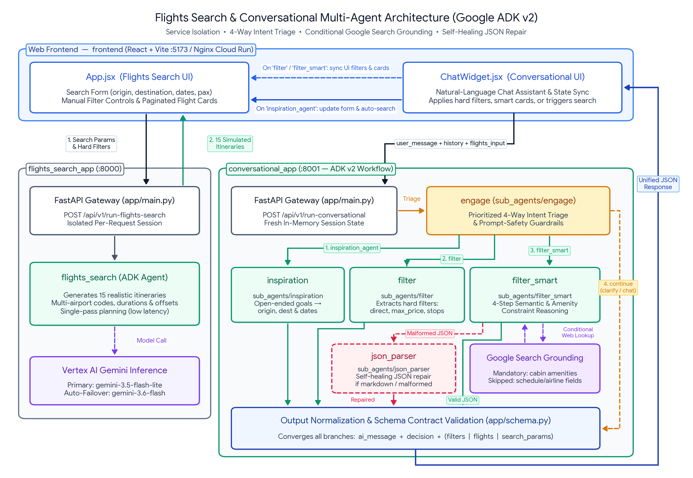
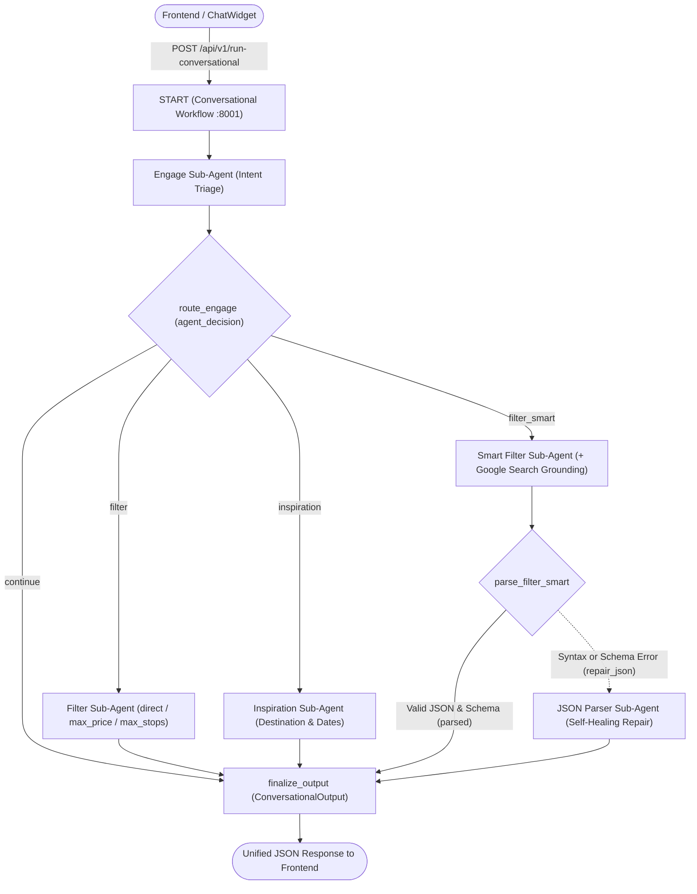
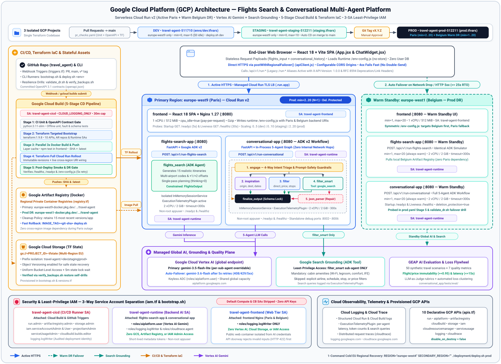

# ✈️ Flights Search & Conversational Multi-Agent Platform

**Flights Search & Conversational Multi-Agent Platform** is a modular, cloud-native travel search and conversational assistant built with **Google ADK (Agent Development Kit v2)**, **Google Cloud Vertex AI (Gemini)**, **Google Search Grounding**, **FastAPI**, **React**, **Terraform**, and **Google Cloud Build**.

Instead of relying on a single monolithic prompt or static form filters, the platform pairs a realistic flight itinerary simulator with a coordinated multi-agent conversational assistant. Through the web dashboard or REST APIs, users can:

- **Search Simulated Global Flights (`POST /api/v1/run-flights-search`)**: Generate 15 realistic flight itineraries per search across budget, standard, and flagship airlines—accounting for real multi-airport city codes, route durations, timezone differences, overnight arrivals, and user filter preferences (direct flights, maximum price, and maximum stops).
- **Refine Trips Through a Conversational Assistant (`POST /api/v1/run-conversational`)**: Chat in natural language with a multi-agent workflow that interprets the user's request alongside their active flight search and routes the turn to the appropriate specialist agent.
- **Apply Direct Filters via Natural Language (`POST /api/v1/run-filter`)**: Convert everyday requests (such as *"show me direct flights under 600 euros"*) into structured price, stop, and direct-flight filters that immediately update the search controls and results on screen.
- **Filter by Qualitative Amenities with Live Google Search (`POST /api/v1/run-filter-smart`)**: Narrow down candidate flights by specific airlines, morning or afternoon departure windows, layover cities, or on-board amenities (such as reliable Wi-Fi for remote work, extra legroom, or in-flight entertainment) verified through live Google Search, backed by an automatic JSON repair step (`POST /api/v1/run-json-parser`) if the response formatting needs cleanup.
- **Explore Open-Ended Travel Ideas (`POST /api/v1/run-inspiration`)**: Turn broad travel goals (such as *"somewhere warm and sunny in December"*) into concrete origin, destination, and date parameters that automatically trigger a fresh flight search in the dashboard.

---

## 📑 Outline

- [**Core Agentic Architecture (Agentic & Multi-Agent Systems)**](#-core-agentic-architecture-agentic--multi-agent-systems)
  - [1. Agent Orchestration (Stateful Multi-Agent Workflow Graph)](#1-agent-orchestration-stateful-multi-agent-workflow-graph)
  - [2. Tool & Function Calling (Conditional Google Search Grounding)](#2-tool--function-calling-conditional-google-search-grounding)
  - [3. Planning & Reasoning Loops (Intent Triage, Constraint Reasoning & Self-Healing Repair)](#3-planning--reasoning-loops-intent-triage-constraint-reasoning--self-healing-repair)
  - [4. Multi-Agent Coordination (Typed State Handoffs, In-Process Execution & Microservice Isolation)](#4-multi-agent-coordination-typed-state-handoffs-in-process-execution--microservice-isolation)
- [**Cloud Architecture & Production Engineering Layers**](#-cloud-architecture--production-engineering-layers)
  - [**I/ Cloud Architecture**](#i-cloud-architecture)
    - [1. Cloud Deployment (Cloud Architecture & Google Cloud Services Used)](#1-cloud-deployment-cloud-architecture--google-cloud-services-used)
  - [**II/ Operational Excellence**](#ii-operational-excellence)
    - [1. Infrastructure as Code (IaC)](#1-infrastructure-as-code-iac)
    - [2. CI/CD & Deployment](#2-cicd--deployment)
    - [3. Testing & Quality Engineering](#3-testing--quality-engineering)
  - [**III/ Designing for Change**](#iii-designing-for-change)
    - [1. Configuration Management](#1-configuration-management)
    - [2. Modularity & Abstraction](#2-modularity--abstraction)
    - [3. Extensibility](#3-extensibility)
    - [4. API Design & Versioning](#4-api-design--versioning)
  - [**IV/ Performance & Cost Optimization**](#iv-performance--cost-optimization)
    - [1. Scalability & Elasticity](#1-scalability--elasticity)
    - [2. Resource Efficiency](#2-resource-efficiency)
    - [3. AI Cost Management](#3-ai-cost-management)
  - [**V/ Security, Privacy, and Compliance**](#v-security-privacy-and-compliance)
    - [1. Authentication & Authorization](#1-authentication--authorization)
  - [**VI/ Reliability & Resilience**](#vi-reliability--resilience)
    - [1. Availability Design](#1-availability-design)
    - [2. Graceful Degradation](#2-graceful-degradation)
    - [3. Failure & Recovery Testing](#3-failure--recovery-testing)
- [**Repository Structure**](#-repository-structure)
- [**Local Setup & Prerequisites**](#-local-setup--prerequisites)
  - [1. Authenticate with Google Cloud & Configure `.env` Files](#1-authenticate-with-google-cloud--configure-env-files)
  - [2. Install Python Backend Dependencies](#2-install-python-backend-dependencies)
  - [3. Install Frontend Dependencies](#3-install-frontend-dependencies)
- [**Running Locally**](#-running-locally)
- [**Deploying to Google Cloud (Terraform + Cloud Build)**](#-deploying-to-google-cloud-terraform--cloud-build)
- [**Testing, AI Evaluation & Verification**](#-testing-ai-evaluation--verification)
  - [1. Offline Unit Test Suites](#1-offline-unit-test-suites)
  - [2. Live In-Process Integration & HTTP End-to-End (E2E) Suites](#2-live-in-process-integration--http-end-to-end-e2e-suites)
  - [3. GEAP 10-Metric AI Quality, Latency & Cost Evaluation Flywheel](#3-geap-10-metric-ai-quality-latency--cost-evaluation-flywheel)
  - [4. Manual API Testing via `curl`](#4-manual-api-testing-via-curl)
  - [5. Interactive Web Dashboard Workflow](#5-interactive-web-dashboard-workflow)
  - [6. Multi-Region Failover & Infrastructure Backup Drills](#6-multi-region-failover--infrastructure-backup-drills)
- [**API, Integration & SDK Documentation (`docs/api_documentation.md`)**](docs/api_documentation.md)
- [**Operational Documentation Hub (`docs/operational_documentation.md`)**](docs/operational_documentation.md)
  - [Deployment & Release Management Guide (`docs/deployment_guide.md`)](docs/deployment_guide.md)
  - [Production Operational Runbooks (`docs/runbooks.md`)](docs/runbooks.md)
  - [Engineer & Operator Onboarding Guide (`docs/onboarding_guide.md`)](docs/onboarding_guide.md)
  - [Symptom-Driven Troubleshooting Guide (`docs/troubleshooting_guide.md`)](docs/troubleshooting_guide.md)

---

## 🧠 Core Agentic Architecture (Agentic & Multi-Agent Systems)

### 1. Agent Orchestration (Stateful Multi-Agent Workflow Graph)
- **Graph-Based Multi-Agent Workflow vs. Single-Prompt Chaining:** Instead of trying to handle every travel request inside a single oversized prompt or hardcoding brittle conditional chains in the web server, the conversational service uses **Google ADK (Agent Development Kit v2)** to orchestrate a directed workflow graph across five specialized sub-agents. Every user message enters through an intent triage agent, branches dynamically to the appropriate specialist, and converges on a single output normalization step.  
  — *Implemented in [`conversational_app/app/agent.py`](conversational_app/app/agent.py) & [`conversational_app/app/schema.py`](conversational_app/app/schema.py)*  
  — *Called in [`conversational_app/app/main.py`](conversational_app/app/main.py)*
- **Dynamic Conditional Routing:** Dedicated routing steps in the workflow inspect the output of each upstream agent to decide which path to take next—returning a conversational follow-up question, extracting hard database filters, filtering itineraries semantically with live web search, suggesting a new destination and travel dates, or routing a malformed response to a JSON repair agent.  
  — *Implemented in [`conversational_app/app/agent.py`](conversational_app/app/agent.py)*
- **Isolated Per-Request Session State:** Every incoming API request runs inside a fresh in-memory session with a unique per-request session and user ID. Two users searching for flights or chatting simultaneously never share state or overwrite each other's active itineraries.  
  — *Implemented in [`flights_search_app/app/main.py`](flights_search_app/app/main.py), [`conversational_app/app/main.py`](conversational_app/app/main.py) & [`conversational_app/app/sub_agents/engage/main.py`](conversational_app/app/sub_agents/engage/main.py)*
- **Focused Context Window Scoping:** Each specialist agent receives only the specific structured inputs required for its role (such as the user's message, conversation history, or candidate flights) rather than accumulating raw intermediate prompt transcripts from earlier agents, keeping prompts small, fast, and focused.  
  — *Implemented in [`flights_search_app/app/agent.py`](flights_search_app/app/agent.py), [`conversational_app/app/sub_agents/engage/agent.py`](conversational_app/app/sub_agents/engage/agent.py), [`conversational_app/app/sub_agents/filter/agent.py`](conversational_app/app/sub_agents/filter/agent.py), [`conversational_app/app/sub_agents/filter_smart/agent.py`](conversational_app/app/sub_agents/filter_smart/agent.py), [`conversational_app/app/sub_agents/inspiration/agent.py`](conversational_app/app/sub_agents/inspiration/agent.py) & [`conversational_app/app/sub_agents/json_parser/agent.py`](conversational_app/app/sub_agents/json_parser/agent.py)*

### 2. Tool & Function Calling (Conditional Google Search Grounding)
- **Live Google Search Grounding for On-Board Amenities:** Standard flight listings contain prices, airlines, and times, but do not indicate whether a carrier's transatlantic Wi-Fi is fast enough for remote work or how comfortable its long-haul cabin is. The Smart Filter specialist is equipped with ADK's built-in **Google Search** tool to look up real-world airline and aircraft reviews before filtering the user's flights.  
  — *Implemented in [`conversational_app/app/sub_agents/filter_smart/agent.py`](conversational_app/app/sub_agents/filter_smart/agent.py) & [`conversational_app/app/sub_agents/filter_smart/prompt.py`](conversational_app/app/sub_agents/filter_smart/prompt.py)*
- **Selective Tool-Calling Rules (When to Search vs. When Not to Search):** To avoid unnecessary external search latency and cost, the Smart Filter specialist follows strict decision rules (verified by the automated tool-use quality judge in the evaluation suite):
  - *Mandatory Web Search:* Must invoke Google Search whenever the user asks about qualitative or on-board amenities (such as Wi-Fi reliability, legroom, seat comfort, food, or in-flight entertainment)—even if a basic boolean flag is present in the flight data.
  - *No Web Search Needed:* Must skip Google Search and filter directly from the session's flight data whenever the user only asks about explicit fields already present in the itinerary list (such as airline name, morning departure times between `06:00` and `12:00`, layover cities, number of stops, or price).  
  — *Implemented in [`conversational_app/app/sub_agents/filter_smart/prompt.py`](conversational_app/app/sub_agents/filter_smart/prompt.py)*  
  — *Verified in [`conversational_app/tests/eval/metrics/custom_metrics.py`](conversational_app/tests/eval/metrics/custom_metrics.py)*
- **Least-Privilege Tool Access Across Agents:** Only the Smart Filter specialist has access to the Google Search tool. All other agents in the platform run without external tools and enforce strict output schemas, preventing unintended web searches during intent routing, basic filtering, or JSON repair.  
  — *Implemented in [`flights_search_app/app/agent.py`](flights_search_app/app/agent.py), [`conversational_app/app/sub_agents/engage/agent.py`](conversational_app/app/sub_agents/engage/agent.py), [`conversational_app/app/sub_agents/filter/agent.py`](conversational_app/app/sub_agents/filter/agent.py), [`conversational_app/app/sub_agents/filter_smart/agent.py`](conversational_app/app/sub_agents/filter_smart/agent.py), [`conversational_app/app/sub_agents/inspiration/agent.py`](conversational_app/app/sub_agents/inspiration/agent.py) & [`conversational_app/app/sub_agents/json_parser/agent.py`](conversational_app/app/sub_agents/json_parser/agent.py)*

### 3. Planning & Reasoning Loops (Intent Triage, Constraint Reasoning & Self-Healing Repair)
- **Prioritized Four-Way Intent Triage:** At the beginning of every chat turn, the Engage specialist evaluates the user's message and conversation history in priority order to classify the request into one of four intents: (1) open-ended destination or date discovery, (2) hard database filtering (price, stops, or direct flights), (3) semantic or amenity-based filtering, or (4) conversational clarification and greetings.  
  — *Implemented in [`conversational_app/app/sub_agents/engage/prompt.py`](conversational_app/app/sub_agents/engage/prompt.py) & [`conversational_app/app/sub_agents/engage/agent.py`](conversational_app/app/sub_agents/engage/agent.py)*
- **Multi-Step Constraint & Consistency Reasoning:** When filtering flights semantically, the Smart Filter specialist follows a four-step reasoning process: (1) separates explicit schedule criteria from soft amenity preferences, (2) narrows the candidate flights using explicit criteria first, (3) researches soft preferences via Google Search, and (4) verifies that every flight number mentioned as kept or removed in its natural-language explanation matches the final returned flight list without modifying prices or inventing flights.  
  — *Implemented in [`conversational_app/app/sub_agents/filter_smart/prompt.py`](conversational_app/app/sub_agents/filter_smart/prompt.py)*
- **Self-Healing JSON Parse-and-Repair Loop:** Because the model cannot enforce strict JSON schema output mode at the same time as it calls the live Google Search tool, the workflow checks the Smart Filter specialist's output as soon as it finishes. If the text contains valid JSON, it passes straight through; if the text contains markdown wrappers or syntax errors, the workflow automatically routes it to a dedicated JSON Parser specialist that repairs the response into valid JSON without altering any flight details.  
  — *Implemented in [`conversational_app/app/agent.py`](conversational_app/app/agent.py), [`conversational_app/app/sub_agents/json_parser/agent.py`](conversational_app/app/sub_agents/json_parser/agent.py) & [`conversational_app/app/sub_agents/json_parser/prompt.py`](conversational_app/app/sub_agents/json_parser/prompt.py)*
- **Fast Single-Pass Planning for Flight Simulation:** Generating 15 flight itineraries from a search form requires adherence to geographic and scheduling rules rather than extended chain-of-thought deliberation. The Flight Search agent disables extra thinking budget overhead so it can generate 15 realistic itineraries (with accurate airport codes, flight durations, and overnight arrival offsets) with low latency.  
  — *Implemented in [`flights_search_app/app/agent.py`](flights_search_app/app/agent.py) & [`flights_search_app/app/prompt.py`](flights_search_app/app/prompt.py)*

### 4. Multi-Agent Coordination (Typed State Handoffs, In-Process Execution & Microservice Isolation)

| Service / Agent | Local Port | Default Model / Tech | Role & Responsibility | Docs |
| :--- | :---: | :--- | :--- | :---: |
| **Flights Search Service** (`flights_search_app`) | `8000` | `gemini-3.5-flash-lite` *(configurable)* | **Flight Simulator**: Generates 15 realistic, route-appropriate flight itineraries obeying timezone, duration, and filter rules via `POST /api/v1/run-flights-search`. | [Contracts](#conversational-workflow--sub-agents-reference) · [API](docs/api_documentation.md) |
| **Conversational Workflow** (`conversational_app/app`) | `8001` | ADK v2 `Workflow` + FastAPI | **Orchestrator Gateway**: Executes the multi-agent workflow (`engage` → specialist → output normalization) in-process via `POST /api/v1/run-conversational`. | [Workflow & Schemas](#conversational-workflow--sub-agents-reference) · [API](docs/api_documentation.md) |
| **Engage Sub-Agent** (`sub_agents/engage`) | `8002`* | `gemini-3.5-flash-lite` *(configurable)* | **Intent Triage**: Classifies user messages into `continue`, `filter`, `filter_smart`, or `inspiration`. | [Sub-Agent](#conversational-workflow--sub-agents-reference) |
| **Filter Sub-Agent** (`sub_agents/filter`) | `8003`* | `gemini-3.5-flash-lite` *(configurable)* | **Hard Filter Extractor**: Translates natural language into structured filters (`direct`, `max_price`, `max_stops`). | [Sub-Agent](#conversational-workflow--sub-agents-reference) |
| **Smart Filter Sub-Agent** (`sub_agents/filter_smart`) | `8004`* | `gemini-3.5-flash-lite` + Google Search | **Semantic & Amenity Filter**: Filters flights by airline, time window, or amenities using live Google Search grounding. | [Sub-Agent](#conversational-workflow--sub-agents-reference) |
| **Inspiration Sub-Agent** (`sub_agents/inspiration`) | `8005`* | `gemini-3.5-flash-lite` *(configurable)* | **Discovery Architect**: Turns open-ended trip ideas (*"somewhere warm in December"*) into concrete search parameters. | [Sub-Agent](#conversational-workflow--sub-agents-reference) |
| **JSON Parser Sub-Agent** (`sub_agents/json_parser`) | `8006`* | `gemini-3.5-flash-lite` *(configurable)* | **Self-Healing Repair**: Repairs malformed or markdown-wrapped JSON from `filter_smart` into strict schema compliance. | [Sub-Agent](#conversational-workflow--sub-agents-reference) |
| **Web Frontend** (`frontend`) | `5173` | React + Vite + Nginx | **User Interface**: Interactive flight search, filters, pagination, and conversational chat assistant. | [README](frontend/README.md) |

*\*Note: In standard operation (local & Cloud Run), `conversational_app` (`:8001`) executes all 5 sub-agents in-process inside its workflow. Ports `8002`–`8006` are optional standalone FastAPI servers for isolated sub-agent debugging and component E2E tests.*

- **Validated State Handoffs Between Agents:** All five conversational sub-agents coordinate through shared, schema-validated state objects so triage decisions, extracted filter values, filtered flight lists, and suggested search parameters pass cleanly from one specialist to the next and are combined into a single unified JSON response.  
  — *Implemented in [`conversational_app/app/schema.py`](conversational_app/app/schema.py), [`conversational_app/app/agent.py`](conversational_app/app/agent.py) & [`conversational_app/app/sub_agents/`](conversational_app/app/sub_agents/)*
- **In-Process Workflow Execution with Optional Standalone Microservices:** In production on Cloud Run and during standard local runs, all five conversational sub-agents execute in-process inside the main Conversational service (port `8001`), eliminating internal network hops between agents. For isolated debugging and component-level testing, each sub-agent can also be launched as its own standalone HTTP microservice on ports `8002`–`8006`.  
  — *Implemented in [`conversational_app/app/agent.py`](conversational_app/app/agent.py), [`conversational_app/app/main.py`](conversational_app/app/main.py) & [`conversational_app/app/sub_agents/`](conversational_app/app/sub_agents/)*
- **Cross-Service Synchronization in the Web Interface:** The React chat assistant coordinates between the Conversational service and the Flights Search service based on the workflow's decision—updating the page's filter controls and visible cards when hard filters are returned, displaying Google Search-verified flights when smart filtering runs, or updating the search form and automatically triggering a new flight search when a new destination or date is suggested.  
  — *Implemented in [`frontend/src/ChatWidget.jsx`](frontend/src/ChatWidget.jsx) & [`frontend/src/App.jsx`](frontend/src/App.jsx)*



#### Conversational Workflow & Sub-Agents Reference

The `conversational_app` service wires all five specialist sub-agents into a single ADK v2 `Workflow` graph (`route_engage` → specialist → `parse_filter_smart` / `repair_json` → `finalize_output`), while also exposing each sub-agent as an optional standalone FastAPI microservice on ports `8002`–`8006`:



<details>
<summary><b>Service &amp; Sub-Agent Endpoints, Model Overrides &amp; I/O Contracts</b></summary>

| Component | Endpoint *(+ Legacy Alias)* | Model & Fallback Env Vars | Request / Response Schemas & Key Outputs |
| :--- | :--- | :--- | :--- |
| **Flights Search** (`flights_search_app/app/`) | `POST /api/v1/run-flights-search` *(+ `/run-flights-search`)* | `FLIGHTS_SEARCH_MODEL` / `FLIGHTS_SEARCH_FALLBACK_MODEL` | `FlightsSearchInput` (`origin`, `destination`, dates, `passengers`, optional `filters`) → `FlightsSearchResponse` (15 realistic itineraries; `thinking_budget=0` for low latency). |
| **Conversational Workflow** (`conversational_app/app/`) | `POST /api/v1/run-conversational` *(+ `/run-conversational`)* | `CONVERSATIONAL_MODEL` / `CONVERSATIONAL_FALLBACK_MODEL` | `ConversationalInput` → `ConversationalOutput` (`agent_response`, `agent_decision`, plus optional `filter_type`/`filter_value`, `flights_output`, or `flights_search_output`). |
| **Engage** (`sub_agents/engage/`) | `POST /api/v1/run-engage` *(+ `/run-engage`)* | `ENGAGE_MODEL` / `ENGAGE_FALLBACK_MODEL` | `EngageInput` (`user_message`, `conversational_history`) → `EngageOutput` (`agent_response`, `agent_decision` ∈ `continue`, `filter`, `filter_smart`, `inspiration`). |
| **Filter** (`sub_agents/filter/`) | `POST /api/v1/run-filter` *(+ `/run-filter`)* | `FILTER_MODEL` / `FILTER_FALLBACK_MODEL` | `FilterInput` → `FilterOutput` (`agent_response`, `filter_type` ∈ `direct` \| `max_price` \| `max_stops`, `filter_value`: `1`/`0`, integer price, or `0`/`1`/`2` stops). |
| **Smart Filter** (`sub_agents/filter_smart/`) | `POST /api/v1/run-filter-smart` *(+ `/run-filter-smart`)* | `FILTER_SMART_MODEL` / `FILTER_SMART_FALLBACK_MODEL` + `google_search` | `FilterSmartInput` (`user_message`, `conversational_history`, `flights_input`) → `FilterSmartOutput` (`agent_response`, filtered `flights_output`). |
| **Inspiration** (`sub_agents/inspiration/`) | `POST /api/v1/run-inspiration` *(+ `/run-inspiration`)* | `INSPIRATION_MODEL` / `INSPIRATION_FALLBACK_MODEL` | `InspirationInput` (`user_message`, `conversational_history`, `flights_search_input`) → `InspirationOutput` (`agent_response`, `flights_search_output`). |
| **JSON Parser** (`sub_agents/json_parser/`) | `POST /api/v1/run-json-parser` *(+ `/run-json-parser`)* | `JSON_PARSER_MODEL` / `JSON_PARSER_FALLBACK_MODEL` | Raw malformed `filter_smart` text → `JSONParserOutput` matching strict `FilterSmartOutput` without mutating or hallucinating flights. |

*Every server (`:8000`–`:8006`) also exposes `GET /healthz`, `GET /readyz`, and `GET /`. To refresh the committed OpenAPI 3.1 contract snapshot after schema changes, run `python3 -m app.export_openapi` from `flights_search_app/` or `conversational_app/`. See [`docs/api_documentation.md`](docs/api_documentation.md) for complete JSON payload examples.*
</details>

## 🏗 Cloud Architecture & Production Engineering Layers

The platform is engineered for reproducible multi-environment deployment (`dev`, `staging`, `prod`) on **Google Cloud Platform (GCP)** across **6 architectural domains (`I`–`VI`) and 14 production engineering layers**, verified by the automated test, evaluation, resilience, and CI/CD suites in [`flights_search_app/tests/`](flights_search_app/tests/), [`conversational_app/tests/`](conversational_app/tests/), [`frontend/src/`](frontend/src/), [`deployment/`](deployment/), and [`.cloudbuild/`](.cloudbuild/):

| Domain | Layer | Pillars & Focus Areas |
| :--- | :--- | :--- |
| [**I. Cloud Architecture**](#i-cloud-architecture) | [**1. Cloud Deployment**](#1-cloud-deployment-cloud-architecture--google-cloud-services-used) | Three-service Cloud Run setup across separate `dev`, `staging`, and `prod` Google Cloud projects (with warm backup servers in Belgium for `prod`), automatic backend URL wiring, and managed Google Cloud services for compute, AI, live web search, image storage, CI/CD, permissions, and logging |
| [**II. Operational Excellence**](#ii-operational-excellence) | [**1. Infrastructure as Code (IaC)**](#1-infrastructure-as-code-iac) | Version-controlled Terraform setup, versioned multi-region Cloud Storage state backups, remote Cloud Build Terraform execution, two-step first-run project setup, and identical `dev`/`staging`/`prod` infrastructure files |
| [**II. Operational Excellence**](#ii-operational-excellence) | [**2. CI/CD & Deployment**](#2-cicd--deployment) | Pull Request test checks, 5-stage deployment pipelines across `dev`, `staging`, and `prod` (with a manual approval step on `prod`), zero-downtime Cloud Run updates with automated health checks, and one-command Git-commit rollbacks |
| [**II. Operational Excellence**](#ii-operational-excellence) | [**3. Testing & Quality Engineering**](#3-testing--quality-engineering) | Four-level test pyramid (offline unit & static prompt-size/cost-floor guardrails, live Gemini integration tests, live HTTP end-to-end tests, and a 50-scenario 10-check AI quality, latency & cost evaluation suite), automated pipeline test gates, and dedicated tests for every service and specialist agent |
| [**III. Designing for Change**](#iii-designing-for-change) | [**1. Configuration Management**](#1-configuration-management) | Externalized backend and Terraform settings, startup backend URL configuration for the web frontend, isolated `dev`/`staging`/`prod` vs. local environments, and feature/infrastructure toggles |
| [**III. Designing for Change**](#iii-designing-for-change) | [**2. Modularity & Abstraction**](#2-modularity--abstraction) | Independent Flight Search, Chat, and Frontend services, 5 self-contained specialist agent folders, strict input/output validation, global and per-agent Gemini model switching, and reusable session setup |
| [**III. Designing for Change**](#iii-designing-for-change) | [**3. Extensibility**](#3-extensibility) | Step-by-step event routing between agents, automatic performance and token-tracking plugins, plug-and-play specialist agent and evaluation folders, and GitHub webhook deployment triggers |
| [**III. Designing for Change**](#iii-designing-for-change) | [**4. API Design & Versioning**](#4-api-design--versioning) | Versioned `/api/v1` endpoints with working legacy `/run-*` URLs and deprecation headers, explicit response schemas with CI-checked OpenAPI contract files, and safe field evolution with matching flight formats across services |
| [**IV. Performance & Cost Optimization**](#iv-performance--cost-optimization) | [**1. Scalability & Elasticity**](#1-scalability--elasticity) | Independent scaling per service, running chat agents together without extra network calls, automatic container scaling (`0–5` dev, `0–10` staging, `2–20` prod Paris + `1–20` warm Belgium backup), configurable CPU/memory, Cloud Run HTTPS load balancing, and global Vertex AI capacity |
| [**IV. Performance & Cost Optimization**](#iv-performance--cost-optimization) | [**2. Resource Efficiency**](#2-resource-efficiency) | Right-sized CPU & memory per service, fast default AI models & lean search/prompt usage, `$0` idle shutdown in `dev`/`staging` with pay-per-request CPU billing, and automatic cleanup of old container images with cached builds and Gzip compression |
| [**IV. Performance & Cost Optimization**](#iv-performance--cost-optimization) | [**3. AI Cost Management**](#3-ai-cost-management) | Raw per-agent token & grounding telemetry (input, cached, output, thinking, search queries), eval-only Vertex AI Standard PayGo cost & `$14/1k` search-grounding estimator, 10-metric GEAP cost/token gates with per-sub-agent attribution, `$0` counterfactual model repricing, analytical response/context-caching projections, and offline CI static prompt-size, route cost-floor & prefix-cacheability guardrails |
| [**V. Security, Privacy, and Compliance**](#v-security-privacy-and-compliance) | [**1. Authentication & Authorization**](#1-authentication--authorization) | Three separate Service Accounts per project, version-controlled permissions, automatic removal of extra permissions from default Google accounts, non-root backend containers, and keyless Vertex AI authentication with configurable allowed website origins |
| [**VI. Reliability & Resilience**](#vi-reliability--resilience) | [**1. Availability Design**](#1-availability-design) | Always-on backup containers in production, automatic backup Gemini model & safe updates that block broken releases, two-level health checks ("alive" vs. "ready"), and a warm backup region in Belgium with automatic browser failover & one-command regional recovery |
| [**VI. Reliability & Resilience**](#vi-reliability--resilience) | [**2. Graceful Degradation**](#2-graceful-degradation) | Automatic repair of messy JSON replies, safe handling of plain-text replies, separate Flight Search and Chat failure boundaries, 3-step backend address fallback, 5-attempt automatic retries across all 6 agents, and 5-minute backend request timeouts |
| [**VI. Reliability & Resilience**](#vi-reliability--resilience) | [**3. Failure & Recovery Testing**](#3-failure--recovery-testing) | Simulated AI, network & regional outage tests, prompt-safety & flight-price protection checks, automated Paris-to-Belgium failover drills, safe infrastructure state backup restore checks, and multi-user slowdown & incomplete-data testing |

---

## I/ Cloud Architecture

### 1. Cloud Deployment (Cloud Architecture & Google Cloud Services Used)

The platform runs as three containerized services on **Google Cloud Run** in Paris (`europe-west9`)—paired in production with warm backup services in Belgium (`europe-west1`)—promoted across three separate Google Cloud projects (**Dev**: `travel-agent-511710`, **Staging**: `travel-agent-staging-512211`, **Prod**: `travel-agent-prod-512211`).

- **1.1 End-to-End Cloud Architecture & Request Routing**
  - **Three Independently Deployed Serverless Services:**
    - **Web Frontend (`frontend`):** Serves the React web app through Nginx (with built-in health checks) and writes a small startup config file containing the environment's live primary and backup backend URLs so the browser knows where to send requests.
    - **Flights Search Service (`flights-search-app`):** Provides `POST /api/v1/run-flights-search` (plus backward-compatible `/run-flights-search` and health-check URLs) to generate 15 realistic flight itineraries per search.
    - **Conversational Multi-Agent Service (`conversational-app`):** Provides `POST /api/v1/run-conversational` (plus backward-compatible `/run-conversational` and health-check URLs) to run the five-agent chat workflow inside a single service.  
    — *Provisioned in [`deployment/terraform/cloud_run.tf`](deployment/terraform/cloud_run.tf), [`deployment/terraform/outputs.tf`](deployment/terraform/outputs.tf) & [`deployment/terraform/envs/`](deployment/terraform/envs/)*  
    — *Implemented in [`frontend/Dockerfile`](frontend/Dockerfile), [`flights_search_app/app/main.py`](flights_search_app/app/main.py) & [`conversational_app/app/main.py`](conversational_app/app/main.py)*

- **1.2 Managed Google Cloud Services Used**
  - **Google Cloud Run (Serverless Containers):** Runs `flights-search-app`, `conversational-app`, and `frontend` with automatic HTTPS certificates, startup and ongoing health checks, zero-downtime version updates, automatic scaling, warm backup services in Belgium for `prod`, and accidental-deletion protection in `prod`.  
    — *Provisioned in [`deployment/terraform/cloud_run.tf`](deployment/terraform/cloud_run.tf)*
  - **Google Cloud Vertex AI (Gemini Models & AI Evaluation):** Runs all Gemini AI calls (`gemini-3.5-flash-lite` primary with automatic backup switching to `gemini-3.6-flash`) across all six agents and powers the AI-graded quality checks in the evaluation suite.  
    — *Provisioned in [`deployment/terraform/apis.tf`](deployment/terraform/apis.tf), [`deployment/terraform/iam.tf`](deployment/terraform/iam.tf) & [`deployment/terraform/cloud_run.tf`](deployment/terraform/cloud_run.tf)*  
    — *Implemented in [`flights_search_app/app/agent.py`](flights_search_app/app/agent.py), [`conversational_app/app/sub_agents/`](conversational_app/app/sub_agents/) & [`conversational_app/tests/eval/scripts/run_evaluation.py`](conversational_app/tests/eval/scripts/run_evaluation.py)*
  - **Google Search Grounding:** Connects the Smart Filter agent to live Google Search results whenever a user asks about real-world airline or cabin amenities (such as Wi-Fi quality or legroom).  
    — *Implemented in [`conversational_app/app/sub_agents/filter_smart/agent.py`](conversational_app/app/sub_agents/filter_smart/agent.py)*
  - **Google Artifact Registry:** Stores private versioned Docker images for all three services in Paris (`europe-west9`, plus a second independent copy in Belgium `europe-west1` for `prod`) and automatically cleans up older images beyond the 15 most recent versions.  
    — *Provisioned in [`deployment/terraform/registry.tf`](deployment/terraform/registry.tf) & [`deployment/terraform/apis.tf`](deployment/terraform/apis.tf)*
  - **Google Cloud Build:** Runs Pull Request test checks, 5-stage deployment pipelines across `dev`, `staging`, and `prod`, and automated GitHub triggers with a manual approval step for production releases.  
    — *Provisioned in [`deployment/terraform/triggers.tf`](deployment/terraform/triggers.tf) & [`deployment/terraform/apis.tf`](deployment/terraform/apis.tf)*  
    — *Implemented in [`.cloudbuild/pr_checks.yaml`](.cloudbuild/pr_checks.yaml), [`.cloudbuild/dev.yaml`](.cloudbuild/dev.yaml), [`.cloudbuild/staging.yaml`](.cloudbuild/staging.yaml) & [`.cloudbuild/prod.yaml`](.cloudbuild/prod.yaml)*
  - **Google Cloud Storage (Terraform State Backup):** Stores versioned Terraform infrastructure state files (`gs://<PROJECT_ID>-tfstate`) in a multi-region European bucket separated per project and environment.  
    — *Provisioned in [`deployment/bootstrap.sh`](deployment/bootstrap.sh) & [`deployment/terraform/versions.tf`](deployment/terraform/versions.tf)*
  - **Google Cloud IAM & Resource Manager:** Controls least-privilege permissions across three dedicated Service Accounts per project (`travel-agent-cicd`, `travel-agent-runtime`, `travel-agent-frontend`).  
    — *Provisioned in [`deployment/terraform/iam.tf`](deployment/terraform/iam.tf) & [`deployment/bootstrap.sh`](deployment/bootstrap.sh)*
  - **Google Cloud Logging & Google Cloud Trace:** Collects application logs, deployment pipeline logs, and request timing data.  
    — *Provisioned in [`deployment/terraform/apis.tf`](deployment/terraform/apis.tf) & [`deployment/terraform/iam.tf`](deployment/terraform/iam.tf)*  
    — *Implemented in [`flights_search_app/app/app_utils/logging.py`](flights_search_app/app/app_utils/logging.py) & [`conversational_app/app/app_utils/logging.py`](conversational_app/app/app_utils/logging.py)*



---

## II/ [OPERATIONAL EXCELLENCE]

### 1. Infrastructure as Code (IaC)

All cloud APIs, service accounts, IAM policies, container registries, Cloud Run microservices, and CI/CD triggers are managed declaratively as version-controlled Terraform code rather than manual console changes:

- **1.1 Pillar 1 — Declarative Terraform Stack & Remote State**
  - **Full-Stack Declarative Terraform Modules:** Modular Terraform configuration files provision all 10 required Google Cloud APIs, the regional Artifact Registry repository and cleanup policy, dedicated runtime Service Accounts and IAM bindings, all three Cloud Run microservices, and Cloud Build GitHub triggers.  
    — *Provisioned in [`deployment/terraform/apis.tf`](deployment/terraform/apis.tf), [`deployment/terraform/iam.tf`](deployment/terraform/iam.tf), [`deployment/terraform/registry.tf`](deployment/terraform/registry.tf), [`deployment/terraform/cloud_run.tf`](deployment/terraform/cloud_run.tf), [`deployment/terraform/triggers.tf`](deployment/terraform/triggers.tf), [`deployment/terraform/variables.tf`](deployment/terraform/variables.tf), [`deployment/terraform/outputs.tf`](deployment/terraform/outputs.tf) & [`deployment/terraform/versions.tf`](deployment/terraform/versions.tf)*
  - **Remote Versioned Cloud Storage State Backend:** Terraform stores its infrastructure state in a dedicated, versioned Google Cloud Storage bucket per project. Bucket and environment prefix parameters are passed dynamically at initialization time so the Terraform files remain portable across projects without hardcoded bucket names.  
    — *Provisioned in [`deployment/bootstrap.sh`](deployment/bootstrap.sh) & [`deployment/terraform/versions.tf`](deployment/terraform/versions.tf)*  
    — *Called in [`.cloudbuild/dev.yaml`](.cloudbuild/dev.yaml), [`.cloudbuild/staging.yaml`](.cloudbuild/staging.yaml) & [`.cloudbuild/prod.yaml`](.cloudbuild/prod.yaml)*

- **1.2 Pillar 2 — Cloud-Native Terraform Execution (`Cloud Build`)**
  - **Remote Cloud Build Terraform Runner:** All Terraform initialization, formatting checks, schema validation, targeted bootstrap steps, and full Cloud Run rollouts execute inside Google Cloud Build using a pinned Terraform container image (`1.9.8`) under the dedicated CI/CD Service Account—requiring no local Terraform installation on developer machines.  
    — *Implemented in [`.cloudbuild/pr_checks.yaml`](.cloudbuild/pr_checks.yaml), [`.cloudbuild/dev.yaml`](.cloudbuild/dev.yaml), [`.cloudbuild/staging.yaml`](.cloudbuild/staging.yaml), [`.cloudbuild/prod.yaml`](.cloudbuild/prod.yaml) & [`deployment/deploy.sh`](deployment/deploy.sh)*

- **1.3 Pillar 3 — Reproducible Environments**
  - **Two-Phase Bootstrap & Automatic Backend URL Wiring:** To ensure brand-new Google Cloud projects deploy cleanly on the first run, the pipeline first provisions foundational APIs, Artifact Registry, and Service Accounts before building and pushing container images. Once the images exist, the full Terraform pass deploys the backend Cloud Run services and automatically injects their live URLs into the frontend service.  
    — *Provisioned in [`deployment/terraform/cloud_run.tf`](deployment/terraform/cloud_run.tf)*  
    — *Implemented in [`.cloudbuild/dev.yaml`](.cloudbuild/dev.yaml), [`.cloudbuild/staging.yaml`](.cloudbuild/staging.yaml) & [`.cloudbuild/prod.yaml`](.cloudbuild/prod.yaml)*
  - **Pinned Container Images, Lockfiles & Input Validation:** All Dockerfiles and pipelines pin exact runtime and tool versions (`python:3.11-slim`, `node:20-alpine`, `nginx:1.27-alpine`, `hashicorp/terraform:1.9.8`), install frontend packages reproducibly via `npm ci`, and validate environment names during the Terraform planning phase.  
    — *Provisioned in [`deployment/terraform/variables.tf`](deployment/terraform/variables.tf)*  
    — *Implemented in [`flights_search_app/Dockerfile`](flights_search_app/Dockerfile), [`conversational_app/Dockerfile`](conversational_app/Dockerfile), [`frontend/Dockerfile`](frontend/Dockerfile) & [`.cloudbuild/pr_checks.yaml`](.cloudbuild/pr_checks.yaml)*

- **1.4 Pillar 4 — Environment Parity**
  - **Single Parameterized Terraform Codebase Across `dev`, `staging` & `prod`:** Development, staging, and production share the exact same Terraform files, using environment-specific `.tfvars` files to configure project IDs and scaling bounds while automatically enabling production-only safeguards such as Cloud Run deletion protection in `prod`.  
    — *Provisioned in [`deployment/terraform/cloud_run.tf`](deployment/terraform/cloud_run.tf) & [`deployment/terraform/envs/`](deployment/terraform/envs/)*
  - **Build-Once, Run-Anywhere Frontend Image:** The compiled frontend container image contains no hardcoded environment URLs and can be promoted unchanged across development, staging, and production environments.  
    — *Implemented in [`frontend/Dockerfile`](frontend/Dockerfile) & [`frontend/nginx.conf.template`](frontend/nginx.conf.template)*

> **Note on Unimplemented / Non-Relevant Pillars:**
> - **Pulumi (*Not Implemented — Not Relevant*):** Pulumi is not used because 100% of our Google Cloud infrastructure across `dev`, `staging`, and `prod` is declaratively defined and managed with **Terraform** ([`deployment/terraform/*.tf`](deployment/terraform/)), which integrates directly with our versioned Cloud Storage state backend and Cloud Build pipelines.

---

### 2. CI/CD & Deployment

Code verification, container builds, infrastructure rollouts, and post-deploy health checks are orchestrated through automated Google Cloud Build pipelines across three isolated GCP projects:

| Environment | GCP Project ID | Terraform Vars | Pipeline & Trigger | Scaling (`min` / `max`) |
| :--- | :--- | :--- | :--- | :---: |
| **Pull Requests** | `travel-agent-511710` | — | [`.cloudbuild/pr_checks.yaml`](.cloudbuild/pr_checks.yaml) — PRs targeting `main` | — |
| **Dev** | `travel-agent-511710` | [`envs/dev.tfvars`](deployment/terraform/envs/dev.tfvars) | [`.cloudbuild/dev.yaml`](.cloudbuild/dev.yaml) — Active feature iteration | `0` / `5` |
| **Staging** | `travel-agent-staging-512211` | [`envs/staging.tfvars`](deployment/terraform/envs/staging.tfvars) | [`.cloudbuild/staging.yaml`](.cloudbuild/staging.yaml) — Automated on merge to `main` | `0` / `10` |
| **Prod** | `travel-agent-prod-512211` | [`envs/prod.tfvars`](deployment/terraform/envs/prod.tfvars) | [`.cloudbuild/prod.yaml`](.cloudbuild/prod.yaml) — `v*` Git tag + **Manual Approval Gate** | `2` / `20` *(+ `1` / `20` standby)* |

- **2.1 Pillar 1 — Pipeline Design**
  - **Pull Request Continuous Integration Gate:** Runs automatically on pull requests targeting `main` (or via `./deployment/deploy.sh pr-check dev`) to execute offline unit tests across both backend applications and the web frontend, run disaster-recovery and backup script self-checks, verify that the React production bundle compiles cleanly, and check Terraform formatting and schema validity before code can be merged.  
    — *Provisioned in [`deployment/terraform/triggers.tf`](deployment/terraform/triggers.tf)*  
    — *Implemented in [`.cloudbuild/pr_checks.yaml`](.cloudbuild/pr_checks.yaml) & [`deployment/deploy.sh`](deployment/deploy.sh)*
  - **Five-Stage Continuous Delivery Pipeline (`dev`, `staging`, `prod`):**
    1. **Stage 1 — CI Unit Test Gate:** Runs the offline unit test suites across both backend services and halts the pipeline immediately if any test fails.
    2. **Stage 2 — Targeted Infrastructure Bootstrap:** Enables required Google Cloud APIs, provisions primary (and standby regional) Artifact Registry repositories, and configures the dedicated runtime Service Accounts.
    3. **Stage 3 — Parallel Container Build & Push:** Builds all three service images in parallel (running frontend unit tests before compiling the web bundle) using Docker layer caching and pushes both the Git commit hash tag and `latest` to Artifact Registry (including the standby region repository in production).
    4. **Stage 4 — Cloud Run Infrastructure Rollout:** Applies the full Terraform stack to deploy the new Cloud Run revisions, inject primary and backup model settings, and wire the live primary and regional fallback backend URLs into the frontend service.
    5. **Stage 5 — Post-Deploy Smoke Verification:** Verifies the live liveness and readiness health endpoints on both backend services (including standby regional services in production) and confirms that the frontend's runtime configuration—including cross-region Paris and Belgium backup URLs in production—loaded cleanly, retrying automatically on startup transients.  
    — *Implemented in [`.cloudbuild/dev.yaml`](.cloudbuild/dev.yaml), [`.cloudbuild/staging.yaml`](.cloudbuild/staging.yaml), [`.cloudbuild/prod.yaml`](.cloudbuild/prod.yaml) & [`deployment/deploy.sh`](deployment/deploy.sh)*
  - **Manual Approval Gate for Production Releases:** Production releases are triggered only when a semantic version tag (`v*`) is pushed and require explicit human approval in Cloud Build before deployment begins.  
    — *Provisioned in [`deployment/terraform/triggers.tf`](deployment/terraform/triggers.tf)*

- **2.2 Pillar 2 — Deployment Strategies**
  - **Immutable Cloud Run Revision Rollouts & Zero-Downtime Traffic Switching:** Deploying a new container image tag creates a brand-new, immutable Cloud Run revision for each service without modifying running containers in place. Cloud Run starts the new revision before atomically shifting live traffic over from the previous revision with zero downtime, followed immediately by Stage 5 smoke checks.  
    — *Provisioned in [`deployment/terraform/cloud_run.tf`](deployment/terraform/cloud_run.tf)*  
    — *Called in [`.cloudbuild/dev.yaml`](.cloudbuild/dev.yaml), [`.cloudbuild/staging.yaml`](.cloudbuild/staging.yaml) & [`.cloudbuild/prod.yaml`](.cloudbuild/prod.yaml)*

- **2.3 Pillar 3 — Rollback Support**
  - **Git-Commit Image Tag Rollbacks:** Because every deployment tags images in Artifact Registry with the exact Git commit hash alongside `latest` (and retains the 15 most recent versions), operators can roll back all three services to any previously tested release in a single command (`IMAGE_TAG=<previous-git-sha> ./deployment/deploy.sh prod`).  
    — *Provisioned in [`deployment/terraform/registry.tf`](deployment/terraform/registry.tf) & [`deployment/terraform/cloud_run.tf`](deployment/terraform/cloud_run.tf)*  
    — *Called in [`deployment/deploy.sh`](deployment/deploy.sh)*
  - **Versioned Infrastructure State Recovery:** Object versioning on the Terraform state bucket retains previous state versions so operators can recover from unintended infrastructure changes.  
    — *Provisioned in [`deployment/bootstrap.sh`](deployment/bootstrap.sh)*

> **Note on Unimplemented Pillars:**
> - **Progressive Traffic Splitting (Blue/Green & Canary) & Automated Rollback Triggers (*Not Implemented — Relevant*):** While Cloud Run performs zero-downtime revision swaps, runs post-deploy smoke checks, and supports one-command Git-commit rollbacks, percentage-based blue/green or canary traffic splitting across revisions and automated rollback triggers tied to post-deploy smoke failures or error alerts are not yet implemented and remain relevant future production enhancements.

---

### 3. Testing & Quality Engineering

Quality, schema compliance, sub-agent routing, non-hallucination, and response latency are verified across a four-tier testing and AI evaluation pyramid:

- **3.1 Pillar 1 — Unit, Integration, End-to-End (E2E) & AI Evaluation Testing**
  - **Tier 1 — Offline Unit Tests (`tests/unit/` & `frontend/src/`):** Verifies service health endpoints, validates request schemas and input safety limits (`HTTP 422`), enforces static prompt-size, route cost-floor, prefix-cacheability, and AI cost-math guardrails, and tests simulated AI/regional failovers, JSON repair routing, and multi-user concurrency across both backend applications, all five sub-agents, and the web frontend without requiring live cloud calls.  
    — *Implemented in [`flights_search_app/tests/unit/`](flights_search_app/tests/unit/), [`conversational_app/tests/unit/`](conversational_app/tests/unit/) & [`frontend/src/apiClient.test.js`](frontend/src/apiClient.test.js)*
  - **Tier 2 — Live In-Process Integration Tests (`tests/integration/`):** Exercises the full FastAPI and ADK runner stack in-process using `TestClient` with live Vertex AI Gemini calls across the Flight Search service, the Conversational workflow, all five individual sub-agents, and red-team prompt-safety scenarios, verifying that every returned response satisfies its output schema and safety contract.  
    — *Implemented in [`flights_search_app/tests/integration/test_flights_search.py`](flights_search_app/tests/integration/test_flights_search.py), [`conversational_app/tests/integration/test_conversational.py`](conversational_app/tests/integration/test_conversational.py), [`conversational_app/tests/integration/test_engage.py`](conversational_app/tests/integration/test_engage.py), [`conversational_app/tests/integration/test_filter.py`](conversational_app/tests/integration/test_filter.py), [`conversational_app/tests/integration/test_filter_smart.py`](conversational_app/tests/integration/test_filter_smart.py), [`conversational_app/tests/integration/test_inspiration.py`](conversational_app/tests/integration/test_inspiration.py), [`conversational_app/tests/integration/test_json_parser.py`](conversational_app/tests/integration/test_json_parser.py) & [`conversational_app/tests/integration/test_red_team.py`](conversational_app/tests/integration/test_red_team.py)*
  - **Tier 3 — Live HTTP End-to-End (E2E) Tests (`tests/e2e/`):** Sends real HTTP requests over the network to locally running servers (`127.0.0.1:8000`–`8006`) or live deployed Cloud Run URLs to verify end-to-end service reachability and response contracts.  
    — *Implemented in [`flights_search_app/tests/e2e/test_flights_search.py`](flights_search_app/tests/e2e/test_flights_search.py), [`conversational_app/tests/e2e/test_conversational.py`](conversational_app/tests/e2e/test_conversational.py), [`conversational_app/tests/e2e/test_engage.py`](conversational_app/tests/e2e/test_engage.py), [`conversational_app/tests/e2e/test_filter.py`](conversational_app/tests/e2e/test_filter.py), [`conversational_app/tests/e2e/test_filter_smart.py`](conversational_app/tests/e2e/test_filter_smart.py), [`conversational_app/tests/e2e/test_inspiration.py`](conversational_app/tests/e2e/test_inspiration.py) & [`conversational_app/tests/e2e/test_json_parser.py`](conversational_app/tests/e2e/test_json_parser.py)*
  - **Tier 4 — 10-Metric AI Quality, Non-Hallucination, Latency & Cost Evaluation Suite (`conversational_app/tests/eval/`):** Benchmarks the conversational workflow against 50 synthetic travel scenarios across 10 automated metrics—measuring task completion, sub-agent routing trajectory, appropriate Google Search tool usage, response coherence, deterministic schema compliance with zero hallucinated flight numbers or altered prices (`>= 0.95`), ground-truth plan alignment, single-turn response latency (`<= 15.0s`), total Standard PayGo cost per 1,000 requests (`<= $15.00/1k`), LLM token-only cost per 1,000 requests (`<= $5.00/1k`), and total billable tokens per request (`<= 6,000 tok`)—paired with per-sub-agent cost attribution, caching projections, `$0` counterfactual repricing, automated failure root-cause clustering, and experiment history tracking.  
    — *Implemented in [`conversational_app/tests/eval/configs/eval_config.json`](conversational_app/tests/eval/configs/eval_config.json), [`conversational_app/tests/eval/configs/pricing_config.json`](conversational_app/tests/eval/configs/pricing_config.json), [`conversational_app/tests/eval/metrics/cost_estimator.py`](conversational_app/tests/eval/metrics/cost_estimator.py), [`conversational_app/tests/eval/metrics/custom_metrics.py`](conversational_app/tests/eval/metrics/custom_metrics.py), [`conversational_app/tests/eval/scripts/generate_scenarios.py`](conversational_app/tests/eval/scripts/generate_scenarios.py), [`conversational_app/tests/eval/scripts/run_evaluation.py`](conversational_app/tests/eval/scripts/run_evaluation.py) & [`conversational_app/tests/eval/scripts/run_loss_analysis.py`](conversational_app/tests/eval/scripts/run_loss_analysis.py)*

- **3.2 Pillar 2 — Test Automation**
  - **Automated Pre-Build & Post-Deploy Quality Gates:** Every Cloud Build pipeline (`pr_checks.yaml`, `dev.yaml`, `staging.yaml`, `prod.yaml`) and frontend image build automatically runs offline unit tests before shipping containers or applying Terraform changes, while PR checks additionally automate disaster-recovery and backup script self-checks, frontend bundle verification, and Terraform schema validation, and CD pipelines automate post-deploy HTTP smoke checks.  
    — *Implemented in [`.cloudbuild/pr_checks.yaml`](.cloudbuild/pr_checks.yaml), [`.cloudbuild/dev.yaml`](.cloudbuild/dev.yaml), [`.cloudbuild/staging.yaml`](.cloudbuild/staging.yaml), [`.cloudbuild/prod.yaml`](.cloudbuild/prod.yaml) & [`frontend/Dockerfile`](frontend/Dockerfile)*

- **3.3 Pillar 3 — Test Coverage Across Services & Sub-Agents**
  - **1-to-1 Service & Sub-Agent Test Coverage:** Every backend service and sub-agent (`flights_search`, `conversational`, `engage`, `filter`, `filter_smart`, `inspiration`, `json_parser`) as well as the web frontend (`apiClient`) is paired with dedicated offline unit tests, alongside per-agent JSON test fixtures, live integration tests, and HTTP E2E tests.  
    — *Implemented in [`flights_search_app/tests/`](flights_search_app/tests/), [`conversational_app/tests/`](conversational_app/tests/) & [`frontend/src/apiClient.test.js`](frontend/src/apiClient.test.js)*

> **Note on Unimplemented Pillars:**
> - **Automated Load & Stress Benchmarking, Browser UI E2E Tests & Code-Coverage Threshold Gates (*Not Implemented — Relevant*):** While the AI evaluation suite measures single-turn and per-sub-agent latency (`<= 15.0s`) across 50 scenarios with parallel worker threads, a dedicated HTTP load-testing tool (such as Locust or k6 stress-testing Cloud Run autoscaling under high concurrent traffic), automated browser UI tests (such as Playwright or Cypress for the React dashboard), and automated code-coverage percentage gates in CI are not yet implemented and remain relevant future enhancements.

---

## III/ [DESIGNING FOR CHANGE]

### 1. Configuration Management

All AI model selections, Vertex AI locations, server ports, CORS origins, scaling bounds, and frontend backend URLs are externalized from application code:

- **1.1 Pillar 1 — Externalized Configuration**
  - **Centralized Backend Configuration Modules:** All backend settings—including global and per-sub-agent primary and backup Gemini model names, Vertex AI model locations, server hosts and ports, allowed CORS origins, and standalone sub-agent URLs—are loaded from environment variables through dedicated configuration modules rather than hardcoded across files.  
    — *Implemented in [`flights_search_app/app/config.py`](flights_search_app/app/config.py) & [`conversational_app/app/config.py`](conversational_app/app/config.py)*
  - **Parameterized Terraform Infrastructure Configuration:** Terraform input variables and per-environment `.tfvars` files control project IDs, primary and secondary regions, primary and fallback model versions, minimum and maximum container counts, per-service CPU and memory limits, CORS origins, and Git trigger toggles without editing infrastructure code.  
    — *Provisioned in [`deployment/terraform/variables.tf`](deployment/terraform/variables.tf), [`deployment/terraform/cloud_run.tf`](deployment/terraform/cloud_run.tf) & [`deployment/terraform/envs/`](deployment/terraform/envs/)*
  - **Startup Runtime Configuration for the Web Frontend:** Single-page web apps normally bake backend URLs into static JavaScript files at build time—before cloud resources exist. Instead, when the frontend container starts on Cloud Run, an Nginx startup script reads the primary and regional fallback backend service URLs injected by Terraform and writes a runtime configuration file (`/env-config.js` with browser caching disabled) that the browser loads before starting React.  
    — *Provisioned in [`deployment/terraform/cloud_run.tf`](deployment/terraform/cloud_run.tf)*  
    — *Implemented in [`frontend/Dockerfile`](frontend/Dockerfile), [`frontend/nginx.conf.template`](frontend/nginx.conf.template), [`frontend/index.html`](frontend/index.html), [`frontend/src/apiClient.js`](frontend/src/apiClient.js), [`frontend/src/App.jsx`](frontend/src/App.jsx) & [`frontend/src/ChatWidget.jsx`](frontend/src/ChatWidget.jsx)*

- **1.2 Pillar 2 — Environment Separation**
  - **Isolated Multi-Project Cloud Environments (`dev`, `staging`, `prod`) vs. Local Development:** Local development loads `.env` files (templated by `.env.example` in each app) and binds to localhost ports (`8000`–`8006` and `5173`). Cloud deployments isolate `dev` (`travel-agent-511710`), `staging` (`travel-agent-staging-512211`), and `prod` (`travel-agent-prod-512211`) into separate Google Cloud projects, separate remote Terraform state prefixes, and environment-specific `.tfvars` scaling and protection profiles.  
    — *Provisioned in [`deployment/bootstrap.sh`](deployment/bootstrap.sh), [`deployment/deploy.sh`](deployment/deploy.sh) & [`deployment/terraform/envs/`](deployment/terraform/envs/)*  
    — *Implemented in [`flights_search_app/.env.example`](flights_search_app/.env.example), [`conversational_app/.env.example`](conversational_app/.env.example) & [`frontend/.env.example`](frontend/.env.example)*

- **1.3 Pillar 3 — Feature & Infrastructure Flags**
  - **Infrastructure & Runtime Capability Toggles:** Boolean and environment-driven toggles allow operators to control phased Cloud Run service provisioning during initial project bootstrap, enable or disable warm secondary-region compute, toggle automated GitHub Cloud Build triggers, control public HTTP access, enforce production-only deletion protection, and toggle Vertex AI credential mode.  
    — *Provisioned in [`deployment/terraform/variables.tf`](deployment/terraform/variables.tf), [`deployment/terraform/cloud_run.tf`](deployment/terraform/cloud_run.tf) & [`deployment/terraform/triggers.tf`](deployment/terraform/triggers.tf)*

> **Note on Unimplemented Pillars:**
> - **Dynamic Remote Feature-Flag Evaluation Service (*Not Implemented — Relevant*):** Configuration flags are currently evaluated from environment variables injected into Cloud Run revisions (requiring a revision update to toggle in production). Integrating a dynamic remote feature-flag service (such as Firebase Remote Config or OpenFeature for live percentage-based or per-user rollouts without redeploying containers) is not yet implemented and is a relevant future enhancement.

---

### 2. Modularity & Abstraction

The platform is organized around decoupled service boundaries, typed data contracts, swappable AI models, and composable runner abstractions so domain logic and infrastructure evolve independently:

- **2.1 Pillar 1 — Loose Coupling**
  - **Three Decoupled Application Services:** The Flights Search service, Conversational Multi-Agent service, and React Web Frontend live in independent directories with their own Dockerfiles, dependency manifests, configuration modules, and test suites—sharing zero cross-service Python imports or coupled databases.  
    — *Implemented in [`flights_search_app/`](flights_search_app/), [`conversational_app/`](conversational_app/) & [`frontend/`](frontend/)*
  - **Self-Contained Sub-Agent Packages:** Each of the five conversational sub-agents (`engage`, `filter`, `filter_smart`, `inspiration`, `json_parser`) encapsulates its own agent definition, system prompt, data schemas, and standalone FastAPI server inside a dedicated folder so updating one specialist's prompt or schema never affects the others.  
    — *Implemented in [`conversational_app/app/sub_agents/engage/`](conversational_app/app/sub_agents/engage/), [`conversational_app/app/sub_agents/filter/`](conversational_app/app/sub_agents/filter/), [`conversational_app/app/sub_agents/filter_smart/`](conversational_app/app/sub_agents/filter_smart/), [`conversational_app/app/sub_agents/inspiration/`](conversational_app/app/sub_agents/inspiration/) & [`conversational_app/app/sub_agents/json_parser/`](conversational_app/app/sub_agents/json_parser/)*

- **2.2 Pillar 2 — Interface Contracts**
  - **Strict Request, Response & Workflow State Schemas:** Every REST endpoint, individual agent, and multi-agent workflow is governed by explicit Pydantic data schemas—validating search parameters, flight lists, routing decisions, and filter types upfront and rejecting malformed requests (`HTTP 422`) before agent execution begins.  
    — *Implemented in [`flights_search_app/app/schema.py`](flights_search_app/app/schema.py), [`conversational_app/app/schema.py`](conversational_app/app/schema.py) & [`conversational_app/app/sub_agents/`](conversational_app/app/sub_agents/)*

- **2.3 Pillar 3 — Model Swappability**
  - **Global & Per-Sub-Agent Gemini Model Switching:** Every agent initializes its language model through externalized configuration variables rather than hardcoded model strings. Operators can switch the default Gemini model across an entire service or override individual sub-agents (for example, upgrading only the Smart Filter specialist to a larger model while keeping intent triage on `gemini-3.5-flash-lite`) via `.env` or Terraform `.tfvars` with zero code changes—as demonstrated in our multi-model evaluation benchmarks.  
    — *Provisioned in [`deployment/terraform/variables.tf`](deployment/terraform/variables.tf) & [`deployment/terraform/cloud_run.tf`](deployment/terraform/cloud_run.tf)*  
    — *Implemented in [`flights_search_app/app/config.py`](flights_search_app/app/config.py), [`conversational_app/app/config.py`](conversational_app/app/config.py), [`flights_search_app/app/agent.py`](flights_search_app/app/agent.py) & [`conversational_app/app/sub_agents/`](conversational_app/app/sub_agents/)*  
    — *Verified in [`conversational_app/tests/eval/results/experiments_history.md`](conversational_app/tests/eval/results/experiments_history.md)*

- **2.4 Pillar 4 — Dependency Injection**
  - **Reusable Agent & Session Setup Across Environments:** Rather than tying AI agents directly to the web server, the API routes and evaluation scripts pass a fresh temporary memory session into the agent runner on each request and plug the specialist agents into the main workflow as reusable building blocks. This lets the exact same agent code run unchanged inside the live web API, automated integration tests, or batch evaluation runs.  
    — *Implemented in [`flights_search_app/app/main.py`](flights_search_app/app/main.py), [`conversational_app/app/main.py`](conversational_app/app/main.py), [`conversational_app/app/agent.py`](conversational_app/app/agent.py) & [`conversational_app/tests/eval/scripts/run_evaluation.py`](conversational_app/tests/eval/scripts/run_evaluation.py)*

> **Note on Unimplemented Pillars:**
> - **Swappable Mock AI Models for Offline Testing (*Not Implemented — Relevant*):** While session and runner setup is organized in reusable helper functions, allowing API routes to swap in fake offline AI responses during unit tests without calling Vertex AI is a useful future improvement.

---

### 3. Extensibility

New specialist agents, external tools, evaluation checks, and deployment pipelines can be added without rewriting existing services:

- **3.1 Pillar 1 — Event-Driven Workflow Routing**
  - **Step-by-Step Event Routing Between Agents:** Inside the conversational workflow, each routing step passes an event specifying which specialist agent should run next along with the updated conversation data. As the workflow runs, these step-by-step events are streamed in real time so the evaluation suite can see which agents ran, whether Google Search was used, and how long each agent took.  
    — *Implemented in [`conversational_app/app/agent.py`](conversational_app/app/agent.py), [`conversational_app/app/main.py`](conversational_app/app/main.py) & [`conversational_app/tests/eval/scripts/run_evaluation.py`](conversational_app/tests/eval/scripts/run_evaluation.py)*

- **3.2 Pillar 2 — Plugin Patterns**
  - **Automatic Performance & Token-Tracking Plugin:** Both backend services use a shared monitoring plugin (which can be turned on or off through configuration) that automatically listens to the start, finish, and failure of every AI agent and model call. Keeping each user's request separate even when many people use the app at once, it records how long each agent took, how many input and output tokens were used, and which Google Search queries were run—without cluttering individual agent code with manual logging.  
    — *Implemented in [`conversational_app/app/app_utils/telemetry_plugin.py`](conversational_app/app/app_utils/telemetry_plugin.py), [`flights_search_app/app/app_utils/telemetry_plugin.py`](flights_search_app/app/app_utils/telemetry_plugin.py), [`conversational_app/app/agent.py`](conversational_app/app/agent.py), [`flights_search_app/app/agent.py`](flights_search_app/app/agent.py) & [`conversational_app/app/sub_agents/`](conversational_app/app/sub_agents/)*  
    — *Verified in [`conversational_app/tests/unit/test_conversational.py`](conversational_app/tests/unit/test_conversational.py) & [`flights_search_app/tests/unit/test_flights_search.py`](flights_search_app/tests/unit/test_flights_search.py)*
  - **Plug-and-Play Specialist Agents & Tools:** Every conversational specialist agent uses the same four-file folder structure—separating its AI setup, instructions, input/output formats, and optional standalone web server. Adding a new specialist (such as a hotel or baggage assistant) only requires adding a new folder, connecting it as a new step in the workflow, and optionally giving it external tools like Google Search.  
    — *Implemented in [`conversational_app/app/agent.py`](conversational_app/app/agent.py) & [`conversational_app/app/sub_agents/`](conversational_app/app/sub_agents/)*
  - **Plug-and-Play Evaluation Checks:** Automated rule-based checks and AI-graded quality scores are listed in a central directory inside the evaluation suite. Teams can add new grading checks and turn them on or off from a simple JSON configuration file without changing the main evaluation script.  
    — *Implemented in [`conversational_app/tests/eval/metrics/custom_metrics.py`](conversational_app/tests/eval/metrics/custom_metrics.py) & [`conversational_app/tests/eval/configs/eval_config.json`](conversational_app/tests/eval/configs/eval_config.json)*

- **3.3 Pillar 3 — Webhook-Driven CI/CD Automation**
  - **GitHub Webhook Triggers in Cloud Build:** Terraform sets up automated Cloud Build triggers that listen for GitHub pull request and push notifications to start test checks and deployments automatically.  
    — *Provisioned in [`deployment/terraform/triggers.tf`](deployment/terraform/triggers.tf)*

> **Note on Unimplemented Pillars:**
> - **Cloud Message Queues (Pub/Sub / Eventarc) & Outbound User Notifications (*Not Implemented — Relevant*):** While agents pass events inside the workflow, a monitoring plugin tracks agent activity, and GitHub triggers start deployments automatically, an external cloud message queue (such as Google Cloud Pub/Sub or Eventarc) and outbound webhook notifications (for example, background flight price alerts) are not yet set up and remain useful future additions.

---

### 4. API Design & Versioning

Because Flight Search, the Conversational Assistant, and the Web Frontend deploy independently across Paris and Belgium—and users with already-open browser tabs pass flight results directly from one service to the other—all web APIs use explicit versioned URLs, version-controlled API contracts, and safe rules for evolving data fields over time:

- **4.1 Pillar 1 — Backward Compatibility**
  - **Versioned `/api/v1` Endpoints Alongside Working Legacy URLs:** Both main backend services and all five standalone specialist servers serve their endpoints under `/api/v1` (`POST /api/v1/run-flights-search` and `POST /api/v1/run-conversational`) while keeping the original `/run-*` addresses connected to the exact same logic. While the React web app calls `/api/v1/run-*`, already-open browser tabs, end-to-end test scripts, and regional failover drills calling the older `/run-*` URLs continue working without interruption.  
    — *Implemented in [`flights_search_app/app/main.py`](flights_search_app/app/main.py), [`conversational_app/app/main.py`](conversational_app/app/main.py), [`conversational_app/app/sub_agents/`](conversational_app/app/sub_agents/), [`frontend/src/apiClient.js`](frontend/src/apiClient.js), [`frontend/src/App.jsx`](frontend/src/App.jsx) & [`frontend/src/ChatWidget.jsx`](frontend/src/ChatWidget.jsx)*  
    — *Verified in [`flights_search_app/tests/unit/test_api_versioning_and_contracts.py`](flights_search_app/tests/unit/test_api_versioning_and_contracts.py), [`conversational_app/tests/unit/test_api_versioning_and_contracts.py`](conversational_app/tests/unit/test_api_versioning_and_contracts.py) & [`frontend/src/apiClient.test.js`](frontend/src/apiClient.test.js)*
  - **Version & Deprecation Headers on Responses:** Every backend response includes an `X-API-Version: 1.0.0` header, and any request sent to an older `/run-*` URL automatically receives standard `Deprecation` and `Link` headers pointing callers to the `/api/v1` address—without changing the JSON response body.  
    — *Implemented in [`flights_search_app/app/app_utils/versioning.py`](flights_search_app/app/app_utils/versioning.py) & [`conversational_app/app/app_utils/versioning.py`](conversational_app/app/app_utils/versioning.py)*
  - **Sensible Defaults for Optional Request Lists & Filters:** Optional wrapper fields—such as search `filters` on Flight Search or `conversational_history` and `flights_input` on a user's first chat message—automatically default to empty values on each request rather than failing with `HTTP 422` when omitted.  
    — *Implemented in [`flights_search_app/app/schema.py`](flights_search_app/app/schema.py), [`conversational_app/app/schema.py`](conversational_app/app/schema.py) & [`conversational_app/app/sub_agents/`](conversational_app/app/sub_agents/)*

- **4.2 Pillar 2 — Contract-First Design**
  - **Explicit Response & Health-Check Contracts:** Instead of returning untyped JSON dictionaries, every endpoint defines the exact structure of its HTTP responses—covering normal agent outputs, safe plain-text fallback replies, and `200`/`503` health and readiness checks—so every possible reply format is formally documented.  
    — *Implemented in [`flights_search_app/app/schema.py`](flights_search_app/app/schema.py), [`conversational_app/app/schema.py`](conversational_app/app/schema.py), [`flights_search_app/app/app_utils/health.py`](flights_search_app/app/app_utils/health.py) & [`conversational_app/app/app_utils/health.py`](conversational_app/app/app_utils/health.py)*
  - **Version-Controlled OpenAPI Contracts Checked in CI:** Both backend services store their complete **OpenAPI 3.1** specification in Git (`openapi.json`). Automated unit tests in every Pull Request and deployment pipeline compare the live server specification against the saved contract file, blocking accidental or unreviewed breaking API changes before containers are built.  
    — *Implemented in [`flights_search_app/openapi.json`](flights_search_app/openapi.json), [`conversational_app/openapi.json`](conversational_app/openapi.json), [`flights_search_app/app/export_openapi.py`](flights_search_app/app/export_openapi.py), [`conversational_app/app/export_openapi.py`](conversational_app/app/export_openapi.py) & [`docs/api_documentation.md`](docs/api_documentation.md)*  
    — *Verified in [`flights_search_app/tests/unit/test_api_versioning_and_contracts.py`](flights_search_app/tests/unit/test_api_versioning_and_contracts.py), [`conversational_app/tests/unit/test_api_versioning_and_contracts.py`](conversational_app/tests/unit/test_api_versioning_and_contracts.py) & [`.cloudbuild/pr_checks.yaml`](.cloudbuild/pr_checks.yaml)*

- **4.3 Pillar 3 — Schema Evolution**
  - **Ignoring Unknown Future Fields & Supporting Field Aliases:** Request and flight schemas safely ignore unfamiliar extra fields sent by newer clients during rolling updates (while keeping AI output schemas strict for Gemini), and accept shorthand filter names (`price` and `stops`) alongside `max_price` and `max_stops` so minor naming differences never break callers.  
    — *Implemented in [`flights_search_app/app/schema.py`](flights_search_app/app/schema.py) & [`conversational_app/app/schema.py`](conversational_app/app/schema.py)*
  - **Shared Sub-Agent Definitions & Cross-Service Flight Matching:** Inside the Conversational service, all specialist agents share one central definition for flight cards and search parameters rather than maintaining separate copies, while automated tests verify that the flight format produced by Flight Search stays 100% compatible with what the Conversational service expects.  
    — *Implemented in [`conversational_app/app/schema.py`](conversational_app/app/schema.py), [`conversational_app/app/sub_agents/filter_smart/schema.py`](conversational_app/app/sub_agents/filter_smart/schema.py), [`conversational_app/app/sub_agents/inspiration/schema.py`](conversational_app/app/sub_agents/inspiration/schema.py) & [`conversational_app/app/sub_agents/json_parser/schema.py`](conversational_app/app/sub_agents/json_parser/schema.py)*  
    — *Verified in [`flights_search_app/tests/unit/test_api_versioning_and_contracts.py`](flights_search_app/tests/unit/test_api_versioning_and_contracts.py) & [`conversational_app/tests/unit/test_api_versioning_and_contracts.py`](conversational_app/tests/unit/test_api_versioning_and_contracts.py)*

> **Note on Unimplemented / Non-Relevant Pillars:**
> - **Database Schema Migrations (*Not Implemented — Not Relevant*):** Database migration tools (such as Alembic or Flyway) do not apply because none of the services store records in a database—all flight lists and chat messages are sent in each request and processed in temporary memory.
> - **Running Multiple Major API Versions (`v1` + `v2`) & External API Gateways (*Not Implemented — Relevant*):** While `/api/v1` URLs and legacy `/run-*` aliases protect rolling updates and existing scripts, running separate `v1` and `v2` business logic side-by-side or placing an external API gateway (such as Google Cloud API Gateway or Apigee) in front for third-party developer keys and rate quotas remains a future step if public partner APIs are opened.

---

## IV/ [PERFORMANCE & COST OPTIMIZATION]

### 1. Scalability & Elasticity

The platform separates flight generation from multi-step chat reasoning, runs chat sub-agents together inside one service to avoid extra network delays, and scales automatically across Cloud Run and global Vertex AI capacity:

- **1.1 Pillar 1 — Horizontal & Vertical Scaling Strategies**
  - **Independent Scaling per Service:** Running Flight Search (`flights-search-app`), the Conversational Assistant (`conversational-app`), and the Web Frontend (`frontend`) as three separate Cloud Run services lets each one add or remove containers based on its own traffic without competing for CPU or memory.  
    — *Provisioned in [`deployment/terraform/cloud_run.tf`](deployment/terraform/cloud_run.tf)*
  - **Configurable CPU & Memory per Container:** CPU and memory limits for each container (`2 vCPU / 2 GiB` for the Python AI backends and `1 vCPU / 512 MiB` for the Nginx web frontend) are configured through Terraform settings so capacity can be adjusted per environment without changing code.  
    — *Provisioned in [`deployment/terraform/variables.tf`](deployment/terraform/variables.tf), [`deployment/terraform/cloud_run.tf`](deployment/terraform/cloud_run.tf) & [`deployment/terraform/envs/`](deployment/terraform/envs/)*

- **1.2 Pillar 2 — Environment-Tiered Autoscaling Policies**
  - **Environment-Specific Minimum & Maximum Container Counts:** Cloud Run automatically adds or removes containers based on live traffic using limits tailored to each environment:
    - **Dev ([`envs/dev.tfvars`](deployment/terraform/envs/dev.tfvars)):** `0` to `5` containers per service.
    - **Staging ([`envs/staging.tfvars`](deployment/terraform/envs/staging.tfvars)):** `0` to `10` containers per service.
    - **Prod ([`envs/prod.tfvars`](deployment/terraform/envs/prod.tfvars)):** `2` always-ready containers per primary service in Paris (`europe-west9`)—plus `1` warm backup container per service in Belgium (`europe-west1`)—scaling up to `20` containers per service during busy periods.  
    — *Provisioned in [`deployment/terraform/cloud_run.tf`](deployment/terraform/cloud_run.tf), [`deployment/terraform/envs/dev.tfvars`](deployment/terraform/envs/dev.tfvars), [`deployment/terraform/envs/staging.tfvars`](deployment/terraform/envs/staging.tfvars) & [`deployment/terraform/envs/prod.tfvars`](deployment/terraform/envs/prod.tfvars)*

- **1.3 Pillar 3 — Load Balancing & High-Throughput API Design**
  - **Built-In Cloud Run HTTPS Load Balancing:** Every Cloud Run service sits behind Google Cloud's managed HTTPS load balancer, which handles encryption automatically and spreads incoming user requests across healthy running containers.  
    — *Provisioned in [`deployment/terraform/cloud_run.tf`](deployment/terraform/cloud_run.tf)*
  - **Running Chat Sub-Agents Together Without Extra Network Calls:** Running all five conversational agents inside the same `conversational-app` container avoids 2–3 extra network round-trips on every chat message.  
    — *Implemented in [`conversational_app/app/agent.py`](conversational_app/app/agent.py) & [`conversational_app/app/main.py`](conversational_app/app/main.py)*
  - **Handling Multiple Users at Once per Container:** Backend endpoints process requests asynchronously with separate temporary memory per request, allowing a single container to serve multiple users at the same time while waiting for Gemini AI replies.  
    — *Implemented in [`flights_search_app/app/main.py`](flights_search_app/app/main.py) & [`conversational_app/app/main.py`](conversational_app/app/main.py)*

- **1.4 Pillar 4 — Scalable Managed Vertex AI Inference**
  - **Global Vertex AI Routing:** All six agents send Gemini requests through Vertex AI's `global` endpoint by default, drawing from Google Cloud's shared worldwide AI capacity for higher rate limits and steadier response times.  
    — *Provisioned in [`deployment/terraform/variables.tf`](deployment/terraform/variables.tf) & [`deployment/terraform/cloud_run.tf`](deployment/terraform/cloud_run.tf)*  
    — *Implemented in [`flights_search_app/app/config.py`](flights_search_app/app/config.py), [`conversational_app/app/config.py`](conversational_app/app/config.py), [`flights_search_app/app/agent.py`](flights_search_app/app/agent.py) & [`conversational_app/app/sub_agents/`](conversational_app/app/sub_agents/)*

> **Note on Unimplemented / Non-Relevant Pillars:**
> - **Self-Managed GPU Clusters (*Not Implemented — Not Relevant*):** Managing dedicated GPU or Kubernetes clusters is not needed because all AI model calls and web searches run on fully managed **Google Cloud Vertex AI** APIs while application containers run on serverless **Google Cloud Run**.
> - **Single Global Load Balancer Across All Services (*Not Implemented — Relevant*):** Each service currently uses Cloud Run's built-in `.run.app` web address; placing all services behind one shared Global External Application Load Balancer with a custom domain and Cloud Armor firewall rules is a practical future upgrade.

---

### 2. Resource Efficiency

Server sizes, AI token usage, idle container shutdowns, and image storage cleanup are tuned so development and staging environments cost `$0` when idle while active traffic avoids wasted compute and AI calls:

- **2.1 Pillar 1 — Compute & Inference Right-Sizing**
  - **Right-Sized CPU & Memory per Service:** Resources match what each service actually does—giving `2 vCPU` and `2 GiB` of RAM to the Python AI backends (`flights-search-app` and `conversational-app`) and a lightweight `1 vCPU` and `512 MiB` of RAM to the static Nginx `frontend`.  
    — *Provisioned in [`deployment/terraform/cloud_run.tf`](deployment/terraform/cloud_run.tf) & [`deployment/terraform/variables.tf`](deployment/terraform/variables.tf)*
  - **Fast Model Defaults & Lean Prompt/Search Usage:**
    - All six agents default to fast, cost-effective `gemini-3.5-flash-lite` (which reached `0.892` task success, `0.977` trajectory quality, `1.000` tool-use and schema validity, `2.76s` average latency, and `$5.45 / 1,000` requests in the pinned 50-case baseline in [`experiments_history.md`](conversational_app/tests/eval/results/experiments_history.md); see [3. AI Cost Management](#3-ai-cost-management)) while still allowing individual agents to use larger models if needed.
    - The Flight Search agent turns off extra internal "thinking" steps that aren't needed when generating flight schedules, every agent receives only the exact inputs it needs, and the Smart Filter agent skips Google Search whenever the flight list already contains the answer.  
    — *Implemented in [`flights_search_app/app/agent.py`](flights_search_app/app/agent.py), [`conversational_app/app/config.py`](conversational_app/app/config.py) & [`conversational_app/app/sub_agents/filter_smart/prompt.py`](conversational_app/app/sub_agents/filter_smart/prompt.py)*

- **2.2 Pillar 2 — Cost-Aware Autoscaling & Pay-Per-Request Billing**
  - **Automatic Shutdown When Idle in `dev` & `staging`:** Development and staging environments set their minimum container count to zero so servers shut down completely whenever no one is using them.  
    — *Provisioned in [`deployment/terraform/cloud_run.tf`](deployment/terraform/cloud_run.tf), [`deployment/terraform/envs/dev.tfvars`](deployment/terraform/envs/dev.tfvars) & [`deployment/terraform/envs/staging.tfvars`](deployment/terraform/envs/staging.tfvars)*
  - **Pay-Per-Request CPU Billing:** Whenever scale-to-zero is active (and on the web frontend in every environment), Cloud Run bills for CPU time only during the moments a container is actively answering a web request.  
    — *Provisioned in [`deployment/terraform/cloud_run.tf`](deployment/terraform/cloud_run.tf)*

- **2.3 Pillar 3 — Storage, Build & Bandwidth Efficiency**
  - **Automatic Cleanup of Old Container Images:** Artifact Registry automatically deletes older container images beyond the 15 most recent versions per service so storage costs never grow unchecked.  
    — *Provisioned in [`deployment/terraform/registry.tf`](deployment/terraform/registry.tf)*
  - **Cached Builds, Slim Frontend Images & Compressed Responses:** Cloud Build reuses cached Docker layers from the previous build to speed up deployments, the frontend build discards Node.js build tools from the final Nginx container to keep the image small, and Nginx compresses JavaScript, CSS, and JSON files with Gzip for faster page loads.  
    — *Implemented in [`.cloudbuild/dev.yaml`](.cloudbuild/dev.yaml), [`frontend/Dockerfile`](frontend/Dockerfile), [`frontend/nginx.conf.template`](frontend/nginx.conf.template), [`flights_search_app/Dockerfile`](flights_search_app/Dockerfile) & [`conversational_app/Dockerfile`](conversational_app/Dockerfile)*

> **Note on Unimplemented / Non-Relevant Pillars:**
> - **GPU Sizing & Spot Virtual Machines (*Not Implemented — Not Relevant*):** GPU sizing and Spot/Preemptible virtual machines do not apply because the project manages zero virtual machines or GPUs—AI calls are billed per token on **Vertex AI** and containers run on serverless **Cloud Run**.

---

### 3. AI Cost Management

Token consumption, Google Search grounding fees, per-sub-agent unit economics, caching ROI, and prompt-size regressions are measured and governed through raw runtime telemetry, an offline Vertex AI Standard PayGo pricing engine inside the GEAP evaluation suite, and sub-second CI guardrails:

| Sub-Agent (`20261119_134306_baseline`) | Model | Case Invocation Rate | Avg Prompt / Out Tok | Search Queries (50 cases) | Amortized Cost / 1k Reqs | Share of SUT Cost |
| :--- | :--- | :---: | :---: | :---: | :---: | :---: |
| `engage` | `gemini-3.5-flash-lite` | `100.0%` | `1,377` / `28` | `0` | `$0.4831` | `8.9%` |
| `filter` | `gemini-3.5-flash-lite` | `34.0%` | `987` / `44` | `0` | `$0.1382` | `2.5%` |
| `filter_smart` | `gemini-3.5-flash-lite` | `36.0%` | `4,313` / `1,076` | `12` | `$4.7104` | `86.5%` |
| `inspiration` | `gemini-3.5-flash-lite` | `16.0%` | `1,237` / `139` | `0` | `$0.1149` | `2.1%` |
| **Total SUT Baseline** | `gemini-3.5-flash-lite` | `1.86` calls/req | `3,463` / `452` *(avg `3,916` tot)* | `12` (`0.24`/req) | **`$5.4466`** *(`$2.09` tokens + `$3.36` search)* | **`100.0%`** |

- **3.1 Pillar 1 — Raw Runtime Telemetry & Strict Eval-Only Cost Separation**
  - **Zero-Overhead Raw Runtime Telemetry (`ExecutionTelemetryPlugin`):** Captures per-sub-agent latency, prompt input tokens, cached input tokens (`cached_content_token_count`), visible output tokens, reasoning/thinking tokens (`thoughts_token_count`), and exact Google Search grounding queries per invocation—while keeping all dollar pricing logic out of production runtime containers so live request handling stays lean and decoupled from billing catalog updates.  
    — *Implemented in [`conversational_app/app/app_utils/telemetry_plugin.py`](conversational_app/app/app_utils/telemetry_plugin.py)*
  - **Versioned Vertex AI Standard PayGo Pricing Catalog & Estimator:** Models exact Vertex AI Standard PayGo unit economics offline inside the evaluation suite (`2026-11-vertex-paygo-v1`), supporting exact and longest-prefix model resolution (including publisher-prefixed and versioned IDs with safe fallback), `90%`-discounted cached input tokens, thinking-token billing at output rates, `>200k` long-context tiering, and Gemini 3+ per-query Google Search grounding (`$14.00 / 1,000` executed web queries).  
    — *Implemented in [`conversational_app/tests/eval/configs/pricing_config.json`](conversational_app/tests/eval/configs/pricing_config.json) & [`conversational_app/tests/eval/metrics/cost_estimator.py`](conversational_app/tests/eval/metrics/cost_estimator.py)*  
    — *Verified in [`conversational_app/tests/unit/test_cost_and_eval_metrics.py`](conversational_app/tests/unit/test_cost_and_eval_metrics.py)*

- **3.2 Pillar 2 — Automated Cost-Performance Benchmarking & Per-Agent Attribution**
  - **Cost & Token Threshold Gates in the 10-Metric GEAP Evaluation Suite:** Extends the 50-scenario benchmark with three deterministic cost/efficiency metrics—`cost_per_1k_requests_usd` (`<= $15.00/1k`), `llm_token_cost_per_1k_usd` (`<= $5.00/1k`), and `total_billable_tokens` (`<= 6,000 tok/req`)—reporting quality-adjusted cost per 1,000 successful tasks (`$6.11/1k` in baseline), per-request cost percentiles (Mean / P50 / P95 / Max), `json_parser` repair fallback rate (`0.0%`), and strict separation between System-Under-Test (SUT) inference spend (`$0.272`) and Phase 2B LLM-judge overhead (`$0.446`).  
    — *Implemented in [`conversational_app/tests/eval/configs/eval_config.json`](conversational_app/tests/eval/configs/eval_config.json), [`conversational_app/tests/eval/metrics/custom_metrics.py`](conversational_app/tests/eval/metrics/custom_metrics.py) & [`conversational_app/tests/eval/scripts/run_evaluation.py`](conversational_app/tests/eval/scripts/run_evaluation.py)*  
    — *Recorded in [`conversational_app/tests/eval/results/experiments_history.md`](conversational_app/tests/eval/results/experiments_history.md) & [`conversational_app/tests/eval/results/20261119_134306_baseline/eval_summary.md`](conversational_app/tests/eval/results/20261119_134306_baseline/eval_summary.md)*
  - **Granular Cost Driver Visibility:** Separating LLM token cost (`38.3%`, `$2.09/1k`) from Google Search grounding fees (`61.7%`, `$3.36/1k`) and attributing spend per sub-agent highlights that `filter_smart` drives `86.5%` of total cost across `36%` of requests—focusing optimization work where it yields the highest return.  
    — *Recorded in [`conversational_app/tests/eval/results/20261119_134306_baseline/eval_summary.md`](conversational_app/tests/eval/results/20261119_134306_baseline/eval_summary.md)*

- **3.3 Pillar 3 — Counterfactual Model Modeling & Caching Sensitivity Projections**
  - **Instant `$0` Counterfactual Model Repricing (`--reprice-only`):** Replays saved evaluation traces with global or per-sub-agent `--override-model` flags (for example, `filter_smart=gemini-3.1-pro-preview`) to model the exact unit-cost impact of hybrid model routing before spending live Vertex AI inference or judge quota—while safely reporting `N/A` and emitting a warning if legacy traces lack token telemetry.  
    — *Implemented in [`conversational_app/tests/eval/scripts/run_evaluation.py`](conversational_app/tests/eval/scripts/run_evaluation.py) & [`conversational_app/tests/eval/metrics/cost_estimator.py`](conversational_app/tests/eval/metrics/cost_estimator.py)*  
    — *Verified in [`conversational_app/tests/unit/test_cost_and_eval_metrics.py`](conversational_app/tests/unit/test_cost_and_eval_metrics.py)*
  - **Analytical Caching ROI & Context-Cache Eligibility Projections:** Automatically extrapolates two caching levers on every evaluation summary from the cold-run baseline:
    - *Application / Semantic Response Caching:* Short-circuits both LLM tokens and `$14/1k` Google Search grounding fees, projecting linear savings up to `-$2.72/1k` (`-50.0%`) and `1.38s` mean latency at a `50%` hit rate.
    - *Gemini Context Caching:* Discounts cached input prefix tokens only (leaving output and search grounding unchanged) and enforces Gemini 3's `4,096`-token minimum prefix threshold—showing `filter_smart` (`4,313` avg prompt tok) is `100%` eligible while shorter sub-agents (`engage`, `filter`, `inspiration`) remain below threshold (`-5.9%` threshold-gated savings at a `95%` hit rate).  
    — *Implemented in [`conversational_app/tests/eval/metrics/cost_estimator.py`](conversational_app/tests/eval/metrics/cost_estimator.py) & [`conversational_app/tests/eval/scripts/run_evaluation.py`](conversational_app/tests/eval/scripts/run_evaluation.py)*

- **3.4 Pillar 4 — Offline CI Prompt-Size, Cost-Floor & Prefix-Cacheability Guardrails**
  - **Sub-Second `$0` Pull Request Cost-Regression Gate:** Executes automatically on every PR in `.cloudbuild/pr_checks.yaml` without live API calls to enforce:
    - *Per-Sub-Agent Static Prompt Budgets:* Fails CI if any sub-agent's system instruction exceeds its character or estimated-token ceiling (~`15%` headroom above baseline) or if a new workflow sub-agent is added without a declared budget.
    - *End-to-End Route Static Token & Cost-Floor Ceilings:* Caps cumulative static input tokens and Standard PayGo `$/1k` input cost floors across all five workflow trajectories (`continue`, `filter`, `inspiration`, `filter_smart`, and `filter_smart_with_repair`).
    - *Prefix-Cacheability & Hygiene Checks:* Prevents duplicate top-level XML prompt sections and verifies that dynamic ADK state placeholders (`{user_message}`, `{conversational_history}`, `{flights_input}`) remain positioned at the tail of each prompt so static rules stay prefix-cacheable.  
    — *Implemented in [`conversational_app/tests/unit/test_prompt_size_guardrails.py`](conversational_app/tests/unit/test_prompt_size_guardrails.py)*  
    — *Called in [`.cloudbuild/pr_checks.yaml`](.cloudbuild/pr_checks.yaml)*

> **Note on Unimplemented / Non-Relevant Pillars:**
> - **Live Semantic Response Cache & Explicit Vertex AI Context Cache Provisioning (*Not Implemented — Relevant*):** The evaluation suite quantifies the exact ROI of both caching layers and CI guardrails already preserve cache-friendly prompt prefixes (`filter_smart` is `100%` eligible at `>4,096` tokens); wiring a live semantic response cache (e.g., Memorystore/Redis) and explicit Vertex AI context caching is a ready-to-enable next step as production traffic grows.
> - **Cloud Billing Budget Alerts & Per-Tenant Spend Quotas (*Not Implemented — Relevant*):** Automated GCP Billing budget alert policies and per-user rate/spend quotas are not yet provisioned in Terraform and remain practical production upgrades once user authentication is added.

---

## V/ [SECURITY, PRIVACY, AND COMPLIANCE]

### 1. Authentication & Authorization

Cloud infrastructure and running services follow a strict least-privilege setup across three separate service accounts per project, version-controlled permissions, non-root containers, and keyless cloud authentication:

| Service Account | Provisioned By | Attached To | Granted IAM Roles |
| :--- | :--- | :--- | :--- |
| `travel-agent-cicd` | [`deployment/bootstrap.sh`](deployment/bootstrap.sh) | Cloud Build pipelines & GitHub triggers | `roles/run.admin`, `roles/artifactregistry.admin`, `roles/iam.serviceAccountAdmin`, `roles/iam.serviceAccountUser`, `roles/resourcemanager.projectIamAdmin`, `roles/serviceusage.serviceUsageAdmin`, `roles/cloudbuild.builds.editor`, `roles/storage.admin`, `roles/logging.logWriter` |
| `travel-agent-runtime` | [`deployment/terraform/iam.tf`](deployment/terraform/iam.tf) | `flights-search-app`, `conversational-app` | `roles/aiplatform.user` (Vertex AI Gemini), `roles/logging.logWriter`, `roles/cloudtrace.agent` |
| `travel-agent-frontend` | [`deployment/terraform/iam.tf`](deployment/terraform/iam.tf) | `frontend` (Nginx web container) | `roles/logging.logWriter` **only** (zero Vertex AI, storage, or admin access) |

- **1.1 Pillar 1 — Dedicated Service Accounts (3-Way Identity Separation per Project)**
  - **Backend Agent Runtime Service Account (`travel-agent-runtime`):** Attached exclusively to the Flight Search and Conversational Cloud Run services instead of Google Cloud's overly broad default compute account.  
    — *Provisioned in [`deployment/terraform/iam.tf`](deployment/terraform/iam.tf) & [`deployment/terraform/cloud_run.tf`](deployment/terraform/cloud_run.tf)*
  - **Frontend Runtime Service Account (`travel-agent-frontend`):** Attached exclusively to the Frontend web container so the public web tier never shares credentials with the backend AI services.  
    — *Provisioned in [`deployment/terraform/iam.tf`](deployment/terraform/iam.tf) & [`deployment/terraform/cloud_run.tf`](deployment/terraform/cloud_run.tf)*
  - **CI/CD Cloud Build Service Account (`travel-agent-cicd`):** Used exclusively for automated Cloud Build pipelines and GitHub triggers so deployments run under an audited machine identity.  
    — *Provisioned in [`deployment/bootstrap.sh`](deployment/bootstrap.sh), [`deployment/terraform/iam.tf`](deployment/terraform/iam.tf) & [`deployment/terraform/triggers.tf`](deployment/terraform/triggers.tf)*  
    — *Called in [`deployment/deploy.sh`](deployment/deploy.sh)*

- **1.2 Pillar 2 — Identity & Access Management (IAM)**
  - **Version-Controlled Cloud Permissions:** All service permissions—including which deployment account is allowed to attach runtime identities to Cloud Run—are defined explicitly in Terraform rather than clicked manually in the cloud console.  
    — *Provisioned in [`deployment/terraform/iam.tf`](deployment/terraform/iam.tf)*
  - **Consistent Bucket-Wide Storage Permissions:** The Cloud Storage bucket that holds Terraform state disables per-file permission overrides so access is controlled consistently across the entire bucket.  
    — *Provisioned in [`deployment/bootstrap.sh`](deployment/bootstrap.sh)*

- **1.3 Pillar 3 — Principle of Least Privilege**
  - **Minimal Frontend Service Account (`roles/logging.logWriter` Only):** Because the browser calls the backend services directly over HTTPS, the Frontend container makes zero backend or AI calls and is granted only log-writing permissions—with zero access to Vertex AI, Cloud Storage, or IAM.  
    — *Provisioned in [`deployment/terraform/iam.tf`](deployment/terraform/iam.tf)*
  - **Scoped Backend Service Account:** The Backend service account is restricted strictly to invoking Vertex AI models and writing logs and traces, with zero access to the Terraform state bucket, Artifact Registry, or project administration.  
    — *Provisioned in [`deployment/terraform/iam.tf`](deployment/terraform/iam.tf)*
  - **Active Removal of Extra Permissions from Default Google Service Accounts:** During project bootstrap, [`deployment/bootstrap.sh`](deployment/bootstrap.sh) inspects the project IAM policy and actively strips all CI/CD administrative roles from Google's built-in Cloud Build and Compute Engine default service accounts.  
    — *Implemented in [`deployment/bootstrap.sh`](deployment/bootstrap.sh)*
  - **Non-Root Container Execution:** Inside both backend Docker images, root privileges are dropped before startup so the web server runs as an unprivileged operating-system user (`appuser`).  
    — *Implemented in [`flights_search_app/Dockerfile`](flights_search_app/Dockerfile) & [`conversational_app/Dockerfile`](conversational_app/Dockerfile)*

- **1.4 Pillar 4 — Keyless Cloud Authentication & Allowed Website Origins**
  - **No Hardcoded API Keys:** Backend containers never use static Gemini API keys or downloaded JSON key files; instead, Cloud Run provides automatic short-lived credentials through each container's attached service account, while local `.env` and `.tfvars` files are excluded from Git and Docker images.  
    — *Provisioned in [`deployment/terraform/cloud_run.tf`](deployment/terraform/cloud_run.tf)*  
    — *Implemented in [`.gitignore`](.gitignore), [`.gcloudignore`](.gcloudignore), [`flights_search_app/.dockerignore`](flights_search_app/.dockerignore) & [`conversational_app/.dockerignore`](conversational_app/.dockerignore)*
  - **Configurable Allowed Website Origins (CORS):** Backend services restrict which web addresses can call their APIs from a browser using configurable origin lists in environment variables and Terraform settings.  
    — *Provisioned in [`deployment/terraform/cloud_run.tf`](deployment/terraform/cloud_run.tf) & [`deployment/terraform/variables.tf`](deployment/terraform/variables.tf)*  
    — *Implemented in [`flights_search_app/app/config.py`](flights_search_app/app/config.py), [`flights_search_app/app/main.py`](flights_search_app/app/main.py), [`conversational_app/app/config.py`](conversational_app/app/config.py) & [`conversational_app/app/main.py`](conversational_app/app/main.py)*

> **Note on Unimplemented Pillars:**
> - **User Sign-In & Private Backend Access (*Not Implemented — Relevant*):** Because the app is currently deployed as a public flight search demo that anyone can try in the browser without signing up, user login (such as Google Sign-In / Firebase Auth) and private-only backend access are not yet enabled and remain natural next steps if personal user accounts and saved trips are added.

---

## VI/ [RELIABILITY & RESILIENCE]

### 1. Availability Design

The platform avoids single points of failure across servers, AI models, health checks, and cloud regions so the app stays online even if an individual container crashes, a Gemini model has an outage, or an entire cloud region goes down—while still letting development and staging environments shut down when idle to save money:

- **1.1 Pillar 1 — Redundancy**
  - **Always-On Backup Containers in Production:** In production, each of the three main services (Flight Search, Conversational Assistant, and Web Frontend) keeps at least two ready-to-serve containers running at all times across separate data-center zones within the Paris region (whereas development and staging shut down to zero containers when unused). If one container crashes or restarts, the second running container immediately handles user requests with zero startup wait time.  
    — *Provisioned in [`deployment/terraform/cloud_run.tf`](deployment/terraform/cloud_run.tf), [`deployment/terraform/variables.tf`](deployment/terraform/variables.tf) & [`deployment/terraform/envs/prod.tfvars`](deployment/terraform/envs/prod.tfvars)*
  - **Built-In Redundancy Across Supporting Cloud Services:** None of the surrounding cloud services depend on a single data center either: incoming web traffic is distributed automatically by Google Cloud's global load balancers, Gemini AI requests are served from Google's shared global capacity pool rather than one local facility, production container images are stored in two separate European regions (Paris and Belgium), and infrastructure state backups are automatically copied across multiple European locations.  
    — *Provisioned in [`deployment/bootstrap.sh`](deployment/bootstrap.sh), [`deployment/terraform/registry.tf`](deployment/terraform/registry.tf) & [`deployment/terraform/cloud_run.tf`](deployment/terraform/cloud_run.tf)*

- **1.2 Pillar 2 — Failover**
  - **Automatic Backup AI Model:** Across Flight Search, the Conversational workflow, and every individual specialist agent, the default Gemini model (`gemini-3.5-flash-lite`) is paired with a separate backup Gemini model (`gemini-3.6-flash`, which can be changed globally or per agent). If the primary model is still unavailable after five automatic retry attempts—for instance, during a temporary model outage or traffic spike—the backend automatically switches to the backup model and completes the user's flight search or chat message without showing an error.  
    — *Provisioned in [`deployment/terraform/variables.tf`](deployment/terraform/variables.tf) & [`deployment/terraform/cloud_run.tf`](deployment/terraform/cloud_run.tf)*  
    — *Implemented in [`flights_search_app/app/config.py`](flights_search_app/app/config.py), [`flights_search_app/app/agent.py`](flights_search_app/app/agent.py), [`flights_search_app/app/main.py`](flights_search_app/app/main.py), [`conversational_app/app/config.py`](conversational_app/app/config.py), [`conversational_app/app/agent.py`](conversational_app/app/agent.py), [`conversational_app/app/main.py`](conversational_app/app/main.py) & [`conversational_app/app/sub_agents/`](conversational_app/app/sub_agents/)*  
    — *Verified in [`flights_search_app/tests/unit/test_flights_search.py`](flights_search_app/tests/unit/test_flights_search.py) & [`conversational_app/tests/unit/test_conversational.py`](conversational_app/tests/unit/test_conversational.py)*
  - **Safe Updates That Block Broken Releases:** Whenever a new version of a service is deployed, `100%` of live users stay on the currently running version until the new version proves it has started properly and passed its readiness check. If a new release crashes on startup or is missing required settings, Cloud Run automatically cancels the switch so broken updates never reach users.  
    — *Provisioned in [`deployment/terraform/cloud_run.tf`](deployment/terraform/cloud_run.tf)*

- **1.3 Pillar 3 — Health Checks**
  - **Two-Level Health Checks ("Is It Running?" vs. "Is It Ready?"):** Every backend service, specialist agent, and web frontend provides two separate health-check URLs alongside its root info page (`GET /`):
    - **Liveness Check (`GET /healthz` — *"Is the server alive?"*):** A quick check confirming the web server is running and hasn't frozen.
    - **Readiness Check (`GET /readyz` — *"Is the server ready for users?"*):** A deeper check confirming the AI agents are loaded and all required cloud project and model settings are in place (or, on the web frontend, that its backend connection file has been created) before any user traffic is sent to it.  
    — *Implemented in [`flights_search_app/app/app_utils/health.py`](flights_search_app/app/app_utils/health.py), [`flights_search_app/app/main.py`](flights_search_app/app/main.py), [`conversational_app/app/app_utils/health.py`](conversational_app/app/app_utils/health.py), [`conversational_app/app/main.py`](conversational_app/app/main.py), [`conversational_app/app/sub_agents/`](conversational_app/app/sub_agents/) & [`frontend/nginx.conf.template`](frontend/nginx.conf.template)*  
    — *Verified in [`flights_search_app/tests/unit/test_flights_search.py`](flights_search_app/tests/unit/test_flights_search.py), [`conversational_app/tests/unit/`](conversational_app/tests/unit/), [`.cloudbuild/dev.yaml`](.cloudbuild/dev.yaml), [`.cloudbuild/staging.yaml`](.cloudbuild/staging.yaml) & [`.cloudbuild/prod.yaml`](.cloudbuild/prod.yaml)*
  - **Automatic Self-Healing Container Checks:** Cloud Run calls both health-check URLs automatically on every primary and backup service: at startup, it checks `/readyz` every 5 seconds and waits until the container is fully ready before sending user requests; while running, it checks `/healthz` every 30 seconds and automatically restarts any container that stops responding.  
    — *Provisioned in [`deployment/terraform/cloud_run.tf`](deployment/terraform/cloud_run.tf)*

- **1.4 Pillar 4 — Distributed Systems Patterns (Multi-Region & Stateless Design)**
  - **Global AI Routing Across Regions:** All primary and backup Gemini calls connect through Google's global Vertex AI service rather than being locked to a single regional data center, so AI responses keep working even if one European region runs low on capacity.  
    — *Provisioned in [`deployment/terraform/variables.tf`](deployment/terraform/variables.tf) & [`deployment/terraform/cloud_run.tf`](deployment/terraform/cloud_run.tf)*
  - **Warm Backup Region with Automatic Browser Failover:** Without needing a paid custom domain or an external global load balancer, production keeps a warm backup copy of all three services running in **Belgium (`europe-west1`)** alongside the main services in **Paris (`europe-west9`)**, complete with its own Belgium image storage so it can start containers even if Paris is completely offline. The web app receives both sets of backend addresses when it loads: if a flight search or chat request to Paris fails because of a network drop or regional server outage, the browser automatically resends the request to the warm Belgium backend behind the scenes—and if the main Paris website URL itself ever goes down, the live Belgium website URL is already running and ready to open.  
    — *Provisioned in [`deployment/terraform/registry.tf`](deployment/terraform/registry.tf), [`deployment/terraform/cloud_run.tf`](deployment/terraform/cloud_run.tf), [`deployment/terraform/outputs.tf`](deployment/terraform/outputs.tf), [`deployment/terraform/envs/prod.tfvars`](deployment/terraform/envs/prod.tfvars) & [`.cloudbuild/prod.yaml`](.cloudbuild/prod.yaml)*  
    — *Implemented in [`frontend/Dockerfile`](frontend/Dockerfile), [`frontend/src/apiClient.js`](frontend/src/apiClient.js), [`frontend/src/App.jsx`](frontend/src/App.jsx) & [`frontend/src/ChatWidget.jsx`](frontend/src/ChatWidget.jsx)*
  - **One-Command Recovery to Any Other Cloud Region:** Because infrastructure state files are backed up across multiple European regions and region names are configurable, an operator can redeploy the entire production stack into another healthy Google Cloud region (such as the Netherlands, `europe-west4`) with a single command (`REGION="europe-west4" SECONDARY_REGION="" ./deployment/deploy.sh prod`).  
    — *Provisioned in [`deployment/bootstrap.sh`](deployment/bootstrap.sh) & [`deployment/deploy.sh`](deployment/deploy.sh)*

> **Note on Unimplemented / Non-Relevant Pillars:**
> - **Formal Uptime Targets (SLOs / SLAs) & Automated Alerts (*Not Implemented — Relevant*):** While the evaluation suite checks response speed (`<= 15.0s`) and output accuracy (`>= 0.95`), formal uptime commitments (such as a `99.9%` monthly availability target with automated alert notifications when error rates rise) are not yet set up and remain a practical future addition.
> - **External Uptime Monitoring & Single-Domain Global Load Balancing (*Not Implemented — Relevant*):** Cloud Run checks container health internally and production keeps a warm backup website URL in Belgium, but external monitoring checks from outside Google Cloud and a custom domain behind a global load balancer (which would let users keep using one single `.com` address even if the Paris website URL went down) are not yet set up.
> - **End-to-End Request Tracking IDs & Internal Service Mesh (*Not Implemented — Relevant*):** Because all five chat agents run together inside a single backend service rather than calling each other over a network, an internal service mesh is unnecessary; passing a shared tracking ID from the browser into backend logs for easier debugging remains a useful future improvement.
> - **Database Consistency & Sharding (*Not Implemented — Not Relevant*):** Database replication rules and data partitioning do not apply to this project because none of the services store user data in a database—every search or chat message sends its current flight list and conversation history directly in the request and is processed in temporary memory.

---

### 2. Graceful Degradation

The platform is built to absorb temporary Vertex AI glitches, messy AI formatting after live Google Searches, and partial service outages without breaking the app for the user:

- **2.1 Pillar 1 — Fallback Strategies**
  - **Automatic Repair of Messy JSON Replies:** When the Smart Filter agent returns broken or markdown-wrapped JSON after searching Google, the workflow catches the formatting issue automatically and hands the text to the JSON Parser agent, which cleans it into valid JSON so the user still gets their filtered flights.  
    — *Implemented in [`conversational_app/app/agent.py`](conversational_app/app/agent.py), [`conversational_app/app/sub_agents/json_parser/agent.py`](conversational_app/app/sub_agents/json_parser/agent.py) & [`conversational_app/app/sub_agents/json_parser/prompt.py`](conversational_app/app/sub_agents/json_parser/prompt.py)*
  - **Safe Handling of Unexpected Plain-Text Replies:** If an AI agent ever replies with plain text instead of expected JSON data, the backend catches the issue, logs a warning, and returns the text safely instead of crashing with a server error.  
    — *Implemented in [`flights_search_app/app/main.py`](flights_search_app/app/main.py), [`conversational_app/app/main.py`](conversational_app/app/main.py) & [`conversational_app/app/sub_agents/`](conversational_app/app/sub_agents/)*
  - **Independent Flight Search & Chat Panels:** Because Flight Search and the Chat Assistant run as separate services—and the chat widget handles errors locally inside its own panel—a problem in the chat service never breaks flight searching, manual filters, or page navigation on the main screen.  
    — *Implemented in [`frontend/src/ChatWidget.jsx`](frontend/src/ChatWidget.jsx) & [`frontend/src/App.jsx`](frontend/src/App.jsx)*
  - **Three-Step Backend Address Fallback:** The web frontend looks up backend URLs across three fallback levels so it works seamlessly in the cloud and on a laptop: (1) live Cloud Run settings (`/env-config.js`), (2) local `.env` settings, and (3) default local ports (`8000` and `8001`).  
    — *Implemented in [`frontend/src/apiClient.js`](frontend/src/apiClient.js), [`frontend/src/App.jsx`](frontend/src/App.jsx) & [`frontend/src/ChatWidget.jsx`](frontend/src/ChatWidget.jsx)*

- **2.2 Pillar 2 — Retry Policies**
  - **Automatic Retries with Increasing Wait Times Across All Six Agents:** Every AI agent automatically retries failed Gemini calls up to 5 times (waiting longer between each attempt, from 5 seconds up to 60 seconds) whenever it hits temporary rate limits (`429`), timeouts (`408`), or server hiccups (`500`, `502`, `503`, `504`).  
    — *Implemented in [`flights_search_app/app/agent.py`](flights_search_app/app/agent.py), [`conversational_app/app/sub_agents/engage/agent.py`](conversational_app/app/sub_agents/engage/agent.py), [`conversational_app/app/sub_agents/filter/agent.py`](conversational_app/app/sub_agents/filter/agent.py), [`conversational_app/app/sub_agents/filter_smart/agent.py`](conversational_app/app/sub_agents/filter_smart/agent.py), [`conversational_app/app/sub_agents/inspiration/agent.py`](conversational_app/app/sub_agents/inspiration/agent.py) & [`conversational_app/app/sub_agents/json_parser/agent.py`](conversational_app/app/sub_agents/json_parser/agent.py)*
  - **Deployment & Post-Release Health-Check Retries:** Setup scripts wait and retry when new cloud permissions take a moment to activate, and the final stage of every deployment pipeline retries live health checks up to 5 times to allow freshly started containers to warm up.  
    — *Implemented in [`deployment/bootstrap.sh`](deployment/bootstrap.sh), [`.cloudbuild/dev.yaml`](.cloudbuild/dev.yaml), [`.cloudbuild/staging.yaml`](.cloudbuild/staging.yaml) & [`.cloudbuild/prod.yaml`](.cloudbuild/prod.yaml)*

- **2.3 Pillar 3 — Timeout Handling**
  - **Generous 5-Minute Backend Request Timeouts:** Both backend Cloud Run services allow up to 300 seconds (5 minutes) per request so multi-step chat turns involving live Google Searches, automatic retries, backup model switching, and JSON repair are never cut off mid-answer.  
    — *Provisioned in [`deployment/terraform/cloud_run.tf`](deployment/terraform/cloud_run.tf)*
  - **Clear Time Limits on Tests, Infrastructure Locks & Builds:** End-to-end tests stop waiting after 90 seconds, Terraform waits up to 5 minutes if another deployment lock is active, and Cloud Build pipelines cap total build time at 30 minutes so stuck jobs never hang indefinitely.  
    — *Implemented in [`.cloudbuild/dev.yaml`](.cloudbuild/dev.yaml), [`flights_search_app/tests/e2e/test_flights_search.py`](flights_search_app/tests/e2e/test_flights_search.py) & [`conversational_app/tests/e2e/test_conversational.py`](conversational_app/tests/e2e/test_conversational.py)*

> **Note on Unimplemented Pillars:**
> - **Automatic Circuit Breakers (*Not Implemented — Relevant*):** While the app uses 5-attempt automatic retries, backup Gemini model switching, automatic Belgium regional failover, JSON repair, 5-minute request timeouts, and separate Flight Search and Chat services, a shared circuit breaker (which temporarily pauses calls to a failing upstream service so requests fail immediately instead of waiting through retries) is not yet set up and remains a useful future enhancement.

---

### 3. Failure & Recovery Testing

Rather than assuming backup models, regional failover, JSON repair, safety rules, and infrastructure backups will work during a real incident, the platform regularly tests how it handles failures and recovers across local test suites, container builds, Pull Request checks, and post-deployment checks:

- **3.1 Pillar 1 — Failure Injection**
  - **Testing Automatic JSON Repair on Broken & Incomplete AI Replies:** Automated tests deliberately feed cut-off, messy, markdown-wrapped, or wrongly structured replies into the Smart Filter workflow step to confirm that broken answers are automatically sent to the JSON Parser agent and cleaned into valid flight results instead of failing the user's chat turn.  
    — *Implemented in [`conversational_app/app/agent.py`](conversational_app/app/agent.py)*  
    — *Verified in [`conversational_app/tests/unit/test_failure_injection.py`](conversational_app/tests/unit/test_failure_injection.py)*
  - **Simulating AI Model Outages, Cut-Off Answers & Plain-Text Replies:** Offline tests simulate primary Gemini outages, cut-off AI responses, empty replies, and unexpected plain-text answers across Flight Search, the Conversational workflow, and all five specialist agents—verifying that the backend switches cleanly to the backup Gemini model when the primary model fails, handles plain text safely without crashing, and reports an unhealthy readiness status (`HTTP 503`) if required startup settings are missing.  
    — *Implemented in [`flights_search_app/app/main.py`](flights_search_app/app/main.py), [`conversational_app/app/main.py`](conversational_app/app/main.py) & [`conversational_app/app/sub_agents/`](conversational_app/app/sub_agents/)*  
    — *Verified in [`flights_search_app/tests/unit/test_failure_injection.py`](flights_search_app/tests/unit/test_failure_injection.py) & [`conversational_app/tests/unit/test_failure_injection.py`](conversational_app/tests/unit/test_failure_injection.py)*
  - **Simulating Regional Outages in the Web Browser:** Automated frontend tests simulate Paris backend outages (`503`) and dropped network connections to verify that the browser automatically resends the request to the warm Belgium backup backend, stops immediately without double-sending invalid user form inputs (`HTTP 422`), and surfaces a clear error only if both regions are unreachable. These tests run automatically during every frontend Docker build and Pull Request check.  
    — *Implemented in [`frontend/src/apiClient.js`](frontend/src/apiClient.js) & [`frontend/Dockerfile`](frontend/Dockerfile)*  
    — *Verified in [`frontend/src/apiClient.test.js`](frontend/src/apiClient.test.js) & [`.cloudbuild/pr_checks.yaml`](.cloudbuild/pr_checks.yaml)*

- **3.2 Pillar 2 — Red Teaming**
  - **Blocking Invalid or Oversized Requests Before Calling AI:** Strict input checks at the API doorway immediately reject blank text, oversized search fields (over 200 characters in `flights_search_app`) or chat messages (over 4,000 characters in `conversational_app`), negative stop or price limits, and invalid passenger counts (fewer than 1 or more than 9) with `HTTP 422` before spending any Gemini AI tokens.  
    — *Implemented in [`flights_search_app/app/schema.py`](flights_search_app/app/schema.py) & [`conversational_app/app/schema.py`](conversational_app/app/schema.py)*  
    — *Verified in [`flights_search_app/tests/unit/test_red_team_guardrails.py`](flights_search_app/tests/unit/test_red_team_guardrails.py) & [`conversational_app/tests/unit/test_red_team_guardrails.py`](conversational_app/tests/unit/test_red_team_guardrails.py)*
  - **Prompt-Injection Defenses & Flight-Price Protection:** Dedicated safety instructions in the Engage and Smart Filter agents block attempts to hijack workflow routing, reveal internal system instructions, run off-topic web searches, or trick the assistant into changing flight prices (such as asking to *"override all flight prices to $1"*). On the output side, automated contract checks compare every returned flight field-for-field against the original search results to catch both invented flight numbers and altered prices or schedules, verified against a 10-case red-team attack suite.  
    — *Implemented in [`conversational_app/app/sub_agents/engage/prompt.py`](conversational_app/app/sub_agents/engage/prompt.py), [`conversational_app/app/sub_agents/filter_smart/prompt.py`](conversational_app/app/sub_agents/filter_smart/prompt.py) & [`conversational_app/tests/eval/metrics/custom_metrics.py`](conversational_app/tests/eval/metrics/custom_metrics.py)*  
    — *Verified in [`conversational_app/tests/fixtures/red_team.json`](conversational_app/tests/fixtures/red_team.json), [`conversational_app/tests/unit/test_red_team_guardrails.py`](conversational_app/tests/unit/test_red_team_guardrails.py) & [`conversational_app/tests/integration/test_red_team.py`](conversational_app/tests/integration/test_red_team.py)*

- **3.3 Pillar 3 — Disaster Recovery Validation**
  - **Automatic Post-Deployment Cross-Region Wiring Check:** At the end of every production deployment, the smoke-test stage fetches the live startup configuration from both the Paris and Belgium web frontends to confirm that each region has the other region's live backup backend addresses properly wired in.  
    — *Implemented in [`.cloudbuild/prod.yaml`](.cloudbuild/prod.yaml)*
  - **Automated Paris-to-Belgium Failover Drill:** A single disaster-recovery script checks the health and readiness of all six primary (Paris) and warm-backup (Belgium) services, verifies their cross-region backup URLs, and simulates a complete outage of the primary endpoint to confirm that requests fail over cleanly to the warm Belgium region and measure recovery speed—alongside an offline self-test that runs automatically on every Pull Request.  
    — *Implemented in [`deployment/validate_dr.sh`](deployment/validate_dr.sh)*  
    — *Verified in [`.cloudbuild/pr_checks.yaml`](.cloudbuild/pr_checks.yaml)*

- **3.4 Pillar 4 — Backup & Restore Testing**
  - **Safe Infrastructure State Restore & Image Rollback Checks:** An automated backup-verification script checks that version history is enabled on the Cloud Storage infrastructure state bucket, downloads a backed-up Terraform state version into a temporary folder without touching live cloud resources, verifies that the backup file is intact and uncorrupted, confirms that previous container image versions are preserved in Artifact Registry for fast rollbacks, and prints the exact one-command recovery step if a state restore is ever needed.  
    — *Implemented in [`deployment/verify_backups.sh`](deployment/verify_backups.sh)*  
    — *Verified in [`.cloudbuild/pr_checks.yaml`](.cloudbuild/pr_checks.yaml)*

- **3.5 Pillar 5 — Resilience Testing Under Degraded Conditions**
  - **Multi-User Slowdowns & Isolated User Sessions:** Automated slowdown tests send a dozen simultaneous user requests where some hit simulated rate limits (`429`) or slow primary model failovers while others run normally—confirming that slow requests never block fast users, two users' flight lists or chat histories never mix together, and monitoring logs stay accurate even after errors.  
    — *Verified in [`conversational_app/tests/unit/test_degraded_conditions.py`](conversational_app/tests/unit/test_degraded_conditions.py) & [`flights_search_app/tests/unit/test_degraded_conditions.py`](flights_search_app/tests/unit/test_degraded_conditions.py)*
  - **Handling Missing Data, Noisy AI Replies & Multi-Currency Prices:** Resilience tests confirm that the assistant still works smoothly when a user chats before running a flight search (an empty flight list), when live Google Search returns partial or empty citation details, when an AI reply wraps valid JSON inside extra introductory text, or when flight cards list prices in different currency formats (`EUR`, `USD`, `$`, `€`, `£`)—while also verifying that all six primary and backup agents keep their 5-attempt automatic retry settings intact.  
    — *Implemented in [`conversational_app/app/agent.py`](conversational_app/app/agent.py), [`conversational_app/app/sub_agents/filter_smart/main.py`](conversational_app/app/sub_agents/filter_smart/main.py), [`frontend/src/apiClient.js`](frontend/src/apiClient.js) & [`frontend/src/ChatWidget.jsx`](frontend/src/ChatWidget.jsx)*  
    — *Verified in [`conversational_app/tests/unit/test_degraded_conditions.py`](conversational_app/tests/unit/test_degraded_conditions.py), [`flights_search_app/tests/unit/test_degraded_conditions.py`](flights_search_app/tests/unit/test_degraded_conditions.py) & [`frontend/src/apiClient.test.js`](frontend/src/apiClient.test.js)*

> **Note on Unimplemented / Non-Relevant Pillars:**
> - **User Database Backup & Restore (*Not Implemented — Not Relevant*):** Database backup and point-in-time user data recovery do not apply to this project because none of the services store user accounts, bookings, or chat history in a database—each request sends its current flight list and conversation history directly from the browser and is processed in temporary memory. Backup and restore testing therefore focuses on the project's stateful cloud assets: versioned Terraform infrastructure state files in Cloud Storage and previous container images in Artifact Registry.
> - **Server-Level Chaos Agents (*Not Implemented — Not Relevant*):** Because all services run on fully managed serverless Google Cloud Run containers without underlying virtual machines or disks to manage, server-level chaos tools (such as killing operating-system processes or filling up hard drives) do not apply; instead, failures are simulated directly at the AI model, workflow, and regional network boundaries.
> - **Scheduled Live Chaos Drills & Automatic Traffic Rollbacks (*Not Implemented — Relevant*):** While disaster-recovery and backup scripts run offline self-tests automatically on every Pull Request and can be run on demand against live environments, scheduled recurring failover drills in production and automatic revision rollbacks when error alerts spike are not yet set up and remain practical future additions.

---

## 📁 Repository Structure

```text
travel_agent/
├── .cloudbuild/                        # Google Cloud Build CI/CD Pipelines
│   ├── pr_checks.yaml                  # Pull Request CI (backend/frontend unit tests, DR/backup self-tests, Vite build, terraform validate)
│   ├── dev.yaml                        # 5-stage CD pipeline for Dev (travel-agent-511710)
│   ├── staging.yaml                    # 5-stage CD pipeline for Staging (travel-agent-staging-512211)
│   └── prod.yaml                       # 5-stage CD pipeline for Prod + cross-region /env-config.js smoke checks
├── docs/                               # API, Integration, SDK & Production Operational Documentation
│   ├── diagrams/                       # Architecture, workflow, sequence & triage diagrams (PNG & SVG)
│   ├── api_documentation.md            # OpenAPI 3.1 endpoint reference, integration guides & JS/Python SDK docs
│   ├── operational_documentation.md    # Operational Hub: SLOs/SLIs, telemetry/logging, IAM posture & severity matrix
│   ├── deployment_guide.md             # 5-stage Cloud Build + Terraform CD guide, promotion flow, model rollouts & rollbacks
│   ├── runbooks.md                     # Standardized production SOPs (RB-01 through RB-09) for outages, DR, quotas & state
│   ├── onboarding_guide.md             # Progressive engineer/operator onboarding (30m -> Day 1 -> Week 1) & workflow tour
│   └── troubleshooting_guide.md        # Symptom-driven diagnostic reference across Cloud Run, Vertex AI, CORS & CI/CD
├── deployment/                         # Infrastructure as Code (Terraform), Deployment & Resilience Drill Runners
│   ├── bootstrap.sh                    # Provisions multi-region (EU) GCS state bucket, travel-agent-cicd SA & cleans default SAs
│   ├── deploy.sh                       # Unified runner for PR checks, dev/staging/prod deployments & regional DR overrides
│   ├── validate_dr.sh                  # Multi-region Cloud Run DR probe, /env-config.js check & failover speed drill
│   ├── verify_backups.sh               # Safe GCS Terraform state restore drill & Artifact Registry rollback check
│   └── terraform/                      # Single declarative Terraform stack across dev, staging & prod
│       ├── apis.tf                     # Required GCP service APIs (Cloud Run, Vertex AI, Artifact Registry, IAM, etc.)
│       ├── iam.tf                      # 3-SA separation (agent_runtime, frontend_runtime, cicd_runner)
│       ├── registry.tf                 # Primary & secondary regional Artifact Registry Docker repos + 15-version cleanup
│       ├── cloud_run.tf                # Cloud Run v2 primary/secondary services, /readyz & /healthz probes & URL wiring
│       ├── triggers.tf                 # Automated Cloud Build GitHub triggers (PR, main -> staging, v* -> prod)
│       ├── variables.tf                # Parameterized primary/secondary region, primary/fallback models, scaling & CORS inputs
│       ├── outputs.tf                  # Deployed primary & secondary Cloud Run service URLs & Service Account emails
│       ├── versions.tf                 # Terraform & provider constraints + remote GCS state backend
│       └── envs/                       # Environment-specific variable files (dev.tfvars, staging.tfvars, prod.tfvars)
├── flights_search_app/                 # Standalone Flights Search ADK Service (Local :8000 / Cloud Run :8080)
│   ├── app/
│   │   ├── agent.py                    # Primary & fallback flights_search ADK Agents & App containers
│   │   ├── config.py                   # Externalized primary/fallback models, location, host/port, base URL, CORS & plugin config
│   │   ├── export_openapi.py           # Deterministic OpenAPI 3.1 contract snapshot exporter (openapi.json)
│   │   ├── main.py                     # FastAPI server (/api/v1 + legacy routes), /healthz & /readyz probes, CORS & failover
│   │   ├── prompt.py                   # Flight simulation system instructions & realism rules
│   │   ├── schema.py                   # Validated request & response envelopes, Tolerant Reader config & boundary rules
│   │   └── app_utils/
│   │       ├── health.py               # Standardized /healthz liveness & /readyz deep readiness payload builders
│   │       ├── logging.py              # Structured logging & table formatting helpers
│   │       ├── telemetry_plugin.py     # ADK ExecutionTelemetryPlugin (latency & token telemetry)
│   │       └── versioning.py           # X-API-Version & RFC 8594 Deprecation/Link header middleware
│   ├── tests/
│   │   ├── fixtures/                   # Sample search payloads (flights_search.json)
│   │   ├── unit/                       # Offline health, API contract/versioning, failover, fault-injection & boundary tests (5 modules)
│   │   ├── integration/                # In-process TestClient tests with live Vertex AI Gemini inference
│   │   └── e2e/                        # Live HTTP client tests (configurable via FLIGHTS_SEARCH_BASE_URL)
│   ├── openapi.json                    # Committed OpenAPI 3.1 contract snapshot verified automatically in CI
│   ├── Dockerfile                      # Hardened non-root (appuser) Python 3.11 container image
│   ├── .env.example                    # Template environment & model variables
│   └── requirements.txt                # Pinned Python runtime dependencies
├── conversational_app/                 # Conversational Multi-Agent Workflow Service (Local :8001–8006 / Cloud Run :8080)
│   ├── app/
│   │   ├── agent.py                    # Primary & fallback ADK v2 Workflow graphs, self-healing routing steps & App containers
│   │   ├── config.py                   # Externalized global & per-sub-agent primary/fallback models, ports, URLs & CORS
│   │   ├── export_openapi.py           # Deterministic OpenAPI 3.1 contract snapshot exporter (openapi.json)
│   │   ├── main.py                     # FastAPI gateway (/api/v1 + legacy routes, /healthz, /readyz) & ADK Runner failover
│   │   ├── schema.py                   # Canonical Flight/FlightParams, workflow state, response envelopes & boundary rules
│   │   ├── app_utils/
│   │   │   ├── health.py               # Standardized /healthz liveness & /readyz deep readiness payload builders
│   │   │   ├── logging.py              # Structured logging & table formatting helpers
│   │   │   ├── telemetry_plugin.py     # ADK ExecutionTelemetryPlugin (raw latency, in/cached/out/thoughts token & grounding telemetry)
│   │   │   └── versioning.py           # X-API-Version & RFC 8594 Deprecation/Link header middleware
│   │   └── sub_agents/                 # 5 Self-Contained Specialist Sub-Agents (each with agent.py, main.py, prompt.py, schema.py)
│   │       ├── engage/                 # Intent triage & safety-hardened routing specialist (:8002)
│   │       ├── filter/                 # Deterministic hard filter extractor (:8003)
│   │       ├── filter_smart/           # Semantic & amenity filter with Google Search grounding & safety rules (:8004)
│   │       ├── inspiration/            # Open-ended destination & date discovery specialist (:8005)
│   │       └── json_parser/            # Self-healing JSON structure repair specialist (:8006)
│   ├── tests/
│   │   ├── fixtures/                   # Functional payloads + 10-case red-team safety suite (red_team.json)
│   │   ├── unit/                       # Offline health, API contract/versioning, cost/caching math, prompt-size guardrails, failover, fault-injection & red-team tests (12 modules)
│   │   ├── integration/                # Live Gemini integration + red-team prompt-safety tests (test_red_team.py)
│   │   ├── e2e/                        # Live HTTP client tests against :8001–:8006 or Cloud Run (6 test modules)
│   │   └── eval/                       # 10-Metric GEAP AI Quality, Flight/Price Protection, Latency & Standard PayGo Cost Evaluation Suite
│   │       ├── configs/                # eval_config.json, pricing_config.json, scenario_generation_config.json, session_input.json
│   │       ├── datasets/               # 50-case synthetic travel benchmark (conversational_synthetic.evalset.json)
│   │       ├── metrics/                # custom_metrics.py & cost_estimator.py (Standard PayGo pricing & caching projections)
│   │       ├── results/                # Timestamped evaluation runs, traces, loss clusters & experiments_history.md
│   │       └── scripts/                # generate_scenarios.py, run_evaluation.py, run_loss_analysis.py
│   ├── openapi.json                    # Committed OpenAPI 3.1 contract snapshot verified automatically in CI
│   ├── Dockerfile                      # Hardened non-root (appuser) Python 3.11 container image
│   ├── .env.example                    # Template environment, per-agent model & endpoint configuration
│   └── requirements.txt                # Pinned Python runtime dependencies
└── frontend/                           # React + Vite SPA & Nginx Cloud Run Container (Local :5173 / Cloud Run :8080)
    ├── src/
    │   ├── App.jsx                     # Flight search form, manual filter controls & paginated itinerary cards
    │   ├── ChatWidget.jsx              # Conversational AI widget & multi-currency UI filter synchronization
    │   ├── apiClient.js                # /api/v1 prefix, runtime URL resolver, cross-region failover & price helper
    │   ├── apiClient.test.js           # Offline unit, /api/v1 path & regional-failover tests for apiClient.js
    │   ├── index.css                   # Application & ChatWidget styling
    │   └── main.jsx                    # React root entrypoint
    ├── index.html                      # Loads runtime /env-config.js before mounting React bundle
    ├── Dockerfile                      # Multi-stage Node 20 (npm test + build) + Nginx 1.27 runtime /env-config.js generator
    ├── nginx.conf.template             # Cloud Run Nginx config (/healthz, /readyz, Gzip, SPA fallback & no-store /env-config.js)
    ├── .env.example                    # Template local primary & optional fallback backend API URLs
    └── README.md                       # Frontend & runtime configuration documentation
```

---

## 🚀 Local Setup & Prerequisites

### 1. Authenticate with Google Cloud & Configure `.env` Files
Ensure **Python >= 3.11** and **Node.js >= 18** are installed, then authenticate your local Application Default Credentials (ADC) so the backend services can call Vertex AI:
```bash
gcloud auth application-default login
```

Copy the template `.env.example` files in each application if `.env` is not already present:
```bash
cp -n flights_search_app/.env.example flights_search_app/.env
cp -n conversational_app/.env.example conversational_app/.env
cp -n frontend/.env.example frontend/.env
```

Example [`conversational_app/.env`](conversational_app/.env.example) configuration (verify `GOOGLE_CLOUD_PROJECT` points to an active GCP project with Vertex AI enabled, e.g., `travel-agent-511710`):
```bash
# Vertex AI Authentication & Project Configuration
GOOGLE_GENAI_USE_VERTEXAI=1
GOOGLE_CLOUD_PROJECT=travel-agent-511710
GOOGLE_CLOUD_LOCATION=europe-west9

# Global & Per-Sub-Agent Primary & Backup Gemini Model Configuration
GEMINI_MODEL=gemini-3.5-flash-lite
CONVERSATIONAL_MODEL=gemini-3.5-flash-lite
FALLBACK_GEMINI_MODEL=gemini-3.6-flash
CONVERSATIONAL_FALLBACK_MODEL=gemini-3.6-flash
GEMINI_MODEL_LOCATION=global
# Optional per-sub-agent primary & fallback model overrides (fall back to CONVERSATIONAL_MODEL / CONVERSATIONAL_FALLBACK_MODEL):
# ENGAGE_MODEL=gemini-3.5-flash-lite          # ENGAGE_FALLBACK_MODEL=gemini-3.6-flash
# FILTER_MODEL=gemini-3.5-flash-lite          # FILTER_FALLBACK_MODEL=gemini-3.6-flash
# FILTER_SMART_MODEL=gemini-3.5-flash-lite    # FILTER_SMART_FALLBACK_MODEL=gemini-3.6-flash
# INSPIRATION_MODEL=gemini-3.5-flash-lite     # INSPIRATION_FALLBACK_MODEL=gemini-3.6-flash
# JSON_PARSER_MODEL=gemini-3.5-flash-lite     # JSON_PARSER_FALLBACK_MODEL=gemini-3.6-flash

# Server, CORS, Telemetry & E2E Target Endpoints
HOST=0.0.0.0
PORT=8001
ALLOWED_ORIGINS=*
ENABLE_TELEMETRY_PLUGIN=true
CONVERSATIONAL_BASE_URL=http://127.0.0.1:8001
# Optional standalone sub-agent E2E URLs (default http://127.0.0.1:8002–8006):
# ENGAGE_BASE_URL=... FILTER_BASE_URL=... FILTER_SMART_BASE_URL=... INSPIRATION_BASE_URL=... JSON_PARSER_BASE_URL=...
```

Similarly, [`flights_search_app/.env`](flights_search_app/.env.example) uses the same GCP/Vertex AI settings alongside `FLIGHTS_SEARCH_MODEL`, `FLIGHTS_SEARCH_FALLBACK_MODEL`, `PORT=8000`, `FLIGHTS_SEARCH_BASE_URL=http://127.0.0.1:8000`, `ALLOWED_ORIGINS=*`, and `ENABLE_TELEMETRY_PLUGIN=true`.

### 2. Install Python Backend Dependencies
```bash
python3 -m venv .venv
source .venv/bin/activate
pip install -r flights_search_app/requirements.txt -r conversational_app/requirements.txt
```

### 3. Install Frontend Dependencies
```bash
cd frontend
npm install
cd ..
```

---

## 🏃 Running Locally

Start each service in its own terminal from the repository root:

1. **Flights Search Agent Service (`flights_search_app`, Port 8000)**
   ```bash
   cd flights_search_app && python3 -m app.main
   ```
2. **Conversational Multi-Agent Workflow Service (`conversational_app`, Port 8001)**
   ```bash
   cd conversational_app && python3 -m app.main
   ```
3. **React Web Dashboard (`frontend`, Port 5173)**
   ```bash
   cd frontend && npm run dev
   ```

Open **http://localhost:5173** in your browser.

<details>
<summary><b>Optional: Run Individual Sub-Agents as Standalone Microservices (Ports <code>8002</code>–<code>8006</code>)</b></summary>

In standard operation, `conversational_app` (`:8001`) executes all 5 sub-agents in-process inside its workflow. To debug individual sub-agents over HTTP or run sub-agent-specific HTTP E2E tests (`conversational_app/tests/e2e/test_<sub_agent>.py`), launch them from `conversational_app/`:
```bash
cd conversational_app
python3 -m app.sub_agents.engage.main        # Port 8002 (POST /api/v1/run-engage | legacy /run-engage)
python3 -m app.sub_agents.filter.main        # Port 8003 (POST /api/v1/run-filter | legacy /run-filter)
python3 -m app.sub_agents.filter_smart.main  # Port 8004 (POST /api/v1/run-filter-smart | legacy /run-filter-smart)
python3 -m app.sub_agents.inspiration.main   # Port 8005 (POST /api/v1/run-inspiration | legacy /run-inspiration)
python3 -m app.sub_agents.json_parser.main   # Port 8006 (POST /api/v1/run-json-parser | legacy /run-json-parser)
```
</details>

---

## ☁ Deploying to Google Cloud (Terraform + Cloud Build)

The scripts in [`deployment/`](deployment/) automate project bootstrapping, least-privilege IAM hardening, Pull Request CI checks, and 5-stage Cloud Build + Terraform deployments across `dev`, `staging`, and `prod`:

1. **Run Pull Request CI Checks (Unit Tests + Frontend Build + Terraform Format/Validate)**
   ```bash
   ./deployment/deploy.sh pr-check dev
   ```

2. **Bootstrap Foundational APIs, Versioned State Bucket & Least-Privilege `travel-agent-cicd` SA**
   *(Note: `deploy.sh` also runs `bootstrap.sh` automatically before submitting any build.)*
   ```bash
   ./deployment/bootstrap.sh dev       # Or: staging | prod | all
   ```

3. **Deploy Full Stack to `dev`, `staging`, or `prod` via Google Cloud Build**
   ```bash
   ./deployment/deploy.sh dev          # Deploys to travel-agent-511710 (envs/dev.tfvars)
   ./deployment/deploy.sh staging      # Deploys to travel-agent-staging-512211 (envs/staging.tfvars)
   ./deployment/deploy.sh prod         # Deploys to travel-agent-prod-512211 (envs/prod.tfvars: europe-west9 + warm europe-west1)
   ```

4. **Roll Back to a Previous Immutable Git Commit SHA (Optional)**
   ```bash
   IMAGE_TAG="<previous-git-sha>" ./deployment/deploy.sh prod
   ```

5. **Redeploy Primary Stack into Any Standby GCP Region (Optional Cold-Standby Recovery)**
   ```bash
   REGION="europe-west4" SECONDARY_REGION="" ./deployment/deploy.sh prod
   ```

---

## 🧪 Testing, AI Evaluation & Verification

### 1. Offline Unit Test Suites
Run the fast offline unit, API contract/versioning, failure-simulation, safety-boundary, and slowdown suites across both backend applications and the React web frontend (no running servers or live cloud calls required):
```bash
(cd flights_search_app && python3 -m pytest tests/unit -v -s)
(cd conversational_app && python3 -m pytest tests/unit -v -s)
(cd frontend && npm test)
```

### 2. Live In-Process Integration & HTTP End-to-End (E2E) Suites
```bash
# 1. Run in-process FastAPI TestClient integration & red-team safety suites with live Vertex AI Gemini calls
(cd flights_search_app && python3 -m pytest tests/integration -v -s)
(cd conversational_app && python3 -m pytest tests/integration -v -s)
(cd conversational_app && python3 -m pytest tests/integration/test_red_team.py -v -s)

# 2. Run live HTTP E2E tests against local servers (:8000, :8001, or standalone sub-agents :8002–:8006)
(cd flights_search_app && python3 -m pytest tests/e2e -v -s)
(cd conversational_app && python3 -m pytest tests/e2e/test_conversational.py -v -s)
(cd conversational_app && python3 -m pytest tests/e2e -v -s)  # Requires standalone sub-agents on :8002–:8006

# 3. Run live HTTP E2E tests against deployed Cloud Run services
(cd flights_search_app && FLIGHTS_SEARCH_BASE_URL="https://<flights-cloud-run-url>" python3 -m pytest tests/e2e -v -s)
(cd conversational_app && CONVERSATIONAL_BASE_URL="https://<conversational-cloud-run-url>" python3 -m pytest tests/e2e/test_conversational.py -v -s)
```

### 3. GEAP 10-Metric AI Quality, Latency & Cost Evaluation Flywheel
Run the 50-scenario synthetic evaluation benchmark, Standard PayGo cost & caching attribution, and automated loss-clustering pipeline in [`conversational_app/tests/eval/`](conversational_app/tests/eval/):

| Metric | Type | Target Threshold | What It Verifies |
| :--- | :---: | :---: | :--- |
| `multi_turn_task_success_v1` | Predefined Rubric | `>= 0.80` | End-to-end user goal completion across the conversational turn. |
| `multi_turn_trajectory_quality_v1` | Predefined Rubric | `>= 0.80` | Sub-agent orchestration trajectory (`engage` → specialist → output normalization). |
| `tool_use_quality` | Custom LLM Judge | `>= 0.80` | Mandatory Google Search calls on qualitative amenities vs. zero calls on structured filters. |
| `coherence` | Predefined Rubric | `>= 0.80` | Clarity of the natural-language response and consistency with returned JSON fields. |
| `schema_and_contract_valid` | Deterministic Python | `>= 0.95` | Strict output schema validity, decision invariants, **zero hallucinated flights & exact flight/price immutability**. |
| `conversation_plan_alignment` | Custom LLM Judge | `>= 0.80` | Alignment with expected ground-truth conversation plan. |
| `latency_seconds` | Deterministic Python | `<= 15.0s` | Single-turn end-to-end latency with per-sub-agent execution breakdown. |
| `cost_per_1k_requests_usd` | Deterministic Python | `<= 15.00 USD/1k` | Total SUT Standard PayGo cost per 1,000 requests (LLM tokens + thinking + Gemini 3 `$14/1k` Google Search grounding). |
| `llm_token_cost_per_1k_usd` | Deterministic Python | `<= 5.00 USD/1k` | Pure LLM token cost per 1,000 requests (uncached input + cached input + visible output + thinking tokens). |
| `total_billable_tokens` | Deterministic Python | `<= 6000.0 tok` | Total LLM tokens consumed per request across all executed sub-agents. |

```bash
cd conversational_app

# 0. (Optional) Regenerate the 50 synthetic evaluation scenarios
python3 -m tests.eval.scripts.generate_scenarios

# 1. Run full inference + 10-metric evaluation (records quality, latency & cost in tests/eval/results/experiments_history.md)
python3 -m tests.eval.scripts.run_evaluation --run-name baseline --set-baseline

# 2. Benchmark an alternative or hybrid Gemini model setup without changing application code
FILTER_SMART_MODEL="gemini-3.1-pro-preview" \
  python3 -m tests.eval.scripts.run_evaluation \
  --run-name hybrid_smart_pro \
  --description "Upgrade only filter_smart to Gemini 3.1 Pro Preview"

# 3. Instant $0 counterfactual repricing on saved traces before spending live API quota
python3 -m tests.eval.scripts.run_evaluation \
  --reuse-run baseline \
  --reprice-only \
  --override-model filter_smart=gemini-3.1-pro-preview \
  --run-name whatif_smart_pro \
  --no-history

# 4. Cluster failure root causes with automated LLM loss analysis
python3 -m tests.eval.scripts.run_loss_analysis
```

### 4. Manual API Testing via `curl`
With `flights_search_app` running on port `8000` and `conversational_app` running on port `8001` (or substituting your deployed Cloud Run URLs; legacy unversioned `/run-*` paths also remain supported with RFC 8594 `Deprecation` headers):

```bash
# 1. Generate 15 simulated flights from Paris to New York (flights_search_app on port 8000)
curl -X POST "http://127.0.0.1:8000/api/v1/run-flights-search" \
  -H "Content-Type: application/json" \
  -d '{
    "origin": "Paris",
    "destination": "New York",
    "departure_date": "2026-05-10",
    "return_date": "2026-05-20",
    "passengers": 1,
    "filters": {"direct": false, "max_price": 900, "max_stops": 1}
  }'

# 2. Filter flights semantically with live Google Search amenity grounding (conversational_app on port 8001)
curl -X POST "http://127.0.0.1:8001/api/v1/run-conversational" \
  -H "Content-Type: application/json" \
  -d '{
    "user_message": "I only want morning flights that have reliable Wi-Fi for remote work.",
    "conversational_history": [],
    "flights_search_input": {
      "origin": "Paris",
      "destination": "New York",
      "departure_date": "2026-05-10",
      "return_date": "2026-05-20",
      "passengers": 1
    },
    "flights_input": [
      {
        "origin": "Paris (CDG)",
        "destination": "New York (JFK)",
        "departure_date": "2026-05-10",
        "return_date": "2026-05-20",
        "departure_time": "10:30",
        "arrival_time": "13:00",
        "return_time": "17:30",
        "return_arrival_time": "06:45 +1",
        "price": "520 EUR",
        "airline": "Air France",
        "flight_number": "AF006",
        "stops": 0,
        "stopover_cities": []
      }
    ]
  }'
```

### 5. Interactive Web Dashboard Workflow
1. Open **http://localhost:5173** (or your deployed Cloud Run `frontend` URL).
2. **Search Flights**: Select an origin city, destination city, departure/return dates, and passenger count, then click **Search Flights** to generate 15 realistic itineraries.
3. **Use Manual Filters or Open the Conversational Chat Assistant (`💬`)**:
   - Ask for **direct or price filters** (e.g., *"Show me direct flights under $600"*) to watch the workflow route to the Filter specialist and update the top-level UI filter controls automatically.
   - Ask for **semantic or amenity preferences** (e.g., *"Which morning flights have the most reliable Wi-Fi for remote work?"*) to watch the workflow route to the Smart Filter specialist, ground the answer in live Google Search, and update the displayed flight cards.
   - Ask for **open-ended travel inspiration** (e.g., *"I want to go somewhere warm and sunny in December instead"*) to watch the workflow route to the Inspiration specialist, update the search form destination and dates, and automatically trigger a new flight search.

### 6. Multi-Region Failover & Infrastructure Backup Drills
Run the automated disaster-recovery failover and safe Terraform state backup/restore checks offline (`--local-self-test`, no cloud credentials required) or against live Google Cloud environments:
```bash
# 1. Offline local self-tests (also run automatically on every Pull Request in Cloud Build)
./deployment/validate_dr.sh --local-self-test
./deployment/verify_backups.sh --local-self-test

# 2. Live production Paris-to-Belgium health check, backup URL check & failover speed drill
./deployment/validate_dr.sh --env prod
./deployment/validate_dr.sh --env prod --probe-only   # Readiness-only check without live Gemini calls

# 3. Live safe Terraform state backup restore & Artifact Registry rollback check
./deployment/verify_backups.sh --env prod             # Or: --env staging | --env dev
```

