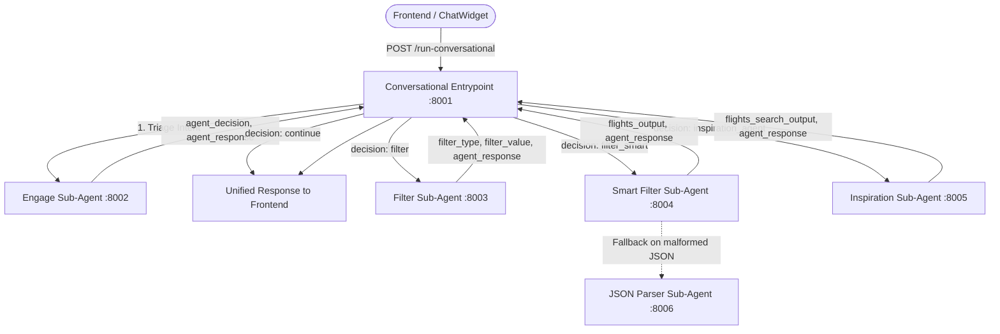

# 💬 Conversational Multi-Agent Application (`conversational_app`)

The **Conversational Multi-Agent Application** powers the interactive **ChatWidget** in the Flights Search platform. Built with **Google ADK (Agent Development Kit)**, **Gemini 3.1 Pro**, and **FastAPI**, it coordinates a central **Conversational** workflow entrypoint (`app/main.py` on port `8001`) alongside five specialized **Sub-Agents** (`app/sub_agents/*` on ports `8002`–`8006`).

---

## 🏗️ Architecture & Request Flow



---

## 📁 Directory Structure

```text
conversational_app/
├── app/                         # Main Conversational Entrypoint (:8001)
│   ├── __init__.py
│   ├── agent.py                 # ADK v2 Workflow definition (conversational)
│   ├── main.py                  # Conversational FastAPI gateway
│   ├── schema.py                # ConversationalInput, ConversationalOutput & ConversationalState schemas
│   ├── app_utils/               # Shared logging and formatting utilities
│   └── sub_agents/              # Specialized ADK Sub-Agent Services
│       ├── engage/              # Intent triage & routing (:8002)
│       ├── filter/              # Deterministic filter extraction (:8003)
│       ├── filter_smart/        # Semantic filtering + Google Search (:8004)
│       ├── inspiration/         # Open-ended destination & date discovery (:8005)
│       └── json_parser/         # Self-healing JSON structure repair (:8006)
├── tests/
│   ├── fixtures/                # Sample JSON inputs for each agent
│   ├── unit/                    # Offline unit tests (mocked LLM / HTTP calls)
│   ├── integration/             # In-process FastAPI TestClient tests (real Gemini calls)
│   └── e2e/                     # Live HTTP tests against localhost:8001–8006
├── .env                         # Shared environment variables for conversational_app
├── pyproject.toml               # Package metadata & pytest configuration
└── requirements.txt             # Python dependencies
```

Each sub-agent directory under `app/sub_agents/<name>/` follows a consistent structure:
- `agent.py`: Instantiates the Google ADK `Agent` and wraps it in an ADK `App`.
- `main.py`: FastAPI microservice managing `InMemorySessionService`, ADK `Runner` execution, and REST endpoints.
- `prompt.py`: System instruction prompt defining the sub-agent's role, rules, and output formatting.
- `schema.py`: Pydantic models enforcing input and output data contracts.

---

## 🤖 Conversational Workflow & Sub-Agents Reference

### 1. Conversational Workflow (Entrypoint — Port `8001`)
- **Location:** [`app/agent.py`](app/agent.py), [`app/main.py`](app/main.py), [`app/schema.py`](app/schema.py)
- **Endpoint:** `POST /run-conversational`
- **Role:** Central ADK v2 `Workflow` gateway sitting behind the React ChatWidget.
- **Execution Pipeline:**
  1. Executes **Engage** with `user_message` and `conversational_history` to classify intent (`agent_decision`).
  2. Routes dynamically based on `agent_decision`:
     - **`continue`**: Returns `agent_response` directly to the user.
     - **`filter`**: Executes **Filter** to extract deterministic parameters (`direct`, `max_price`, `max_stops`).
     - **`filter_smart`**: Executes **Smart Filter** with `flights_input` to filter flights using qualitative reasoning and live Google Search (with automatic fallback to **JSON Parser** on malformed JSON).
     - **`inspiration_agent`**: Executes **Inspiration** with `flights_search_input` to suggest a new destination and dates.
  3. Packages all outputs into a unified `ConversationalOutput` envelope.

<details>
<summary><b>Conversational Schemas (<code>ConversationalInput</code> / <code>ConversationalOutput</code>)</b></summary>

**Request (`ConversationalInput`):**
```json
{
  "user_message": "Show me flights with good WiFi departing in the morning",
  "conversational_history": [
    "user: Search flights from Paris to New York on 2026-05-10",
    "bot: Found 15 flights matching your search."
  ],
  "flights_search_input": {
    "origin": "Paris",
    "destination": "New York",
    "departure_date": "2026-05-10",
    "return_date": "2026-05-20",
    "passengers": 1
  },
  "flights_input": [
    {
      "origin": "Paris (CDG)",
      "destination": "New York (JFK)",
      "departure_date": "2026-05-10",
      "return_date": "2026-05-20",
      "departure_time": "10:30",
      "arrival_time": "13:00",
      "return_time": "17:30",
      "return_arrival_time": "06:45 +1",
      "price": "520 EUR",
      "airline": "Air France",
      "flight_number": "AF006",
      "stops": 0,
      "stopover_cities": []
    }
  ]
}
```

**Response (`ConversationalOutput`):**
```json
{
  "status": "success",
  "results": {
    "agent_response": "Filtered out afternoon flights. Verified that Air France AF006 offers satellite WiFi.",
    "agent_decision": "filter_smart",
    "flights_output": [
      {
        "origin": "Paris (CDG)",
        "destination": "New York (JFK)",
        "departure_date": "2026-05-10",
        "return_date": "2026-05-20",
        "departure_time": "10:30",
        "arrival_time": "13:00",
        "return_time": "17:30",
        "return_arrival_time": "06:45 +1",
        "price": "520 EUR",
        "airline": "Air France",
        "flight_number": "AF006",
        "stops": 0,
        "stopover_cities": []
      }
    ]
  }
}
```
</details>

---

### 2. Engage Sub-Agent (Port `8002`)
- **Location:** [`app/sub_agents/engage/`](app/sub_agents/engage/)
- **Endpoint:** `POST /run-engage`
- **Model:** `gemini-2.5-pro`
- **Role:** Receptionist & Triage Specialist. Classifies user intent into one of four hierarchical routing decisions:
  1. **`inspiration_agent`**: Open-ended destination requests, broad regions, or vague timeframes (*"somewhere sunny in December"*, *"take me to Europe"*).
  2. **`filter`**: Hard database filters only—`max_price` (*"under $500"*), `max_stops` (*"at most 1 stop"*), or `direct` (*"direct flights only"*).
  3. **`filter_smart`**: Qualitative or soft filters—specific airlines (*"Air France only"*), time-of-day (*"morning departures"*), aircraft types (*"A350"*), or amenities (*"good WiFi"*, *"extra legroom"*).
  4. **`continue`**: Greetings, general questions, or ambiguous inputs needing clarification.

<details>
<summary><b>Engage Schemas (<code>EngageInput</code> / <code>EngageOutput</code>)</b></summary>

**Request (`EngageInput`):**
```json
{
  "user_message": "I only want direct flights under 600 euros.",
  "conversational_history": [
    "user: Search flights from Paris to New York on 2026-05-10",
    "bot: Found 15 flights matching your search."
  ]
}
```

**Response (`EngageOutput`):**
```json
{
  "status": "success",
  "results": [
    {
      "agent_response": "Filtering for direct flights under 600 EUR.",
      "agent_decision": "filter"
    }
  ]
}
```
</details>

---

### 3. Filter Sub-Agent (Port `8003`)
- **Location:** [`app/sub_agents/filter/`](app/sub_agents/filter/)
- **Endpoint:** `POST /run-filter`
- **Model:** `gemini-2.5-pro`
- **Role:** Deterministic Filter Extractor. Translates natural language into structured database parameters:
  - **`direct`**: `1` (true) or `0` (false) — triggered by *"non-stop"*, *"direct"*, *"no stops"*.
  - **`max_price`**: Integer amount (e.g., `500`) — triggered by *"under $X"*, *"less than X"*, *"budget is X"*.
  - **`max_stops`**: Integer count (`0`, `1`, `2`) — triggered by *"at most 1 stop"*, *"maximum 2 stops"*.

<details>
<summary><b>Filter Schemas (<code>FilterInput</code> / <code>FilterOutput</code>)</b></summary>

**Request (`FilterInput`):**
```json
{
  "user_message": "Show me direct flights only",
  "conversational_history": []
}
```

**Response (`FilterOutput`):**
```json
{
  "status": "success",
  "results": [
    {
      "agent_response": "Searching for direct flights only.",
      "filter_type": "direct",
      "filter_value": 1
    }
  ]
}
```
</details>

---

### 4. Smart Filter Sub-Agent (Port `8004`)
- **Location:** [`app/sub_agents/filter_smart/`](app/sub_agents/filter_smart/)
- **Endpoint:** `POST /run-filter-smart`
- **Model & Tools:** `gemini-2.5-pro` + `google_search`
- **Role:** Semantic Flight Filter. Evaluates candidate flights against explicit metadata criteria (airlines, departure windows like morning `06:00–12:00`, airports) and invokes **Google Search** to verify qualitative amenities (WiFi quality, seat pitch/legroom, aircraft features).
- **Resilience:** Strips markdown code fences via `load_json_with_markdown` and automatically falls back to the **JSON Parser Sub-Agent (`:8006`)** if the raw LLM output is malformed JSON.

<details>
<summary><b>Smart Filter Schemas (<code>FilterSmartInput</code> / <code>FilterSmartOutput</code>)</b></summary>

**Request (`FilterSmartInput`):**
```json
{
  "user_message": "I only want flights that have good WiFi and depart in the morning.",
  "conversational_history": [],
  "flights_input": [
    {
      "origin": "London (LHR)",
      "destination": "New York (JFK)",
      "departure_date": "2026-05-10",
      "return_date": "2026-05-20",
      "departure_time": "09:30",
      "arrival_time": "12:15",
      "return_time": "18:00",
      "return_arrival_time": "06:20 +1",
      "price": "610 EUR",
      "airline": "British Airways",
      "flight_number": "BA178",
      "stops": 0,
      "stopover_cities": []
    }
  ]
}
```

**Response (`FilterSmartOutput`):**
```json
{
  "status": "success",
  "results": [
    {
      "agent_response": "Filtered out afternoon flights to match your morning preference (06:00-12:00). Researched in-flight connectivity and confirmed British Airways BA178 offers high-speed satellite WiFi.",
      "flights_output": [
        {
          "origin": "London (LHR)",
          "destination": "New York (JFK)",
          "departure_date": "2026-05-10",
          "return_date": "2026-05-20",
          "departure_time": "09:30",
          "arrival_time": "12:15",
          "return_time": "18:00",
          "return_arrival_time": "06:20 +1",
          "price": "610 EUR",
          "airline": "British Airways",
          "flight_number": "BA178",
          "stops": 0,
          "stopover_cities": []
        }
      ]
    }
  ]
}
```
</details>

---

### 5. Inspiration Sub-Agent (Port `8005`)
- **Location:** [`app/sub_agents/inspiration/`](app/sub_agents/inspiration/)
- **Endpoint:** `POST /run-inspiration`
- **Model:** `gemini-2.5-pro`
- **Role:** Travel Discovery Architect. Transforms open-ended travel aspirations (*"somewhere sunny in December"*, *"a trip to Europe in May"*) into concrete, searchable flight parameters (`flights_search_output`) along with a tailored `agent_response` pitch.

<details>
<summary><b>Inspiration Schemas (<code>InspirationInput</code> / <code>InspirationOutput</code>)</b></summary>

**Request (`InspirationInput`):**
```json
{
  "user_message": "I want to go somewhere sunny and warm in December instead.",
  "conversational_history": [],
  "flights_search_input": {
    "origin": "Paris",
    "destination": "New York",
    "departure_date": "2026-05-10",
    "return_date": "2026-05-20",
    "passengers": 1
  }
}
```

**Response (`InspirationOutput`):**
```json
{
  "status": "success",
  "results": [
    {
      "agent_response": "How about swapping the chilly winter for tropical beaches in Cancun? December is prime season for warm weather and clear skies in the Caribbean!",
      "flights_search_output": {
        "origin": "Paris",
        "destination": "Cancun",
        "departure_date": "2026-12-05",
        "return_date": "2026-12-15",
        "passengers": 1
      }
    }
  ]
}
```
</details>

---

### 6. JSON Parser Sub-Agent (Port `8006`)
- **Location:** [`app/sub_agents/json_parser/`](app/sub_agents/json_parser/)
- **Endpoint:** `POST /run-json-parser`
- **Model:** `gemini-2.5-pro`
- **Role:** Self-Healing JSON Structure Corrector. Repairs malformed or unescaped JSON text from upstream agents (such as `filter_smart`) and enforces strict schema compliance (`agent_response` and `flights_output`) without mutating or hallucinating flight attributes.

<details>
<summary><b>JSON Parser Schemas (<code>JSONParserInput</code> / <code>JSONParserOutput</code>)</b></summary>

**Request (`JSONParserInput`):**
```json
{
  "agent_response": "Here are the flights:\n{'agent_response': 'Filtered for high-speed WiFi.', 'flights_output': []}"
}
```

**Response (`JSONParserOutput`):**
```json
{
  "status": "success",
  "results": [
    {
      "agent_response": "Filtered for high-speed WiFi.",
      "flights_output": []
    }
  ]
}
```
</details>

---

## 🚀 Running Locally

### 1. Environment Configuration (`.env`)
All services in `conversational_app` automatically load environment variables from [`conversational_app/.env`](.env) via `python-dotenv`:
```dotenv
GOOGLE_CLOUD_PROJECT=travel-agent-511710
GOOGLE_CLOUD_LOCATION=europe-west9
GOOGLE_GENAI_USE_VERTEXAI=TRUE
```

### 2. Installation
From `conversational_app/`:
```bash
pip install -r requirements.txt
```

### 3. Start the Orchestrator & Sub-Agent Services
Run from `conversational_app/` (in separate terminals or background processes):

```bash
# Main Conversational Gateway (Port 8001)
python3 -m app.main

# Engage Sub-Agent (Port 8002)
python3 -m app.sub_agents.engage.main

# Filter Sub-Agent (Port 8003)
python3 -m app.sub_agents.filter.main

# Smart Filter Sub-Agent (Port 8004)
python3 -m app.sub_agents.filter_smart.main

# Inspiration Sub-Agent (Port 8005)
python3 -m app.sub_agents.inspiration.main

# JSON Parser Sub-Agent (Port 8006)
python3 -m app.sub_agents.json_parser.main
```

---

## 🧪 Testing

Run the automated test suite from `conversational_app/` using `pytest` or by running individual test modules directly:

```bash
# Run all test tiers (unit, integration, e2e)
python3 -m pytest -v -s

# 1. Unit tests (offline, mocked LLM / HTTP calls)
python3 -m pytest tests/unit -v -s
python3 -m tests.unit.test_conversational
python3 -m tests.unit.test_engage
python3 -m tests.unit.test_filter
python3 -m tests.unit.test_filter_smart
python3 -m tests.unit.test_inspiration
python3 -m tests.unit.test_json_parser

# 2. Integration tests (in-process FastAPI TestClient with real Gemini calls)
python3 -m pytest tests/integration -v -s
python3 -m tests.integration.test_engage
python3 -m tests.integration.test_filter
python3 -m tests.integration.test_filter_smart
python3 -m tests.integration.test_inspiration
python3 -m tests.integration.test_json_parser
python3 -m tests.integration.test_conversational

# 3. End-to-End tests (live HTTP requests against running servers on ports 8001–8006)
python3 -m pytest tests/e2e -v -s
python3 -m tests.e2e.test_conversational
python3 -m tests.e2e.test_engage
python3 -m tests.e2e.test_filter
python3 -m tests.e2e.test_filter_smart
python3 -m tests.e2e.test_inspiration
python3 -m tests.e2e.test_json_parser
```
