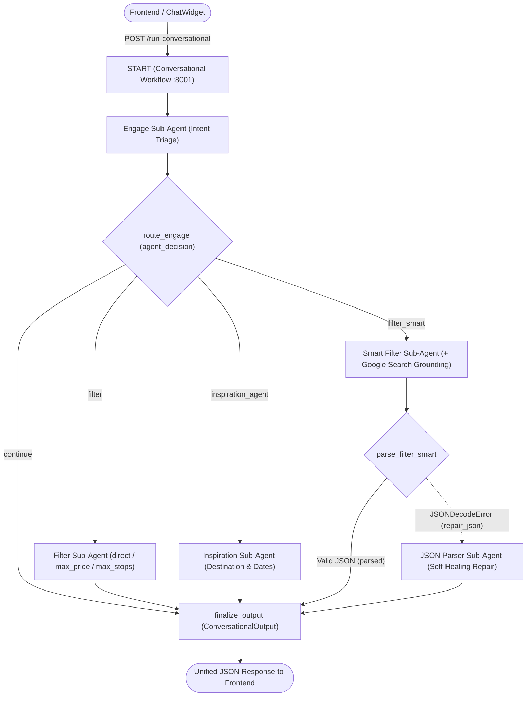

# 💬 Conversational Multi-Agent Application (`conversational_app`)

The **Conversational Multi-Agent Application** powers the interactive **ChatWidget** in the Flights Search platform. Built with **Google ADK (Agent Development Kit v2)**, **Google Gemini on Vertex AI**, and **FastAPI**, it orchestrates five specialized sub-agents inside an event-driven ADK v2 **`Workflow`** (`POST /run-conversational` on local port `8001` / Cloud Run port `8080`), while also allowing each sub-agent to run as an isolated microservice on ports `8002`–`8006` for component testing.

---

## 🏗️ Workflow Architecture & Resilience Flow



### Key Architectural & Resilience Features
- **In-Process ADK v2 `Workflow` + Optional Standalone Endpoints**:
  - **Production & Default Local Mode (`:8001`)**: [`app/agent.py`](app/agent.py) wires all 5 sub-agents directly into a single ADK v2 `Workflow` graph—avoiding internal network hops and deploying as a single Cloud Run service (`conversational-app`).
  - **Component Isolation Mode (`:8002`–`:8006`)**: Each sub-agent under `app/sub_agents/<name>/main.py` also exposes its own FastAPI server for standalone debugging and component E2E testing.
- **Externalized Model & Endpoint Configuration ([`app/config.py`](app/config.py))**:
  - Supports global model selection (`CONVERSATIONAL_MODEL` / `GEMINI_MODEL`, default `gemini-3.5-flash-lite`) **plus independent per-sub-agent overrides** (`ENGAGE_MODEL`, `FILTER_MODEL`, `FILTER_SMART_MODEL`, `INSPIRATION_MODEL`, `JSON_PARSER_MODEL`) and `GEMINI_MODEL_LOCATION` (`global`).
- **Graceful Degradation & Self-Healing**:
  - **Exponential Backoff Retries**: All 5 sub-agents configure `HttpRetryOptions(attempts=5, initial_delay=5.0, max_delay=60.0, exp_base=2.0)` on HTTP `408, 429, 500, 502, 503, 504`.
  - **Automatic JSON Repair Fallback**: Because `filter_smart` uses live `google_search` grounding, its output cannot simultaneously enforce strict JSON schema mode. `parse_filter_smart` first attempts fast regex extraction (`load_json_with_markdown`) and automatically routes malformed responses to `json_parser` (`repair_json`) without failing the user request.

---

## 📁 Directory Structure

```text
conversational_app/
├── app/                         # Main Conversational Workflow Service (:8001)
│   ├── __init__.py
│   ├── agent.py                 # ADK v2 Workflow graph (route_engage, parse_filter_smart, finalize_output)
│   ├── config.py                # Centralized env configuration (models, per-agent overrides, URLs, CORS)
│   ├── main.py                  # FastAPI gateway, CORS middleware & ADK Runner execution
│   ├── schema.py                # ConversationalInput, ConversationalOutput & ConversationalState schemas
│   ├── app_utils/               # Structured logging & table/dict formatting helpers
│   └── sub_agents/              # Specialized ADK Sub-Agents (each with agent.py, main.py, prompt.py, schema.py)
│       ├── engage/              # Intent triage & routing (:8002)
│       ├── filter/              # Deterministic filter extraction (:8003)
│       ├── filter_smart/        # Semantic filtering + Google Search grounding (:8004)
│       ├── inspiration/         # Open-ended destination & date discovery (:8005)
│       └── json_parser/         # Self-healing JSON structure repair (:8006)
├── tests/
│   ├── fixtures/                # Sample JSON test inputs for orchestrator & each sub-agent
│   ├── unit/                    # Fast offline health checks, Pydantic schema & 422 validation tests
│   ├── integration/             # In-process FastAPI TestClient tests with live Gemini calls
│   ├── e2e/                     # Live HTTP client tests (configurable via *_BASE_URL env vars)
│   └── eval/                    # 7-metric GEAP AI Quality, Non-Hallucination & Latency Evaluation Suite
│       ├── configs/             # eval_config.json, scenario_generation_config.json, session_input.json
│       ├── datasets/            # 50-case synthetic travel benchmark (conversational_synthetic.evalset.json)
│       ├── metrics/             # Custom Python & LLM-as-a-Judge evaluation metrics
│       ├── results/             # Timestamped evaluation runs, traces & experiments_history.md
│       └── scripts/             # generate_scenarios.py, run_evaluation.py, run_loss_analysis.py
├── Dockerfile                   # Production non-root Python 3.11 container for Cloud Run
├── .dockerignore                # Excludes local caches/tests from container build context
├── .env.example                 # Template environment, model & endpoint configuration
├── pyproject.toml               # Project metadata & pytest configuration
└── requirements.txt             # Pinned runtime Python dependencies
```

---

## ⚙️ Configuration Variables (`.env` / Cloud Run)

| Variable | Default | Description |
| :--- | :--- | :--- |
| `GOOGLE_GENAI_USE_VERTEXAI` | `1` | Authenticates to Vertex AI using Application Default Credentials (ADC). |
| `GOOGLE_CLOUD_PROJECT` | `travel-agent-511710` | Target GCP Project ID. |
| `GOOGLE_CLOUD_LOCATION` | `europe-west9` | Primary GCP region. |
| `CONVERSATIONAL_MODEL` | `GEMINI_MODEL` (`gemini-3.5-flash-lite`) | Default Gemini model ID inherited by all 5 sub-agents. |
| `ENGAGE_MODEL` / `FILTER_MODEL` / `FILTER_SMART_MODEL` / `INSPIRATION_MODEL` / `JSON_PARSER_MODEL` | `CONVERSATIONAL_MODEL` | Optional per-sub-agent model overrides (e.g., upgrade only `FILTER_SMART_MODEL`). |
| `GEMINI_MODEL_LOCATION` | `global` | Vertex AI model endpoint location. |
| `HOST` / `PORT` | `0.0.0.0` / `8001` | Bind address and port for main FastAPI service (`8080` on Cloud Run). |
| `CONVERSATIONAL_BASE_URL` | `http://127.0.0.1:8001` | Target URL for `tests/e2e/test_conversational.py`. |
| `ENGAGE_BASE_URL` ... `JSON_PARSER_BASE_URL` | `http://127.0.0.1:8002`–`8006` | Configurable standalone sub-agent URLs for microservice mode & E2E tests. |
| `ALLOWED_ORIGINS` | `*` | Comma-separated allowed CORS origins. |

---

## 🤖 Conversational Workflow & Sub-Agents Reference

### 1. Conversational Workflow (Entrypoint — Port `8001`)
- **Location:** [`app/agent.py`](app/agent.py), [`app/main.py`](app/main.py), [`app/schema.py`](app/schema.py)
- **Endpoint:** `POST /run-conversational`
- **Execution Pipeline:**
  1. Runs **Engage** with `user_message` and `conversational_history` to classify user intent (`agent_decision`).
  2. Routes via `route_engage`:
     - **`continue`**: Returns `agent_response` directly via `finalize_output`.
     - **`filter`**: Runs **Filter** to extract hard filter parameters (`direct`, `max_price`, `max_stops`).
     - **`filter_smart`**: Runs **Smart Filter** on `flights_input` using reasoning + `google_search`, validated through `parse_filter_smart` (with automatic `repair_json` fallback to **JSON Parser**).
     - **`inspiration_agent`**: Runs **Inspiration** on `flights_search_input` to suggest new destination/dates (`flights_search_output`).
  3. Normalizes output into a strict `ConversationalOutput` JSON response.

<details>
<summary><b>Conversational Schemas (<code>ConversationalInput</code> / <code>ConversationalOutput</code>)</b></summary>

**Request (`ConversationalInput`):**
```json
{
  "user_message": "Show me flights with good WiFi departing in the morning",
  "conversational_history": [
    "user: Search flights from Paris to New York on 2026-05-10",
    "bot: Found 15 flights matching your search."
  ],
  "flights_search_input": {
    "origin": "Paris",
    "destination": "New York",
    "departure_date": "2026-05-10",
    "return_date": "2026-05-20",
    "passengers": 1
  },
  "flights_input": [
    {
      "origin": "Paris (CDG)",
      "destination": "New York (JFK)",
      "departure_date": "2026-05-10",
      "return_date": "2026-05-20",
      "departure_time": "10:30",
      "arrival_time": "13:00",
      "return_time": "17:30",
      "return_arrival_time": "06:45 +1",
      "price": "520 EUR",
      "airline": "Air France",
      "flight_number": "AF006",
      "stops": 0,
      "stopover_cities": []
    }
  ]
}
```

**Response (`ConversationalOutput`):**
```json
{
  "status": "success",
  "results": {
    "agent_response": "Filtered out afternoon flights. Verified that Air France AF006 offers satellite WiFi.",
    "agent_decision": "filter_smart",
    "flights_output": [
      {
        "origin": "Paris (CDG)",
        "destination": "New York (JFK)",
        "departure_date": "2026-05-10",
        "return_date": "2026-05-20",
        "departure_time": "10:30",
        "arrival_time": "13:00",
        "return_time": "17:30",
        "return_arrival_time": "06:45 +1",
        "price": "520 EUR",
        "airline": "Air France",
        "flight_number": "AF006",
        "stops": 0,
        "stopover_cities": []
      }
    ]
  }
}
```
</details>

---

### 2. Engage Sub-Agent (Port `8002`)
- **Location:** [`app/sub_agents/engage/`](app/sub_agents/engage/) | **Standalone Endpoint:** `POST /run-engage`
- **Model Config:** `ENGAGE_MODEL` (defaults to `CONVERSATIONAL_MODEL` / `gemini-3.5-flash-lite`)
- **Role:** Intent Triage Specialist classifying user messages into `inspiration_agent`, `filter`, `filter_smart`, or `continue`.

<details>
<summary><b>Engage Schemas (<code>EngageInput</code> / <code>EngageOutput</code>)</b></summary>

**Request (`EngageInput`):**
```json
{
  "user_message": "I only want direct flights under 600 euros.",
  "conversational_history": []
}
```

**Response (`EngageOutput`):**
```json
{
  "status": "success",
  "results": [
    {
      "agent_response": "Filtering for direct flights under 600 EUR.",
      "agent_decision": "filter"
    }
  ]
}
```
</details>

---

### 3. Filter Sub-Agent (Port `8003`)
- **Location:** [`app/sub_agents/filter/`](app/sub_agents/filter/) | **Standalone Endpoint:** `POST /run-filter`
- **Model Config:** `FILTER_MODEL` (defaults to `CONVERSATIONAL_MODEL` / `gemini-3.5-flash-lite`)
- **Role:** Deterministic Filter Extractor converting natural language into `direct` (`1`/`0`), `max_price` (integer), or `max_stops` (`0`/`1`/`2`).

<details>
<summary><b>Filter Schemas (<code>FilterInput</code> / <code>FilterOutput</code>)</b></summary>

**Request (`FilterInput`):**
```json
{
  "user_message": "Show me direct flights only",
  "conversational_history": []
}
```

**Response (`FilterOutput`):**
```json
{
  "status": "success",
  "results": [
    {
      "agent_response": "Searching for direct flights only.",
      "filter_type": "direct",
      "filter_value": 1
    }
  ]
}
```
</details>

---

### 4. Smart Filter Sub-Agent (Port `8004`)
- **Location:** [`app/sub_agents/filter_smart/`](app/sub_agents/filter_smart/) | **Standalone Endpoint:** `POST /run-filter-smart`
- **Model & Tools:** `FILTER_SMART_MODEL` (default `gemini-3.5-flash-lite`) + `google_search`
- **Role:** Semantic Flight Filter evaluating airlines, departure/arrival time windows, airports, and qualitative cabin amenities (WiFi, legroom, aircraft features) via live Google Search grounding, backed by automatic fallback to `json_parser` if malformed JSON is returned.

<details>
<summary><b>Smart Filter Schemas (<code>FilterSmartInput</code> / <code>FilterSmartOutput</code>)</b></summary>

**Request (`FilterSmartInput`):**
```json
{
  "user_message": "I only want flights that have good WiFi and depart in the morning.",
  "conversational_history": [],
  "flights_input": [
    {
      "origin": "London (LHR)",
      "destination": "New York (JFK)",
      "departure_date": "2026-05-10",
      "return_date": "2026-05-20",
      "departure_time": "09:30",
      "arrival_time": "12:15",
      "return_time": "18:00",
      "return_arrival_time": "06:20 +1",
      "price": "610 EUR",
      "airline": "British Airways",
      "flight_number": "BA178",
      "stops": 0,
      "stopover_cities": []
    }
  ]
}
```

**Response (`FilterSmartOutput`):**
```json
{
  "status": "success",
  "results": [
    {
      "agent_response": "Filtered out afternoon flights and confirmed British Airways BA178 offers satellite WiFi.",
      "flights_output": [
        {
          "origin": "London (LHR)",
          "destination": "New York (JFK)",
          "departure_date": "2026-05-10",
          "return_date": "2026-05-20",
          "departure_time": "09:30",
          "arrival_time": "12:15",
          "return_time": "18:00",
          "return_arrival_time": "06:20 +1",
          "price": "610 EUR",
          "airline": "British Airways",
          "flight_number": "BA178",
          "stops": 0,
          "stopover_cities": []
        }
      ]
    }
  ]
}
```
</details>

---

### 5. Inspiration Sub-Agent (Port `8005`)
- **Location:** [`app/sub_agents/inspiration/`](app/sub_agents/inspiration/) | **Standalone Endpoint:** `POST /run-inspiration`
- **Model Config:** `INSPIRATION_MODEL` (defaults to `CONVERSATIONAL_MODEL` / `gemini-3.5-flash-lite`)
- **Role:** Travel Discovery Architect translating open-ended travel goals (*"somewhere sunny in December"*) into concrete `flights_search_output` parameters that trigger a fresh search in the frontend.

<details>
<summary><b>Inspiration Schemas (<code>InspirationInput</code> / <code>InspirationOutput</code>)</b></summary>

**Request (`InspirationInput`):**
```json
{
  "user_message": "I want to go somewhere sunny and warm in December instead.",
  "conversational_history": [],
  "flights_search_input": {
    "origin": "Paris",
    "destination": "New York",
    "departure_date": "2026-05-10",
    "return_date": "2026-05-20",
    "passengers": 1
  }
}
```

**Response (`InspirationOutput`):**
```json
{
  "status": "success",
  "results": [
    {
      "agent_response": "How about Cancun? December is prime season for warm weather and clear skies in the Caribbean!",
      "flights_search_output": {
        "origin": "Paris",
        "destination": "Cancun",
        "departure_date": "2026-12-05",
        "return_date": "2026-12-15",
        "passengers": 1
      }
    }
  ]
}
```
</details>

---

### 6. JSON Parser Sub-Agent (Port `8006`)
- **Location:** [`app/sub_agents/json_parser/`](app/sub_agents/json_parser/) | **Standalone Endpoint:** `POST /run-json-parser`
- **Model Config:** `JSON_PARSER_MODEL` (defaults to `CONVERSATIONAL_MODEL` / `gemini-3.5-flash-lite`)
- **Role:** Self-Healing JSON Repair Specialist ensuring malformed or unescaped outputs from `filter_smart` conform strictly to `JSONParserOutput` without mutating or hallucinating flights.

---

## 🚀 Running Locally

```bash
cd conversational_app
cp -n .env.example .env
pip install -r requirements.txt

# Start the unified Conversational Workflow Gateway (Port 8001)
python3 -m app.main
```

*(Optional)* Start individual sub-agent FastAPI servers (`:8002`–`:8006`) if running sub-agent-specific HTTP E2E tests:
```bash
python3 -m app.sub_agents.engage.main        # Port 8002
python3 -m app.sub_agents.filter.main        # Port 8003
python3 -m app.sub_agents.filter_smart.main  # Port 8004
python3 -m app.sub_agents.inspiration.main   # Port 8005
python3 -m app.sub_agents.json_parser.main   # Port 8006
```

---

## 🧪 Testing & AI Quality Evaluation

### 1. Unit, Integration & E2E Tests (`pytest`)
```bash
cd conversational_app

# 1. Unit tests (fast, offline health checks + Pydantic schema & 422 validation)
python3 -m pytest tests/unit -v -s

# 2. Integration tests (in-process TestClient with live Gemini calls across workflow & sub-agents)
python3 -m pytest tests/integration -v -s

# 3. End-to-End tests against local servers (:8001–:8006)
python3 -m pytest tests/e2e -v -s

# 4. End-to-End test against a live Cloud Run deployment
CONVERSATIONAL_BASE_URL="https://conversational-app-5tqnsbwara-od.a.run.app" \
  python3 -m pytest tests/e2e/test_conversational.py -v -s
```

### 2. GEAP AI Evaluation & Loss Analysis Flywheel (`tests/eval/`)
The [`tests/eval/`](tests/eval/) suite evaluates the full multi-agent workflow against 50 synthetic travel scenarios ([`conversational_synthetic.evalset.json`](tests/eval/datasets/conversational_synthetic.evalset.json)) across **7 automated metrics** configured in [`eval_config.json`](tests/eval/configs/eval_config.json):

| Metric | Type | Threshold | What It Measures |
| :--- | :---: | :---: | :--- |
| `multi_turn_task_success_v1` | Predefined Rubric | `>= 0.80` | End-to-end user goal completion. |
| `multi_turn_trajectory_quality_v1` | Predefined Rubric | `>= 0.80` | Sub-agent routing accuracy (`engage` → specialist). |
| `tool_use_quality` | Custom LLM Judge | `>= 0.80` | Appropriate `google_search` grounding usage on `filter_smart`. |
| `coherence` | Predefined Rubric | `>= 0.80` | Logical clarity and helpfulness of `agent_response`. |
| `schema_and_contract_valid` | Deterministic Python | `>= 0.95` | Strict `ConversationalOutput` schema validity, decision invariants & **zero hallucinated flights**. |
| `conversation_plan_alignment` | Custom LLM Judge | `>= 0.80` | Alignment with expected ground-truth `conversation_plan`. |
| `latency_seconds` | Deterministic Python | `<= 15.0s` | Single-turn end-to-end response latency (lower is better). |

```bash
cd conversational_app

# Step 1 (Optional): Regenerate synthetic evaluation scenarios
python3 -m tests.eval.scripts.generate_scenarios

# Step 2: Run inference + 7-metric evaluation (tracks deltas in tests/eval/results/experiments_history.md)
python3 -m tests.eval.scripts.run_evaluation --run-name baseline --set-baseline

# Compare an alternative Gemini model without changing code:
CONVERSATIONAL_MODEL="gemini-2.5-pro" \
  python3 -m tests.eval.scripts.run_evaluation \
  --run-name gemini_2_5_pro \
  --description "Evaluate Gemini 2.5 Pro across all sub-agents"

# Step 3: Cluster failure root causes with automated loss analysis
python3 -m tests.eval.scripts.run_loss_analysis
```
