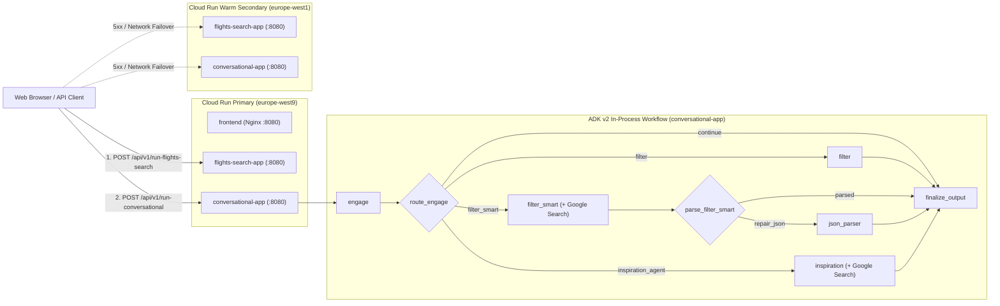
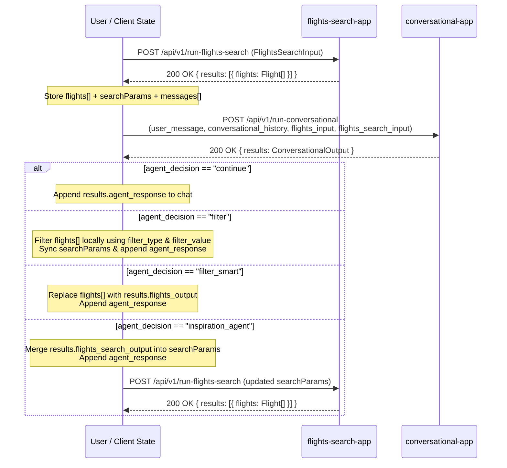

# Travel Agent Platform — API, Integration & SDK Documentation

Complete API reference, integration architecture, and SDK guide for the **Travel Agent** multi-agent platform powered by **Google ADK v2** (`google-adk==2.11.0`), **Gemini on Vertex AI** (`google-genai==2.31.0`), **FastAPI** (`0.135.1`), and **React 18**.

---

## Table of Contents

- [Service Topology & API Inventory](#service-topology--api-inventory)
- [Part 1: OpenAPI 3.1 Specifications & Endpoint Reference](#part-1-openapi-31-specifications--endpoint-reference)
  - [1.1 Contract Governance & Interactive Docs](#11-contract-governance--interactive-docs)
  - [1.2 API Versioning & Standard Response Headers](#12-api-versioning--standard-response-headers)
  - [1.3 Flights Search Agent Service (`flights-search-app`)](#13-flights-search-agent-service-flights-search-app)
  - [1.4 Conversational Agent Service (`conversational-app`)](#14-conversational-agent-service-conversational-app)
  - [1.5 Standalone Specialist Sub-Agent APIs (Local / Eval Microservices)](#15-standalone-specialist-sub-agent-apis-local--eval-microservices)
  - [1.6 Health, Readiness & Frontend Operational Contracts](#16-health-readiness--frontend-operational-contracts)
- [Part 2: Integration Guides](#part-2-integration-guides)
  - [2.1 Stateless Multi-Service Integration Workflow](#21-stateless-multi-service-integration-workflow)
  - [2.2 Authentication, IAM & CORS](#22-authentication-iam--cors)
  - [2.3 Resilience, Failover & Error Handling](#23-resilience-failover--error-handling)
- [Part 3: SDK & Client Library Documentation](#part-3-sdk--client-library-documentation)
  - [3.1 Frontend JavaScript Client SDK (`frontend/src/apiClient.js`)](#31-frontend-javascript-client-sdk-frontendsrcapiclientjs)
  - [3.2 Python In-Process Agent & Google ADK v2 SDK](#32-python-in-process-agent--google-adk-v2-sdk)
  - [3.3 External HTTP Client Examples & OpenAPI Code Generation](#33-external-http-client-examples--openapi-code-generation)

---

## Service Topology & API Inventory

The platform comprises two primary FastAPI AI backend services, one Nginx/React SPA service, and five optional standalone FastAPI sub-agent microservices used for isolated local debugging and evaluation.



### Complete Service Matrix

| Service | Entrypoint | Local Default URL | Cloud Run Port / Timeout | Canonical Endpoint (`v1`) | Deprecated Alias | Committed OpenAPI Spec |
| :--- | :--- | :--- | :--- | :--- | :--- | :--- |
| **Flights Search** (`flights-search-app`) | [`flights_search_app/app/main.py`](../flights_search_app/app/main.py) | `http://127.0.0.1:8000` | `8080` / `300s` | `POST /api/v1/run-flights-search` | `POST /run-flights-search` | [`flights_search_app/openapi.json`](../flights_search_app/openapi.json) |
| **Conversational Workflow** (`conversational-app`) | [`conversational_app/app/main.py`](../conversational_app/app/main.py) | `http://127.0.0.1:8001` | `8080` / `300s` | `POST /api/v1/run-conversational` | `POST /run-conversational` | [`conversational_app/openapi.json`](../conversational_app/openapi.json) |
| **Engage Sub-Agent** (`engage`) | [`engage/main.py`](../conversational_app/app/sub_agents/engage/main.py) | `http://127.0.0.1:8002` | Local / Dev only | `POST /api/v1/run-engage` | `POST /run-engage` | Dynamic (`GET /openapi.json`) |
| **Filter Sub-Agent** (`filter`) | [`filter/main.py`](../conversational_app/app/sub_agents/filter/main.py) | `http://127.0.0.1:8003` | Local / Dev only | `POST /api/v1/run-filter` | `POST /run-filter` | Dynamic (`GET /openapi.json`) |
| **Filter Smart Sub-Agent** (`filter_smart`) | [`filter_smart/main.py`](../conversational_app/app/sub_agents/filter_smart/main.py) | `http://127.0.0.1:8004` | Local / Dev only | `POST /api/v1/run-filter-smart` | `POST /run-filter-smart` | Dynamic (`GET /openapi.json`) |
| **Inspiration Sub-Agent** (`inspiration`) | [`inspiration/main.py`](../conversational_app/app/sub_agents/inspiration/main.py) | `http://127.0.0.1:8005` | Local / Dev only | `POST /api/v1/run-inspiration` | `POST /run-inspiration` | Dynamic (`GET /openapi.json`) |
| **JSON Parser Sub-Agent** (`json_parser`) | [`json_parser/main.py`](../conversational_app/app/sub_agents/json_parser/main.py) | `http://127.0.0.1:8006` | Local / Dev only | `POST /api/v1/run-json-parser` | `POST /run-json-parser` | Dynamic (`GET /openapi.json`) |
| **Web Frontend** (`frontend`) | [`frontend/nginx.conf.template`](../frontend/nginx.conf.template) | `http://127.0.0.1:5173` | `8080` / `60s` | `GET /`, `/healthz`, `/readyz`, `/env-config.js` | — | — |

---

## Part 1: OpenAPI 3.1 Specifications & Endpoint Reference

### 1.1 Contract Governance & Interactive Docs

Both primary services follow a **contract-first OpenAPI 3.1.0** workflow:
- **Committed Snapshots**: Deterministic JSON schemas—including numeric (`minimum`, `maximum`) and string length (`minLength`, `maxLength`) bounds—are checked into Git at [`flights_search_app/openapi.json`](../flights_search_app/openapi.json) and [`conversational_app/openapi.json`](../conversational_app/openapi.json).
- **Live Interactive Viewers**: Every running FastAPI service (main backends and standalone sub-agents) automatically serves:
  - `GET /openapi.json` — Live OpenAPI `3.1.0` JSON schema
  - `GET /docs` — Interactive Swagger UI
  - `GET /redoc` — ReDoc API reference
- **Exporting & Drift Enforcement**: Contract snapshots are regenerated via [`flights_search_app/app/export_openapi.py`](../flights_search_app/app/export_openapi.py) and [`conversational_app/app/export_openapi.py`](../conversational_app/app/export_openapi.py), and CI blocks unreviewed contract drift via [`flights_search_app/tests/unit/test_api_versioning_and_contracts.py`](../flights_search_app/tests/unit/test_api_versioning_and_contracts.py) and [`conversational_app/tests/unit/test_api_versioning_and_contracts.py`](../conversational_app/tests/unit/test_api_versioning_and_contracts.py):

```bash
# Regenerate deterministic OpenAPI 3.1 snapshots after intentional schema updates
(cd flights_search_app && python3 -m app.export_openapi)
(cd conversational_app && python3 -m app.export_openapi)
```

### 1.2 API Versioning & Standard Response Headers

Implemented in [`flights_search_app/app/app_utils/versioning.py`](../flights_search_app/app/app_utils/versioning.py) and [`conversational_app/app/app_utils/versioning.py`](../conversational_app/app/app_utils/versioning.py) (`API_VERSION = "1.0.0"`, `API_V1_PREFIX = "/api/v1"`):

| Header | Emitted On | Value | Purpose |
| :--- | :--- | :--- | :--- |
| `X-API-Version` | **All** responses (`2xx`, `4xx`, `5xx`) | `1.0.0` | Tracks active contract version across rolling Cloud Run updates. |
| `Deprecation` | Legacy `/run-*` routes only | `true` | RFC 8594 deprecation signal for unversioned callers. |
| `Link` | Legacy `/run-*` routes only | `</api/v1/run-...>; rel="successor-version"` | Points clients to the canonical `/api/v1` route. |
| `Access-Control-Expose-Headers` | CORS responses on main backends | `X-API-Version, Deprecation, Link` | Makes versioning headers readable to browser `fetch()` clients. |

---

### 1.3 Flights Search Agent Service (`flights-search-app`)

- **OpenAPI Spec**: [`flights_search_app/openapi.json`](../flights_search_app/openapi.json) (`openapi: 3.1.0`, `info.version: 1.0.0`)
- **Pydantic Schemas**: [`flights_search_app/app/schema.py`](../flights_search_app/app/schema.py)

#### Endpoints

| Method | Path | Operation ID | Status Codes | Description |
| :--- | :--- | :--- | :--- | :--- |
| `POST` | `/api/v1/run-flights-search` | `run_flights_search_v1` | `200`, `422`, `500` | **Canonical**: Generates simulated round-trip flights matching search criteria. |
| `POST` | `/run-flights-search` | `run_flights_search_legacy` | `200`, `422`, `500` | **Deprecated alias**: Identical behavior + RFC 8594 deprecation headers. |
| `GET` | `/` | `root__get` | `200` | Service status banner (`RootInfoResponse`). |
| `GET` | `/healthz` | `healthz_healthz_get` | `200` | Zero-I/O Cloud Run liveness probe (`LivenessResponse`). |
| `GET` | `/readyz` | `readyz_readyz_get` | `200`, `503` | Startup/readiness validation of ADK `App`, models, and Vertex AI env vars. |

#### Request Schema: `FlightsSearchInput`

> [!NOTE]
> Numeric (`minimum`, `maximum`) and string length (`minLength`, `maxLength`) constraints are exported directly in [`flights_search_app/openapi.json`](../flights_search_app/openapi.json) via Pydantic `Field(...)` metadata, while `@field_validator` methods in [`schema.py`](../flights_search_app/app/schema.py) additionally trim whitespace and reject whitespace-only strings (`"   "`) with `HTTP 422`.

| Field | Type | Required | OpenAPI Bounds | Default | Validation & Alias Rules |
| :--- | :--- | :--- | :--- | :--- | :--- |
| `origin` | `string` | Yes | `minLength: 1`, `maxLength: 200` | — | Trimmed; rejects whitespace-only strings. |
| `destination` | `string` | Yes | `minLength: 1`, `maxLength: 200` | — | Trimmed; rejects whitespace-only strings. |
| `departure_date` | `string` | Yes | `minLength: 1`, `maxLength: 200` | — | `YYYY-MM-DD`; trimmed; rejects whitespace-only strings. |
| `return_date` | `string` | Yes | `minLength: 1`, `maxLength: 200` | — | `YYYY-MM-DD`; trimmed; rejects whitespace-only strings. |
| `passengers` | `integer` | Yes | `minimum: 1`, `maximum: 9` | — | Must satisfy `1 <= passengers <= 9`. |
| `filters` | `Filters` | No | — | `{}` | Safe per-request empty `Filters()` default when omitted. |
| `filters.direct` | `boolean \| null` | No | — | `null` | When `true`, restricts generation to direct (`0` stop) flights. |
| `filters.max_price` | `integer \| null` | No | `minimum: 0` | `null` | Accepts shorthand alias **`price`** (`AliasChoices("max_price", "price")`). |
| `filters.max_stops` | `integer \| null` | No | `minimum: 0` | `null` | Accepts shorthand alias **`stops`** (`AliasChoices("max_stops", "stops")`). |

#### Response Schema: `FlightsSearchResponse`

- `status`: `"success"`
- `results`: **`Array`** of `FlightsSearchOutput` (`{"flights": [Flight, ...]}`) or `RawTextFallback` (`{"raw_text": "..."}`).

Each `Flight` object contains **13 required fields** (100% wire-compatible with `conversational-app`):

| Field | Type | OpenAPI Bounds | Example |
| :--- | :--- | :--- | :--- |
| `origin` | `string` | — | `"Paris (CDG)"` |
| `destination` | `string` | — | `"New York (JFK)"` |
| `departure_date` | `string` | — | `"2027-03-10"` |
| `return_date` | `string` | — | `"2027-03-20"` |
| `departure_time` | `string` | — | `"10:30"` |
| `arrival_time` | `string` | — | `"13:00"` |
| `return_time` | `string` | — | `"17:30"` |
| `return_arrival_time` | `string` | — | `"06:45 +1"` |
| `price` | `string` | — | Currency-formatted string, e.g. `"520 EUR"` |
| `airline` | `string` | — | `"Air France"` |
| `flight_number` | `string` | — | `"AF006"` |
| `stops` | `integer` | `minimum: 0` | `0` |
| `stopover_cities` | `string[]` | — | `[]` (direct) or `["London"]` |

#### Example Request & Response (`POST /api/v1/run-flights-search`)

```json
// Request
{
  "origin": "Paris",
  "destination": "New York",
  "departure_date": "2027-03-10",
  "return_date": "2027-03-20",
  "passengers": 1,
  "filters": {
    "direct": false,
    "max_price": 800,
    "max_stops": 1
  }
}
```

```json
// Response (HTTP 200 OK, X-API-Version: 1.0.0)
{
  "status": "success",
  "results": [
    {
      "flights": [
        {
          "origin": "Paris (CDG)",
          "destination": "New York (JFK)",
          "departure_date": "2027-03-10",
          "return_date": "2027-03-20",
          "departure_time": "10:30",
          "arrival_time": "13:00",
          "return_time": "17:30",
          "return_arrival_time": "06:45 +1",
          "price": "520 EUR",
          "airline": "Air France",
          "flight_number": "AF006",
          "stops": 0,
          "stopover_cities": []
        }
      ]
    }
  ]
}
```

---

### 1.4 Conversational Agent Service (`conversational-app`)

- **OpenAPI Spec**: [`conversational_app/openapi.json`](../conversational_app/openapi.json) (`openapi: 3.1.0`, `info.version: 1.0.0`)
- **Pydantic Schemas**: [`conversational_app/app/schema.py`](../conversational_app/app/schema.py)

#### Endpoints

| Method | Path | Operation ID | Status Codes | Description |
| :--- | :--- | :--- | :--- | :--- |
| `POST` | `/api/v1/run-conversational` | `run_conversational_v1` | `200`, `422`, `500` | **Canonical**: Runs the stateful ADK v2 multi-agent workflow graph. |
| `POST` | `/run-conversational` | `run_conversational_legacy` | `200`, `422`, `500` | **Deprecated alias**: Identical behavior + RFC 8594 deprecation headers. |
| `GET` | `/` | `root__get` | `200` | Service status banner (`RootInfoResponse`). |
| `GET` | `/healthz` | `healthz_healthz_get` | `200` | Zero-I/O Cloud Run liveness probe (`LivenessResponse`). |
| `GET` | `/readyz` | `readyz_readyz_get` | `200`, `503` | Validates ADK workflow graph, all 5 sub-agent model bindings, and Vertex AI env vars. |

#### Request Schema: `ConversationalInput`

| Field | Type | Required | OpenAPI Bounds | Default | Validation Rules |
| :--- | :--- | :--- | :--- | :--- | :--- |
| `user_message` | `string` | Yes | `minLength: 1`, `maxLength: 4000` | — | Rejects whitespace-only messages via `@field_validator`. |
| `flights_search_input` | `FlightParams` | Yes | Strings `1..200`, `passengers` `1..9` | — | Current `origin`, `destination`, `departure_date`, `return_date`, and `passengers`. |
| `conversational_history` | `string[]` | No | — | `[]` | Ordered prior turns formatted as `"role: message"` (e.g., `"bot: Hello..."`, `"user: direct only"`). |
| `flights_input` | `Flight[]` | No | `stops >= 0` | `[]` | Currently loaded flight cards to filter. |

#### Response Schema: `ConversationalResponse` & `ConversationalOutput`

> [!WARNING]
> **Envelope Shape Difference (`results` Array vs. Object):**
> - `flights-search-app` (and the 5 standalone sub-agent servers) return `results` as a **JSON Array**: `data.results[0].flights`.
> - `conversational-app` returns `results` as a **single JSON Object**: `data.results.agent_decision`.
> - Because `response_model_exclude_none=True` is active on all routes, unused optional fields (`filter_type`, `filter_value`, `flights_output`, `flights_search_output`) are **omitted** from the JSON response rather than serialized as `null`.

| Field in `results` | Type | Populated When `agent_decision` Is | Description |
| :--- | :--- | :--- | :--- |
| `agent_response` | `string` | Always | Natural-language assistant reply to display in chat. |
| `agent_decision` | `"continue" \| "filter" \| "filter_smart" \| "inspiration_agent"` | Always | Routing decision produced by `engage`. |
| `filter_type` | `"direct" \| "max_price" \| "max_stops"` | `"filter"` | Hard numeric/boolean filter category. |
| `filter_value` | `integer` | `"filter"` | Filter threshold (`1` for `direct`, price cap for `max_price`, max stops for `max_stops`). |
| `flights_output` | `Flight[]` | `"filter_smart"` | Filtered subset of `flights_input` (grounded with Google Search when needed, e.g. Wi-Fi, aircraft, CO2). |
| `flights_search_output` | `FlightParams` | `"inspiration_agent"` | New destination/date search parameters suggested by `inspiration`. |

#### Example Responses Across All 4 `agent_decision` Branches

```json
// 1. Continue conversation ("agent_decision": "continue")
{
  "status": "success",
  "results": {
    "agent_response": "I can filter your flights by price, stops, airlines, or amenities, or suggest new destinations!",
    "agent_decision": "continue"
  }
}

// 2. Hard deterministic filter ("agent_decision": "filter")
{
  "status": "success",
  "results": {
    "agent_response": "I've filtered the results to show flights under 600 EUR.",
    "agent_decision": "filter",
    "filter_type": "max_price",
    "filter_value": 600
  }
}

// 3. Smart semantic/grounded filter ("agent_decision": "filter_smart")
{
  "status": "success",
  "results": {
    "agent_response": "Here are the Air France flights with high-speed Wi-Fi.",
    "agent_decision": "filter_smart",
    "flights_output": [
      {
        "origin": "Paris (CDG)",
        "destination": "New York (JFK)",
        "departure_date": "2027-03-10",
        "return_date": "2027-03-20",
        "departure_time": "10:30",
        "arrival_time": "13:00",
        "return_time": "17:30",
        "return_arrival_time": "06:45 +1",
        "price": "520 EUR",
        "airline": "Air France",
        "flight_number": "AF006",
        "stops": 0,
        "stopover_cities": []
      }
    ]
  }
}

// 4. Travel inspiration & new search trigger ("agent_decision": "inspiration_agent")
{
  "status": "success",
  "results": {
    "agent_response": "Lisbon is warm and sunny in March! Searching flights from Paris to Lisbon.",
    "agent_decision": "inspiration_agent",
    "flights_search_output": {
      "origin": "Paris",
      "destination": "Lisbon",
      "departure_date": "2027-03-10",
      "return_date": "2027-03-20",
      "passengers": 1
    }
  }
}
```

---

### 1.5 Standalone Specialist Sub-Agent APIs (Local / Eval Microservices)

In production, `conversational-app` executes all five specialist agents **in-process** via the ADK v2 `Workflow` graph in [`conversational_app/app/agent.py`](../conversational_app/app/agent.py). For isolated testing, debugging, or microservice experimentation, each sub-agent also exposes its own FastAPI app (configured in [`conversational_app/app/config.py`](../conversational_app/app/config.py)):

| Sub-Agent | Default URL | Canonical Route | Request Schema | Response `results` Item Schema | Notes |
| :--- | :--- | :--- | :--- | :--- | :--- |
| **Engage** | `127.0.0.1:8002` | `POST /api/v1/run-engage` | [`EngageInput`](../conversational_app/app/sub_agents/engage/schema.py) (`user_message`, `conversational_history?`) | [`EngageOutput`](../conversational_app/app/sub_agents/engage/schema.py) (`agent_response`, `agent_decision`) | Intent router (`continue`, `filter`, `filter_smart`, `inspiration_agent`). |
| **Filter** | `127.0.0.1:8003` | `POST /api/v1/run-filter` | [`FilterInput`](../conversational_app/app/sub_agents/filter/schema.py) (`user_message`, `conversational_history?`) | [`FilterOutput`](../conversational_app/app/sub_agents/filter/schema.py) (`agent_response`, `filter_type`, `filter_value`) | Extracts `direct`, `max_price`, or `max_stops`. |
| **Filter Smart** | `127.0.0.1:8004` | `POST /api/v1/run-filter-smart` | [`FilterSmartInput`](../conversational_app/app/sub_agents/filter_smart/schema.py) (`user_message`, `conversational_history?`, `flights_input?`) | [`FilterSmartOutput`](../conversational_app/app/sub_agents/filter_smart/schema.py) (`agent_response`, `flights_output`) | Uses `google_search` tool; standalone server calls `JSON_PARSER_BASE_URL/api/v1/run-json-parser` over HTTP on malformed JSON. |
| **Inspiration** | `127.0.0.1:8005` | `POST /api/v1/run-inspiration` | [`InspirationInput`](../conversational_app/app/sub_agents/inspiration/schema.py) (`user_message`, `conversational_history?`, `flights_search_input`) | [`InspirationOutput`](../conversational_app/app/sub_agents/inspiration/schema.py) (`agent_response`, `flights_search_output`) | Uses `google_search` tool to propose destinations/dates. |
| **JSON Parser** | `127.0.0.1:8006` | `POST /api/v1/run-json-parser` | [`JSONParserInput`](../conversational_app/app/sub_agents/json_parser/schema.py) (`agent_response`) | [`JSONParserOutput`](../conversational_app/app/sub_agents/json_parser/schema.py) (`agent_response`, `flights_output`) | Self-healing repair agent converting unparsed LLM text into `Flight[]`. |

> [!NOTE]
> Standalone sub-agent servers return `results` as a `List[...]` (`{"status": "success", "results": [...]}`), expose `/healthz`, `/readyz`, `/docs`, and `/openapi.json`, and do **not** attach `CORSMiddleware` by default (intended for server-to-server or CLI testing).

---

### 1.6 Health, Readiness & Frontend Operational Contracts

Defined in [`conversational_app/app/app_utils/health.py`](../conversational_app/app/app_utils/health.py) and [`frontend/nginx.conf.template`](../frontend/nginx.conf.template):

| Endpoint | HTTP Status | Schema / Payload | Behavior |
| :--- | :--- | :--- | :--- |
| `GET /healthz` (Backends) | `200 OK` | `{"status": "ok", "service": "<service-name>"}` | Zero-I/O liveness check (`LivenessResponse`). |
| `GET /readyz` (Backends) | `200 OK` | `{"status": "ready", "service": "...", "models": {...}, "fallback_model": "gemini-3.6-flash"}` | Verifies ADK `App` initialization, non-empty model names, and `GOOGLE_CLOUD_PROJECT` / `GOOGLE_CLOUD_LOCATION` when `GOOGLE_GENAI_USE_VERTEXAI=1` (`ReadinessResponse`). Performs zero live LLM calls. |
| `GET /readyz` (Backends) | `503 Service Unavailable` | `{"status": "not_ready", "service": "...", "errors": ["..."]}` | Blocks Cloud Run startup traffic until configuration errors are resolved (`UnreadyResponse`). |
| `GET /healthz` (Frontend) | `200 OK` | `{"status": "ok", "service": "frontend"}` | Nginx liveness probe (`Cache-Control: no-store`). |
| `GET /readyz` (Frontend) | `200` / `503` | `{"status": "ready", "service": "frontend"}` | Verifies `/usr/share/nginx/html/env-config.js` was generated at container startup. |
| `GET /env-config.js` (Frontend) | `200 OK` | `window.__ENV__ = { ... };` | Uncached runtime backend URL injection for Cloud Run containers. |

---

## Part 2: Integration Guides

### 2.1 Stateless Multi-Service Integration Workflow

Because neither backend persists session state across HTTP requests (each request creates an isolated `InMemorySessionService` keyed by a fresh UUID in [`conversational_app/app/main.py`](../conversational_app/app/main.py)), **the client owns the UI state** and passes context between the two services. Reference implementation: [`frontend/src/App.jsx`](../frontend/src/App.jsx) and [`frontend/src/ChatWidget.jsx`](../frontend/src/ChatWidget.jsx).



#### Client Action Matrix for `ConversationalOutput`

1. **`agent_decision === "continue"`**:
   - Display `results.agent_response` in the chat transcript. Leave `flights` and `searchParams` unchanged.
2. **`agent_decision === "filter"`**:
   - Display `results.agent_response`.
   - Apply deterministic client-side filtering on `flights` using `results.filter_type` and `results.filter_value`:
     - `"direct"`: Keep flights where `flight.stops === 0` (and set `searchParams.direct = true`).
     - `"max_price"`: Parse currency string via `parseFlightPrice(flight.price)` and keep flights `<= results.filter_value` (set `searchParams.max_price`).
     - `"max_stops"`: Keep flights where `flight.stops <= results.filter_value` (set `searchParams.max_stops`).
3. **`agent_decision === "filter_smart"`**:
   - Display `results.agent_response`.
   - Replace the displayed flight list directly with `results.flights_output` (already filtered by Gemini + Google Search grounding).
4. **`agent_decision === "inspiration_agent"`**:
   - Display `results.agent_response`.
   - Merge `results.flights_search_output` (`origin`, `destination`, `departure_date`, `return_date`, `passengers`) into `searchParams` and **immediately trigger a new `POST /api/v1/run-flights-search` call**.

#### Formatting `conversational_history`

Format each prior message in chronological order as `"<sender>: <message>"` before appending the current `user_message`:
```json
[
  "bot: Hello! I can help you filter or find flights.",
  "user: Show me flights under 600 EUR",
  "bot: I've filtered the results to show flights under 600 EUR."
]
```

---

### 2.2 Authentication, IAM & CORS

#### 1. Local Development
- **Client-to-Backend**: Unauthenticated HTTP (`http://127.0.0.1:8000` and `http://127.0.0.1:8001`).
- **Backend-to-Gemini**: Keyless Application Default Credentials (`gcloud auth application-default login`) with `GOOGLE_GENAI_USE_VERTEXAI=1`, `GOOGLE_CLOUD_PROJECT`, and `GOOGLE_CLOUD_LOCATION` in `.env` (see [`conversational_app/.env.example`](../conversational_app/.env.example)).

#### 2. Cloud Run Deployment Modes ([`deployment/terraform/cloud_run.tf`](../deployment/terraform/cloud_run.tf) & [`deployment/terraform/iam.tf`](../deployment/terraform/iam.tf))
- **Public Demo Mode (`allow_public_access = true`)**: Cloud Run sets `invoker_iam_disabled = true`, allowing browsers and HTTP clients to call `https://*.a.run.app/api/v1/*` directly over TLS without an `Authorization` header.
- **Private IAM Mode (`allow_public_access = false`)**: Callers must hold `roles/run.invoker` on the target Cloud Run service and attach a Google-signed **OIDC ID Token** whose `aud` (audience) matches the Cloud Run service base URL:
  ```bash
  TOKEN="$(gcloud auth print-identity-token --audiences=https://flights-search-app-xyz.a.run.app)"
  curl -H "Authorization: Bearer ${TOKEN}" ...
  ```
- **Container Runtime Identities**: Backend containers run as `travel-agent-runtime` (`roles/aiplatform.user`, `roles/logging.logWriter`, `roles/cloudtrace.agent`); no API keys are passed in request headers or stored in containers.

#### 3. CORS Configuration
- Controlled via comma-separated `ALLOWED_ORIGINS` env var (defaults to `*` locally; locked down via `var.allowed_origins` in Terraform).
- Allows all methods/headers (`allow_credentials=True`) and exposes `X-API-Version`, `Deprecation`, and `Link`.

---

### 2.3 Resilience, Failover & Error Handling

The platform implements **three concentric resilience layers**:

| Layer | Where Implemented | Trigger | Behavior |
| :--- | :--- | :--- | :--- |
| **1. Client Cross-Region Failover** | [`frontend/src/apiClient.js`](../frontend/src/apiClient.js) | Network `TypeError` (DNS/TLS/timeout) or `HTTP >= 500` from primary (`europe-west9`) | Retries once against warm secondary Cloud Run URL (`europe-west1`). **Never retries `4xx` errors.** |
| **2. Server Cross-Model Failover** | [`flights_search_app/app/main.py`](../flights_search_app/app/main.py), [`conversational_app/app/main.py`](../conversational_app/app/main.py) | Unhandled exception after primary model (`gemini-3.5-flash-lite`) retries exhaust | Automatically re-runs isolated `fallback_app` bound to `FALLBACK_GEMINI_MODEL` (`gemini-3.6-flash`). |
| **3. Per-Agent Vertex AI HTTP Retry** | [`flights_search_app/app/agent.py`](../flights_search_app/app/agent.py) & sub-agents | Vertex AI HTTP `408`, `429`, `500`, `502`, `503`, `504` | `HttpRetryOptions(attempts=5, initial_delay=5.0, max_delay=60.0, exp_base=2.0)`. |

#### Handling Error & Fallback Responses

| Scenario | HTTP Status | Response Body | Recommended Client Action |
| :--- | :--- | :--- | :--- |
| **Valid structured output** | `200 OK` | `{"status": "success", "results": ...}` | Process `FlightsSearchOutput` or `ConversationalOutput`. |
| **Non-JSON upstream LLM text** | `200 OK` | `{"status": "success", "results": {"raw_text": "..."}}` (or `[{"raw_text": "..."}]`) | Check `'raw_text' in results`; display `raw_text` safely in chat or show retry prompt without crashing JSON consumers. |
| **Schema / validator violation** | `422 Unprocessable Entity` | `{"detail": [{"loc": ["body", "passengers"], "msg": "...", "type": "..."}]}` | Surface field validation error to user. **Do not retry secondary region.** |
| **Primary + backup LLM failure** | `500 Internal Server Error` | `{"detail": "Internal Server Error during request processing."}` | Fail over to secondary Cloud Run region if configured; otherwise show retry banner. |
| **Service unready / misconfigured** | `503 Service Unavailable` | `{"status": "not_ready", "service": "...", "errors": [...]}` | Fail over to secondary Cloud Run region. |

#### Forward-Compatible Schema Evolution Rules
- **Tolerant Reader (`extra="ignore"`)**: All input models (`FlightsSearchInput`, `Filters`, `ConversationalInput`, `FlightParams`, `Flight`) silently ignore unknown fields so newer clients can roll out ahead of backends without `HTTP 422` errors.
- **Cross-Service `Flight` Parity**: `Flight` in `flights_search_app` and `Flight` in `conversational_app` must remain 100% identical (enforced in CI unit tests).

---

## Part 3: SDK & Client Library Documentation

### 3.1 Frontend JavaScript Client SDK (`frontend/src/apiClient.js`)

Zero-dependency ES module at [`frontend/src/apiClient.js`](../frontend/src/apiClient.js) used by the React frontend and unit-tested via Node's built-in test runner (`npm test` -> [`frontend/src/apiClient.test.js`](../frontend/src/apiClient.test.js)).

#### Exports Reference

1. **`API_V1_PREFIX`** (`string`)
   - Constant value `'/api/v1'`.

2. **`resolveBackendUrl(envKey, defaultUrl = '')`** -> `string`
   - Resolves backend base URLs using 3-tier precedence and strips trailing slashes:
     1. Cloud Run runtime container config (`window.__ENV__[envKey]` from `/env-config.js`)
     2. Vite build-time env (`import.meta.env[envKey]`)
     3. `defaultUrl` fallback (e.g., `'http://127.0.0.1:8000'`)

3. **`postWithRegionalFailover({ primaryUrl, fallbackUrl = '', path, payload, fetchImpl = fetch })`** -> `Promise<Response>`
   - Sends `POST` with `Content-Type: application/json` and `JSON.stringify(payload)` to `${primaryUrl}/${path}`.
   - Automatically retries **once** against `${fallbackUrl}/${path}` when `fallbackUrl` is non-empty, distinct from `primaryUrl`, and the primary call either throws a network error (`TypeError`) or returns `response.status >= 500`.
   - Returns `4xx` responses (e.g., `422`) immediately without retrying.

4. **`parseFlightPrice(priceStr)`** -> `number`
   - Extracts non-negative numeric values from multi-currency strings (`"520 EUR"` -> `520`, `"£1,250.50"` -> `1250.5`, `"$610"` -> `610`).
   - Returns `Number.NaN` for negative values, empty strings, `"N/A"`, `null`, or `undefined`.

#### Usage Example

```javascript
import {
  API_V1_PREFIX,
  parseFlightPrice,
  postWithRegionalFailover,
  resolveBackendUrl,
} from './apiClient';

const FLIGHTS_URL = resolveBackendUrl('VITE_FLIGHTS_SEARCH_API_URL', 'http://127.0.0.1:8000');
const FLIGHTS_FALLBACK_URL = resolveBackendUrl('VITE_FLIGHTS_SEARCH_FALLBACK_API_URL', '');

const response = await postWithRegionalFailover({
  primaryUrl: FLIGHTS_URL,
  fallbackUrl: FLIGHTS_FALLBACK_URL,
  path: `${API_V1_PREFIX}/run-flights-search`,
  payload: {
    origin: 'Paris',
    destination: 'Tokyo',
    departure_date: '2027-04-10',
    return_date: '2027-04-24',
    passengers: 2,
    filters: { max_stops: 1 },
  },
});

const data = await response.json();
const under900 = (data.results?.[0]?.flights ?? []).filter(
  (flight) => parseFlightPrice(flight.price) <= 900
);
```

---

### 3.2 Python In-Process Agent & Google ADK v2 SDK

For evaluation pipelines, batch jobs, notebooks, or custom Python backends, both applications can be imported and executed **in-process** as Python SDK packages without starting Uvicorn or making HTTP calls.

#### Core Python Symbols & Factories

| Module | Symbol | Signature / Purpose |
| :--- | :--- | :--- |
| [`flights_search_app/app/main.py`](../flights_search_app/app/main.py) | `execute_agent_run` | `async (user_input: FlightsSearchInput) -> List[Dict[str, Any]]` — Runs flight search with automatic primary -> backup Gemini failover. |
| [`flights_search_app/app/agent.py`](../flights_search_app/app/agent.py) | `build_flights_search_agent`, `build_flights_search_app` | Factory functions returning an ADK `Agent` or `App` bound to any Gemini model ID. |
| [`conversational_app/app/main.py`](../conversational_app/app/main.py) | `execute_agent_run` | `async (user_input: ConversationalInput) -> Dict[str, Any]` — Runs the full ADK v2 multi-agent workflow with automatic backup model failover. |
| [`conversational_app/app/agent.py`](../conversational_app/app/agent.py) | `build_conversational_workflow`, `build_conversational_app` | Builds isolated ADK v2 `Workflow` graphs or `App` containers with custom per-sub-agent models or mock agents. |
| [`conversational_app/app/sub_agents/`](../conversational_app/app/sub_agents/) | `build_<name>_agent(model_name)` | Individual agent factories: `build_engage_agent`, `build_filter_agent`, `build_filter_smart_agent`, `build_inspiration_agent`, `build_json_parser_agent`. |
| [`conversational_app/app/app_utils/telemetry_plugin.py`](../conversational_app/app/app_utils/telemetry_plugin.py) | `ExecutionTelemetryPlugin`, `build_plugins` | Invocation-isolated ADK `BasePlugin` logging per-agent latency, prompt/candidate token counts, and Google Search grounding queries. |

#### Example 1: High-Level Async Python Execution (With Automatic Model Failover)

```python
import asyncio
# Run with PYTHONPATH=conversational_app (or flights_search_app)
from app.main import execute_agent_run
from app.schema import ConversationalInput, FlightParams


async def main() -> None:
    payload = ConversationalInput(
        user_message="Suggest a warm beach destination in Europe instead",
        conversational_history=["bot: Hello! How can I help with your trip?"],
        flights_input=[],
        flights_search_input=FlightParams(
            origin="Paris",
            destination="London",
            departure_date="2027-03-10",
            return_date="2027-03-17",
            passengers=2,
        ),
    )
    result = await execute_agent_run(payload)
    print("Decision:", result["agent_decision"])
    print("Reply:", result["agent_response"])
    print("Suggested Search:", result.get("flights_search_output"))


asyncio.run(main())
```

#### Example 2: Custom ADK v2 `Runner` & `App` Composition

```python
import asyncio
from uuid import uuid4
from google.adk.runners import Runner
from google.adk.sessions import InMemorySessionService

from app.agent import APP_NAME, build_conversational_app
from app.schema import ConversationalInput, FlightParams


async def run_custom_models() -> None:
    custom_app = build_conversational_app(
        engage_model="gemini-3.5-flash-lite",
        filter_model="gemini-3.5-flash-lite",
        filter_smart_model="gemini-3.6-flash",
        inspiration_model="gemini-3.6-flash",
        json_parser_model="gemini-3.5-flash-lite",
    )

    session_service = InMemorySessionService()
    user_id, session_id = str(uuid4()), str(uuid4())

    initial_state = ConversationalInput(
        user_message="Only direct flights under 700 EUR",
        flights_search_input=FlightParams(
            origin="Paris",
            destination="New York",
            departure_date="2027-03-10",
            return_date="2027-03-20",
            passengers=1,
        ),
    ).model_dump()

    await session_service.create_session(
        app_name=APP_NAME,
        user_id=user_id,
        session_id=session_id,
        state=initial_state,
    )

    runner = Runner(app=custom_app, app_name=APP_NAME, session_service=session_service)
    events = await runner.run_debug(
        "Follow the system instructions.",
        user_id=user_id,
        session_id=session_id,
        quiet=True,
    )
    print(events[-1].content.parts[-1].text)


asyncio.run(run_custom_models())
```

---

### 3.3 External HTTP Client Examples & OpenAPI Code Generation

#### Python Async HTTP Client (`httpx` + Regional Failover + Optional Cloud Run IAM Auth)

```python
from typing import Any, Dict, Optional
import httpx


class TravelAgentClient:
    """Async HTTP client for Flights Search & Conversational Agent v1 APIs."""

    def __init__(
        self,
        flights_url: str = "http://127.0.0.1:8000",
        conversational_url: str = "http://127.0.0.1:8001",
        flights_fallback_url: str = "",
        conversational_fallback_url: str = "",
        bearer_token: Optional[str] = None,
        timeout: float = 120.0,
    ) -> None:
        self.flights_url = flights_url.rstrip("/")
        self.conversational_url = conversational_url.rstrip("/")
        self.flights_fallback_url = flights_fallback_url.rstrip("/")
        self.conversational_fallback_url = conversational_fallback_url.rstrip("/")
        self.headers = {"Content-Type": "application/json"}
        if bearer_token:
            self.headers["Authorization"] = f"Bearer {bearer_token}"
        self.timeout = timeout

    async def _post_with_failover(
        self, primary: str, fallback: str, path: str, payload: Dict[str, Any]
    ) -> Dict[str, Any]:
        async with httpx.AsyncClient(timeout=self.timeout, headers=self.headers) as client:
            try:
                resp = await client.post(f"{primary}{path}", json=payload)
                if resp.status_code >= 500 and fallback and fallback != primary:
                    resp = await client.post(f"{fallback}{path}", json=payload)
            except httpx.RequestError:
                if not fallback or fallback == primary:
                    raise
                resp = await client.post(f"{fallback}{path}", json=payload)
            resp.raise_for_status()
            return resp.json()

    async def search_flights(self, payload: Dict[str, Any]) -> Dict[str, Any]:
        return await self._post_with_failover(
            self.flights_url,
            self.flights_fallback_url,
            "/api/v1/run-flights-search",
            payload,
        )

    async def run_conversational(self, payload: Dict[str, Any]) -> Dict[str, Any]:
        return await self._post_with_failover(
            self.conversational_url,
            self.conversational_fallback_url,
            "/api/v1/run-conversational",
            payload,
        )
```

> [!TIP]
> For private Cloud Run services (`allow_public_access = false`), mint `bearer_token` in Python via `google.oauth2.id_token.fetch_id_token(google.auth.transport.requests.Request(), target_audience=service_url)`.

#### CLI Quick Reference (`curl`)

```bash
# 1. Readiness probes
curl -s http://127.0.0.1:8000/readyz | jq
curl -s http://127.0.0.1:8001/readyz | jq

# 2. Search flights (v1)
curl -i -X POST http://127.0.0.1:8000/api/v1/run-flights-search \
  -H "Content-Type: application/json" \
  -d '{
    "origin": "Paris",
    "destination": "New York",
    "departure_date": "2027-03-10",
    "return_date": "2027-03-20",
    "passengers": 1,
    "filters": {"max_price": 750}
  }'

# 3. Conversational turn (v1)
curl -i -X POST http://127.0.0.1:8001/api/v1/run-conversational \
  -H "Content-Type: application/json" \
  -d '{
    "user_message": "Only direct flights please",
    "conversational_history": ["bot: Hello! How can I help?"],
    "flights_input": [],
    "flights_search_input": {
      "origin": "Paris",
      "destination": "New York",
      "departure_date": "2027-03-10",
      "return_date": "2027-03-20",
      "passengers": 1
    }
  }'
```

#### Generating Strongly-Typed SDKs from the OpenAPI 3.1 Snapshots

Because both [`flights_search_app/openapi.json`](../flights_search_app/openapi.json) and [`conversational_app/openapi.json`](../conversational_app/openapi.json) are deterministic OpenAPI `3.1.0` specifications with explicit `operationId`s (`run_flights_search_v1`, `run_conversational_v1`) and field validation bounds (`minimum`, `maximum`, `minLength`, `maxLength`), you can generate typed client SDKs directly:

```bash
# TypeScript types & fetch client (openapi-typescript)
npx openapi-typescript flights_search_app/openapi.json -o sdk/ts/flights-search.d.ts
npx openapi-typescript conversational_app/openapi.json -o sdk/ts/conversational.d.ts

# Python typed httpx client (openapi-python-client)
uvx openapi-python-client generate --path flights_search_app/openapi.json --output-path sdk/python/flights_client
uvx openapi-python-client generate --path conversational_app/openapi.json --output-path sdk/python/conversational_client
```
