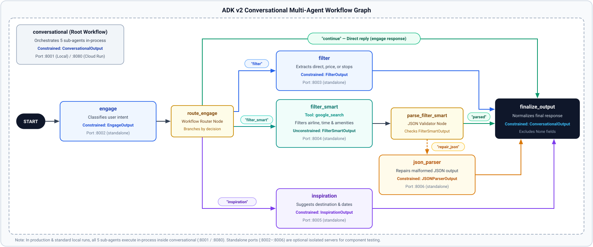
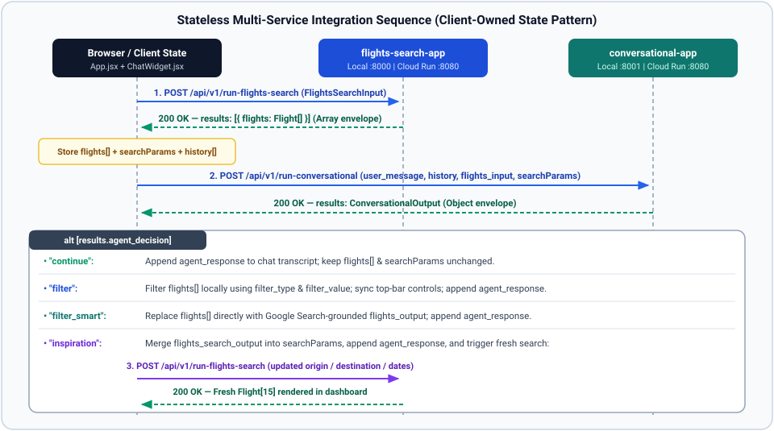

# Travel Agent Platform — API, Integration & SDK Reference

Complete HTTP API reference, OpenAPI 3.1 contract guide, stateless client integration architecture, and JavaScript/Python SDK documentation for the **Travel Agent** multi-agent platform.

| Field | Details |
| :--- | :--- |
| **Document ID** | `OPS-API-001` |
| **Target Audience** | Frontend Engineers, Backend / AI Engineers, Partner API Integrators |
| **Scope** | `/api/v1` REST contracts, OpenAPI 3.1 governance, stateless UI integration flow, IAM/CORS auth, and JS/Python SDKs |
| **API Contract Version** | `1.0.0` (`X-API-Version: 1.0.0`, OpenAPI `3.1.0`) |
| **Documentation Suite** | [Operational Hub](operational_documentation.md) · [Onboarding](onboarding_guide.md) · **API & SDK (Current)** · [Deployment](deployment_guide.md) · [Runbooks](runbooks.md) · [Troubleshooting](troubleshooting_guide.md) · [Root README](../README.md) |

---

## Table of Contents

1. [Service Topology & API Inventory](#1-service-topology--api-inventory)
2. [Contract Governance, Versioning & Standard Headers](#2-contract-governance-versioning--standard-headers)
   - [2.1 OpenAPI 3.1 Governance & Interactive Viewers](#21-openapi-31-governance--interactive-viewers)
   - [2.2 API Versioning & Response Headers](#22-api-versioning--response-headers)
3. [Primary Backend REST APIs (`/api/v1`)](#3-primary-backend-rest-apis-apiv1)
   - [3.1 Flights Search Service (`flights-search-app`)](#31-flights-search-service-flights-search-app)
   - [3.2 Conversational Workflow Service (`conversational-app`)](#32-conversational-workflow-service-conversational-app)
4. [Standalone Sub-Agent & Operational Endpoints](#4-standalone-sub-agent--operational-endpoints)
   - [4.1 Standalone Specialist Sub-Agent APIs (`:8002`–`:8006`)](#41-standalone-specialist-sub-agent-apis-80028006)
   - [4.2 Health, Readiness & Frontend Config Endpoints](#42-health-readiness--frontend-config-endpoints)
5. [Client Integration Guide](#5-client-integration-guide)
   - [5.1 Stateless Multi-Service Integration Sequence](#51-stateless-multi-service-integration-sequence)
   - [5.2 Authentication, IAM & CORS](#52-authentication-iam--cors)
   - [5.3 Resilience, Failover & Error Handling](#53-resilience-failover--error-handling)
6. [SDK & Client Library Reference](#6-sdk--client-library-reference)
   - [6.1 Frontend JavaScript SDK (`frontend/src/apiClient.js`)](#61-frontend-javascript-sdk-frontendsrcapiclientjs)
   - [6.2 Python In-Process Agent & Google ADK v2 SDK](#62-python-in-process-agent--google-adk-v2-sdk)
   - [6.3 External HTTP Clients, `curl` & OpenAPI Code Generation](#63-external-http-clients-curl--openapi-code-generation)
7. [Related Documentation & Next Steps](#7-related-documentation--next-steps)

---

## 1. Service Topology & API Inventory

The platform consists of **two primary FastAPI AI backend services** (`flights-search-app` and `conversational-app`), **one React/Nginx SPA service** (`frontend`), and **five optional standalone FastAPI sub-agent servers** (`:8002`–`:8006`) used for isolated local debugging and component E2E tests.

Inside `conversational-app`, all five specialist sub-agents execute **in-process** within a single ADK v2 `Workflow` graph (`filter_smart` is the only agent equipped with the live `google_search` tool):



### Complete Service & Endpoint Matrix

| Service | Entrypoint | Local Default URL | Cloud Run Port / Timeout | Canonical Endpoint (`v1`) | Deprecated Alias | OpenAPI 3.1 Spec |
| :--- | :--- | :--- | :--- | :--- | :--- | :--- |
| **Flights Search** (`flights-search-app`) | [`flights_search_app/app/main.py`](../flights_search_app/app/main.py) | `http://127.0.0.1:8000` | `8080` / `300s` | `POST /api/v1/run-flights-search` | `POST /run-flights-search` | [`flights_search_app/openapi.json`](../flights_search_app/openapi.json) |
| **Conversational Workflow** (`conversational-app`) | [`conversational_app/app/main.py`](../conversational_app/app/main.py) | `http://127.0.0.1:8001` | `8080` / `300s` | `POST /api/v1/run-conversational` | `POST /run-conversational` | [`conversational_app/openapi.json`](../conversational_app/openapi.json) |
| **Engage Sub-Agent** (`engage`) | [`engage/main.py`](../conversational_app/app/sub_agents/engage/main.py) | `http://127.0.0.1:8002` | Local / Dev only | `POST /api/v1/run-engage` | `POST /run-engage` | Live (`GET /openapi.json`) |
| **Filter Sub-Agent** (`filter`) | [`filter/main.py`](../conversational_app/app/sub_agents/filter/main.py) | `http://127.0.0.1:8003` | Local / Dev only | `POST /api/v1/run-filter` | `POST /run-filter` | Live (`GET /openapi.json`) |
| **Filter Smart Sub-Agent** (`filter_smart`) | [`filter_smart/main.py`](../conversational_app/app/sub_agents/filter_smart/main.py) | `http://127.0.0.1:8004` | Local / Dev only | `POST /api/v1/run-filter-smart` | `POST /run-filter-smart` | Live (`GET /openapi.json`) |
| **Inspiration Sub-Agent** (`inspiration`) | [`inspiration/main.py`](../conversational_app/app/sub_agents/inspiration/main.py) | `http://127.0.0.1:8005` | Local / Dev only | `POST /api/v1/run-inspiration` | `POST /run-inspiration` | Live (`GET /openapi.json`) |
| **JSON Parser Sub-Agent** (`json_parser`) | [`json_parser/main.py`](../conversational_app/app/sub_agents/json_parser/main.py) | `http://127.0.0.1:8006` | Local / Dev only | `POST /api/v1/run-json-parser` | `POST /run-json-parser` | Live (`GET /openapi.json`) |
| **Web Frontend** (`frontend`) | [`frontend/nginx.conf.template`](../frontend/nginx.conf.template) | `http://127.0.0.1:5173` | `8080` / `300s` (default) | `GET /`, `/healthz`, `/readyz`, `/env-config.js` | — | — |

---

## 2. Contract Governance, Versioning & Standard Headers

### 2.1 OpenAPI 3.1 Governance & Interactive Viewers

Both primary backend services enforce a **contract-first OpenAPI `3.1.0`** workflow:
- **Committed Snapshots:** Deterministic JSON specifications—including numeric (`minimum`, `maximum`) and string length (`minLength`, `maxLength`) bounds—are committed at [`flights_search_app/openapi.json`](../flights_search_app/openapi.json) and [`conversational_app/openapi.json`](../conversational_app/openapi.json).
- **Live Interactive Viewers:** Every running FastAPI service automatically serves:
  - `GET /docs` — Interactive Swagger UI
  - `GET /redoc` — ReDoc API documentation
  - `GET /openapi.json` — Live OpenAPI `3.1.0` JSON specification
- **CI Drift Enforcement:** [`test_api_versioning_and_contracts.py`](../conversational_app/tests/unit/test_api_versioning_and_contracts.py) fails Stage 1 if live schemas diverge from committed `openapi.json`. Regenerate snapshots after intentional schema edits ([`RB-08`](runbooks.md#rb-08-intentional-api-schema-change--openapi-31-snapshot-regeneration)):

```bash
(cd flights_search_app && python3 -m app.export_openapi)
(cd conversational_app && python3 -m app.export_openapi)
```

### 2.2 API Versioning & Response Headers

Implemented in [`flights_search_app/app/app_utils/versioning.py`](../flights_search_app/app/app_utils/versioning.py) and [`conversational_app/app/app_utils/versioning.py`](../conversational_app/app/app_utils/versioning.py) (`API_VERSION = "1.0.0"`, `API_V1_PREFIX = "/api/v1"`):

| Header | Emitted On | Value | Purpose |
| :--- | :--- | :--- | :--- |
| `X-API-Version` | **All** responses (`2xx`, `4xx`, `5xx`) | `1.0.0` | Identifies active API contract version across rolling revisions. |
| `Deprecation` | Legacy `/run-*` routes only | `true` | RFC 8594 deprecation signal for unversioned callers. |
| `Link` | Legacy `/run-*` routes only | `</api/v1/run-...>; rel="successor-version"` | Directs callers to the canonical `/api/v1` endpoint. |
| `Access-Control-Expose-Headers` | CORS responses on main backends | `X-API-Version, Deprecation, Link` | Makes versioning headers readable to browser `fetch()` clients. |

---

## 3. Primary Backend REST APIs (`/api/v1`)

### 3.1 Flights Search Service (`flights-search-app`)

- **OpenAPI Snapshot:** [`flights_search_app/openapi.json`](../flights_search_app/openapi.json)
- **Pydantic Schemas:** [`flights_search_app/app/schema.py`](../flights_search_app/app/schema.py)

#### Endpoints

| Method | Path | Operation ID | Status Codes | Description |
| :--- | :--- | :--- | :--- | :--- |
| `POST` | `/api/v1/run-flights-search` | `run_flights_search_v1` | `200`, `422`, `500` | **Canonical:** Generates 15 simulated round-trip itineraries matching search criteria. |
| `POST` | `/run-flights-search` | `run_flights_search_legacy` | `200`, `422`, `500` | **Deprecated alias:** Identical behavior + RFC 8594 deprecation headers. |
| `GET` | `/` | `root__get` | `200` | Service status banner (`RootInfoResponse`). |
| `GET` | `/healthz` | `healthz_healthz_get` | `200` | Zero-I/O Cloud Run liveness probe (`LivenessResponse`). |
| `GET` | `/readyz` | `readyz_readyz_get` | `200`, `503` | Startup/readiness check of ADK `App`, models, and Vertex AI env vars. |

#### Request Schema: `FlightsSearchInput`

> [!NOTE]
> All string fields are trimmed by `@field_validator` in [`schema.py`](../flights_search_app/app/schema.py); whitespace-only strings (`"   "`) are rejected with `HTTP 422`. Unknown extra fields are safely ignored (`extra="ignore"`).

| Field | Type | Required | OpenAPI Bounds | Default | Validation & Alias Rules |
| :--- | :--- | :---: | :--- | :--- | :--- |
| `origin` | `string` | Yes | `minLength: 1`, `maxLength: 200` | — | Trimmed; rejects blank/whitespace-only strings. |
| `destination` | `string` | Yes | `minLength: 1`, `maxLength: 200` | — | Trimmed; rejects blank/whitespace-only strings. |
| `departure_date` | `string` | Yes | `minLength: 1`, `maxLength: 200` | — | `YYYY-MM-DD`; trimmed; rejects blank strings. |
| `return_date` | `string` | Yes | `minLength: 1`, `maxLength: 200` | — | `YYYY-MM-DD`; trimmed; rejects blank strings. |
| `passengers` | `integer` | Yes | `minimum: 1`, `maximum: 9` | — | Must satisfy `1 <= passengers <= 9`. |
| `filters` | `Filters` | No | — | `{}` | Defaults to an empty `Filters()` object. |
| `filters.direct` | `boolean \| null` | No | — | `null` | When `true`, restricts results to direct (`0`-stop) flights. |
| `filters.max_price` | `integer \| null` | No | `minimum: 0` | `null` | Also accepts shorthand alias **`price`** (`AliasChoices("max_price", "price")`). |
| `filters.max_stops` | `integer \| null` | No | `minimum: 0` | `null` | Also accepts shorthand alias **`stops`** (`AliasChoices("max_stops", "stops")`). |

#### Response Schema: `FlightsSearchResponse` & `Flight`

`FlightsSearchResponse` returns `{"status": "success", "results": [{"flights": [Flight, ...]}]}` (or `[{"raw_text": "..."}]` on non-JSON fallback). Every `Flight` object contains **13 required fields** (100% identical across `flights-search-app` and `conversational-app`):

| Field | Type | Bounds | Example |
| :--- | :--- | :--- | :--- |
| `origin` | `string` | — | `"Paris (CDG)"` |
| `destination` | `string` | — | `"New York (JFK)"` |
| `departure_date` | `string` | — | `"2027-03-10"` |
| `return_date` | `string` | — | `"2027-03-20"` |
| `departure_time` | `string` | — | `"10:30"` |
| `arrival_time` | `string` | — | `"13:00"` |
| `return_time` | `string` | — | `"17:30"` |
| `return_arrival_time` | `string` | — | `"06:45 +1"` |
| `price` | `string` | — | `"520 EUR"` |
| `airline` | `string` | — | `"Air France"` |
| `flight_number` | `string` | — | `"AF006"` |
| `stops` | `integer` | `minimum: 0` | `0` |
| `stopover_cities` | `string[]` | — | `[]` or `["London"]` |

#### Example Request & Response (`POST /api/v1/run-flights-search`)

**Request:**
```json
{
  "origin": "Paris",
  "destination": "New York",
  "departure_date": "2027-03-10",
  "return_date": "2027-03-20",
  "passengers": 1,
  "filters": {
    "direct": false,
    "max_price": 800,
    "max_stops": 1
  }
}
```

**Response (`HTTP 200 OK`, `X-API-Version: 1.0.0`):**
```json
{
  "status": "success",
  "results": [
    {
      "flights": [
        {
          "origin": "Paris (CDG)",
          "destination": "New York (JFK)",
          "departure_date": "2027-03-10",
          "return_date": "2027-03-20",
          "departure_time": "10:30",
          "arrival_time": "13:00",
          "return_time": "17:30",
          "return_arrival_time": "06:45 +1",
          "price": "520 EUR",
          "airline": "Air France",
          "flight_number": "AF006",
          "stops": 0,
          "stopover_cities": []
        }
      ]
    }
  ]
}
```

---

### 3.2 Conversational Workflow Service (`conversational-app`)

- **OpenAPI Snapshot:** [`conversational_app/openapi.json`](../conversational_app/openapi.json)
- **Pydantic Schemas:** [`conversational_app/app/schema.py`](../conversational_app/app/schema.py)

#### Endpoints

| Method | Path | Operation ID | Status Codes | Description |
| :--- | :--- | :--- | :--- | :--- |
| `POST` | `/api/v1/run-conversational` | `run_conversational_v1` | `200`, `422`, `500` | **Canonical:** Executes the 5-agent ADK v2 workflow graph. |
| `POST` | `/run-conversational` | `run_conversational_legacy` | `200`, `422`, `500` | **Deprecated alias:** Identical behavior + RFC 8594 deprecation headers. |
| `GET` | `/` | `root__get` | `200` | Service status banner (`RootInfoResponse`). |
| `GET` | `/healthz` | `healthz_healthz_get` | `200` | Zero-I/O Cloud Run liveness probe (`LivenessResponse`). |
| `GET` | `/readyz` | `readyz_readyz_get` | `200`, `503` | Validates ADK workflow graph, all 5 sub-agent model bindings, and Vertex AI env vars. |

#### Request Schema: `ConversationalInput`

| Field | Type | Required | OpenAPI Bounds | Default | Validation Rules |
| :--- | :--- | :---: | :--- | :--- | :--- |
| `user_message` | `string` | Yes | `minLength: 1`, `maxLength: 4000` | — | Rejects blank or whitespace-only messages. |
| `flights_search_input` | `FlightParams` | Yes | Strings `1..200`, `passengers` `1..9` | — | Active `origin`, `destination`, `departure_date`, `return_date`, and `passengers`. |
| `conversational_history` | `string[]` | No | — | `[]` | Prior turns formatted as `"role: message"` (e.g., `"bot: Hello..."`, `"user: direct only"`). |
| `flights_input` | `Flight[]` | No | `stops >= 0` | `[]` | Currently displayed flight itineraries to filter. |

#### Response Schema: `ConversationalResponse` & `ConversationalOutput`

> [!WARNING]
> **Envelope Shape Difference (`results` Array vs. Object):**
> - `flights-search-app` (and standalone sub-agent servers `:8002`–`:8006`) return `results` as a **JSON Array**: `data.results[0].flights`.
> - `conversational-app` returns `results` as a **single JSON Object**: `data.results.agent_decision`.
> - Because `response_model_exclude_none=True` is active on all routes, unused optional fields (`filter_type`, `filter_value`, `flights_output`, `flights_search_output`) are **omitted** rather than serialized as `null`.

| Field in `results` | Type | Present When `agent_decision` Is | Description |
| :--- | :--- | :--- | :--- |
| `agent_response` | `string` | Always | Natural-language assistant reply to display in chat. |
| `agent_decision` | `"continue" \| "filter" \| "filter_smart" \| "inspiration"` | Always | Routing decision selected by `engage`. |
| `filter_type` | `"direct" \| "max_price" \| "max_stops"` | `"filter"` | Hard deterministic filter category. |
| `filter_value` | `integer` | `"filter"` | Threshold (`1` for `direct`, price cap for `max_price`, max stops for `max_stops`). |
| `flights_output` | `Flight[]` | `"filter_smart"` | Filtered subset of `flights_input` (grounded via `google_search` when amenities are queried). |
| `flights_search_output` | `FlightParams` | `"inspiration"` | New destination/date search parameters proposed by `inspiration`. |

#### Example Responses for All 4 `agent_decision` Branches

1. **Greeting / Clarification (`"continue"`):**
   ```json
   {
     "status": "success",
     "results": {
       "agent_response": "I can filter your flights by price, stops, airlines, or cabin amenities, or suggest new destinations!",
       "agent_decision": "continue"
     }
   }
   ```

2. **Hard Deterministic Filter (`"filter"`):**
   ```json
   {
     "status": "success",
     "results": {
       "agent_response": "I've filtered the results to show flights under 600 EUR.",
       "agent_decision": "filter",
       "filter_type": "max_price",
       "filter_value": 600
     }
   }
   ```

3. **Smart Semantic / Grounded Filter (`"filter_smart"`):**
   ```json
   {
     "status": "success",
     "results": {
       "agent_response": "Here are the Air France flights offering reliable high-speed Wi-Fi.",
       "agent_decision": "filter_smart",
       "flights_output": [
         {
           "origin": "Paris (CDG)",
           "destination": "New York (JFK)",
           "departure_date": "2027-03-10",
           "return_date": "2027-03-20",
           "departure_time": "10:30",
           "arrival_time": "13:00",
           "return_time": "17:30",
           "return_arrival_time": "06:45 +1",
           "price": "520 EUR",
           "airline": "Air France",
           "flight_number": "AF006",
           "stops": 0,
           "stopover_cities": []
         }
       ]
     }
   }
   ```

4. **Travel Inspiration & New Search Trigger (`"inspiration"`):**
   ```json
   {
     "status": "success",
     "results": {
       "agent_response": "Lisbon is warm and sunny in March! Searching flights from Paris to Lisbon.",
       "agent_decision": "inspiration",
       "flights_search_output": {
         "origin": "Paris",
         "destination": "Lisbon",
         "departure_date": "2027-03-10",
         "return_date": "2027-03-20",
         "passengers": 1
       }
     }
   }
   ```

---

## 4. Standalone Sub-Agent & Operational Endpoints

### 4.1 Standalone Specialist Sub-Agent APIs (`:8002`–`:8006`)

For local component isolation and sub-agent E2E testing, each specialist in [`conversational_app/app/sub_agents/`](../conversational_app/app/sub_agents/) exposes its own FastAPI app:

| Sub-Agent | Default URL | Canonical Route | Request Schema | Response `results[0]` Schema | Tooling & Behavior |
| :--- | :--- | :--- | :--- | :--- | :--- |
| **Engage** | `127.0.0.1:8002` | `POST /api/v1/run-engage` | [`EngageInput`](../conversational_app/app/sub_agents/engage/schema.py) (`user_message`, `conversational_history?`) | [`EngageOutput`](../conversational_app/app/sub_agents/engage/schema.py) (`agent_response`, `agent_decision`) | Constrained JSON schema (no external tools). |
| **Filter** | `127.0.0.1:8003` | `POST /api/v1/run-filter` | [`FilterInput`](../conversational_app/app/sub_agents/filter/schema.py) (`user_message`, `conversational_history?`) | [`FilterOutput`](../conversational_app/app/sub_agents/filter/schema.py) (`agent_response`, `filter_type`, `filter_value`) | Constrained JSON schema (no external tools). |
| **Filter Smart** | `127.0.0.1:8004` | `POST /api/v1/run-filter-smart` | [`FilterSmartInput`](../conversational_app/app/sub_agents/filter_smart/schema.py) (`user_message`, `conversational_history?`, `flights_input?`) | [`FilterSmartOutput`](../conversational_app/app/sub_agents/filter_smart/schema.py) (`agent_response`, `flights_output`) | **Equipped with `google_search` tool**; standalone server calls `JSON_PARSER_BASE_URL/api/v1/run-json-parser` over HTTP if JSON repair is needed. |
| **Inspiration** | `127.0.0.1:8005` | `POST /api/v1/run-inspiration` | [`InspirationInput`](../conversational_app/app/sub_agents/inspiration/schema.py) (`user_message`, `conversational_history?`, `flights_search_input`) | [`InspirationOutput`](../conversational_app/app/sub_agents/inspiration/schema.py) (`agent_response`, `flights_search_output`) | Constrained `InspirationOutput` JSON schema (no external tools). |
| **JSON Parser** | `127.0.0.1:8006` | `POST /api/v1/run-json-parser` | [`JSONParserInput`](../conversational_app/app/sub_agents/json_parser/schema.py) (`agent_response`) | [`JSONParserOutput`](../conversational_app/app/sub_agents/json_parser/schema.py) (`agent_response`, `flights_output`) | Constrained JSON repair agent (no external tools). |

### 4.2 Health, Readiness & Frontend Config Endpoints

| Endpoint | Service | HTTP Status | Response Body | Purpose |
| :--- | :--- | :---: | :--- | :--- |
| `GET /healthz` | Backends | `200` | `{"status": "ok", "service": "<name>"}` | Zero-I/O Cloud Run liveness check (`LivenessResponse`). |
| `GET /readyz` | Backends | `200` | `{"status": "ready", "service": "...", "models": {...}, "fallback_model": "gemini-3.6-flash"}` | Validates ADK `App`, model bindings, and Vertex AI env vars (`ReadinessResponse`). |
| `GET /readyz` | Backends | `503` | `{"status": "not_ready", "service": "...", "errors": ["..."]}` | Blocks Cloud Run startup traffic when misconfigured (`UnreadyResponse`). |
| `GET /healthz` | Frontend | `200` | `{"status": "ok", "service": "frontend"}` | Nginx liveness probe (`Cache-Control: no-store`). |
| `GET /readyz` | Frontend | `200` / `503` | `{"status": "ready", "service": "frontend"}` | Verifies `/usr/share/nginx/html/env-config.js` exists on disk. |
| `GET /env-config.js` | Frontend | `200` | `window.__ENV__ = { ... };` | Runtime Cloud Run primary & secondary backend URL injection. |

---

## 5. Client Integration Guide

### 5.1 Stateless Multi-Service Integration Sequence

Because neither backend persists user state across HTTP requests, **the client owns the active UI state** (`flights`, `searchParams`, and `messages`) and passes it into each conversational turn. Reference implementation: [`frontend/src/App.jsx`](../frontend/src/App.jsx) and [`frontend/src/ChatWidget.jsx`](../frontend/src/ChatWidget.jsx).



#### Client Action Matrix for `ConversationalOutput`

1. **`agent_decision === "continue"`**:
   - Append `results.agent_response` to chat. Keep `flights` and `searchParams` unchanged.
2. **`agent_decision === "filter"`**:
   - Append `results.agent_response` to chat and filter `flights` locally using `results.filter_type` and `results.filter_value`:
     - `"direct"` → keep `flight.stops === 0` (`searchParams.direct = true`)
     - `"max_price"` → keep `parseFlightPrice(flight.price) <= results.filter_value` (`searchParams.max_price`)
     - `"max_stops"` → keep `flight.stops <= results.filter_value` (`searchParams.max_stops`)
3. **`agent_decision === "filter_smart"`**:
   - Append `results.agent_response` to chat and replace `flights` directly with `results.flights_output`.
4. **`agent_decision === "inspiration"`**:
   - Append `results.agent_response` to chat, merge `results.flights_search_output` into `searchParams`, and **immediately call `POST /api/v1/run-flights-search`** with the updated parameters.

### 5.2 Authentication, IAM & CORS

- **Local Development:** Unauthenticated HTTP to `127.0.0.1:8000` and `127.0.0.1:8001`; backends authenticate to Vertex AI via keyless ADC (`gcloud auth application-default login`).
- **Cloud Run Public Mode (`allow_public_access = true`):** `invoker_iam_disabled = true` allows direct HTTPS calls without an `Authorization` header.
- **Cloud Run Private IAM Mode (`allow_public_access = false`):** Callers require `roles/run.invoker` and must pass a Google-signed OIDC ID token whose audience matches the Cloud Run service URL:
  ```bash
  TOKEN="$(gcloud auth print-identity-token --audiences=https://flights-search-app-xyz.a.run.app)"
  curl -H "Authorization: Bearer ${TOKEN}" ...
  ```
- **CORS:** Configured via comma-separated `ALLOWED_ORIGINS` (`*` locally; configurable via `allowed_origins` in Terraform `.tfvars`), exposing `X-API-Version`, `Deprecation`, and `Link`.

### 5.3 Resilience, Failover & Error Handling

| Scenario | HTTP Status | Response Body | Recommended Client Handling |
| :--- | :---: | :--- | :--- |
| **Structured agent output** | `200` | `{"status": "success", "results": ...}` | Handle `FlightsSearchOutput` or `ConversationalOutput` per §5.1. |
| **Plain-text LLM fallback** | `200` | `{"status": "success", "results": {"raw_text": "..."}}` (or `[{"raw_text": "..."}]`) | Check for `raw_text` before accessing `flights` / `agent_decision`; display safely or prompt retry. |
| **Input validation failure** | `422` | `{"detail": [{"loc": [...], "msg": "...", "type": "..."}]}` | Surface validation message to user. **Never retry against secondary region.** |
| **Primary + backup LLM failed** | `500` | `{"detail": "Internal Server Error during request processing."}` | Retry once against warm secondary Cloud Run URL (`europe-west1`) if configured. |
| **Revision unready** | `503` | `{"status": "not_ready", "service": "...", "errors": [...]}` | Retry once against warm secondary Cloud Run URL (`europe-west1`). |

---

## 6. SDK & Client Library Reference

### 6.1 Frontend JavaScript SDK (`frontend/src/apiClient.js`)

Zero-dependency ES module at [`frontend/src/apiClient.js`](../frontend/src/apiClient.js) (unit-tested in [`frontend/src/apiClient.test.js`](../frontend/src/apiClient.test.js)):

- **`API_V1_PREFIX`** (`'/api/v1'`) — Canonical route prefix constant.
- **`resolveBackendUrl(envKey, defaultUrl = '')`** — Resolves base URLs using 3-tier precedence (`window.__ENV__[envKey]` → `import.meta.env[envKey]` → `defaultUrl`) and strips trailing slashes.
- **`postWithRegionalFailover({ primaryUrl, fallbackUrl = '', path, payload, fetchImpl = fetch })`** — Sends `POST` JSON to `primaryUrl` and retries **once** against `fallbackUrl` on network `TypeError` or `HTTP >= 500` (returns `4xx` responses immediately).
- **`parseFlightPrice(priceStr)`** — Extracts non-negative numbers from multi-currency strings (`"520 EUR"` → `520`, `"£1,250.50"` → `1250.5`), or `Number.NaN` if invalid.

```javascript
import {
  API_V1_PREFIX,
  parseFlightPrice,
  postWithRegionalFailover,
  resolveBackendUrl,
} from './apiClient';

const FLIGHTS_URL = resolveBackendUrl('VITE_FLIGHTS_SEARCH_API_URL', 'http://127.0.0.1:8000');
const FLIGHTS_FALLBACK_URL = resolveBackendUrl('VITE_FLIGHTS_SEARCH_FALLBACK_API_URL', '');

const response = await postWithRegionalFailover({
  primaryUrl: FLIGHTS_URL,
  fallbackUrl: FLIGHTS_FALLBACK_URL,
  path: `${API_V1_PREFIX}/run-flights-search`,
  payload: {
    origin: 'Paris',
    destination: 'Tokyo',
    departure_date: '2027-04-10',
    return_date: '2027-04-24',
    passengers: 2,
    filters: { max_stops: 1 },
  },
});

const data = await response.json();
const under900 = (data.results?.[0]?.flights ?? []).filter(
  (flight) => parseFlightPrice(flight.price) <= 900
);
```

### 6.2 Python In-Process Agent & Google ADK v2 SDK

Both backend apps can be imported and executed directly in Python (for batch jobs, notebooks, or GEAP evaluation) without starting Uvicorn:

| Module | Exported Symbol(s) | Purpose |
| :--- | :--- | :--- |
| [`flights_search_app/app/main.py`](../flights_search_app/app/main.py) | `execute_agent_run(user_input)` | Async flight search runner with automatic primary → backup Gemini failover. |
| [`flights_search_app/app/agent.py`](../flights_search_app/app/agent.py) | `build_flights_search_agent`, `build_flights_search_app` | Factories building an ADK `Agent` or `App` bound to any Gemini model ID. |
| [`conversational_app/app/main.py`](../conversational_app/app/main.py) | `execute_agent_run(user_input)` | Async 5-agent workflow runner with automatic backup model failover. |
| [`conversational_app/app/agent.py`](../conversational_app/app/agent.py) | `build_conversational_workflow`, `build_conversational_app` | Builds isolated ADK v2 `Workflow` graphs or `App` containers with per-sub-agent models or mocks. |
| [`conversational_app/app/sub_agents/`](../conversational_app/app/sub_agents/) | `build_<name>_agent(model_name)` | Specialist factories (`engage`, `filter`, `filter_smart`, `inspiration`, `json_parser`). |
| [`conversational_app/app/app_utils/telemetry_plugin.py`](../conversational_app/app/app_utils/telemetry_plugin.py) | `ExecutionTelemetryPlugin`, `build_plugins` | Invocation-isolated ADK `BasePlugin` logging latency, tokens, and Google Search queries. |

```python
import asyncio
# Run with PYTHONPATH=conversational_app
from app.main import execute_agent_run
from app.schema import ConversationalInput, FlightParams


async def main() -> None:
    payload = ConversationalInput(
        user_message="Suggest a warm beach destination in Europe instead",
        conversational_history=["bot: Hello! How can I help with your trip?"],
        flights_input=[],
        flights_search_input=FlightParams(
            origin="Paris",
            destination="London",
            departure_date="2027-03-10",
            return_date="2027-03-17",
            passengers=2,
        ),
    )
    result = await execute_agent_run(payload)
    print("Decision:", result["agent_decision"])
    print("Reply:", result["agent_response"])
    print("Suggested Search:", result.get("flights_search_output"))


asyncio.run(main())
```

### 6.3 External HTTP Clients, `curl` & OpenAPI Code Generation

#### Python Async HTTP Client (`httpx` + Regional Failover)

```python
from typing import Any, Dict, Optional
import httpx


class TravelAgentClient:
    """Async HTTP client for Flights Search & Conversational Agent v1 APIs."""

    def __init__(
        self,
        flights_url: str = "http://127.0.0.1:8000",
        conversational_url: str = "http://127.0.0.1:8001",
        flights_fallback_url: str = "",
        conversational_fallback_url: str = "",
        bearer_token: Optional[str] = None,
        timeout: float = 120.0,
    ) -> None:
        self.flights_url = flights_url.rstrip("/")
        self.conversational_url = conversational_url.rstrip("/")
        self.flights_fallback_url = flights_fallback_url.rstrip("/")
        self.conversational_fallback_url = conversational_fallback_url.rstrip("/")
        self.headers = {"Content-Type": "application/json"}
        if bearer_token:
            self.headers["Authorization"] = f"Bearer {bearer_token}"
        self.timeout = timeout

    async def _post_with_failover(
        self, primary: str, fallback: str, path: str, payload: Dict[str, Any]
    ) -> Dict[str, Any]:
        async with httpx.AsyncClient(timeout=self.timeout, headers=self.headers) as client:
            try:
                resp = await client.post(f"{primary}{path}", json=payload)
                if resp.status_code >= 500 and fallback and fallback != primary:
                    resp = await client.post(f"{fallback}{path}", json=payload)
            except httpx.RequestError:
                if not fallback or fallback == primary:
                    raise
                resp = await client.post(f"{fallback}{path}", json=payload)
            resp.raise_for_status()
            return resp.json()

    async def search_flights(self, payload: Dict[str, Any]) -> Dict[str, Any]:
        return await self._post_with_failover(
            self.flights_url, self.flights_fallback_url, "/api/v1/run-flights-search", payload
        )

    async def run_conversational(self, payload: Dict[str, Any]) -> Dict[str, Any]:
        return await self._post_with_failover(
            self.conversational_url, self.conversational_fallback_url, "/api/v1/run-conversational", payload
        )
```

#### CLI Quick Reference (`curl`)

```bash
# 1. Readiness probes
curl -fsS http://127.0.0.1:8000/readyz | python3 -m json.tool
curl -fsS http://127.0.0.1:8001/readyz | python3 -m json.tool

# 2. Search flights (v1)
curl -i -X POST http://127.0.0.1:8000/api/v1/run-flights-search \
  -H "Content-Type: application/json" \
  -d '{
    "origin": "Paris",
    "destination": "New York",
    "departure_date": "2027-03-10",
    "return_date": "2027-03-20",
    "passengers": 1,
    "filters": {"max_price": 750}
  }'

# 3. Conversational turn (v1)
curl -i -X POST http://127.0.0.1:8001/api/v1/run-conversational \
  -H "Content-Type: application/json" \
  -d '{
    "user_message": "Only direct flights please",
    "conversational_history": ["bot: Hello! How can I help?"],
    "flights_input": [],
    "flights_search_input": {
      "origin": "Paris",
      "destination": "New York",
      "departure_date": "2027-03-10",
      "return_date": "2027-03-20",
      "passengers": 1
    }
  }'
```

#### Generating Typed Client SDKs from OpenAPI 3.1 Snapshots

```bash
# TypeScript types (openapi-typescript)
npx openapi-typescript flights_search_app/openapi.json -o sdk/ts/flights-search.d.ts
npx openapi-typescript conversational_app/openapi.json -o sdk/ts/conversational.d.ts

# Python typed httpx client (openapi-python-client)
uvx openapi-python-client generate --path flights_search_app/openapi.json --output-path sdk/python/flights_client
uvx openapi-python-client generate --path conversational_app/openapi.json --output-path sdk/python/conversational_client
```

---

## 7. Related Documentation & Next Steps

| If You Want To... | Go To |
| :--- | :--- |
| **Boot `:8000`, `:8001`, and `:5173` locally to test these APIs** | [Engineer & Operator Onboarding Guide (`onboarding_guide.md`)](onboarding_guide.md) |
| **Update a Pydantic schema & regenerate `openapi.json`** | [Runbook `RB-08` (`runbooks.md`)](runbooks.md#rb-08-intentional-api-schema-change--openapi-31-snapshot-regeneration) |
| **Diagnose `HTTP 422`, `503`, or CORS errors** | [Symptom-Driven Troubleshooting Guide (`troubleshooting_guide.md`)](troubleshooting_guide.md) |
| **Deploy API or schema updates to Cloud Run** | [Deployment & Release Management Guide (`deployment_guide.md`)](deployment_guide.md) |
