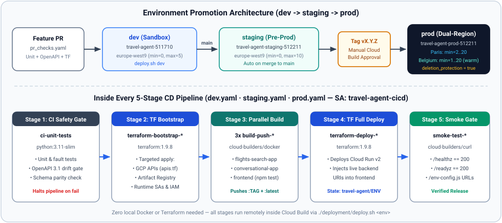

# Travel Agent Platform — Deployment & Release Management Guide

End-to-end deployment guide covering first-time GCP project bootstrap, the 5-stage Cloud Build + Terraform pipeline, environment promotion (`dev` → `staging` → `prod`), Gemini model rollouts, post-release verification, and rollback procedures.

| Field | Details |
| :--- | :--- |
| **Document ID** | `OPS-DEPLOY-001` |
| **Target Audience** | Release Engineers, DevOps / SREs, Backend / AI & Frontend Contributors |
| **Scope** | GCP bootstrap, PR CI checks, 5-stage CD pipelines, model configuration rollouts, verification, and rollbacks |
| **Deployment Tooling** | Google Cloud Build · Terraform `1.9.8` · Artifact Registry · Cloud Run v2 · [`deployment/*.sh`](../deployment/) |
| **Documentation Suite** | [Operational Hub](operational_documentation.md) · [Onboarding](onboarding_guide.md) · [API & SDK](api_documentation.md) · **Deployment (Current)** · [Runbooks](runbooks.md) · [Troubleshooting](troubleshooting_guide.md) · [Root README](../README.md) |

---

## Table of Contents

1. [Release Promotion Architecture](#1-release-promotion-architecture)
2. [Prerequisites & Operator Permissions](#2-prerequisites--operator-permissions)
3. [Pre-Deployment Checklist](#3-pre-deployment-checklist)
4. [First-Time GCP Project Bootstrap (`bootstrap.sh`)](#4-first-time-gcp-project-bootstrap-bootstrapsh)
5. [Pipeline Anatomy: Inside the 5-Stage CD Workflow](#5-pipeline-anatomy-inside-the-5-stage-cd-workflow)
6. [Step-by-Step Deployment Procedures](#6-step-by-step-deployment-procedures)
   - [6.1 Pull Request CI Gate (`pr-check`)](#61-pull-request-ci-gate-pr-check)
   - [6.2 Deploying to `dev`](#62-deploying-to-dev)
   - [6.3 Promoting to `staging`](#63-promoting-to-staging)
   - [6.4 Releasing to `prod` (Git Tag + Manual Approval vs. CLI)](#64-releasing-to-prod-git-tag--manual-approval-vs-cli)
   - [6.5 Enabling Automated GitHub Cloud Build Triggers](#65-enabling-automated-github-cloud-build-triggers)
7. [Configuration & Gemini Model Rollouts](#7-configuration--gemini-model-rollouts)
8. [Post-Deployment Verification](#8-post-deployment-verification)
9. [Rollback & Recovery Procedures](#9-rollback--recovery-procedures)
10. [Known Deployment Nuances & Guardrails](#10-known-deployment-nuances--guardrails)
11. [Related Documentation & Next Steps](#11-related-documentation--next-steps)

---

## 1. Release Promotion Architecture

All infrastructure and application changes promote progressively across three isolated Google Cloud projects (`dev` → `staging` → `prod`). Operators do **not** need local Docker or local Terraform—all builds, tests, image pushes, and `terraform apply` runs execute remotely inside **Google Cloud Build** under the least-privilege `travel-agent-cicd` Service Account.



---

## 2. Prerequisites & Operator Permissions

### Workstation Requirements (for CLI-triggered deployments)
- **`gcloud` CLI** (`>= 460.0.0`), authenticated via `gcloud auth login`
- **`git`** (`>= 2.30`, used by [`deployment/deploy.sh`](../deployment/deploy.sh) to compute the immutable `SHORT_SHA` image tag)
- **`bash`** and **`python3`** (`>= 3.11`, used only when running local pre-flight tests or DR verification scripts)
- *No local Docker daemon or local Terraform binary is required.*

### Required GCP IAM Roles for the Operator
- **First-time `bootstrap.sh` execution:** Project `roles/owner`, or the combination of `roles/serviceusage.serviceUsageAdmin`, `roles/resourcemanager.projectIamAdmin`, `roles/iam.serviceAccountAdmin`, and `roles/storage.admin`.
- **Standard `deploy.sh` execution (post-bootstrap):**
  - `roles/cloudbuild.builds.editor` on the target GCP project
  - `roles/iam.serviceAccountUser` on `travel-agent-cicd@<PROJECT_ID>.iam.gserviceaccount.com`
  - `roles/storage.objectAdmin` (for `gcloud builds submit` source archive upload)
- **Approving a `prod` Git-tag build in Cloud Build Console:** `roles/cloudbuild.builds.approver` on `travel-agent-prod-512211`.

---

## 3. Pre-Deployment Checklist

Complete every item before promoting to `staging` or `prod`:

- [ ] **Clean Git Working Tree:** Commit all changes (`git status` is clean). `deploy.sh` tags images with `git rev-parse --short HEAD` while uploading your local working directory.
- [ ] **Offline Unit & Contract Suites Pass:**
  ```bash
  (cd flights_search_app && python3 -m pytest tests/unit -q)
  (cd conversational_app && python3 -m pytest tests/unit -q)
  (cd frontend && npm test)
  ```
- [ ] **OpenAPI 3.1 Snapshots Regenerated (if schemas changed):** If any Pydantic model in `schema.py` changed, run `python3 -m app.export_openapi` in both backend apps (see [`RB-08`](runbooks.md#rb-08-intentional-api-schema-change--openapi-31-snapshot-regeneration)).
- [ ] **AI Quality Gate Verified (if prompts, routing, or models changed):** Run `python3 -m tests.eval.scripts.run_evaluation` in `conversational_app/` and confirm all 7 GEAP metrics pass (`schema_and_contract_valid >= 0.95`, rubric/judge metrics `>= 0.80`, `latency_seconds <= 15.0s`).
- [ ] **Target `.tfvars` Reviewed:** Confirm scaling, CORS `allowed_origins`, and Gemini model IDs in [`deployment/terraform/envs/`](../deployment/terraform/envs/).

---

## 4. First-Time GCP Project Bootstrap (`bootstrap.sh`)

Before Terraform can run inside Cloud Build on a new GCP project, bootstrap APIs, the versioned remote GCS state bucket, and the `travel-agent-cicd` Service Account must exist. [`deployment/bootstrap.sh`](../deployment/bootstrap.sh) is **100% idempotent** and is called automatically by [`deployment/deploy.sh`](../deployment/deploy.sh), or can be run standalone:

```bash
# Bootstrap a single environment (dev | staging | prod)
./deployment/bootstrap.sh dev

# Bootstrap all three GCP projects sequentially
./deployment/bootstrap.sh all
```

### What `bootstrap.sh` Performs
1. **Enables 5 Bootstrap APIs:** `serviceusage`, `cloudresourcemanager`, `iam`, `storage`, and `cloudbuild` *(runtime APIs such as Cloud Run, Artifact Registry, and Vertex AI are managed declaratively by Terraform in [`apis.tf`](../deployment/terraform/apis.tf))*.
2. **Creates Versioned Multi-Region State Bucket:** Provisions `gs://<PROJECT_ID>-tfstate` in `EU` with `--uniform-bucket-level-access` and `--versioning` enabled.
3. **Creates Dedicated CI/CD Service Account:** Provisions `travel-agent-cicd@<PROJECT_ID>.iam.gserviceaccount.com`.
4. **Grants Least-Privilege CI/CD Roles:** Binds the 9 required deployment roles strictly to `travel-agent-cicd` (with 3-attempt retry logic).
5. **Hardens Default Google SAs:** Actively strips any of those 9 CI/CD admin roles from `<PROJECT_NUMBER>@cloudbuild.gserviceaccount.com` and `<PROJECT_NUMBER>-compute@developer.gserviceaccount.com`, waiting `15s` if IAM policy bindings changed so permissions propagate cleanly.

---

## 5. Pipeline Anatomy: Inside the 5-Stage CD Workflow

All three CD pipelines ([`.cloudbuild/dev.yaml`](../.cloudbuild/dev.yaml), [`.cloudbuild/staging.yaml`](../.cloudbuild/staging.yaml), [`.cloudbuild/prod.yaml`](../.cloudbuild/prod.yaml), `timeout: 1800s`) execute the same **5-stage pipeline**:

| Stage | Step ID(s) | Builder Image | Action & Failure Gate |
| :---: | :--- | :--- | :--- |
| **1** | `ci-unit-tests` | `python:3.11-slim` | Installs pinned dependencies + `pytest==9.0.2` and runs `tests/unit` for both `flights_search_app` and `conversational_app`. Aborts immediately on any unit failure or OpenAPI 3.1 drift. |
| **2** | `terraform-bootstrap-*` | `hashicorp/terraform:1.9.8` | Initializes GCS backend (`bucket=${PROJECT_ID}-tfstate`, `prefix=travel-agent/${_ENV}`) and runs a **targeted** `terraform apply` for APIs, primary/secondary Artifact Registry repos, and runtime Service Accounts (`travel-agent-runtime`, `travel-agent-frontend`). Solves the first-deploy chicken-and-egg problem before container images exist. |
| **3** | `build-push-flights-search`<br/>`build-push-conversational`<br/>`build-push-frontend` | `gcr.io/cloud-builders/docker` | Runs **in parallel** (`waitFor: ['terraform-bootstrap-*']`). Pulls `:latest` for layer caching, builds each image (running `npm ci && npm test && npm run build` inside `frontend/Dockerfile`), and pushes `:<TAG>` + `:latest` to `europe-west9` (plus `europe-west1` when `_SECONDARY_REGION` is set). |
| **4** | `terraform-deploy-*` | `hashicorp/terraform:1.9.8` | Runs full `terraform apply -auto-approve -lock-timeout=5m`. Deploys backend Cloud Run revisions first, then injects their live `.run.app` URIs into `frontend` (`VITE_*_API_URL` and `VITE_*_FALLBACK_API_URL`). Exports live URLs to `/workspace/service_urls.env`. |
| **5** | `smoke-test-*` | `gcr.io/cloud-builders/curl` | Probes `/healthz` and `/readyz` on every primary (and secondary) service (`--retry 5 --retry-delay 3`) and verifies `/env-config.js` on `frontend`. In `prod.yaml`, also asserts via `grep -F` that symmetric Paris ↔ Belgium URLs match the exact Terraform outputs. |

---

## 6. Step-by-Step Deployment Procedures

### 6.1 Pull Request CI Gate (`pr-check`)

Before merging to `main` (or at any time during development), trigger the remote CI pipeline ([`.cloudbuild/pr_checks.yaml`](../.cloudbuild/pr_checks.yaml)):

```bash
./deployment/deploy.sh pr-check dev
```

This validates:
1. Backend unit & contract tests (`flights_search_app` + `conversational_app`)
2. Resilience script self-tests (`validate_dr.sh --local-self-test` + `verify_backups.sh --local-self-test`)
3. Frontend `npm ci`, `npm test`, and `npm run build`
4. `terraform fmt -check -recursive`, `terraform init -backend=false`, and `terraform validate`

### 6.2 Deploying to `dev`

Use `dev` (`travel-agent-511710`) to test infrastructure, Dockerfile, or multi-service Cloud Run changes:

```bash
./deployment/deploy.sh dev
```

### 6.3 Promoting to `staging`

- **Automated (when GitHub Trigger is enabled):** Merge the approved PR into `main`. The `travel-agent-cd-staging` trigger runs `.cloudbuild/staging.yaml` tagged with `$SHORT_SHA`.
- **Manual CLI Promotion:** From a clean checkout of `main`:
  ```bash
  git checkout main && git pull origin main
  ./deployment/deploy.sh staging
  ```

Run the post-deploy verification checks in [§8 Post-Deployment Verification](#8-post-deployment-verification) against `staging` before cutting a production release tag.

### 6.4 Releasing to `prod` (Git Tag + Manual Approval vs. CLI)

Production deploys simultaneously to **`europe-west9`** (`min_instances = 2` per service) and warm standby **`europe-west1`** (`secondary_min_instances = 1` per service), with `deletion_protection = true`.

#### Path A — Annotated SemVer Tag Release (Recommended when GitHub Triggers are active)
1. Tag and push from a verified `main` commit:
   ```bash
   git checkout main && git pull origin main
   git tag -a v1.2.0 -m "Release v1.2.0: <summary of changes>"
   git push origin v1.2.0
   ```
2. Open **Google Cloud Console → Cloud Build → History** in `travel-agent-prod-512211` (region `europe-west9`).
3. Select the `PENDING_APPROVAL` build created by `travel-agent-cd-prod`, review the commit diff and staging validation, and click **Approve**.
4. Monitor all 5 stages to green (`~5–8 minutes`).

#### Path B — Direct CLI Production Release (`deploy.sh`)
From an authorized release workstation on a clean Git tag or `main` commit:
```bash
git checkout v1.2.0
./deployment/deploy.sh prod
```

### 6.5 Enabling Automated GitHub Cloud Build Triggers

[`variables.tf`](../deployment/terraform/variables.tf) defaults `enable_cloudbuild_triggers = false` so fresh GCP projects deploy cleanly before linking GitHub. Once the **Cloud Build GitHub App** is connected to your repository in `europe-west9`:

1. Add to the target [`deployment/terraform/envs/<env>.tfvars`](../deployment/terraform/envs/):
   ```hcl
   enable_cloudbuild_triggers = true
   github_owner               = "<your-github-org-or-user>"
   github_repo                = "travel_agent"
   ```
2. Run `./deployment/deploy.sh <env>` to create `travel-agent-pr-checks`, `travel-agent-cd-staging`, or `travel-agent-cd-prod` ([`triggers.tf`](../deployment/terraform/triggers.tf)).

---

## 7. Configuration & Gemini Model Rollouts

All runtime settings are externalized—**zero Python or JavaScript code edits** are needed to upgrade Gemini models, adjust scaling bounds, or restrict CORS origins.

### Upgrading Primary or Backup Gemini Models
1. Edit [`deployment/terraform/envs/<env>.tfvars`](../deployment/terraform/envs/):
   ```hcl
   flights_search_model  = "gemini-3.5-flash-lite"
   conversational_model  = "gemini-3.5-flash-lite"
   fallback_gemini_model = "gemini-3.6-flash"
   gemini_model_location = "global"
   ```
2. Run the 50-scenario GEAP evaluation (`python3 -m tests.eval.scripts.run_evaluation` in `conversational_app/`), commit, and promote through `staging` → `prod`.

### Environment Variable Precedence Reference (`config.py`)

> [!WARNING]
> **Exact Variable Names & Distinct Fallback Rule:**
> 1. In [`conversational_app/app/config.py`](../conversational_app/app/config.py), the global backup model variable is **`FALLBACK_GEMINI_MODEL`** (not `CONVERSATIONAL_FALLBACK_MODEL`).
> 2. Never set a primary model equal to its fallback model—both `agent.py` modules disable `fallback_app` (`None`) whenever primary and fallback model strings are identical.

| Service Scope | Primary Model Env Var(s) (Priority Order) | Backup Model Env Var(s) (Priority Order) | Default Primary / Backup |
| :--- | :--- | :--- | :--- |
| **Flights Search** (`flights-search-app`) | `FLIGHTS_SEARCH_MODEL` → `GEMINI_MODEL` | `FLIGHTS_SEARCH_FALLBACK_MODEL` → `FALLBACK_GEMINI_MODEL` | `gemini-3.5-flash-lite` / `gemini-3.6-flash` |
| **Conversational Global** (`conversational-app`) | `CONVERSATIONAL_MODEL` → `GEMINI_MODEL` | `FALLBACK_GEMINI_MODEL` | `gemini-3.5-flash-lite` / `gemini-3.6-flash` |
| **Per-Sub-Agent Overrides** (`conversational-app`) | `ENGAGE_MODEL`, `FILTER_MODEL`, `FILTER_SMART_MODEL`, `INSPIRATION_MODEL`, `JSON_PARSER_MODEL` | `ENGAGE_FALLBACK_MODEL`, `FILTER_FALLBACK_MODEL`, `FILTER_SMART_FALLBACK_MODEL`, `INSPIRATION_FALLBACK_MODEL`, `JSON_PARSER_FALLBACK_MODEL` | Inherits Conversational Global |

---

## 8. Post-Deployment Verification

After Cloud Build Stage 5 (`smoke-test-*`) completes, run these verification commands for `staging` and `prod` releases:

```bash
# 1. Fetch live primary Cloud Run URLs (adjust PROJECT_ID for staging vs prod)
PROJECT_ID="travel-agent-prod-512211"
FLIGHTS_URL=$(gcloud run services describe flights-search-app --project="$PROJECT_ID" --region=europe-west9 --format='value(status.url)')
CONV_URL=$(gcloud run services describe conversational-app --project="$PROJECT_ID" --region=europe-west9 --format='value(status.url)')
FRONT_URL=$(gcloud run services describe frontend --project="$PROJECT_ID" --region=europe-west9 --format='value(status.url)')

# 2. Verify deep readiness & active Gemini model bindings
curl -fsS "${FLIGHTS_URL}/readyz" | python3 -m json.tool
curl -fsS "${CONV_URL}/readyz" | python3 -m json.tool
curl -fsS "${FRONT_URL}/env-config.js"

# 3. Run live HTTP E2E suites against deployed Cloud Run endpoints
(cd flights_search_app && FLIGHTS_SEARCH_BASE_URL="$FLIGHTS_URL" python3 -m pytest tests/e2e -v)
(cd conversational_app && CONVERSATIONAL_BASE_URL="$CONV_URL" python3 -m pytest tests/e2e/test_conversational.py -v)

# 4. (Prod only) Verify multi-region warm standby & <= 25s failover RTO
./deployment/validate_dr.sh --env prod
```

---

## 9. Rollback & Recovery Procedures

### Option A — Full-Stack Immutable Git SHA Rollback (`~3–5 min`, Recommended)
Artifact Registry retains the **15 most recent** image tags per service ([`registry.tf`](../deployment/terraform/registry.tf)). Rolling back via `deploy.sh` restores all services across both regions while keeping Terraform state converged:

```bash
# List retained tags in Artifact Registry if needed
gcloud artifacts docker images list \
  europe-west9-docker.pkg.dev/travel-agent-prod-512211/travel-agent/conversational-app \
  --include-tags --project="travel-agent-prod-512211" --limit=10

# Check out the known-good commit SHA or SemVer tag and redeploy
git checkout <previous-good-sha-or-tag>
IMAGE_TAG="<previous-good-sha-or-tag>" ./deployment/deploy.sh prod
```

### Option B — Instant Cloud Run Traffic Shift (`< 30 sec`, Emergency Mitigation)
During a `SEV-1` outage where waiting `~4 minutes` for Cloud Build is unacceptable, pin `100%` of traffic immediately to the previous healthy Cloud Run revision, then follow up with **Option A** to reconcile Terraform state (full SOP in **[`RB-01`](runbooks.md#rb-01-production-service-outage--elevated-5xx--triage--immutable-rollback)**):

```bash
gcloud run revisions list --service=conversational-app --region=europe-west9 --project=travel-agent-prod-512211 --limit=5
gcloud run services update-traffic conversational-app \
  --to-revisions=<PREVIOUS_HEALTHY_REVISION>=100 \
  --region=europe-west9 \
  --project=travel-agent-prod-512211
```

### Option C — Cold-Standby Region Evacuation
If both `europe-west9` and `europe-west1` experience a simultaneous GCP regional incident, evacuate the entire stack into any healthy European region (e.g., `europe-west4`):

```bash
REGION="europe-west4" SECONDARY_REGION="" ./deployment/deploy.sh prod
```

---

## 10. Known Deployment Nuances & Guardrails

1. **Always Invoke `./deployment/deploy.sh` Instead of Raw `gcloud builds submit`:**
   [`.gcloudignore`](../.gcloudignore) excludes `.git/` to keep source uploads small and fast, leaving Cloud Build's built-in `$SHORT_SHA` empty on manual CLI builds. `deploy.sh` resolves `IMAGE_TAG=$(git rev-parse --short HEAD)` locally before submitting.
2. **Always Pass `-backend-config="prefix=travel-agent/<env>"` on Manual `terraform init`:**
   [`versions.tf`](../deployment/terraform/versions.tf) defaults `prefix = "travel-agent/state"`, whereas Cloud Build pipelines use `travel-agent/dev`, `travel-agent/staging`, and `travel-agent/prod`. Omitting `prefix` during manual inspection points Terraform at a separate state path and triggers `409 AlreadyExists` errors.
3. **Production `deletion_protection = true`:**
   [`cloud_run.tf`](../deployment/terraform/cloud_run.tf) enables `deletion_protection` when `environment == "prod"`. Retiring or renaming a `prod` service requires setting `deletion_protection = false` in a first PR before removing the resource.
4. **Tightening `allowed_origins` After First Production Deploy:**
   [`envs/prod.tfvars`](../deployment/terraform/envs/prod.tfvars) starts with `allowed_origins = "*"` because Cloud Run `.run.app` hashes are assigned on creation. Once `frontend_url` and `frontend_secondary_url` exist (or a custom domain is attached), set `allowed_origins` to both exact `https://` origins (comma-separated, no trailing slashes) and re-run `./deployment/deploy.sh prod`.

---

## 11. Related Documentation & Next Steps

| If You Want To... | Go To |
| :--- | :--- |
| **Execute emergency rollbacks, regional failovers, or state unlocks** | [Production Operational Runbooks (`runbooks.md`)](runbooks.md) |
| **Debug a failed Cloud Build stage or `/readyz` `503` error** | [Symptom-Driven Troubleshooting Guide (`troubleshooting_guide.md`)](troubleshooting_guide.md) |
| **Review environment capacity, IAM roles, and SLO targets** | [Operational Documentation Hub (`operational_documentation.md`)](operational_documentation.md) |
| **Regenerate `openapi.json` contracts before opening a PR** | [API, Integration & SDK Reference (`api_documentation.md`)](api_documentation.md) |
