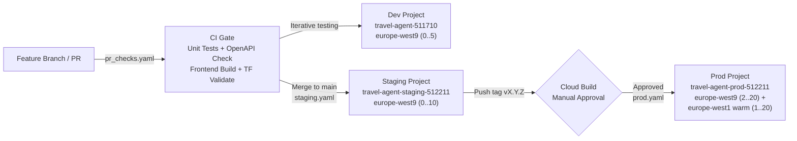

# Travel Agent Platform — Deployment & Release Management Guide

| Metadata | Value |
| :--- | :--- |
| **Document ID** | `OPS-DEPLOY-001` |
| **Related Docs** | [Operational Hub](operational_documentation.md) · [Runbooks](runbooks.md) · [Onboarding](onboarding_guide.md) · [Troubleshooting](troubleshooting_guide.md) · [API Docs](api_documentation.md) |
| **Deployment Tooling** | Google Cloud Build, Terraform (`1.9.8`), Artifact Registry, Google Cloud Run v2 |
| **Automation Scripts** | [`deployment/bootstrap.sh`](../deployment/bootstrap.sh), [`deployment/deploy.sh`](../deployment/deploy.sh), [`deployment/validate_dr.sh`](../deployment/validate_dr.sh), [`deployment/verify_backups.sh`](../deployment/verify_backups.sh) |

---

## Table of Contents

1. [Release Promotion Architecture](#1-release-promotion-architecture)
2. [Prerequisites & Operator Permissions](#2-prerequisites--operator-permissions)
3. [Pre-Deployment Checklist](#3-pre-deployment-checklist)
4. [First-Time GCP Project Bootstrap (`bootstrap.sh`)](#4-first-time-gcp-project-bootstrap-bootstrapsh)
5. [Pipeline Anatomy: Inside the 5-Stage CD Workflow](#5-pipeline-anatomy-inside-the-5-stage-cd-workflow)
6. [Step-by-Step Deployment Procedures](#6-step-by-step-deployment-procedures)
   - [6.1 Pull Request CI Gate (`pr-check`)](#61-pull-request-ci-gate-pr-check)
   - [6.2 Deploying to `dev`](#62-deploying-to-dev)
   - [6.3 Promoting to `staging`](#63-promoting-to-staging)
   - [6.4 Releasing to `prod` (Git Tag + Manual Approval vs. CLI)](#64-releasing-to-prod-git-tag--manual-approval-vs-cli)
   - [6.5 Enabling Automated GitHub Cloud Build Triggers](#65-enabling-automated-github-cloud-build-triggers)
7. [Configuration & Gemini Model Rollouts](#7-configuration--gemini-model-rollouts)
8. [Post-Deployment Verification](#8-post-deployment-verification)
9. [Rollback & Recovery Procedures](#9-rollback--recovery-procedures)
10. [Known Deployment Nuances & Guardrails](#10-known-deployment-nuances--guardrails)

---

## 1. Release Promotion Architecture

All infrastructure and application changes flow through three isolated Google Cloud projects (`dev` → `staging` → `prod`). No local Terraform or Docker daemon is required on operator workstations—all builds, tests, and `terraform apply` runs execute remotely inside **Google Cloud Build** under the dedicated `travel-agent-cicd` Service Account.



---

## 2. Prerequisites & Operator Permissions

### Workstation Requirements (for CLI-triggered deployments)
- **`gcloud` CLI** (`>= 460.0.0`), authenticated via `gcloud auth login`
- **`git`** (used by [`deployment/deploy.sh`](../deployment/deploy.sh) to resolve the immutable `SHORT_SHA` image tag)
- **`bash`** (`>= 4.0` or macOS `/usr/bin/env bash`) and **`python3`** (`>= 3.11`, used only if running local pre-flight tests or DR drills)
- *No local Docker or local Terraform installation is required.*

### Required GCP IAM Roles for the Human Operator
- **To run first-time `bootstrap.sh`:** Project `roles/owner` or (`roles/serviceusage.serviceUsageAdmin` + `roles/resourcemanager.projectIamAdmin` + `roles/iam.serviceAccountAdmin` + `roles/storage.admin`) on the target GCP project.
- **To trigger `deploy.sh` after bootstrap:**
  - `roles/cloudbuild.builds.editor` on the target project
  - `roles/iam.serviceAccountUser` on `travel-agent-cicd@<PROJECT_ID>.iam.gserviceaccount.com`
  - `roles/storage.objectAdmin` (for `gcloud builds submit` source tarball upload)
- **To approve a `prod` Git-tag release in Cloud Build:** `roles/cloudbuild.builds.approver` on `travel-agent-prod-512211`.

---

## 3. Pre-Deployment Checklist

Complete this checklist before promoting changes to `staging` or `prod`:

- [ ] **Clean Git Working Tree:** Commit all changes (`git status` is clean). Remember that `deploy.sh` tags images with `git rev-parse --short HEAD` while uploading your local directory context.
- [ ] **Offline Unit & Contract Suites Pass:**
  ```bash
  (cd flights_search_app && python3 -m pytest tests/unit -q)
  (cd conversational_app && python3 -m pytest tests/unit -q)
  (cd frontend && npm test)
  ```
- [ ] **OpenAPI 3.1 Snapshots Updated (if schemas changed):** If any Pydantic request/response model in `schema.py` changed, regenerate [`flights_search_app/openapi.json`](../flights_search_app/openapi.json) and [`conversational_app/openapi.json`](../conversational_app/openapi.json) via `python3 -m app.export_openapi` (see [`RB-08`](runbooks.md#rb-08-intentional-api-schema-change--openapi-31-snapshot-regeneration)).
- [ ] **AI Quality Gate Verified (if prompts, routing, or models changed):** Run `python3 -m tests.eval.scripts.run_evaluation` in `conversational_app/` and confirm all 7 GEAP metrics meet threshold (`schema_and_contract_valid >= 0.95`, others `>= 0.80`, `latency_seconds <= 15.0s`).
- [ ] **Environment `.tfvars` Reviewed:** Confirm target settings in [`deployment/terraform/envs/`](../deployment/terraform/envs/) (`min_instances`, `max_instances`, `allowed_origins`, model IDs).

---

## 4. First-Time GCP Project Bootstrap (`bootstrap.sh`)

Before Terraform can run inside Cloud Build on a brand-new GCP project, foundational APIs, the remote GCS state bucket, and the `travel-agent-cicd` Service Account must exist. [`deployment/bootstrap.sh`](../deployment/bootstrap.sh) is **idempotent** and is automatically invoked by [`deployment/deploy.sh`](../deployment/deploy.sh), or can be run standalone:

```bash
# Bootstrap a single environment (dev | staging | prod)
./deployment/bootstrap.sh dev

# Bootstrap all three GCP projects sequentially
./deployment/bootstrap.sh all
```

### What `bootstrap.sh` Executes
1. **Enables 5 Bootstrap APIs:** `serviceusage`, `cloudresourcemanager`, `iam`, `storage`, `cloudbuild` *(application APIs like Cloud Run and Vertex AI are managed later by Terraform in [`apis.tf`](../deployment/terraform/apis.tf))*.
2. **Provisions Versioned Multi-Region State Bucket:** Creates `gs://<PROJECT_ID>-tfstate` in `EU` with `--uniform-bucket-level-access` and `--versioning` enabled.
3. **Creates Dedicated CI/CD Identity:** Creates `travel-agent-cicd@<PROJECT_ID>.iam.gserviceaccount.com`.
4. **Binds CI/CD Roles:** Grants the 9 required deployment roles strictly to `travel-agent-cicd` (with 3-attempt retry logic).
5. **Hardens Default Google SAs:** Actively strips all 9 CI/CD administrative roles from `<PROJECT_NUMBER>@cloudbuild.gserviceaccount.com` and `<PROJECT_NUMBER>-compute@developer.gserviceaccount.com`, then waits `15s` if IAM bindings changed so permissions propagate before Cloud Build starts.

---

## 5. Pipeline Anatomy: Inside the 5-Stage CD Workflow

All three CD pipelines ([`.cloudbuild/dev.yaml`](../.cloudbuild/dev.yaml), [`.cloudbuild/staging.yaml`](../.cloudbuild/staging.yaml), [`.cloudbuild/prod.yaml`](../.cloudbuild/prod.yaml), `timeout: 1800s`) execute an identical **5-stage architecture**:

| Stage | Step ID(s) | Builder Image | Action & Failure Gate |
| :---: | :--- | :--- | :--- |
| **1** | `ci-unit-tests` | `python:3.11-slim` | Installs pinned requirements + `pytest==9.0.2` and runs `tests/unit` for both `flights_search_app` and `conversational_app`. Halts immediately on any unit or OpenAPI drift failure. |
| **2** | `terraform-bootstrap-*` | `hashicorp/terraform:1.9.8` | Initializes GCS backend (`bucket=${PROJECT_ID}-tfstate`, `prefix=travel-agent/${_ENV}`) and runs a **targeted** `terraform apply` for APIs, primary/secondary Artifact Registry repos, and runtime Service Accounts (`travel-agent-runtime`, `travel-agent-frontend`). Solves the chicken-and-egg problem on first deploy before Docker images exist. |
| **3** | `build-push-flights-search`<br/>`build-push-conversational`<br/>`build-push-frontend` | `gcr.io/cloud-builders/docker` | Runs **in parallel** (`waitFor: ['terraform-bootstrap-*']`). Pulls `:latest` for layer caching, builds each image (running `npm ci && npm test && npm run build` inside `frontend/Dockerfile`), and pushes `:<TAG>` + `:latest` to `europe-west9` (and `europe-west1` when `_SECONDARY_REGION` is set). |
| **4** | `terraform-deploy-*` | `hashicorp/terraform:1.9.8` | Runs full `terraform apply -auto-approve -lock-timeout=5m` (`deploy_cloud_run_services=true`). Deploys backend Cloud Run revisions first, then injects their live `.run.app` URIs into `frontend` (`VITE_*_API_URL` and `VITE_*_FALLBACK_API_URL`). Exports live URLs to `/workspace/service_urls.env`. |
| **5** | `smoke-test-*` | `gcr.io/cloud-builders/curl` | Probes `/healthz` and `/readyz` on every primary (and secondary) service (`--retry 5 --retry-delay 3`) and verifies `/env-config.js` on `frontend`. In `prod.yaml`, additionally asserts via `grep -F` that symmetric Paris ↔ Belgium URLs match the exact Terraform outputs. |

---

## 6. Step-by-Step Deployment Procedures

### 6.1 Pull Request CI Gate (`pr-check`)

Before merging to `main` (or locally at any time), run the full CI gate on Cloud Build via [`pr_checks.yaml`](../.cloudbuild/pr_checks.yaml):

```bash
./deployment/deploy.sh pr-check dev
```

This verifies:
1. Backend unit tests (`flights_search_app` + `conversational_app`)
2. Resilience script self-tests (`validate_dr.sh --local-self-test` + `verify_backups.sh --local-self-test`)
3. Frontend `npm ci`, `npm test`, and `npm run build`
4. `terraform fmt -check -recursive`, `terraform init -backend=false`, and `terraform validate`

### 6.2 Deploying to `dev`

Use `dev` (`travel-agent-511710`) to validate infrastructure, container, or multi-service integration changes:

```bash
./deployment/deploy.sh dev
```

### 6.3 Promoting to `staging`

- **Automated (GitHub Trigger enabled):** Merge the approved Pull Request into `main`. The `travel-agent-cd-staging` trigger automatically runs `.cloudbuild/staging.yaml` tagged with `$SHORT_SHA`.
- **Manual CLI Promotion:** From a clean checkout of `main`:
  ```bash
  git checkout main && git pull origin main
  ./deployment/deploy.sh staging
  ```

Verify `staging` with live E2E tests against the output Cloud Run URLs before cutting a production tag (see [§8 Post-Deployment Verification](#8-post-deployment-verification)).

### 6.4 Releasing to `prod` (Git Tag + Manual Approval vs. CLI)

Production deploys to **both** `europe-west9` (`min_instances = 2` per service) and warm standby `europe-west1` (`secondary_min_instances = 1` per service), with `deletion_protection = true`.

#### Path A — Standard SemVer Tag Release (Recommended when GitHub Triggers are active)
1. Cut and push an annotated semantic version tag from `main`:
   ```bash
   git checkout main && git pull origin main
   git tag -a v1.2.0 -m "Release v1.2.0: <summary of changes>"
   git push origin v1.2.0
   ```
2. Open **Google Cloud Console → Cloud Build → History** in project `travel-agent-prod-512211` (region `europe-west9`).
3. Locate the `PENDING_APPROVAL` build triggered by `travel-agent-cd-prod`, review the commit diff and staging results, and click **Approve**.
4. Monitor all 5 stages to completion (`~5–8 minutes`).

#### Path B — Direct CLI Production Release (`deploy.sh`)
When deploying directly from an authorized operator workstation:
```bash
git checkout v1.2.0   # Or verified main commit
./deployment/deploy.sh prod
```

### 6.5 Enabling Automated GitHub Cloud Build Triggers

By default, [`variables.tf`](../deployment/terraform/variables.tf) sets `enable_cloudbuild_triggers = false` so new GCP projects deploy cleanly before a GitHub repository is linked in Cloud Build. Once the **Cloud Build GitHub App** is connected to the project in `europe-west9`:

1. Add to the target [`deployment/terraform/envs/<env>.tfvars`](../deployment/terraform/envs/):
   ```hcl
   enable_cloudbuild_triggers = true
   github_owner               = "<your-github-org-or-user>"
   github_repo                = "travel_agent"
   ```
2. Re-run `./deployment/deploy.sh <env>` to provision `travel-agent-pr-checks`, `travel-agent-cd-staging`, or `travel-agent-cd-prod` ([`triggers.tf`](../deployment/terraform/triggers.tf)).

---

## 7. Configuration & Gemini Model Rollouts

All runtime configuration is externalized. **Zero application code edits** are needed to upgrade Gemini models, tune scaling, or tighten CORS.

### Changing Primary or Backup Gemini Models Across an Environment
1. Edit [`deployment/terraform/envs/<env>.tfvars`](../deployment/terraform/envs/):
   ```hcl
   flights_search_model  = "gemini-3.5-flash-lite"
   conversational_model  = "gemini-3.5-flash-lite"
   fallback_gemini_model = "gemini-3.6-flash"
   gemini_model_location = "global"
   ```
2. Benchmark in `conversational_app` if changing conversational models (`python3 -m tests.eval.scripts.run_evaluation`), commit, and deploy to `staging` then `prod`.

### Environment Variable Precedence Reference (`config.py`)

> [!WARNING]
> **Exact Variable Names Matter:** In [`conversational_app/app/config.py`](../conversational_app/app/config.py), the global backup model variable is **`FALLBACK_GEMINI_MODEL`** (not `CONVERSATIONAL_FALLBACK_MODEL`). Per-sub-agent overrides are supported as shown below.

| Scope | Primary Model Variable(s) (in priority order) | Backup Model Variable(s) (in priority order) | Default Primary / Backup |
| :--- | :--- | :--- | :--- |
| **Flights Search** (`flights-search-app`) | `FLIGHTS_SEARCH_MODEL` → `GEMINI_MODEL` | `FLIGHTS_SEARCH_FALLBACK_MODEL` → `FALLBACK_GEMINI_MODEL` | `gemini-3.5-flash-lite` / `gemini-3.6-flash` |
| **Conversational Global** (`conversational-app`) | `CONVERSATIONAL_MODEL` → `GEMINI_MODEL` | `FALLBACK_GEMINI_MODEL` | `gemini-3.5-flash-lite` / `gemini-3.6-flash` |
| **Per-Sub-Agent Overrides** (`conversational-app`) | `ENGAGE_MODEL`, `FILTER_MODEL`, `FILTER_SMART_MODEL`, `INSPIRATION_MODEL`, `JSON_PARSER_MODEL` | `ENGAGE_FALLBACK_MODEL`, `FILTER_FALLBACK_MODEL`, `FILTER_SMART_FALLBACK_MODEL`, `INSPIRATION_FALLBACK_MODEL`, `JSON_PARSER_FALLBACK_MODEL` | Inherits Conversational Global |

> [!CAUTION]
> Never set a primary model equal to its fallback model (e.g., `FLIGHTS_SEARCH_MODEL == FLIGHTS_SEARCH_FALLBACK_MODEL`). Both `agent.py` modules intentionally disable `fallback_app` (`None`) when primary and fallback model strings are identical!

---

## 8. Post-Deployment Verification

After Stage 5 (`smoke-test-*`) succeeds in Cloud Build, run these verification checks for `staging` and `prod` releases:

```bash
# 1. Retrieve live Cloud Run URLs (example: prod)
PROJECT_ID="travel-agent-prod-512211"
FLIGHTS_URL=$(gcloud run services describe flights-search-app --project="$PROJECT_ID" --region=europe-west9 --format='value(status.url)')
CONV_URL=$(gcloud run services describe conversational-app --project="$PROJECT_ID" --region=europe-west9 --format='value(status.url)')
FRONT_URL=$(gcloud run services describe frontend --project="$PROJECT_ID" --region=europe-west9 --format='value(status.url)')

# 2. Inspect deep readiness & active model configuration
curl -fsS "${FLIGHTS_URL}/readyz" | python3 -m json.tool
curl -fsS "${CONV_URL}/readyz" | python3 -m json.tool
curl -fsS "${FRONT_URL}/env-config.js"

# 3. Run live HTTP E2E test suites against the deployed endpoints
(cd flights_search_app && FLIGHTS_SEARCH_BASE_URL="$FLIGHTS_URL" python3 -m pytest tests/e2e -v)
(cd conversational_app && CONVERSATIONAL_BASE_URL="$CONV_URL" python3 -m pytest tests/e2e/test_conversational.py -v)

# 4. (Prod only) Run multi-region DR & cross-region failover validation
./deployment/validate_dr.sh --env prod
```

---

## 9. Rollback & Recovery Procedures

### Option A — Full-Stack Immutable Git SHA Rollback (`~3–5 min`, Recommended)
Artifact Registry retains the **15 most recent** image tags per service (`keep-recent-versions` policy in [`registry.tf`](../deployment/terraform/registry.tf)). To roll back all services (across both regions in `prod`) while keeping Terraform state aligned:

```bash
# List retained tags in Artifact Registry if you need to look up the prior good SHA/tag
gcloud artifacts docker images list \
  europe-west9-docker.pkg.dev/travel-agent-prod-512211/travel-agent/conversational-app \
  --include-tags --project="travel-agent-prod-512211" --limit=10

# Roll back to the known-good Git commit SHA or SemVer tag
git checkout <previous-good-sha-or-tag>
IMAGE_TAG="<previous-good-sha-or-tag>" ./deployment/deploy.sh prod
```

### Option B — Instant Cloud Run Traffic Shift (`< 30 sec`, Emergency Mitigation Only)
During a `SEV-1` incident where waiting `~4 minutes` for Cloud Build is unacceptable, shift `100%` of Cloud Run traffic immediately to the previous healthy revision, then follow up with Option A so Terraform state does not drift (full procedure in **[`RB-01`](runbooks.md#rb-01-production-service-outage--elevated-5xx--triage--immutable-rollback)**):

```bash
gcloud run revisions list --service=conversational-app --region=europe-west9 --project=travel-agent-prod-512211 --limit=5
gcloud run services update-traffic conversational-app \
  --to-revisions=<PREVIOUS_HEALTHY_REVISION>=100 \
  --region=europe-west9 \
  --project=travel-agent-prod-512211
```

### Option C — Cold-Standby Region Evacuation
If both `europe-west9` and `europe-west1` are impaired, redeploy the full stack into any healthy European region (e.g., `europe-west4`) with a single override:

```bash
REGION="europe-west4" SECONDARY_REGION="" ./deployment/deploy.sh prod
```

---

## 10. Known Deployment Nuances & Guardrails

1. **Always Use `deployment/deploy.sh` Rather Than Raw `gcloud builds submit`:**
   [`.gcloudignore`](../.gcloudignore) intentionally excludes `.git/` to keep Cloud Build uploads fast and small. Consequently, Cloud Build's built-in `$SHORT_SHA` is empty during manual CLI submissions. `deploy.sh` computes `IMAGE_TAG=$(git rev-parse --short HEAD)` locally before calling `gcloud builds submit`. Running `gcloud builds submit` directly without `_IMAGE_TAG` falls back to mutable `latest`.
2. **Never Omit `-backend-config="prefix=travel-agent/<env>"` in Manual `terraform init`:**
   [`versions.tf`](../deployment/terraform/versions.tf) defines a default `prefix = "travel-agent/state"`, whereas all Cloud Build pipelines override it with `-backend-config="prefix=travel-agent/${_ENV}"` (`travel-agent/dev`, `travel-agent/staging`, `travel-agent/prod`). Running `terraform init` locally without the matching `prefix` points Terraform at an empty/separate state file and causes `409 AlreadyExists` errors!
3. **Cloud Run `deletion_protection = true` in `prod`:**
   Production Cloud Run services cannot be destroyed until `deletion_protection` is explicitly disabled first in Terraform and applied, protecting `prod` from accidental `terraform destroy` or service rename recreation.
4. **Locking Down `allowed_origins` in Production:**
   [`envs/prod.tfvars`](../deployment/terraform/envs/prod.tfvars) defaults to `allowed_origins = "*"` so initial deployments work before `.run.app` URLs are known. Once `frontend_url` and `frontend_secondary_url` are created (or a custom domain is attached), set `allowed_origins = "https://frontend-<hash>-ew.a.run.app,https://frontend-<hash>-od.a.run.app"` and re-run `./deployment/deploy.sh prod`.
