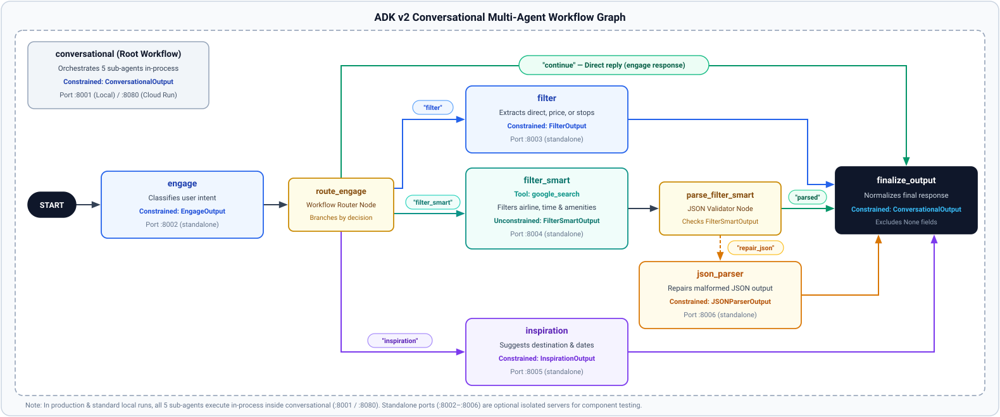

# Travel Agent Platform — Engineer & Operator Onboarding Guide

Step-by-step onboarding guide to take a new developer or SRE from a fresh clone to a running local multi-agent stack in **~15 minutes**, and to production readiness within the first week.

| Field | Details |
| :--- | :--- |
| **Document ID** | `OPS-ONBOARD-001` |
| **Target Audience** | New Backend / AI Engineers, Frontend Engineers, SRE / Platform Operators |
| **Scope** | Workstation prerequisites, GCP IAM setup, 15-minute local quickstart, architecture mental model, codebase map, and test pyramid |
| **Time to First Local Run** | **~15 minutes** (once GCP Vertex AI access is active) |
| **Documentation Suite** | [Operational Hub](operational_documentation.md) · **Onboarding (Current)** · [API & SDK](api_documentation.md) · [Deployment](deployment_guide.md) · [Runbooks](runbooks.md) · [Troubleshooting](troubleshooting_guide.md) · [Root README](../README.md) |

---

## Table of Contents

1. [Progressive Onboarding Roadmap](#1-progressive-onboarding-roadmap)
2. [Workstation Prerequisites & GCP Access](#2-workstation-prerequisites--gcp-access)
   - [2.1 Required Local Tools & Versions](#21-required-local-tools--versions)
   - [2.2 GCP IAM Permissions Checklist](#22-gcp-iam-permissions-checklist)
3. [15-Minute Local Quickstart](#3-15-minute-local-quickstart)
4. [Architectural Mental Model (How the System Works)](#4-architectural-mental-model-how-the-system-works)
5. [Codebase Tour & Where to Change What](#5-codebase-tour--where-to-change-what)
6. [Developer Workflow, Testing Pyramid & PR Guardrails](#6-developer-workflow-testing-pyramid--pr-guardrails)
7. [First-Week Onboarding Verification Checklist](#7-first-week-onboarding-verification-checklist)
8. [Related Documentation & Next Steps](#8-related-documentation--next-steps)

---

## 1. Progressive Onboarding Roadmap

| Phase | Timeframe | Goal | Key Milestone |
| :--- | :---: | :--- | :--- |
| **Phase 1: Local Boot** | **First 30 Min** | Authenticate keyless ADC, install dependencies, pass offline unit tests, and boot all 3 services locally. | Run a live flight search & all 4 chat intents at `http://localhost:5173`. |
| **Phase 2: System Fluency** | **Day 1** | Understand the ADK v2 5-agent workflow graph, OpenAPI 3.1 contract governance, and testing tiers. | Inspect Swagger UIs (`/docs`), trace `ADK Plugin Telemetry` logs, and run integration suites. |
| **Phase 3: Production Readiness** | **Week 1** | Master Cloud Build promotion, 7-metric GEAP AI evaluation, and multi-region DR drills. | Run `./deployment/deploy.sh pr-check dev`, pass local DR/backup self-tests, and merge first PR. |

---

## 2. Workstation Prerequisites & GCP Access

### 2.1 Required Local Tools & Versions

| Tool | Required Local Version | Production Container Equivalent | Verification Command |
| :--- | :--- | :--- | :--- |
| **Python** | `>= 3.11` (`3.11`–`3.13` supported locally) | `python:3.11-slim` | `python3 --version` |
| **Node.js & npm** | `>= 18.0` (`20.x` recommended) | `node:20-alpine` | `node --version && npm --version` |
| **Google Cloud SDK (`gcloud`)** | `>= 460.0.0` | Cloud Build managed | `gcloud --version` |
| **Git** | `>= 2.30` | — | `git --version` |
| **Docker / Terraform** | *Optional locally* | Executed remotely in Cloud Build (`terraform:1.9.8`) | — |

### 2.2 GCP IAM Permissions Checklist

Request the appropriate IAM roles from your Platform / GCP Project Owner before running live Gemini calls or Cloud Build deployments:

| Role Profile | Target GCP Project(s) | Required IAM Roles | Purpose |
| :--- | :--- | :--- | :--- |
| **All Developers (Local AI Dev)** | `travel-agent-511710` (`dev`) | `roles/aiplatform.user`, `roles/serviceusage.serviceUsageConsumer` | Enables keyless local `gcloud auth application-default login` calls to Vertex AI Gemini & GEAP Eval. |
| **Application Contributor (CI / Dev Deploy)** | `travel-agent-511710` (`dev`) | Above + `roles/cloudbuild.builds.editor`, `roles/storage.objectAdmin`, `roles/iam.serviceAccountUser` (on `travel-agent-cicd`), `roles/run.viewer`, `roles/logging.viewer` | Enables running `./deployment/deploy.sh pr-check dev` and `./deployment/deploy.sh dev`. |
| **SRE / Release Engineer** | `travel-agent-staging-512211`, `travel-agent-prod-512211` | Above + `roles/cloudbuild.builds.approver`, `roles/run.admin`, `roles/storage.admin` | Approving `v*` production releases, executing `RB-01`–`RB-09`, and running live DR drills. |

---

## 3. 15-Minute Local Quickstart

### Step 1: Clone & Authenticate Keyless Vertex AI Credentials (ADC)
The platform never uses static Gemini API keys or downloaded JSON service account keys. Authenticate your local Application Default Credentials:

```bash
git clone <REPO_URL> travel_agent
cd travel_agent

gcloud auth login
gcloud auth application-default login
gcloud config set project travel-agent-511710
```

### Step 2: Create Local `.env` Files from Templates
```bash
cp -n flights_search_app/.env.example flights_search_app/.env
cp -n conversational_app/.env.example conversational_app/.env
cp -n frontend/.env.example frontend/.env
```
*(Confirm `GOOGLE_CLOUD_PROJECT=travel-agent-511710` in both backend `.env` files, or point it to your sandbox GCP project where `aiplatform.googleapis.com` is enabled.)*

### Step 3: Install Python & Frontend Dependencies
```bash
# Shared Python virtual environment across both backend apps + test/eval tooling
python3 -m venv .venv
source .venv/bin/activate
pip install --upgrade pip
pip install \
  -r flights_search_app/requirements.txt \
  -r conversational_app/requirements.txt \
  pytest==9.0.2 httpx==0.28.1

# Optional: install pinned GEAP evaluation extras if you will tune prompts or models
pip install google-cloud-aiplatform==1.148.1 pandas==3.0.6 tqdm==4.70.1

# Frontend dependencies
(cd frontend && npm install)
```

### Step 4: Run Offline Unit Tests (Zero Cloud Calls — `< 10s`)
```bash
(cd flights_search_app && python3 -m pytest tests/unit -v)
(cd conversational_app && python3 -m pytest tests/unit -v)
(cd frontend && npm test)
```

### Step 5: Start the 3 Services Locally
Open **three terminal tabs** from the repository root (run `source .venv/bin/activate` in Terminals 1 & 2):

- **Terminal 1 — Flights Search Service (`:8000`):**
  ```bash
  cd flights_search_app && python3 -m app.main
  ```
- **Terminal 2 — Conversational Multi-Agent Workflow (`:8001`):**
  ```bash
  cd conversational_app && python3 -m app.main
  ```
- **Terminal 3 — React Web Frontend (`:5173`):**
  ```bash
  cd frontend && npm run dev
  ```

### Step 6: Smoke-Test Your Local Stack
```bash
# Verify readiness probes return HTTP 200 ("status": "ready")
curl -fsS http://127.0.0.1:8000/readyz | python3 -m json.tool
curl -fsS http://127.0.0.1:8001/readyz | python3 -m json.tool
```

Open these URLs in your browser:
- **Web Dashboard:** `http://localhost:5173`
- **Flights Search Swagger UI:** `http://127.0.0.1:8000/docs`
- **Conversational Swagger UI:** `http://127.0.0.1:8001/docs`

In the Web Dashboard, click **Search Flights** (`Paris` → `New York`), open the **`💬`** chat widget, and verify all four workflow branches:
1. **Greeting / Clarification (`continue`):** *"Hi! What can you help me with?"*
2. **Hard Filter (`filter`):** *"Only direct flights under 700 euros"* → watch top-bar filter inputs and flight cards update automatically.
3. **Smart Filter + Google Search (`filter_smart`):** *"Which morning flights have reliable Wi-Fi for remote work?"* → watch Terminal 2 print live `Google Search Grounding Queries` inside the `ADK Plugin Telemetry` table.
4. **Inspiration (`inspiration`):** *"Take me somewhere warm and sunny in December instead"* → watch the search bar update and trigger a fresh flight search automatically.

---

## 4. Architectural Mental Model (How the System Works)



Keep five core architectural principles in mind when navigating or changing the system:

1. **100% Stateless Per-Request Execution:**
   There is no database or server-side session cache. `flights-search-app` generates 15 simulated itineraries and returns them to the browser ([`App.jsx`](../frontend/src/App.jsx)). On every chat turn, [`ChatWidget.jsx`](../frontend/src/ChatWidget.jsx) sends `user_message`, `conversational_history`, `flights_search_input`, and the current `flights_input` list to `conversational-app`, which runs inside an ephemeral `InMemorySessionService` (`uuid4()`) and discards state immediately after responding.
2. **Directed Workflow Graph Over Monolithic Prompts (`ADK v2 Workflow`):**
   [`conversational_app/app/agent.py`](../conversational_app/app/agent.py) wires five specialized sub-agents through deterministic routing functions (`route_engage` → specialist → `finalize_output`).
3. **Strict Tool Isolation & Self-Healing JSON Repair:**
   `filter_smart` is the **only** agent equipped with `google_search` (`inspiration`, `engage`, `filter`, and `json_parser` run tool-free with constrained Pydantic `output_schema`s). Because Vertex AI cannot enforce constrained JSON decoding simultaneously with live `google_search` calls, `parse_filter_smart` validates the response and automatically routes malformed text to `json_parser` (`repair_json`) before `finalize_output`.
4. **Dual-Mode Execution (In-Process `:8001` vs. Standalone `:8002`–`:8006`):**
   In production and standard local runs, `conversational_app` (`:8001`) executes all 5 sub-agents in-process. However, every `app/sub_agents/<name>/main.py` also defines an isolated FastAPI server (`:8002`–`:8006`) so you can run, `curl`, and E2E-test a single specialist independently.
5. **Build-Once Frontend & Concentric Resilience:**
   `frontend` generates `/usr/share/nginx/html/env-config.js` (`window.__ENV__`) at Cloud Run container boot rather than baking URLs at build time, enabling automatic browser failover (`europe-west9` → `europe-west1`) layered on top of backend 5x retries and `gemini-3.5-flash-lite` → `gemini-3.6-flash` model failover.

---

## 5. Codebase Tour & Where to Change What

### Top-Level Directory Map

```text
travel_agent/
├── flights_search_app/     # Flights Search FastAPI + ADK Agent (:8000 local / :8080 Cloud Run)
├── conversational_app/     # 5-Agent ADK v2 Workflow + standalone sub-agents (:8001–:8006) + GEAP eval
├── frontend/               # React 18 + Vite SPA + Nginx runtime /env-config.js (:5173 local / :8080 Cloud Run)
├── deployment/             # bootstrap.sh, deploy.sh, validate_dr.sh, verify_backups.sh & Terraform IaC
├── .cloudbuild/            # pr_checks.yaml + 5-stage CD pipelines (dev.yaml, staging.yaml, prod.yaml)
├── docs/                   # Unified operational, onboarding, API/SDK, deployment, runbook & triage docs
└── skills/                 # Reusable frontend design/integration skill references
```

### Task-to-File Lookup Table

| Engineering Task | Files to Edit | Mandatory Verification Step |
| :--- | :--- | :--- |
| **Tune intent routing rules** | [`conversational_app/app/sub_agents/engage/prompt.py`](../conversational_app/app/sub_agents/engage/prompt.py) | Run `tests/unit`, `tests/integration/test_red_team.py`, and GEAP eval (`run_evaluation.py`). |
| **Tune Google Search / amenity filtering** | [`conversational_app/app/sub_agents/filter_smart/prompt.py`](../conversational_app/app/sub_agents/filter_smart/prompt.py) | Verify `tool_use_quality >= 0.80` and `schema_and_contract_valid >= 0.95` in GEAP eval. |
| **Tune flight generation realism / rules** | [`flights_search_app/app/prompt.py`](../flights_search_app/app/prompt.py) | Run `flights_search_app/tests/unit` and `tests/integration`. |
| **Add a new conversational sub-agent** | 1. Copy `app/sub_agents/filter/` (`agent.py`, `main.py`, `prompt.py`, `schema.py`)<br/>2. Add model/port vars in [`conversational_app/app/config.py`](../conversational_app/app/config.py)<br/>3. Wire node & edge in [`conversational_app/app/agent.py`](../conversational_app/app/agent.py) (`build_conversational_workflow`) | Regenerate `openapi.json` if `ConversationalOutput` changed; add unit + integration tests. |
| **Modify request/response API schemas** | [`flights_search_app/app/schema.py`](../flights_search_app/app/schema.py) & [`conversational_app/app/schema.py`](../conversational_app/app/schema.py) | Run `python3 -m app.export_openapi` in **both** apps ([`RB-08`](runbooks.md#rb-08-intentional-api-schema-change--openapi-31-snapshot-regeneration)). |
| **Change Gemini models or Cloud Run scaling** | [`deployment/terraform/envs/*.tfvars`](../deployment/terraform/envs/) & `.env.example` | Deploy via `./deployment/deploy.sh <env>`. |
| **Modify Cloud Run probes, resources, or IAM** | [`deployment/terraform/cloud_run.tf`](../deployment/terraform/cloud_run.tf), [`iam.tf`](../deployment/terraform/iam.tf) | Validate via `./deployment/deploy.sh pr-check dev`. |
| **Update React UI or regional failover logic** | [`frontend/src/App.jsx`](../frontend/src/App.jsx), [`ChatWidget.jsx`](../frontend/src/ChatWidget.jsx), [`apiClient.js`](../frontend/src/apiClient.js) | Run `(cd frontend && npm test && npm run build)`. |

---

## 6. Developer Workflow, Testing Pyramid & PR Guardrails

Run the relevant verification tiers before opening a Pull Request targeting `main`:

1. **Tier 1 — Offline Unit, Fault-Injection & OpenAPI Contract Tests (Mandatory on every PR):**
   ```bash
   (cd flights_search_app && python3 -m pytest tests/unit -v)
   (cd conversational_app && python3 -m pytest tests/unit -v)
   (cd frontend && npm test && npm run build)
   ```
   > [!IMPORTANT]
   > CI executes [`flights_search_app/tests/unit/test_api_versioning_and_contracts.py`](../flights_search_app/tests/unit/test_api_versioning_and_contracts.py) and [`conversational_app/tests/unit/test_api_versioning_and_contracts.py`](../conversational_app/tests/unit/test_api_versioning_and_contracts.py) on every PR and CD run. Modifying any Pydantic field or FastAPI route without running `python3 -m app.export_openapi` will fail Stage 1 immediately.

2. **Tier 2 — Live In-Process Gemini Integration & Red-Team Safety Tests (Run when changing prompts, schemas, or ADK wiring):**
   ```bash
   (cd flights_search_app && python3 -m pytest tests/integration -v)
   (cd conversational_app && python3 -m pytest tests/integration -v)
   ```

3. **Tier 3 — Standalone Sub-Agent Isolation Debugging (Optional):**
   To debug a single sub-agent over HTTP (for example `filter_smart` on port `8004`; note that if `filter_smart` emits malformed JSON in standalone mode, also run `json_parser` on `:8006`):
   ```bash
   # Terminal A: Start standalone sub-agent server
   cd conversational_app && python3 -m app.sub_agents.filter_smart.main

   # Terminal B: Run its E2E test
   cd conversational_app && python3 -m pytest tests/e2e/test_filter_smart.py -v -s
   ```

4. **Tier 4 — 50-Scenario 7-Metric GEAP Evaluation Suite (Mandatory when changing prompts or Gemini models):**
   ```bash
   cd conversational_app
   python3 -m tests.eval.scripts.run_evaluation --run-name my_feature_branch
   ```

5. **Tier 5 — Resilience Script Self-Tests & Remote PR Gate:**
   ```bash
   ./deployment/validate_dr.sh --local-self-test
   ./deployment/verify_backups.sh --local-self-test
   ./deployment/deploy.sh pr-check dev
   ```

---

## 7. First-Week Onboarding Verification Checklist

Use this checklist to track your onboarding completion:

- [ ] Authenticated local ADC (`gcloud auth application-default login`) with zero downloaded JSON service account keys.
- [ ] Passed all offline unit suites across `flights_search_app`, `conversational_app`, and `frontend`.
- [ ] Booted `:8000`, `:8001`, and `:5173` locally and tested `continue`, `filter`, `filter_smart`, and `inspiration` flows in the browser.
- [ ] Located the `ADK Plugin Telemetry` latency/token/grounding table in your local `conversational_app` terminal logs.
- [ ] Inspected live OpenAPI 3.1 Swagger docs at `http://127.0.0.1:8000/docs` and `http://127.0.0.1:8001/docs` and verified `X-API-Version: 1.0.0` response headers.
- [ ] Executed `./deployment/validate_dr.sh --local-self-test` and `./deployment/verify_backups.sh --local-self-test` locally.
- [ ] Reviewed [Production Runbooks (`runbooks.md`)](runbooks.md) and [Troubleshooting Guide (`troubleshooting_guide.md`)](troubleshooting_guide.md) before joining on-call.

---

## 8. Related Documentation & Next Steps

| If You Want To... | Go To |
| :--- | :--- |
| **Explore HTTP `/api/v1` payloads, headers & Python/JS SDKs** | [API, Integration & SDK Reference (`api_documentation.md`)](api_documentation.md) |
| **Understand production SLOs, IAM & Cloud Logging queries** | [Operational Documentation Hub (`operational_documentation.md`)](operational_documentation.md) |
| **Deploy your changes to `dev`, `staging`, or `prod`** | [Deployment & Release Management Guide (`deployment_guide.md`)](deployment_guide.md) |
| **Fix a local ADC, port, CORS, or test error** | [Symptom-Driven Troubleshooting Guide (`troubleshooting_guide.md`)](troubleshooting_guide.md) |
