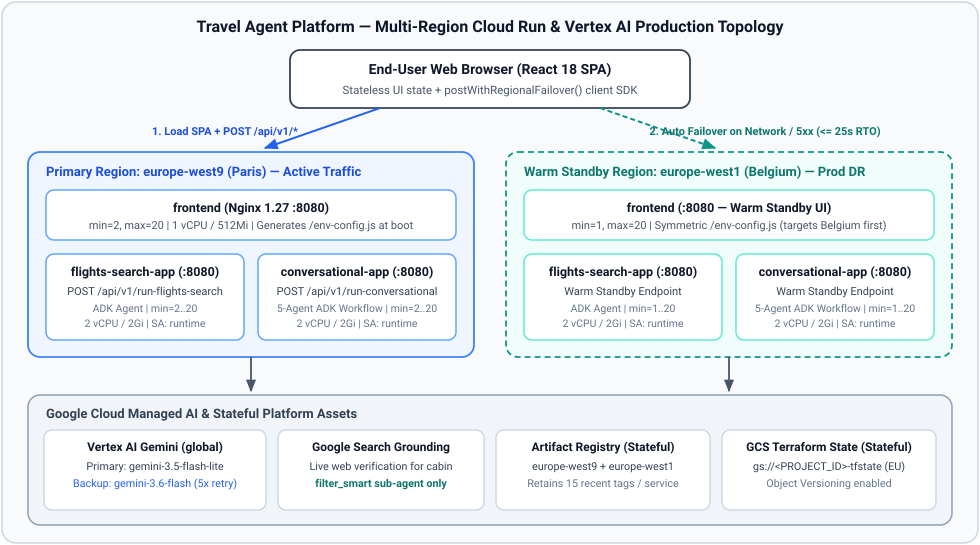

# Travel Agent Platform — Operational Documentation Hub

Central operational reference for the **Travel Agent** multi-agent platform—covering production topology, environment capacity, SLOs, observability, IAM security, automated self-healing layers, and incident escalation.

| Field | Details |
| :--- | :--- |
| **Document ID** | `OPS-HUB-001` |
| **Target Audience** | On-Call Responders, SRE / Platform Engineers, Release Managers, Backend / AI & Frontend Engineers |
| **Scope** | Multi-region Cloud Run topology (`europe-west9` + `europe-west1`), SLIs/SLOs, probes, telemetry, IAM, and incident cadence |
| **Core Stack** | `google-adk==2.11.0` · `google-genai==2.31.0` · `FastAPI 0.135.1` · `React 18` · `Cloud Run v2` · `Terraform 1.9.8` |
| **Documentation Suite** | **Operational Hub (Current)** · [Onboarding](onboarding_guide.md) · [API & SDK](api_documentation.md) · [Deployment](deployment_guide.md) · [Runbooks](runbooks.md) · [Troubleshooting](troubleshooting_guide.md) · [Root README](../README.md) |

---

## Table of Contents

1. [Documentation Suite & Role-Based Reading Guide](#1-documentation-suite--role-based-reading-guide)
2. [Operational Architecture & Service Inventory](#2-operational-architecture--service-inventory)
3. [Environment Topology & Capacity Matrix](#3-environment-topology--capacity-matrix)
4. [Service Level Indicators (SLIs) & Objectives (SLOs)](#4-service-level-indicators-slis--objectives-slos)
5. [Observability, Logging & Telemetry Reference](#5-observability-logging--telemetry-reference)
   - [5.1 Health & Readiness Probe Semantics](#51-health--readiness-probe-semantics)
   - [5.2 ADK Runtime Telemetry (`ExecutionTelemetryPlugin`)](#52-adk-runtime-telemetry-executiontelemetryplugin)
   - [5.3 Essential Cloud Logging Queries (`gcloud`)](#53-essential-cloud-logging-queries-gcloud)
6. [Security, Identity & Least-Privilege IAM Posture](#6-security-identity--least-privilege-iam-posture)
7. [Automated Resilience & Self-Healing Layers](#7-automated-resilience--self-healing-layers)
8. [Incident Severity Matrix & Operational Cadence](#8-incident-severity-matrix--operational-cadence)
   - [8.1 Incident Severity Classification & SLAs](#81-incident-severity-classification--slas)
   - [8.2 Scheduled Operational Cadence](#82-scheduled-operational-cadence)
9. [Related Documentation & Next Steps](#9-related-documentation--next-steps)

---

## 1. Documentation Suite & Role-Based Reading Guide

> [!IMPORTANT]
> **Responding to an Active Production Alert?** Jump straight to **[Production Runbooks (`docs/runbooks.md`)](runbooks.md)** (`RB-01` through `RB-09`) or use the 30-second triage tree in the **[Troubleshooting Guide (`docs/troubleshooting_guide.md`)](troubleshooting_guide.md)**.

All six documents in [`docs/`](./) share a uniform structure (`Overview → Metadata → Table of Contents → Visual Diagram → Step-by-Step Reference → Verification & Next Steps`):

| Document | ID | Primary Audience | When to Use |
| :--- | :---: | :--- | :--- |
| **[Operational Hub](operational_documentation.md)** *(this doc)* | `OPS-HUB-001` | All Engineers, SRE, Tech Leads | Reviewing production topology, SLOs, telemetry logs, IAM posture, and escalation SLAs |
| **[Onboarding Guide](onboarding_guide.md)** | `OPS-ONBOARD-001` | New Engineers & Operators | Setting up a local workstation in 15 minutes, understanding the codebase, and shipping a first PR |
| **[API & SDK Reference](api_documentation.md)** | `OPS-API-001` | Frontend, Backend & Partner Devs | Integrating with `/api/v1` endpoints, OpenAPI 3.1 schemas, JS failover client, or Python ADK SDK |
| **[Deployment Guide](deployment_guide.md)** | `OPS-DEPLOY-001` | Release Engineers, DevOps, Devs | Bootstrapping GCP projects, promoting `dev → staging → prod`, rolling out models, or rolling back |
| **[Operational Runbooks](runbooks.md)** | `OPS-RB-001` | On-Call Responders, SRE | Executing copy-pasteable SOPs (`RB-01`–`RB-09`) for outages, regional failovers, quotas, or DR drills |
| **[Troubleshooting Guide](troubleshooting_guide.md)** | `OPS-TSG-001` | All Engineers, On-Call | Diagnosing exact errors (`503`, `429`, `422`, CORS, Terraform locks, or local setup issues) |

---

## 2. Operational Architecture & Service Inventory

The platform is a **100% stateless**, cloud-native multi-agent application running on **Google Cloud Run v2** and **Vertex AI (Gemini)**. Neither backend service persists user data to a database; every HTTP request creates an isolated in-memory ADK session (`InMemorySessionService`) scoped to a fresh UUID (`uuid4()`) and discards it upon completion.



### Runtime & Stateful Asset Inventory

| Component | Type | Source Directory | Cloud Run Service | Runtime Service Account | State Model |
| :--- | :--- | :--- | :--- | :--- | :--- |
| **Flights Search Service** | FastAPI + ADK v2 `Agent` | [`flights_search_app/`](../flights_search_app/) | `flights-search-app` | `travel-agent-runtime` | Stateless (`InMemorySessionService`) |
| **Conversational Service** | FastAPI + ADK v2 `Workflow` (5 sub-agents in-process) | [`conversational_app/`](../conversational_app/) | `conversational-app` | `travel-agent-runtime` | Stateless (`InMemorySessionService`) |
| **Web Frontend** | React 18 SPA + Nginx `1.27-alpine` | [`frontend/`](../frontend/) | `frontend` | `travel-agent-frontend` | Stateless (generates `/env-config.js` at boot) |
| **Terraform Remote State** | Versioned GCS Object (`EU`) | [`deployment/terraform/`](../deployment/terraform/) | `gs://<PROJECT_ID>-tfstate` | `travel-agent-cicd` | **Stateful** (GCS Object Versioning enabled) |
| **Container Registry** | Regional Docker Repos | [`deployment/terraform/registry.tf`](../deployment/terraform/registry.tf) | `travel-agent` (`europe-west9` + `europe-west1`) | `travel-agent-cicd` | **Stateful** (Retains 15 recent tags/service) |

> [!NOTE]
> **In-Process vs. Standalone Sub-Agent Execution:** In Cloud Run (`dev`, `staging`, `prod`) and standard local development, all 5 specialist sub-agents (`engage`, `filter`, `filter_smart`, `inspiration`, `json_parser`) execute **in-process** inside `conversational-app` (`:8080` on Cloud Run / `:8001` locally) with zero internal HTTP hops. Standalone FastAPI servers on ports `8002`–`8006` exist strictly for isolated local debugging and component E2E tests.

---

## 3. Environment Topology & Capacity Matrix

Each environment runs inside its own isolated Google Cloud Project, provisioned declaratively from a single Terraform stack ([`deployment/terraform/`](../deployment/terraform/)) parameterized by [`deployment/terraform/envs/*.tfvars`](../deployment/terraform/envs/).

| Attribute | `dev` (Sandbox) | `staging` (Pre-Production) | `prod` (Production Dual-Region) |
| :--- | :--- | :--- | :--- |
| **GCP Project ID** | `travel-agent-511710` | `travel-agent-staging-512211` | `travel-agent-prod-512211` |
| **Terraform Vars** | [`envs/dev.tfvars`](../deployment/terraform/envs/dev.tfvars) | [`envs/staging.tfvars`](../deployment/terraform/envs/staging.tfvars) | [`envs/prod.tfvars`](../deployment/terraform/envs/prod.tfvars) |
| **CD Pipeline Config** | [`.cloudbuild/dev.yaml`](../.cloudbuild/dev.yaml) | [`.cloudbuild/staging.yaml`](../.cloudbuild/staging.yaml) | [`.cloudbuild/prod.yaml`](../.cloudbuild/prod.yaml) |
| **Release Trigger** | Manual (`./deployment/deploy.sh dev`) + PR gate | Push/merge to `main` (or CLI) | Git tag `^v[0-9]+\.[0-9]+\.[0-9]+.*$` + **Manual Approval** |
| **Primary Region** | `europe-west9` (Paris) | `europe-west9` (Paris) | `europe-west9` (Paris) |
| **Warm Secondary Region** | Disabled (`""`) | Disabled (`""`) | `europe-west1` (Belgium) |
| **Primary Scaling (`min` / `max`)** | `0` / `5` (scales to `$0` idle) | `0` / `10` (scales to `$0` idle) | `2` / `20` (always-on N+1 redundancy) |
| **Secondary Scaling (`min` / `max`)** | — | — | `1` / `20` (warm standby) |
| **Backend CPU / Memory** | `2` vCPU / `2Gi` (`cpu_idle = true`) | `2` vCPU / `2Gi` (`cpu_idle = true`) | `2` vCPU / `2Gi` (`cpu_idle = false` when `min >= 1`) |
| **Frontend CPU / Memory** | `1` vCPU / `512Mi` (`cpu_idle = true`) | `1` vCPU / `512Mi` (`cpu_idle = true`) | `1` vCPU / `512Mi` (`cpu_idle = true`) |
| **Request Timeout** | `300s` | `300s` | `300s` |
| **Deletion Protection** | `false` | `false` | `true` (`deletion_protection = true`) |
| **GCS State Bucket** | `gs://travel-agent-511710-tfstate` | `gs://travel-agent-staging-512211-tfstate` | `gs://travel-agent-prod-512211-tfstate` |
| **Cloud Build State Prefix** | `travel-agent/dev` | `travel-agent/staging` | `travel-agent/prod` |

---

## 4. Service Level Indicators (SLIs) & Objectives (SLOs)

Production health is measured against seven quantitative targets enforced by [`deployment/validate_dr.sh`](../deployment/validate_dr.sh), [`deployment/verify_backups.sh`](../deployment/verify_backups.sh), and [`conversational_app/tests/eval/configs/eval_config.json`](../conversational_app/tests/eval/configs/eval_config.json):

| Category | SLI Metric | Target Objective (SLO) | Measurement Source |
| :--- | :--- | :--- | :--- |
| **API Availability** | Ratio of non-`5xx` HTTP responses on `/api/v1/run-flights-search` & `/api/v1/run-conversational` | **>= 99.5%** (rolling 30-day window) | Cloud Run `run.googleapis.com/request_count` (`response_code_class != "5xx"`) |
| **Probe Readiness** | HTTP `200` rate on `GET /healthz` and `GET /readyz` across active revisions | **>= 99.9%** | Cloud Run startup/liveness probes & CD Stage 5 smoke gate |
| **Conversational Latency** | Single-turn end-to-end execution latency (`conversational-app`) | **Mean <= 15.0s** (Baseline: `~4.64s` on `gemini-3.5-flash-lite`) | `ADK Plugin Telemetry` (`total_latency`) & GEAP `latency_seconds` |
| **Regional Failover RTO** | Client-perceived recovery time during primary regional blackout (`europe-west9` → `europe-west1`) | **<= 25,000 ms (`25s`)** | Automated drill in [`deployment/validate_dr.sh`](../deployment/validate_dr.sh) |
| **Infrastructure RPO** | Data loss window for stateful assets (`.tfstate` & container images) | **`0` lost mutations** (every apply & build is versioned immediately) | [`deployment/verify_backups.sh`](../deployment/verify_backups.sh) |
| **AI Contract Integrity** | Valid schema compliance + **zero hallucinated flight numbers or mutated prices** | **>= 95.0%** (`schema_and_contract_valid >= 0.95`) | [`custom_metrics.py`](../conversational_app/tests/eval/metrics/custom_metrics.py) |
| **AI Task & Tool Quality** | Task success, trajectory quality, Google Search tool-use quality, coherence & plan alignment | **>= 80.0%** (`>= 0.80` on all 5 rubric/judge metrics) | [`eval_config.json`](../conversational_app/tests/eval/configs/eval_config.json) |

---

## 5. Observability, Logging & Telemetry Reference

### 5.1 Health & Readiness Probe Semantics

All three Cloud Run services separate **startup/readiness** from **liveness** in [`deployment/terraform/cloud_run.tf`](../deployment/terraform/cloud_run.tf):

| Probe Type | Endpoint | Cloud Run Cadence | Validation Performed | Failure Action |
| :--- | :--- | :--- | :--- | :--- |
| **Startup / Readiness** | `GET /readyz` | `period=5s`, `timeout=3s`, `failure_threshold=12` (`60s` startup budget) | **Backends** ([`health.py`](../conversational_app/app/app_utils/health.py)): Verifies `adk_app.root_agent` is initialized, all configured model IDs are non-empty, and `GOOGLE_CLOUD_PROJECT` + `GOOGLE_CLOUD_LOCATION` are set when `GOOGLE_GENAI_USE_VERTEXAI=1` *(zero LLM network calls)*.<br/>**Frontend** ([`nginx.conf.template`](../frontend/nginx.conf.template)): Verifies `/usr/share/nginx/html/env-config.js` exists on disk. | Returns `HTTP 503` (`{"status": "not_ready", "errors": [...]}`). Cloud Run blocks traffic from shifting to the broken revision. |
| **Liveness** | `GET /healthz` | `period=30s`, `timeout=5s`, `failure_threshold=3` (`90s` window) | Zero-I/O check returning `HTTP 200` (`{"status": "ok", "service": "<name>"}`). | Cloud Run terminates and replaces the unresponsive container instance. |

### 5.2 ADK Runtime Telemetry (`ExecutionTelemetryPlugin`)

When `ENABLE_TELEMETRY_PLUGIN=true` (default), both backend services attach [`ExecutionTelemetryPlugin`](../conversational_app/app/app_utils/telemetry_plugin.py) to their primary and fallback ADK `App` instances. Each completed request prints an invocation-isolated telemetry table to `stdout` (ingested automatically by **Google Cloud Logging**):

```text
===============================================================================================
ADK Plugin Telemetry | invocation=a1b2c3d4 | total_latency=3.842s | total_tokens=1420 (in=1180, out=240)
===============================================================================================
| Agent        | Latency | In Tokens | Out Tokens | Google Search Grounding Queries           |
|--------------|---------|-----------|------------|-------------------------------------------|
| engage       | 0.612s  | 310       | 42         | -                                         |
| filter_smart | 3.210s  | 870       | 198        | Air France AF006 WiFi reliability review  |
===============================================================================================
```

| Event | Severity | Exact Log Pattern (`stdout` / Browser Console) | Source File |
| :--- | :---: | :--- | :--- |
| **Agent Telemetry Summary** | `INFO` | `ADK Plugin Telemetry \| invocation=` | [`telemetry_plugin.py`](../conversational_app/app/app_utils/telemetry_plugin.py) |
| **Upstream Gemini Retry / Error** | `WARNING` | `[execution_telemetry] Model error in agent` | [`telemetry_plugin.py`](../conversational_app/app/app_utils/telemetry_plugin.py) |
| **Primary → Backup Model Failover** | `WARNING` | `Failing over to backup model` | [`conversational_app/app/main.py`](../conversational_app/app/main.py), [`flights_search_app/app/main.py`](../flights_search_app/app/main.py) |
| **Dual-Model Failure (`HTTP 500`)** | `ERROR` | `also failed:` / `A critical error occurred while processing the request.` | [`conversational_app/app/main.py`](../conversational_app/app/main.py), [`flights_search_app/app/main.py`](../flights_search_app/app/main.py) |
| **Smart Filter JSON Repair** | `WARNING` | `Filter Smart response was not valid FilterSmartOutput JSON. Routing to json_parser.` | [`conversational_app/app/agent.py`](../conversational_app/app/agent.py) |
| **Plain-Text Fallback** | `WARNING` | `Agent response text was not valid JSON. Returning raw text.` | [`conversational_app/app/main.py`](../conversational_app/app/main.py), [`flights_search_app/app/main.py`](../flights_search_app/app/main.py) |
| **Browser Cross-Region Failover** | Browser `warn` | `[RegionalFailover] Primary endpoint ... failed ...` | [`frontend/src/apiClient.js`](../frontend/src/apiClient.js) |

### 5.3 Essential Cloud Logging Queries (`gcloud`)

```bash
# 1. Recent HTTP 5xx or Python ERROR logs across all Cloud Run services in prod
gcloud logging read \
  'resource.type="cloud_run_revision" AND (severity>=ERROR OR httpRequest.status>=500)' \
  --project="travel-agent-prod-512211" \
  --limit=30 \
  --format="table(timestamp, resource.labels.service_name, resource.labels.location, severity, httpRequest.status, textPayload)"

# 2. Frequency of Primary -> Backup Gemini model failovers
gcloud logging read \
  'resource.type="cloud_run_revision" AND textPayload:"Failing over to backup model"' \
  --project="travel-agent-prod-512211" \
  --limit=20 \
  --format="table(timestamp, resource.labels.service_name, resource.labels.location, textPayload)"

# 3. Per-agent latency, token usage, and Google Search grounding queries
gcloud logging read \
  'resource.type="cloud_run_revision" AND textPayload:"ADK Plugin Telemetry"' \
  --project="travel-agent-prod-512211" \
  --limit=10 \
  --format="value(timestamp, textPayload)"

# 4. Filter Smart -> JSON Parser self-healing repair occurrences
gcloud logging read \
  'resource.type="cloud_run_revision" AND resource.labels.service_name="conversational-app" AND textPayload:"Routing to json_parser"' \
  --project="travel-agent-prod-512211" \
  --limit=20
```

---

## 6. Security, Identity & Least-Privilege IAM Posture

Every GCP project enforces strict **3-way Service Account separation** via [`deployment/bootstrap.sh`](../deployment/bootstrap.sh) and [`deployment/terraform/iam.tf`](../deployment/terraform/iam.tf). Zero static Gemini API keys or JSON service account key files exist anywhere in the platform.

| Identity | Service Account Email | Attached To | Granted IAM Roles | Hardening Controls |
| :--- | :--- | :--- | :--- | :--- |
| **CI/CD Runner** | `travel-agent-cicd@<PROJECT_ID>.iam.gserviceaccount.com` | Cloud Build pipelines & GitHub triggers | `serviceusage.serviceUsageAdmin`, `resourcemanager.projectIamAdmin`, `iam.serviceAccountAdmin`, `iam.serviceAccountUser`, `run.admin`, `artifactregistry.admin`, `cloudbuild.builds.editor`, `storage.admin`, `logging.logWriter` | Provisioned by `bootstrap.sh`; default Compute & Cloud Build SAs are stripped of all 9 admin roles (`bootstrap.sh` Step 5). |
| **Backend Runtime** | `travel-agent-runtime@<PROJECT_ID>.iam.gserviceaccount.com` | `flights-search-app`, `conversational-app` | `roles/aiplatform.user`, `roles/logging.logWriter`, `roles/cloudtrace.agent` | Runs as non-root OS user `appuser`; zero access to GCS `.tfstate`, Artifact Registry, or IAM. |
| **Frontend Runtime** | `travel-agent-frontend@<PROJECT_ID>.iam.gserviceaccount.com` | `frontend` (Nginx) | `roles/logging.logWriter` **only** | Zero Vertex AI, storage, or backend IAM privileges. |

---

## 7. Automated Resilience & Self-Healing Layers

Before escalating an alert, verify whether one of the five built-in resilience layers has already mitigated user impact:

1. **Per-Agent Exponential Backoff (`HttpRetryOptions`)**: Every ADK agent retries transient Vertex AI `408, 429, 500, 502, 503, 504` responses up to **5 attempts** (`5.0s` initial delay, `2.0x` multiplier, `60.0s` max delay).
2. **Automatic Backup Gemini Model Failover**: If the primary model (`gemini-3.5-flash-lite`) still raises an exception after retries, `execute_agent_run()` re-executes the request in a fresh `InMemorySessionService` against `fallback_app` (`gemini-3.6-flash`).
3. **Self-Healing JSON Repair (`parse_filter_smart` → `json_parser`)**: Because `filter_smart` uses live `google_search` grounding (preventing strict constrained JSON decoding on that step), malformed JSON outputs automatically route to `json_parser` for repair without failing the user turn.
4. **Browser Cross-Region Backend Failover (`postWithRegionalFailover`)**: In `prod`, if `europe-west9` returns `HTTP >= 500` or experiences a network drop, [`frontend/src/apiClient.js`](../frontend/src/apiClient.js) transparently retries once against warm `europe-west1` (`HTTP 4xx` validation errors are never retried).
5. **Warm Secondary Frontend (`frontend_secondary_url`)**: If the `europe-west9` `frontend` service itself is unreachable, the warm `europe-west1` `frontend` (`min_instances = 1`) is pre-configured to target `europe-west1` backends first with `europe-west9` as fallback.

---

## 8. Incident Severity Matrix & Operational Cadence

### 8.1 Incident Severity Classification & SLAs

| Severity | Definition & Examples | Response SLA | Mitigation SLA | Primary Runbooks |
| :---: | :--- | :---: | :---: | :--- |
| **`SEV-1` (Critical)** | Complete production outage across both regions; both primary & fallback Gemini models failing (`HTTP 500` > 5%); broken release live in both regions; security/IAM compromise. | **<= 15 min** | **<= 30 min** | [`RB-01`](runbooks.md#rb-01-production-service-outage--elevated-5xx--triage--immutable-rollback), [`RB-02`](runbooks.md#rb-02-primary-region-europe-west9-outage--multi-region-failover--recovery), [`RB-03`](runbooks.md#rb-03-vertex-ai-quota-exhaustion-429-or-primary-model-degradation--emergency-model-swap) |
| **`SEV-2` (High)** | Primary region (`europe-west9`) degraded (clients failing over to `europe-west1`); primary Gemini model failing over to backup on > 20% of requests; `prod` CD pipeline blocked during urgent release. | **<= 30 min** | **<= 2 hours** | [`RB-02`](runbooks.md#rb-02-primary-region-europe-west9-outage--multi-region-failover--recovery), [`RB-03`](runbooks.md#rb-03-vertex-ai-quota-exhaustion-429-or-primary-model-degradation--emergency-model-swap), [`RB-04`](runbooks.md#rb-04-terraform-state-lock-contention-or-corrupted-tfstate--recovery) |
| **`SEV-3` (Moderate)** | Mean conversational latency `> 15s`; Cloud Run nearing `max_instances`; `staging` or `dev` broken; elevated `json_parser` repair rate without user-facing `5xx`. | **<= 4 hours** | **<= 1 business day** | [`RB-05`](runbooks.md#rb-05-traffic-spike--latency-saturation--emergency-capacity-scaling), [`RB-09`](runbooks.md#rb-09-ai-quality-regression--running-the-7-metric-geap-eval--loss-flywheel) |
| **`SEV-4` (Low)** | Minor UI issue, legacy deprecation header warning, documentation update, or local workstation question. | **Next business day** | Backlog / next sprint | [Troubleshooting Guide](troubleshooting_guide.md) |

### 8.2 Scheduled Operational Cadence

| Cadence | Operational Activity | Command / Workflow | Reference |
| :--- | :--- | :--- | :--- |
| **Every Pull Request** | Offline unit tests, OpenAPI 3.1 drift gate, frontend build, DR/backup local self-tests, Terraform validate | `./deployment/deploy.sh pr-check dev` *(or `pr_checks.yaml` trigger)* | [Deployment Guide §5](deployment_guide.md#5-pipeline-anatomy-inside-the-5-stage-cd-workflow) |
| **Every Prompt / Model Edit** | 50-scenario 7-metric GEAP AI evaluation & regression check in `experiments_history.md` | `python3 -m tests.eval.scripts.run_evaluation --run-name <name>` | [`RB-09`](runbooks.md#rb-09-ai-quality-regression--running-the-7-metric-geap-eval--loss-flywheel) |
| **Every Prod Release** | Annotated SemVer tag (`vX.Y.Z`), Cloud Build manual approval, Stage 5 smoke check & live E2E check | `git tag -a vX.Y.Z -m "..." && git push origin vX.Y.Z` | [Deployment Guide §6](deployment_guide.md#6-step-by-step-deployment-procedures) |
| **Weekly** | Zero-cost probe-only multi-region DR & `/env-config.js` symmetry check | `./deployment/validate_dr.sh --env prod --probe-only` | [`RB-06`](runbooks.md#rb-06-scheduled-multi-region-dr--backup-verification-drills) |
| **Monthly** | Live multi-region failover RTO drill (`<= 25s`) + non-destructive `.tfstate` & image tag backup drill | `./deployment/validate_dr.sh --env prod && ./deployment/verify_backups.sh --env prod` | [`RB-06`](runbooks.md#rb-06-scheduled-multi-region-dr--backup-verification-drills) |
| **Quarterly** | Least-privilege IAM audit & default Google SA role stripping across `dev`, `staging`, and `prod` | `./deployment/bootstrap.sh all` | [`RB-07`](runbooks.md#rb-07-iam-drift-remediation--default-service-account-hardening-audit) |

---

## 9. Related Documentation & Next Steps

| If You Want To... | Go To |
| :--- | :--- |
| **Set up the platform locally in 15 minutes** | [Engineer & Operator Onboarding Guide (`onboarding_guide.md`)](onboarding_guide.md) |
| **Execute an incident mitigation or scheduled drill** | [Production Operational Runbooks (`runbooks.md`)](runbooks.md) |
| **Promote a release or update Gemini models** | [Deployment & Release Management Guide (`deployment_guide.md`)](deployment_guide.md) |
| **Diagnose a specific HTTP error, log warning, or CI failure** | [Symptom-Driven Troubleshooting Guide (`troubleshooting_guide.md`)](troubleshooting_guide.md) |
| **Integrate with HTTP `/api/v1` endpoints or client SDKs** | [API, Integration & SDK Reference (`api_documentation.md`)](api_documentation.md) |
