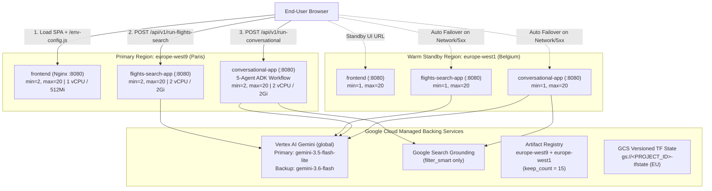

# Travel Agent Platform — Operational Documentation Hub

| Metadata | Value |
| :--- | :--- |
| **Document ID** | `OPS-HUB-001` |
| **Platform** | Flights Search & Conversational Multi-Agent Platform (`google-adk==2.11.0`, `FastAPI`, `React 18`, `Cloud Run`, `Vertex AI`) |
| **Environments** | `dev` (`travel-agent-511710`), `staging` (`travel-agent-staging-512211`), `prod` (`travel-agent-prod-512211`) |
| **Primary / Standby Regions** | Primary: `europe-west9` (Paris) · Warm Standby (`prod`): `europe-west1` (Belgium) · Vertex AI: `global` |
| **Target Audience** | On-Call Engineers, SRE / Platform Engineers, Release Managers, Backend / AI & Frontend Developers |
| **Review Cadence** | After every production architecture change and quarterly alongside DR/backup drills |

---

## Quick Navigation by Role & Urgency

> [!IMPORTANT]
> **Active Production Incident?** Jump directly to **[Production Runbooks (`docs/runbooks.md`)](runbooks.md)** (`RB-01` through `RB-09`) or the **[Troubleshooting Guide (`docs/troubleshooting_guide.md`)](troubleshooting_guide.md)** triage tree.

| Document | Purpose & Scope | Primary Audience | When to Use |
| :--- | :--- | :--- | :--- |
| **[Operational Hub (`operational_documentation.md`)](operational_documentation.md)** *(this doc)* | Production topology, SLOs/SLIs, observability & telemetry reference, IAM security matrix, incident severity & operational cadence | All Engineers, SRE, Tech Leads | Understanding production posture, monitoring, SLOs, and escalation |
| **[Deployment Guide (`deployment_guide.md`)](deployment_guide.md)** | Environment specs, first-run bootstrap, 5-stage Cloud Build + Terraform pipelines, release promotion, model rollouts & rollbacks | Release Engineers, DevOps, Developers | Shipping code/prompts/models to `dev`, `staging`, or `prod`, or rolling back |
| **[Operational Runbooks (`runbooks.md`)](runbooks.md)** | Copy-pasteable, step-by-step Standard Operating Procedures (`RB-01`–`RB-09`) with preconditions, verification, and rollback steps | On-Call Responders, SRE | Responding to alerts, outages, region failovers, state locks, or scheduled drills |
| **[Onboarding Guide (`onboarding_guide.md`)](onboarding_guide.md)** | Time-boxed setup (`First 30m` → `Day 1` → `Week 1`), local stack execution, architectural mental model, test pyramid & first PR | New Engineers & Operators | Joining the project, setting up a workstation, or making a first change |
| **[Troubleshooting Guide (`troubleshooting_guide.md`)](troubleshooting_guide.md)** | Symptom-driven diagnostics (`Symptom` → `Root Cause` → `Log Query` → `Fix`) across Cloud Run, Vertex AI/ADK, CORS, CI/CD & local dev | All Engineers, On-Call | Diagnosing errors (`503`, `429`, `422`, failover warnings, CI/Terraform failures) |
| **[API & SDK Reference (`api_documentation.md`)](api_documentation.md)** | OpenAPI 3.1 contracts, `/api/v1` versioning, request/response schemas, CORS headers, and client SDK integration | Frontend, Backend & Partner Devs | Integrating with or evolving HTTP endpoints and schemas |

---

## Table of Contents

1. [Operational Architecture & Service Inventory](#1-operational-architecture--service-inventory)
2. [Environment Topology & Capacity Matrix](#2-environment-topology--capacity-matrix)
3. [Service Level Indicators (SLIs) & Objectives (SLOs)](#3-service-level-indicators-slis--objectives-slos)
4. [Observability, Logging & Telemetry Reference](#4-observability-logging--telemetry-reference)
5. [Security, Identity & Least-Privilege IAM Posture](#5-security-identity--least-privilege-iam-posture)
6. [Resilience & Failure-Handling Layers](#6-resilience--failure-handling-layers)
7. [Incident Severity Classification & Escalation](#7-incident-severity-classification--escalation)
8. [Operational Cadence & Maintenance Schedule](#8-operational-cadence--maintenance-schedule)

---

## 1. Operational Architecture & Service Inventory

The platform is a **stateless**, cloud-native multi-agent system running on **Google Cloud Run** and **Vertex AI (Gemini)**. Neither backend service persists user data to a database; every HTTP request creates an isolated in-memory ADK session (`InMemorySessionService`) scoped to a per-request UUID (`uuid4()`).



### Runtime & Stateful Asset Inventory

| Component | Type | Source Directory | Cloud Run Service Name | Runtime Identity | Stateful? |
| :--- | :--- | :--- | :--- | :--- | :---: |
| **Flights Search Service** | FastAPI + ADK v2 `Agent` | [`flights_search_app/`](../flights_search_app/) | `flights-search-app` | `travel-agent-runtime` | Stateless (`InMemorySessionService`) |
| **Conversational Service** | FastAPI + ADK v2 `Workflow` (5 sub-agents in-process) | [`conversational_app/`](../conversational_app/) | `conversational-app` | `travel-agent-runtime` | Stateless (`InMemorySessionService`) |
| **Web Frontend** | React 18 SPA + Nginx `1.27-alpine` | [`frontend/`](../frontend/) | `frontend` | `travel-agent-frontend` | Stateless (generates `/env-config.js` at boot) |
| **Terraform State** | Versioned GCS Object | [`deployment/terraform/`](../deployment/terraform/) | `gs://<PROJECT_ID>-tfstate` | `travel-agent-cicd` | **Stateful** (Object Versioning enabled) |
| **Container Registry** | Regional Docker Repos | [`deployment/terraform/registry.tf`](../deployment/terraform/registry.tf) | `travel-agent` (`europe-west9` + `europe-west1`) | `travel-agent-cicd` | **Stateful** (Retains last `15` tags/service) |

> [!NOTE]
> **In-Process vs. Standalone Sub-Agent Execution:** In Cloud Run (`dev`, `staging`, `prod`) and standard local development, all 5 specialist sub-agents (`engage`, `filter`, `filter_smart`, `inspiration`, `json_parser`) run **in-process** inside `conversational-app` (`:8080` on Cloud Run / `:8001` locally). Standalone FastAPI entrypoints on ports `8002`–`8006` exist strictly for local component isolation and sub-agent E2E testing.

---

## 2. Environment Topology & Capacity Matrix

Each environment is isolated in its own dedicated Google Cloud Project, defined declaratively by a shared Terraform stack ([`deployment/terraform/`](../deployment/terraform/)) parameterized via [`deployment/terraform/envs/*.tfvars`](../deployment/terraform/envs/).

| Attribute | `dev` | `staging` | `prod` |
| :--- | :--- | :--- | :--- |
| **GCP Project ID** | `travel-agent-511710` | `travel-agent-staging-512211` | `travel-agent-prod-512211` |
| **Terraform Vars** | [`envs/dev.tfvars`](../deployment/terraform/envs/dev.tfvars) | [`envs/staging.tfvars`](../deployment/terraform/envs/staging.tfvars) | [`envs/prod.tfvars`](../deployment/terraform/envs/prod.tfvars) |
| **CD Pipeline Config** | [`.cloudbuild/dev.yaml`](../.cloudbuild/dev.yaml) | [`.cloudbuild/staging.yaml`](../.cloudbuild/staging.yaml) | [`.cloudbuild/prod.yaml`](../.cloudbuild/prod.yaml) |
| **Automated Trigger** | Manual (`./deployment/deploy.sh dev`) + PR gate | Push/merge to `main` | Git tag `^v[0-9]+\.[0-9]+\.[0-9]+.*$` + **Manual Approval** |
| **Primary Region** | `europe-west9` (Paris) | `europe-west9` (Paris) | `europe-west9` (Paris) |
| **Warm Secondary Region** | Disabled (`""`) | Disabled (`""`) | `europe-west1` (Belgium) |
| **Primary Scaling (`min` / `max`)** | `0` / `5` (scales to `$0` idle) | `0` / `10` (scales to `$0` idle) | `2` / `20` (always-on N+1 redundancy) |
| **Secondary Scaling (`min` / `max`)** | — | — | `1` / `20` (warm standby) |
| **Backend CPU / Memory** | `2` vCPU / `2Gi` (`cpu_idle = true`) | `2` vCPU / `2Gi` (`cpu_idle = true`) | `2` vCPU / `2Gi` (`cpu_idle = false` on `min >= 1`) |
| **Frontend CPU / Memory** | `1` vCPU / `512Mi` (`cpu_idle = true`) | `1` vCPU / `512Mi` (`cpu_idle = true`) | `1` vCPU / `512Mi` (`cpu_idle = true`) |
| **Backend Request Timeout** | `300s` | `300s` | `300s` |
| **Deletion Protection** | `false` | `false` | `true` (`deletion_protection = true`) |
| **GCS State Bucket** | `gs://travel-agent-511710-tfstate` | `gs://travel-agent-staging-512211-tfstate` | `gs://travel-agent-prod-512211-tfstate` |
| **Pipeline State Prefix** | `travel-agent/dev` | `travel-agent/staging` | `travel-agent/prod` |

---

## 3. Service Level Indicators (SLIs) & Objectives (SLOs)

Operators measure platform health against the following production targets, aligned with the automated thresholds in [`validate_dr.sh`](../deployment/validate_dr.sh) and [`eval_config.json`](../conversational_app/tests/eval/configs/eval_config.json):

| Category | SLI Metric | Target Objective (SLO) | Measurement Source |
| :--- | :--- | :--- | :--- |
| **Availability** | Ratio of non-`5xx` HTTP responses on `/api/v1/run-flights-search` & `/api/v1/run-conversational` | **>= 99.5%** rolling 30-day window | Cloud Run `run.googleapis.com/request_count` (`response_code_class != "5xx"`) |
| **Probe Health** | HTTP `200` success rate on `GET /healthz` and `GET /readyz` across active revisions | **99.9%** | Cloud Run startup/liveness probes & post-deploy Stage 5 smoke checks |
| **Conversational Latency** | Single-turn end-to-end execution latency (`conversational-app`) | **Mean <= 15.0s** (Baseline: `~4.64s` on `gemini-3.5-flash-lite`) | `ADK Plugin Telemetry` (`total_latency`) & GEAP `latency_seconds` metric |
| **Regional Failover RTO** | Client-perceived recovery time from primary regional blackout (`europe-west9` → `europe-west1`) | **<= 25,000 ms (`25s`)** | Automated drill in [`deployment/validate_dr.sh`](../deployment/validate_dr.sh) |
| **Infrastructure RPO** | Data loss window for stateful assets (Terraform state & container images) | **`0` mutations** (every `terraform apply` & build is versioned immediately) | [`deployment/verify_backups.sh`](../deployment/verify_backups.sh) |
| **AI Contract Integrity** | Valid schema compliance + **zero hallucinated flight numbers or mutated prices** | **>= 95.0%** (`schema_and_contract_valid >= 0.95`) | [`conversational_app/tests/eval/metrics/custom_metrics.py`](../conversational_app/tests/eval/metrics/custom_metrics.py) |
| **AI Task & Routing Quality** | Task success, trajectory quality, tool-use quality, coherence & plan alignment | **>= 80.0%** (`>= 0.80` across all 5 rubric/judge checks) | [`conversational_app/tests/eval/configs/eval_config.json`](../conversational_app/tests/eval/configs/eval_config.json) |

---

## 4. Observability, Logging & Telemetry Reference

### 4.1 Health & Readiness Probe Semantics

All Cloud Run services (`flights-search-app`, `conversational-app`, `frontend`) implement a strict separation between **liveness** and **readiness** configured in [`deployment/terraform/cloud_run.tf`](../deployment/terraform/cloud_run.tf):

| Probe | Endpoint | Cloud Run Config (`cloud_run.tf`) | What It Checks | Failure Behavior |
| :--- | :--- | :--- | :--- | :--- |
| **Startup / Readiness** | `GET /readyz` | `period=5s`, `timeout=3s`, `failure_threshold=12` (`60s` max startup) | **Backends** ([`health.py`](../conversational_app/app/app_utils/health.py)): Verifies `adk_app.root_agent` is initialized, all configured model strings are non-empty, and `GOOGLE_CLOUD_PROJECT` + `GOOGLE_CLOUD_LOCATION` are set when `GOOGLE_GENAI_USE_VERTEXAI=1` *(zero LLM network calls)*.<br/>**Frontend** ([`nginx.conf.template`](../frontend/nginx.conf.template)): Verifies `/usr/share/nginx/html/env-config.js` exists on disk. | Returns `HTTP 503` (`{"status": "not_ready", "errors": [...]}`). Cloud Run blocks traffic from shifting to the broken revision, keeping the prior healthy revision live. |
| **Liveness** | `GET /healthz` | `period=30s`, `timeout=5s`, `failure_threshold=3` (`90s` window) | Zero-I/O check returning `HTTP 200` (`{"status": "ok", "service": "<name>"}`). | Cloud Run kills and replaces the wedged container instance. |

### 4.2 ADK Runtime Telemetry (`ExecutionTelemetryPlugin`)

When `ENABLE_TELEMETRY_PLUGIN=true` (default), both backend services attach [`ExecutionTelemetryPlugin`](../conversational_app/app/app_utils/telemetry_plugin.py) to their primary and fallback ADK `App` containers. On every completed request, the plugin emits a structured ASCII/GitHub table to `stdout` (captured automatically by **Google Cloud Logging**) keyed by an 8-character `invocation` ID:

```text
===============================================================================================
ADK Plugin Telemetry | invocation=a1b2c3d4 | total_latency=3.842s | total_tokens=1420 (in=1180, out=240)
===============================================================================================
| Agent        | Latency | In Tokens | Out Tokens | Google Search Grounding Queries           |
|--------------|---------|-----------|------------|-------------------------------------------|
| engage       | 0.612s  | 310       | 42         | -                                         |
| filter_smart | 3.210s  | 870       | 198        | Air France AF006 WiFi reliability review  |
===============================================================================================
```

**Key Operational Log Signatures to Monitor:**

| Event | Severity | Exact Log Pattern (`stdout` / Cloud Logging) | Source File |
| :--- | :---: | :--- | :--- |
| **Agent Telemetry Summary** | `INFO` | `ADK Plugin Telemetry \| invocation=` | [`telemetry_plugin.py`](../conversational_app/app/app_utils/telemetry_plugin.py) |
| **Upstream Gemini Retry / Error** | `WARNING` | `[execution_telemetry] Model error in agent` | [`telemetry_plugin.py`](../conversational_app/app/app_utils/telemetry_plugin.py) |
| **Primary → Backup Model Failover** | `WARNING` | `Failing over to backup model` | [`conversational_app/app/main.py`](../conversational_app/app/main.py), [`flights_search_app/app/main.py`](../flights_search_app/app/main.py) |
| **Both Primary & Backup Failed (`HTTP 500`)** | `ERROR` | `also failed:` / `A critical error occurred while processing the request.` | [`conversational_app/app/main.py`](../conversational_app/app/main.py), [`flights_search_app/app/main.py`](../flights_search_app/app/main.py) |
| **Smart Filter Self-Healing JSON Repair** | `WARNING` | `Filter Smart response was not valid FilterSmartOutput JSON. Routing to json_parser.` | [`conversational_app/app/agent.py`](../conversational_app/app/agent.py) |
| **Plain-Text Non-JSON Degradation** | `WARNING` | `Agent response text was not valid JSON. Returning raw text.` | [`conversational_app/app/main.py`](../conversational_app/app/main.py), [`flights_search_app/app/main.py`](../flights_search_app/app/main.py) |
| **Browser Cross-Region Failover** | Browser `warn` | `[RegionalFailover] Primary endpoint ... failed ... Failing over to warm secondary endpoint` | [`frontend/src/apiClient.js`](../frontend/src/apiClient.js) |

### 4.3 Essential Cloud Logging Queries (`gcloud`)

```bash
# 1. Tail recent HTTP 5xx or Python ERROR logs across all Cloud Run services in prod
gcloud logging read \
  'resource.type="cloud_run_revision" AND (severity>=ERROR OR httpRequest.status>=500)' \
  --project="travel-agent-prod-512211" \
  --limit=30 \
  --format="table(timestamp, resource.labels.service_name, resource.labels.location, severity, textPayload, httpRequest.status)"

# 2. Check frequency of Primary -> Backup Gemini model failovers
gcloud logging read \
  'resource.type="cloud_run_revision" AND textPayload:"Failing over to backup model"' \
  --project="travel-agent-prod-512211" \
  --limit=20 \
  --format="table(timestamp, resource.labels.service_name, resource.labels.location, textPayload)"

# 3. Inspect per-agent latency, token consumption, and Google Search queries
gcloud logging read \
  'resource.type="cloud_run_revision" AND textPayload:"ADK Plugin Telemetry"' \
  --project="travel-agent-prod-512211" \
  --limit=10 \
  --format="value(timestamp, textPayload)"

# 4. Track Filter Smart -> JSON Parser self-healing repair rate
gcloud logging read \
  'resource.type="cloud_run_revision" AND resource.labels.service_name="conversational-app" AND textPayload:"Routing to json_parser"' \
  --project="travel-agent-prod-512211" \
  --limit=20
```

---

## 5. Security, Identity & Least-Privilege IAM Posture

Every GCP project enforces strict **3-way Service Account separation** provisioned by [`deployment/bootstrap.sh`](../deployment/bootstrap.sh) and [`deployment/terraform/iam.tf`](../deployment/terraform/iam.tf). No static Gemini API keys or JSON service account keys are used anywhere in the platform.

| Service Account | Email Pattern | Attached To | Granted IAM Roles | Security Controls |
| :--- | :--- | :--- | :--- | :--- |
| **CI/CD Runner** | `travel-agent-cicd@<PROJECT_ID>.iam.gserviceaccount.com` | Cloud Build pipelines & GitHub triggers | `roles/serviceusage.serviceUsageAdmin`, `roles/resourcemanager.projectIamAdmin`, `roles/iam.serviceAccountAdmin`, `roles/iam.serviceAccountUser`, `roles/run.admin`, `roles/artifactregistry.admin`, `roles/cloudbuild.builds.editor`, `roles/storage.admin`, `roles/logging.logWriter` | Provisioned by `bootstrap.sh`; default Compute & Cloud Build SAs are actively stripped of these roles (`bootstrap.sh` Step 5). |
| **Backend Runtime** | `travel-agent-runtime@<PROJECT_ID>.iam.gserviceaccount.com` | `flights-search-app`, `conversational-app` | `roles/aiplatform.user`, `roles/logging.logWriter`, `roles/cloudtrace.agent` | Runs as non-root OS user `appuser`; zero access to GCS `.tfstate`, Artifact Registry, or IAM. |
| **Frontend Runtime** | `travel-agent-frontend@<PROJECT_ID>.iam.gserviceaccount.com` | `frontend` (Nginx) | `roles/logging.logWriter` **only** | Zero Vertex AI, storage, or backend IAM privileges. |

---

## 6. Resilience & Failure-Handling Layers

Before escalating an incident, understand the five automated self-healing mechanisms built into the stack:

1. **Per-Agent Exponential Backoff (`HttpRetryOptions`)**: Every ADK agent retries transient Vertex AI HTTP `408, 429, 500, 502, 503, 504` responses up to **5 attempts** (`5.0s` initial delay, `2.0x` multiplier, `60.0s` max delay).
2. **Automatic Backup Gemini Model Failover**: If the primary model (`gemini-3.5-flash-lite`) still raises an error or schema truncation exception, `execute_agent_run()` automatically re-runs the request in a fresh `InMemorySessionService` against `fallback_app` (`gemini-3.6-flash`).
3. **Self-Healing JSON Repair (`parse_filter_smart` → `json_parser`)**: Because `filter_smart` uses live `google_search` grounding (preventing strict constrained-decoding JSON mode), malformed or schema-mismatched JSON outputs are automatically routed to the `json_parser` specialist to repair syntax without failing the turn.
4. **Browser Cross-Region Backend Failover (`postWithRegionalFailover`)**: In `prod`, if `europe-west9` returns `HTTP >= 500` or suffers a network drop, [`frontend/src/apiClient.js`](../frontend/src/apiClient.js) transparently retries the `POST` against the warm `europe-west1` backend (`HTTP 4xx` validation errors are never retried).
5. **Warm Secondary Frontend URL (`frontend_secondary_url`)**: If the `europe-west9` `frontend` Cloud Run endpoint itself is unreachable, `frontend` in `europe-west1` (`min_instances = 1`) is pre-wired to call `europe-west1` backends first with `europe-west9` as fallback.

---

## 7. Incident Severity Classification & Escalation

| Severity | Definition & Examples | Target Response | Target Resolution / Mitigation | Primary Playbook |
| :---: | :--- | :---: | :---: | :--- |
| **`SEV-1` (Critical)** | Complete production outage across both regions; both primary and fallback Gemini models failing (`HTTP 500` > 5%); broken deployment bypassing traffic; security/IAM compromise. | **<= 15 min** | **<= 30 min** (rollback or regional switchover) | [`RB-01`](runbooks.md#rb-01-production-service-outage--elevated-5xx--triage--immutable-rollback), [`RB-02`](runbooks.md#rb-02-primary-region-europe-west9-outage--multi-region-failover--recovery), [`RB-03`](runbooks.md#rb-03-vertex-ai-quota-exhaustion-429-or-primary-model-degradation--emergency-model-swap) |
| **`SEV-2` (High)** | Primary region (`europe-west9`) degraded (browser failing over to `europe-west1`); primary Gemini model failing over to backup model on > 20% of traffic; production CD pipeline blocked during urgent fix. | **<= 30 min** | **<= 2 hours** | [`RB-02`](runbooks.md#rb-02-primary-region-europe-west9-outage--multi-region-failover--recovery), [`RB-03`](runbooks.md#rb-03-vertex-ai-quota-exhaustion-429-or-primary-model-degradation--emergency-model-swap), [`RB-04`](runbooks.md#rb-04-terraform-state-lock-contention-or-corrupted-tfstate--recovery) |
| **`SEV-3` (Moderate)** | Elevated latency (`> 15s` mean) or traffic nearing `max_instances`; `staging` or `dev` broken; elevated `json_parser` fallback rate without user-facing `5xx`. | **<= 4 hours** (business hours) | **<= 1 business day** | [`RB-05`](runbooks.md#rb-05-traffic-spike--latency-saturation--emergency-capacity-scaling), [`RB-09`](runbooks.md#rb-09-ai-quality-regression--running-the-7-metric-geap-eval--loss-flywheel) |
| **`SEV-4` (Low)** | Minor UI bug, non-blocking deprecation header warning, documentation drift, or local dev tooling issue. | **Next business day** | Backlog / next sprint | [`Troubleshooting Guide`](troubleshooting_guide.md) |

---

## 8. Operational Cadence & Maintenance Schedule

| Frequency | Operational Activity | Command / Tool | Reference |
| :--- | :--- | :--- | :--- |
| **Every Pull Request** | Unit tests, OpenAPI contract drift check, frontend build, DR/backup local self-tests, Terraform fmt/validate | `./deployment/deploy.sh pr-check dev` *(automated via `pr_checks.yaml`)* | [Deployment Guide §5](deployment_guide.md#5-pipeline-anatomy-inside-the-5-stage-cd-workflow) |
| **Every Prompt / Model Change** | Run 50-scenario 7-metric GEAP AI evaluation & verify zero regressions in `experiments_history.md` | `python3 -m tests.eval.scripts.run_evaluation --run-name <name>` | [`RB-09`](runbooks.md#rb-09-ai-quality-regression--running-the-7-metric-geap-eval--loss-flywheel) |
| **Every Prod Release** | SemVer Git tag (`vX.Y.Z`), Cloud Build manual approval gate, Stage 5 smoke check + live E2E check | `git tag vX.Y.Z && git push origin vX.Y.Z` | [Deployment Guide §6](deployment_guide.md#6-step-by-step-deployment-procedures) |
| **Weekly** | Probe-only multi-region DR & `/env-config.js` symmetric wiring verification (zero LLM token cost) | `./deployment/validate_dr.sh --env prod --probe-only` | [`RB-06`](runbooks.md#rb-06-scheduled-multi-region-dr--backup-verification-drills) |
| **Monthly** | Full live multi-region failover RTO drill (`<= 25s`) + non-destructive GCS `.tfstate` & Artifact Registry restore drill | `./deployment/validate_dr.sh --env prod && ./deployment/verify_backups.sh --env prod` | [`RB-06`](runbooks.md#rb-06-scheduled-multi-region-dr--backup-verification-drills) |
| **Quarterly** | Least-privilege IAM audit & default SA role stripping across `dev`, `staging`, `prod` | `./deployment/bootstrap.sh all` | [`RB-07`](runbooks.md#rb-07-iam-drift-remediation--default-service-account-hardening-audit) |
