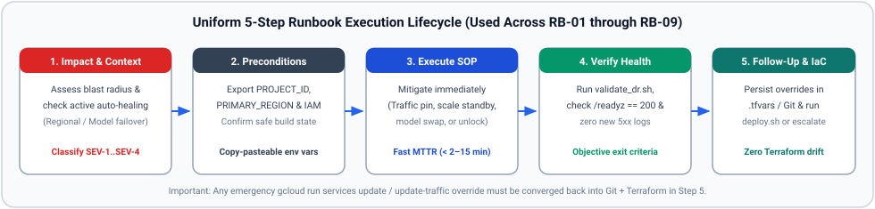

# Travel Agent Platform — Production Operational Runbooks

Copy-pasteable Standard Operating Procedures (`RB-01` through `RB-09`) for incident response, regional disaster recovery, emergency model/capacity overrides, Terraform state recovery, OpenAPI contract updates, and AI quality regressions.

| Field | Details |
| :--- | :--- |
| **Document ID** | `OPS-RB-001` |
| **Target Audience** | On-Call Responders, SRE / Platform Engineers, Release Managers, AI Engineers |
| **Scope** | Step-by-step execution playbooks (`RB-01`–`RB-09`) with preconditions, objective verification, and Terraform convergence |
| **Design Standard** | Every runbook follows an identical **5-step lifecycle**: **Impact & Context → Preconditions → Step-by-Step Execution → Verification Criteria → Follow-Up & Escalation** |
| **Documentation Suite** | [Operational Hub](operational_documentation.md) · [Onboarding](onboarding_guide.md) · [API & SDK](api_documentation.md) · [Deployment](deployment_guide.md) · **Runbooks (Current)** · [Troubleshooting](troubleshooting_guide.md) · [Root README](../README.md) |

---

## Table of Contents

1. [Runbook Lifecycle & Quick Index](#1-runbook-lifecycle--quick-index)
2. [`RB-01`: Production Service Outage / Elevated `5xx` — Triage & Immutable Rollback](#rb-01-production-service-outage--elevated-5xx--triage--immutable-rollback)
3. [`RB-02`: Primary Region (`europe-west9`) Outage — Multi-Region Failover & Recovery](#rb-02-primary-region-europe-west9-outage--multi-region-failover--recovery)
4. [`RB-03`: Vertex AI Quota Exhaustion (`429`) or Primary Model Degradation — Emergency Model Swap](#rb-03-vertex-ai-quota-exhaustion-429-or-primary-model-degradation--emergency-model-swap)
5. [`RB-04`: Terraform State Lock Contention or Corrupted `.tfstate` — Recovery](#rb-04-terraform-state-lock-contention-or-corrupted-tfstate--recovery)
   - [Scenario A: Stale State Lock (`default.tflock`)](#scenario-a-stale-state-lock-defaulttflock-after-a-cancelledcrashed-cloud-build)
   - [Scenario B: Corrupted or Unintended `.tfstate` Mutation](#scenario-b-corrupted-or-unintended-terraform-state-mutation)
6. [`RB-05`: Traffic Spike / Latency Saturation — Emergency Capacity Scaling](#rb-05-traffic-spike--latency-saturation--emergency-capacity-scaling)
7. [`RB-06`: Scheduled Multi-Region DR & Backup Verification Drills](#rb-06-scheduled-multi-region-dr--backup-verification-drills)
8. [`RB-07`: IAM Drift Remediation & Default Service Account Hardening Audit](#rb-07-iam-drift-remediation--default-service-account-hardening-audit)
9. [`RB-08`: Intentional API Schema Change & OpenAPI 3.1 Snapshot Regeneration](#rb-08-intentional-api-schema-change--openapi-31-snapshot-regeneration)
10. [`RB-09`: AI Quality Regression — Running the 7-Metric GEAP Eval & Loss Flywheel](#rb-09-ai-quality-regression--running-the-7-metric-geap-eval--loss-flywheel)
11. [Related Documentation & Next Steps](#11-related-documentation--next-steps)

---

## 1. Runbook Lifecycle & Quick Index



| ID | Runbook Title | Trigger / Alert Condition | Default Severity | Target MTTR |
| :---: | :--- | :--- | :---: | :---: |
| **[`RB-01`](#rb-01-production-service-outage--elevated-5xx--triage--immutable-rollback)** | Production Service Outage / Elevated `5xx` — Triage & Immutable Rollback | Cloud Run `5xx` rate `> 2%` or post-deploy regression | `SEV-1` | `<= 15 min` |
| **[`RB-02`](#rb-02-primary-region-europe-west9-outage--multi-region-failover--recovery)** | Primary Region (`europe-west9`) Outage — Multi-Region Failover & Recovery | `europe-west9` Cloud Run unreachable or regional GCP incident | `SEV-1` / `SEV-2` | `<= 25s` (API) / `<= 15m` (UI) |
| **[`RB-03`](#rb-03-vertex-ai-quota-exhaustion-429-or-primary-model-degradation--emergency-model-swap)** | Vertex AI Quota Exhaustion (`429`) or Primary Model Degradation — Emergency Model Swap | Spike in `Failing over to backup model` or dual-model `500`s | `SEV-1` / `SEV-2` | `<= 15 min` |
| **[`RB-04`](#rb-04-terraform-state-lock-contention-or-corrupted-tfstate--recovery)** | Terraform State Lock Contention or Corrupted `.tfstate` — Recovery | `Error acquiring the state lock` or `.tfstate` corruption in CD | `SEV-2` | `<= 20 min` |
| **[`RB-05`](#rb-05-traffic-spike--latency-saturation--emergency-capacity-scaling)** | Traffic Spike / Latency Saturation — Emergency Capacity Scaling | Active instances hitting `max_instances` or latency `> 15s` | `SEV-2` / `SEV-3` | `<= 15 min` |
| **[`RB-06`](#rb-06-scheduled-multi-region-dr--backup-verification-drills)** | Scheduled Multi-Region DR & Backup Verification Drills | Weekly probe check / Monthly live RTO & backup restore drill | Routine | `~5 min` |
| **[`RB-07`](#rb-07-iam-drift-remediation--default-service-account-hardening-audit)** | IAM Drift Remediation & Default Service Account Hardening Audit | Quarterly security review or IAM policy drift alert | Routine / `SEV-2` | `<= 10 min` |
| **[`RB-08`](#rb-08-intentional-api-schema-change--openapi-31-snapshot-regeneration)** | Intentional API Schema Change & OpenAPI 3.1 Snapshot Regeneration | `test_api_versioning_and_contracts.py` failing on schema update | Routine | `<= 5 min` |
| **[`RB-09`](#rb-09-ai-quality-regression--running-the-7-metric-geap-eval--loss-flywheel)** | AI Quality Regression — Running the 7-Metric GEAP Eval & Loss Flywheel | Misrouted intents, mutated flight prices, or prompt/model tuning | `SEV-3` / Routine | `~15–30 min` |

---

## `RB-01`: Production Service Outage / Elevated `5xx` — Triage & Immutable Rollback

| Field | Value |
| :--- | :--- |
| **Severity** | `SEV-1` |
| **Trigger / Symptom** | Elevated HTTP `500`/`502`/`503`/`504` on `flights-search-app`, `conversational-app`, or `frontend`, or regression immediately after deployment. |
| **Target MTTR** | `< 2 min` (emergency traffic pin) · `<= 10 min` (Terraform state convergence) |
| **Required IAM** | `roles/run.admin` (emergency traffic pin) or `roles/cloudbuild.builds.editor` + `roles/iam.serviceAccountUser` on `travel-agent-cicd` |

### 1. Impact & Context
- If only `europe-west9` returns `5xx`, [`frontend/src/apiClient.js`](../frontend/src/apiClient.js) (`postWithRegionalFailover`) is already automatically retrying browser API calls against `europe-west1`.
- If a bad release deployed broken containers to **both** regions simultaneously, cross-region failover will also hit the broken revision—**roll back immediately**.

### 2. Preconditions
```bash
export PROJECT_ID="travel-agent-prod-512211"
export PRIMARY_REGION="europe-west9"
export SECONDARY_REGION="europe-west1"
```

### 3. Step-by-Step Execution

1. **Identify the failing service and inspect the last 20 errors:**
   ```bash
   gcloud logging read \
     'resource.type="cloud_run_revision" AND (severity>=ERROR OR httpRequest.status>=500)' \
     --project="${PROJECT_ID}" \
     --limit=20 \
     --format="table(timestamp, resource.labels.service_name, resource.labels.revision_name, resource.labels.location, httpRequest.status, textPayload)"
   ```

2. **List recent Cloud Run revisions to verify whether a rollout triggered the outage:**
   ```bash
   for SVC in flights-search-app conversational-app frontend; do
     echo "=== ${SVC} (${PRIMARY_REGION}) ==="
     gcloud run revisions list --service="${SVC}" --region="${PRIMARY_REGION}" --project="${PROJECT_ID}" --limit=3 \
       --format="table(metadata.name, status.conditions[0].status, spec.containers[0].image, metadata.creationTimestamp)"
   done
   ```

3. **Fast Mitigation (`< 30s`): Shift `100%` of Cloud Run traffic back to the prior healthy revision** *(run for the affected service in both regions)*:
   ```bash
   SVC="conversational-app"   # Or flights-search-app / frontend
   GOOD_REV_PRIMARY="<prior-healthy-revision-europe-west9>"
   GOOD_REV_SECONDARY="<prior-healthy-revision-europe-west1>"

   gcloud run services update-traffic "${SVC}" \
     --to-revisions="${GOOD_REV_PRIMARY}=100" \
     --region="${PRIMARY_REGION}" --project="${PROJECT_ID}"

   gcloud run services update-traffic "${SVC}" \
     --to-revisions="${GOOD_REV_SECONDARY}=100" \
     --region="${SECONDARY_REGION}" --project="${PROJECT_ID}"
   ```

4. **Permanent State Convergence (`~5 min`): Reconcile Terraform & all services to the last known-good Git SHA/tag:**
   ```bash
   gcloud artifacts docker images list \
     "${PRIMARY_REGION}-docker.pkg.dev/${PROJECT_ID}/travel-agent/conversational-app" \
     --include-tags --project="${PROJECT_ID}" --limit=5

   git checkout <GOOD_GIT_SHA_OR_TAG>
   IMAGE_TAG="<GOOD_GIT_SHA_OR_TAG>" ./deployment/deploy.sh prod
   ```

### 4. Verification Criteria
```bash
./deployment/validate_dr.sh --env prod --probe-only
```
- All 6 regional services (`3` primary + `3` secondary) return `/healthz=200` and `/readyz=200`.
- Cloud Logging shows zero new `severity>=ERROR` entries over a 5-minute observation window.

### 5. Follow-Up & Escalation
- If `5xx` errors persist on a previously healthy image SHA, the root cause is an upstream dependency (`Vertex AI` or regional GCP infrastructure) → escalate immediately to **[`RB-02`](#rb-02-primary-region-europe-west9-outage--multi-region-failover--recovery)** (Regional Outage) or **[`RB-03`](#rb-03-vertex-ai-quota-exhaustion-429-or-primary-model-degradation--emergency-model-swap)** (Vertex AI Outage).

---

## `RB-02`: Primary Region (`europe-west9`) Outage — Multi-Region Failover & Recovery

| Field | Value |
| :--- | :--- |
| **Severity** | `SEV-1` (if primary `frontend` is unreachable) · `SEV-2` (if only primary backends are degraded) |
| **Trigger / Symptom** | GCP Service Health announces an incident in `europe-west9` (Paris), or probes to `europe-west9` time out / return `502`/`503`/`504`. |
| **Target RTO** | `<= 25s` automatic client API failover · `< 5 min` manual standby frontend URL distribution / DNS switch |
| **Required IAM** | `roles/run.viewer` (verification), `roles/run.admin` (scaling standby), `roles/cloudbuild.builds.editor` (cold-region evacuation) |

### 1. Impact & Context
- **Backend API Failover is Automatic:** Users who already loaded the SPA automatically fail over `POST /api/v1/run-flights-search` and `POST /api/v1/run-conversational` to `europe-west1` via [`postWithRegionalFailover()`](../frontend/src/apiClient.js).
- **Frontend Entrypoint Switchover:** Because no Global External Application Load Balancer sits in front of `.run.app` URLs by default, if `frontend` in `europe-west9` is unreachable, share or repoint CNAME/DNS to the warm `frontend` URL in `europe-west1` (`min_instances = 1`).

### 2. Preconditions
```bash
export PROJECT_ID="travel-agent-prod-512211"
export PRIMARY_REGION="europe-west9"
export SECONDARY_REGION="europe-west1"
```

### 3. Step-by-Step Execution

1. **Verify Warm Standby (`europe-west1`) health and print standby URLs:**
   ```bash
   for SVC in flights-search-app conversational-app frontend; do
     URL=$(gcloud run services describe "${SVC}" --project="${PROJECT_ID}" --region="${SECONDARY_REGION}" --format="value(status.url)")
     echo "${SVC} (${SECONDARY_REGION}): ${URL}"
     curl -fsS "${URL}/healthz" && echo ""
     curl -fsS "${URL}/readyz" && echo ""
   done
   ```

2. **Pre-scale Warm Standby (`europe-west1`) `min-instances` from `1` to `3` to absorb 100% of production traffic without cold starts:**
   ```bash
   for SVC in flights-search-app conversational-app frontend; do
     gcloud run services update "${SVC}" \
       --min-instances=3 \
       --region="${SECONDARY_REGION}" \
       --project="${PROJECT_ID}"
   done
   ```

3. **If Primary `frontend` (`europe-west9`) is down:** Point users / status page / DNS to the `frontend` URL in `europe-west1` from Step 1 (its `/env-config.js` already targets `europe-west1` backends first).

4. **(Extreme Multi-Region Outage Only) Evacuate to a Cold-Standby GCP Region (e.g., `europe-west4`):**
   ```bash
   REGION="europe-west4" SECONDARY_REGION="" ./deployment/deploy.sh prod
   ```

### 4. Verification Criteria
- `curl -fsS "<SECONDARY_FRONTEND_URL>/env-config.js"` shows `VITE_FLIGHTS_SEARCH_API_URL` and `VITE_CONVERSATIONAL_API_URL` pointing to `europe-west1`.
- Live E2E check against `europe-west1` passes:
  ```bash
  (cd conversational_app && CONVERSATIONAL_BASE_URL="<SECONDARY_CONV_URL>" python3 -m pytest tests/e2e/test_conversational.py -v)
  ```

### 5. Follow-Up & Escalation (Failback Procedure)
1. Once GCP resolves the `europe-west9` incident, run `./deployment/validate_dr.sh --env prod` to verify both regions pass readiness and RTO checks.
2. Run `./deployment/deploy.sh prod` to restore `secondary_min_instances = 1` cleanly from [`envs/prod.tfvars`](../deployment/terraform/envs/prod.tfvars).

---

## `RB-03`: Vertex AI Quota Exhaustion (`429`) or Primary Model Degradation — Emergency Model Swap

| Field | Value |
| :--- | :--- |
| **Severity** | `SEV-2` (backup model absorbing traffic with high latency) · `SEV-1` (both primary & backup models failing) |
| **Trigger / Symptom** | Cloud Logging shows frequent `Failing over to backup model` warnings, `429 RESOURCE_EXHAUSTED`, `503 Service Unavailable`, or `500` responses. |
| **Target MTTR** | `<= 5 min` (Cloud Run env override) · `<= 10 min` (Terraform `.tfvars` convergence) |
| **Required IAM** | `roles/run.admin` + `roles/iam.serviceAccountUser` on `travel-agent-runtime` |

### 1. Impact & Context
- When `gemini-3.5-flash-lite` hits `429` or `5xx`, the SDK executes **5 exponential backoff retries** (`5s + 10s + 20s + 40s = ~75s`) before failing over to `gemini-3.6-flash`. Users still receive valid responses, **but per-turn latency jumps above `75s`**. Promoting a healthy primary model eliminates that `75s` retry penalty immediately.

### 2. Preconditions
```bash
export PROJECT_ID="travel-agent-prod-512211"
```

### 3. Step-by-Step Execution

1. **Identify which model and agent role is failing in Cloud Logging:**
   ```bash
   gcloud logging read \
     'resource.type="cloud_run_revision" AND (textPayload:"Model error in agent" OR textPayload:"Failing over to backup model" OR textPayload:"also failed:")' \
     --project="${PROJECT_ID}" \
     --limit=25 \
     --format="table(timestamp, resource.labels.service_name, textPayload)"
   ```

2. **Emergency Fast-Path (`< 2 min`): Swap primary & distinct fallback model env vars on Cloud Run** *(keep primary and fallback distinct so `fallback_app` remains active)*:
   ```bash
   NEW_PRIMARY="gemini-3.6-flash"
   NEW_FALLBACK="gemini-2.5-flash"

   for REG in europe-west9 europe-west1; do
     gcloud run services update flights-search-app \
       --update-env-vars="FLIGHTS_SEARCH_MODEL=${NEW_PRIMARY},FALLBACK_GEMINI_MODEL=${NEW_FALLBACK}" \
       --region="${REG}" --project="${PROJECT_ID}"

     gcloud run services update conversational-app \
       --update-env-vars="CONVERSATIONAL_MODEL=${NEW_PRIMARY},FALLBACK_GEMINI_MODEL=${NEW_FALLBACK}" \
       --region="${REG}" --project="${PROJECT_ID}"
   done
   ```
   *(Tip: To override only one specialist—such as `filter_smart`—pass `--update-env-vars="FILTER_SMART_MODEL=gemini-2.5-pro"` on `conversational-app`.)*

3. **Persist in Git / Terraform:** Update `flights_search_model`, `conversational_model`, and `fallback_gemini_model` in [`deployment/terraform/envs/prod.tfvars`](../deployment/terraform/envs/prod.tfvars), commit, and run `./deployment/deploy.sh prod`.

### 4. Verification Criteria
```bash
CONV_URL=$(gcloud run services describe conversational-app --project="${PROJECT_ID}" --region=europe-west9 --format="value(status.url)")
curl -fsS "${CONV_URL}/readyz" | python3 -m json.tool
```
- Confirm `"models"` reflects `${NEW_PRIMARY}` and `"fallback_model"` reflects `${NEW_FALLBACK}`.
- Confirm `total_latency` in `ADK Plugin Telemetry` logs returns below `15.0s`.

### 5. Follow-Up & Escalation
- If `429 RESOURCE_EXHAUSTED` affects all models in `GEMINI_MODEL_LOCATION=global`, inspect **IAM & Admin → Quotas** in `travel-agent-prod-512211` for `aiplatform.googleapis.com` RPM/TPM limits and request a quota increase or verify project billing status.

---

## `RB-04`: Terraform State Lock Contention or Corrupted `.tfstate` — Recovery

| Field | Value |
| :--- | :--- |
| **Severity** | `SEV-2` (blocks CI/CD deployments; zero immediate impact on live Cloud Run traffic) |
| **Trigger / Symptom** | Cloud Build Stage 2 or Stage 4 fails with `Error acquiring the state lock` (after `5m`) or invalid/corrupted `.tfstate` JSON. |
| **Target MTTR** | `<= 15 min` |
| **Required IAM** | `roles/storage.admin` on `gs://<PROJECT_ID>-tfstate` |

### 1. Impact & Context
- Live Cloud Run containers continue serving traffic normally.
- GCS Object Versioning is enabled on `gs://<PROJECT_ID>-tfstate` by [`bootstrap.sh`](../deployment/bootstrap.sh), preserving every historical `.tfstate` generation.

### 2. Preconditions
```bash
export ENV_NAME="prod"                         # dev | staging | prod
export PROJECT_ID="travel-agent-prod-512211"   # travel-agent-511710 | travel-agent-staging-512211 | travel-agent-prod-512211
export TF_BUCKET="gs://${PROJECT_ID}-tfstate"
# Cloud Build pipelines store state under prefix travel-agent/${ENV_NAME}
export STATE_URI="${TF_BUCKET}/travel-agent/${ENV_NAME}/default.tfstate"
```

### 3. Step-by-Step Execution

#### Scenario A: Stale State Lock (`default.tflock`) After a Cancelled/Crashed Cloud Build
1. **Confirm NO Cloud Build job is currently active** in `${PROJECT_ID}`:
   ```bash
   gcloud builds list --ongoing --project="${PROJECT_ID}" --region="europe-west9"
   ```
   *(STOP if any build is `WORKING`—wait for completion or cancel it first.)*

2. **Inspect and delete the orphaned GCS lock object:**
   ```bash
   gcloud storage ls -l "${TF_BUCKET}/travel-agent/${ENV_NAME}/default.tflock" --project="${PROJECT_ID}"
   gcloud storage rm "${TF_BUCKET}/travel-agent/${ENV_NAME}/default.tflock" --project="${PROJECT_ID}"
   ```

#### Scenario B: Corrupted or Unintended Terraform State Mutation
1. **List archived GCS object generations (`#<GENERATION_NUMBER>`):**
   ```bash
   gcloud storage ls -a "${STATE_URI}" --project="${PROJECT_ID}"
   ```

2. **Download the candidate prior generation to a local temp directory and validate JSON integrity:**
   ```bash
   TMP_DIR="$(mktemp -d)"
   TARGET_GEN="<GENERATION_NUMBER>"
   gcloud storage cp "${STATE_URI}#${TARGET_GEN}" "${TMP_DIR}/candidate.tfstate" --project="${PROJECT_ID}"

   python3 -c '
   import json, sys
   s = json.load(open(sys.argv[1]))
   assert s["version"] >= 4 and s["lineage"] and isinstance(s["resources"], list)
   print(f"Valid tfstate: serial={s[\"serial\"]}, lineage={s[\"lineage\"]}, resources={len(s[\"resources\"])}")
   ' "${TMP_DIR}/candidate.tfstate"
   ```

3. **Promote the validated generation as the active state** (non-destructively appends a new latest generation):
   ```bash
   gcloud storage cp "${STATE_URI}#${TARGET_GEN}" "${STATE_URI}" --project="${PROJECT_ID}"
   rm -rf "${TMP_DIR}"
   ```

### 4. Verification Criteria
- Re-run `./deployment/deploy.sh ${ENV_NAME}` and verify Stage 2 (`terraform-bootstrap-*`) and Stage 4 (`terraform-deploy-*`) acquire the lock and complete cleanly.

### 5. Follow-Up & Escalation
- Run `./deployment/verify_backups.sh --local-self-test` to confirm state validator integrity, and audit Cloud Build cancellation history to prevent concurrent manual `deploy.sh` submissions.

---

## `RB-05`: Traffic Spike / Latency Saturation — Emergency Capacity Scaling

| Field | Value |
| :--- | :--- |
| **Severity** | `SEV-2` / `SEV-3` |
| **Trigger / Symptom** | Cloud Run active instances reach `max_instances` (`20` in `prod`), ingress queueing triggers `HTTP 429`/`503`, or container memory approaches `2Gi`. |
| **Target MTTR** | `<= 10 min` |
| **Required IAM** | `roles/run.admin` (instant override) + repository push access (`.tfvars` persistence) |

### 1. Impact & Context
- Requests queued past Cloud Run concurrency limits experience elevated latency or `HTTP 429`/`503` at ingress before reaching FastAPI.
- Raising `min-instances`, `max-instances`, and CPU/memory takes effect immediately on Cloud Run without rebuilding Docker images.

### 2. Preconditions
```bash
export PROJECT_ID="travel-agent-prod-512211"
```

### 3. Step-by-Step Execution

1. **Apply immediate Cloud Run capacity increase across primary and warm standby regions:**
   ```bash
   for REG in europe-west9 europe-west1; do
     for SVC in flights-search-app conversational-app; do
       gcloud run services update "${SVC}" \
         --min-instances=4 \
         --max-instances=50 \
         --cpu=4 --memory=4Gi \
         --region="${REG}" --project="${PROJECT_ID}"
     done
   done
   ```

2. **Persist updated capacity bounds in [`deployment/terraform/envs/prod.tfvars`](../deployment/terraform/envs/prod.tfvars):**
   ```hcl
   min_instances  = 4
   max_instances  = 50
   backend_cpu    = "4"
   backend_memory = "4Gi"
   ```
   Commit and run `./deployment/deploy.sh prod` so subsequent CD runs preserve the new scaling bounds.

### 4. Verification Criteria
```bash
gcloud run services describe conversational-app \
  --region=europe-west9 --project="${PROJECT_ID}" \
  --format="yaml(spec.template.scaling,spec.template.containers[0].resources)"
```
- Confirm `maxInstanceCount: 50`, `minInstanceCount: 4`, `cpu: '4'`, and `memory: 4Gi`.

### 5. Follow-Up & Escalation
- Monitor Vertex AI `429` rates closely ([`RB-03`](#rb-03-vertex-ai-quota-exhaustion-429-or-primary-model-degradation--emergency-model-swap))—raising Cloud Run `max_instances` proportionally increases peak concurrent Gemini RPM.

---

## `RB-06`: Scheduled Multi-Region DR & Backup Verification Drills

| Field | Value |
| :--- | :--- |
| **Severity** | Routine Preventive Maintenance (escalate to `SEV-2` if a live `prod` drill fails) |
| **Cadence** | Weekly (`--probe-only`) · Monthly (Full live RTO drill + Backup restore drill) |
| **Scripts** | [`deployment/validate_dr.sh`](../deployment/validate_dr.sh), [`deployment/verify_backups.sh`](../deployment/verify_backups.sh) |
| **Required IAM** | `roles/run.viewer`, `roles/storage.objectViewer`, `roles/artifactregistry.reader` on target project |

### 1. Impact & Context
- All drills are **100% non-destructive**: they never mutate live Cloud Run traffic, overwrite GCS `.tfstate`, or delete Artifact Registry images.
- Weekly `--probe-only` checks consume zero Gemini tokens; monthly full drills execute a single live standby inference call to prove end-to-end RTO (`<= 25,000ms`).

### 2. Preconditions
```bash
gcloud auth login
export PROJECT_ID="travel-agent-prod-512211"
```

### 3. Step-by-Step Execution

1. **Offline Script Self-Checks (Zero GCP Credentials Required):**
   ```bash
   ./deployment/validate_dr.sh --local-self-test
   ./deployment/verify_backups.sh --local-self-test
   ```

2. **Weekly Probe-Only Production DR Check (Zero LLM Token Cost):**
   ```bash
   ./deployment/validate_dr.sh --env prod --probe-only
   ```

3. **Monthly Full Live Multi-Region Failover RTO Drill:**
   ```bash
   ./deployment/validate_dr.sh --env prod
   ```

4. **Monthly Non-Destructive Backup & Image Retention Verification:**
   ```bash
   # Verify GCS bucket versioning & Cloud Build environment state generations
   gcloud storage ls -a "gs://${PROJECT_ID}-tfstate/travel-agent/prod/default.tfstate" --project="${PROJECT_ID}"

   # Run automated restore validator & Artifact Registry 15-tag check
   ./deployment/verify_backups.sh --env prod
   ```
   > [!NOTE]
   > [`verify_backups.sh`](../deployment/verify_backups.sh) checks `travel-agent/state/default.tfstate` by default while Cloud Build stores environment state at `travel-agent/<env>/default.tfstate`. Running the `gcloud storage ls -a` command above verifies the active Cloud Build state path directly (see [Troubleshooting §7.6](troubleshooting_guide.md#76-verify_backupssh---env-env-reports-no-versioned-state-objects-found)).

### 4. Verification Criteria
- `validate_dr.sh` exits `0` with `✅ Live Multi-Region DR & Failover Validation completed successfully!` and measured failover RTO `<= 25000 ms`.
- Artifact Registry retains `>= 1` (up to `15`) rollback image tags across both `europe-west9` and `europe-west1`.

### 5. Follow-Up & Escalation
- If `validate_dr.sh` reports an `/env-config.js` mismatch or standby `503`, trigger `./deployment/deploy.sh prod` or investigate via **[`RB-01`](#rb-01-production-service-outage--elevated-5xx--triage--immutable-rollback)** / **[`RB-02`](#rb-02-primary-region-europe-west9-outage--multi-region-failover--recovery)**.

---

## `RB-07`: IAM Drift Remediation & Default Service Account Hardening Audit

| Field | Value |
| :--- | :--- |
| **Severity** | Routine Quarterly Audit (or `SEV-2` if over-privileged default SAs are detected) |
| **Trigger / Symptom** | Quarterly security review or manual GCP Console edits granting admin roles to default Compute/Cloud Build SAs. |
| **Target MTTR** | `<= 10 min` |
| **Required IAM** | `roles/resourcemanager.projectIamAdmin`, `roles/iam.serviceAccountAdmin` |

### 1. Impact & Context
- Ensures strict 3-SA separation (`travel-agent-cicd`, `travel-agent-runtime`, `travel-agent-frontend`) and strips administrative roles from Google-managed default service accounts without interrupting running workloads.

### 2. Preconditions
```bash
gcloud auth login
```

### 3. Step-by-Step Execution

1. **Run the idempotent bootstrap hardener across all three environments:**
   ```bash
   ./deployment/bootstrap.sh all
   ```

2. **Audit live IAM bindings on all `travel-agent-*` Service Accounts:**
   ```bash
   for PROJ in travel-agent-511710 travel-agent-staging-512211 travel-agent-prod-512211; do
     echo "=== ${PROJ} ==="
     gcloud projects get-iam-policy "${PROJ}" \
       --flatten="bindings[].members" \
       --filter="bindings.members:travel-agent-" \
       --format="table(bindings.members, bindings.role)"
   done
   ```

### 4. Verification Criteria
- `travel-agent-frontend` holds **only** `roles/logging.logWriter`.
- `travel-agent-runtime` holds **only** `roles/aiplatform.user`, `roles/logging.logWriter`, and `roles/cloudtrace.agent`.
- Default `<PROJECT_NUMBER>@cloudbuild.gserviceaccount.com` and `<PROJECT_NUMBER>-compute@developer.gserviceaccount.com` hold zero CI/CD admin roles.

### 5. Follow-Up & Escalation
- If unexpected custom roles remain attached to `travel-agent-runtime` or `travel-agent-frontend`, remove them via `gcloud projects remove-iam-policy-binding` and reconcile [`deployment/terraform/iam.tf`](../deployment/terraform/iam.tf).

---

## `RB-08`: Intentional API Schema Change & OpenAPI 3.1 Snapshot Regeneration

| Field | Value |
| :--- | :--- |
| **Severity** | Routine Engineering Workflow |
| **Trigger / Symptom** | `tests/unit/test_api_versioning_and_contracts.py` fails locally or in Cloud Build Stage 1 because live FastAPI schemas diverged from committed `openapi.json`. |
| **Target MTTR** | `<= 5 min` |
| **Required IAM** | None (runs 100% offline in local `.venv`) |

### 1. Impact & Context
- Contract drift tests prevent accidental breaking changes to `/api/v1` endpoints. Regenerating `openapi.json` explicitly records intentional schema evolutions in Git.

### 2. Preconditions
```bash
source .venv/bin/activate
```
- Confirm backward-compatibility rules:
  - Do not remove or change the type of existing `/api/v1` fields without introducing `/api/v2`.
  - Keep `model_config = ConfigDict(extra="ignore", ...)` on request models.
  - Keep `Flight` fields 100% identical between [`flights_search_app/app/schema.py`](../flights_search_app/app/schema.py) and [`conversational_app/app/schema.py`](../conversational_app/app/schema.py).

### 3. Step-by-Step Execution

1. **Regenerate deterministic OpenAPI 3.1 snapshots for both backend services:**
   ```bash
   (cd flights_search_app && python3 -m app.export_openapi)
   (cd conversational_app && python3 -m app.export_openapi)
   ```

2. **Review the `git diff` on both committed specifications:**
   ```bash
   git diff flights_search_app/openapi.json conversational_app/openapi.json
   ```

### 4. Verification Criteria
```bash
(cd flights_search_app && python3 -m pytest tests/unit/test_api_versioning_and_contracts.py -v)
(cd conversational_app && python3 -m pytest tests/unit/test_api_versioning_and_contracts.py -v)
```
- Both contract test suites pass with zero diffs.

### 5. Follow-Up & Escalation
- Update [API, Integration & SDK Reference (`api_documentation.md`)](api_documentation.md) if any public fields, validation bounds, or endpoints changed, and commit `openapi.json` in the same PR.

---

## `RB-09`: AI Quality Regression — Running the 7-Metric GEAP Eval & Loss Flywheel

| Field | Value |
| :--- | :--- |
| **Severity** | `SEV-3` / Pre-Release AI Quality Gate |
| **Trigger / Symptom** | Misrouted intents (`engage`), missing/unneeded Google Search calls (`filter_smart`), hallucinated or price-mutated flights, or pre-release validation of prompt/model edits. |
| **Target Duration** | `~15–30 min` |
| **Required IAM** | Local ADC (`gcloud auth application-default login`) with `roles/aiplatform.user` |

### 1. Impact & Context
- Evaluates the in-process 5-agent workflow across 50 synthetic travel scenarios using 7 automated metrics (3 Vertex AI rubric metrics, 2 custom LLM judges, and 2 deterministic Python contract/latency checks).

### 2. Preconditions
```bash
source .venv/bin/activate
pip install google-cloud-aiplatform==1.148.1 pandas==3.0.6 tqdm==4.70.1
gcloud auth application-default login
```

### 3. Step-by-Step Execution

1. **Execute the 50-scenario 7-metric GEAP evaluation run:**
   ```bash
   cd conversational_app
   python3 -m tests.eval.scripts.run_evaluation \
     --run-name "investigate_$(date +%Y%m%d)" \
     --description "Evaluate prompt/model quality across 50 synthetic scenarios"
   ```

2. **If any metric falls below threshold, run automated LLM root-cause loss clustering:**
   ```bash
   python3 -m tests.eval.scripts.run_loss_analysis
   ```

### 4. Verification Criteria
Inspect `eval_summary.md` in the generated timestamped results folder and [`experiments_history.md`](../conversational_app/tests/eval/results/experiments_history.md). All 7 metrics must meet target SLOs:
- `schema_and_contract_valid >= 0.95` (zero hallucinated flight numbers, exact price immutability)
- `multi_turn_task_success_v1 >= 0.80`
- `multi_turn_trajectory_quality_v1 >= 0.80`
- `tool_use_quality >= 0.80`
- `coherence >= 0.80`
- `conversation_plan_alignment >= 0.80`
- `latency_seconds <= 15.0s`

### 5. Follow-Up & Escalation
- Use `loss_clusters.md` to pinpoint the exact sub-agent prompt (`engage/prompt.py`, `filter_smart/prompt.py`, etc.) responsible for failures, refine the prompt, re-run Step 1 to verify zero regressions, and promote via [Deployment Guide §6](deployment_guide.md#6-step-by-step-deployment-procedures).

---

## 11. Related Documentation & Next Steps

| If You Want To... | Go To |
| :--- | :--- |
| **Look up an unfamiliar error message before picking a runbook** | [Symptom-Driven Troubleshooting Guide (`troubleshooting_guide.md`)](troubleshooting_guide.md) |
| **Review SLO definitions, Cloud Logging queries & severity SLAs** | [Operational Documentation Hub (`operational_documentation.md`)](operational_documentation.md) |
| **Run standard `dev → staging → prod` releases** | [Deployment & Release Management Guide (`deployment_guide.md`)](deployment_guide.md) |
| **Inspect `/api/v1` request/response contracts** | [API, Integration & SDK Reference (`api_documentation.md`)](api_documentation.md) |
