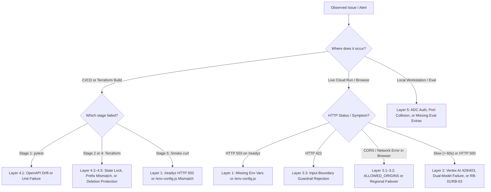

# Travel Agent Platform — Symptom-Driven Troubleshooting Guide

| Metadata | Value |
| :--- | :--- |
| **Document ID** | `OPS-TSG-001` |
| **Related Docs** | [Operational Hub](operational_documentation.md) · [Deployment Guide](deployment_guide.md) · [Runbooks](runbooks.md) · [Onboarding](onboarding_guide.md) · [API Docs](api_documentation.md) |
| **Structure** | Organized by **Symptom / Exact Error Signature → Root Cause → Diagnostic Check → Resolution** |

---

## Table of Contents

1. [Fast Triage Decision Tree](#1-fast-triage-decision-tree)
2. [One-Line Diagnostic & Cloud Logging Cheat Sheet](#2-one-line-diagnostic--cloud-logging-cheat-sheet)
3. [Layer 1: Cloud Run Startup, Liveness & Readiness Failures (`503`)](#3-layer-1-cloud-run-startup-liveness--readiness-failures-503)
4. [Layer 2: Vertex AI, ADK Workflow & LLM Runtime Failures](#4-layer-2-vertex-ai-adk-workflow--llm-runtime-failures)
5. [Layer 3: Frontend, CORS, `422` Validation & Regional Failover Issues](#5-layer-3-frontend-cors-422-validation--regional-failover-issues)
6. [Layer 4: CI/CD, Cloud Build & Terraform Pipeline Failures](#6-layer-4-cicd-cloud-build--terraform-pipeline-failures)
7. [Layer 5: Local Development, Sub-Agent E2E & GEAP Evaluation Issues](#7-layer-5-local-development-sub-agent-e2e--geap-evaluation-issues)

---

## 1. Fast Triage Decision Tree



---

## 2. One-Line Diagnostic & Cloud Logging Cheat Sheet

Set `PROJECT_ID` (`travel-agent-511710`, `travel-agent-staging-512211`, or `travel-agent-prod-512211`) before running:

```bash
export PROJECT_ID="travel-agent-prod-512211"

# 1. Check /healthz and /readyz across all services in primary region
for SVC in flights-search-app conversational-app frontend; do
  URL=$(gcloud run services describe "$SVC" --project="$PROJECT_ID" --region=europe-west9 --format='value(status.url)')
  echo "=== $SVC ($URL) ===" && curl -i -s "${URL}/readyz" | head -n 15 && echo ""
done

# 2. Stream recent ERROR / 5xx logs across all Cloud Run revisions
gcloud logging read \
  'resource.type="cloud_run_revision" AND (severity>=ERROR OR httpRequest.status>=500)' \
  --project="$PROJECT_ID" --limit=25 \
  --format="table(timestamp, resource.labels.service_name, resource.labels.location, httpRequest.status, textPayload)"

# 3. Inspect failed Cloud Build steps
BUILD_ID=$(gcloud builds list --project="$PROJECT_ID" --region=europe-west9 --limit=1 --format='value(id)')
gcloud builds log "$BUILD_ID" --project="$PROJECT_ID" --region=europe-west9 | tail -n 80

# 4. Run full automated multi-region DR & /env-config.js check (prod)
./deployment/validate_dr.sh --env prod --probe-only
```

---

## 3. Layer 1: Cloud Run Startup, Liveness & Readiness Failures (`503`)

### 3.1 `GET /readyz` Returns `HTTP 503` (`"status": "not_ready"`) on Backend Services
- **Exact Error Payload** ([`health.py`](../conversational_app/app/app_utils/health.py)):
  ```json
  {
    "status": "not_ready",
    "service": "conversational-app",
    "errors": [
      "GOOGLE_CLOUD_PROJECT must be set when GOOGLE_GENAI_USE_VERTEXAI is enabled.",
      "GOOGLE_CLOUD_LOCATION must be set when GOOGLE_GENAI_USE_VERTEXAI is enabled."
    ]
  }
  ```
  *(Or `"Model configuration '<role>' is empty."` / `"ADK App or root_agent is not initialized."`)*
- **Root Cause:** When `GOOGLE_GENAI_USE_VERTEXAI` is truthy (`1`, `true`, `yes`, `on`), `evaluate_readiness()` enforces non-empty `GOOGLE_CLOUD_PROJECT`, `GOOGLE_CLOUD_LOCATION`, and non-empty model strings for every agent role before Cloud Run's `startup_probe` (`failure_threshold = 12`, `period = 5s`) admits traffic.
- **Diagnostic Check:**
  ```bash
  gcloud run services describe conversational-app --region=europe-west9 --project="$PROJECT_ID" \
    --format="yaml(spec.template.containers[0].env)"
  ```
- **Resolution:** Ensure `GOOGLE_CLOUD_PROJECT`, `GOOGLE_CLOUD_LOCATION`, and model variables are non-empty in `.env` (local) or [`deployment/terraform/cloud_run.tf`](../deployment/terraform/cloud_run.tf) / `.tfvars`, then redeploy.

### 3.2 `GET /readyz` Returns `HTTP 503` (`"missing /env-config.js"`) on `frontend`
- **Exact Error Payload** ([`nginx.conf.template`](../frontend/nginx.conf.template)):
  ```json
  {"status":"not_ready","service":"frontend","errors":["missing /env-config.js"]}
  ```
- **Root Cause:** `/docker-entrypoint.d/40-generate-env-config.sh` in [`frontend/Dockerfile`](../frontend/Dockerfile) did not run (for example, container `entrypoint` was overridden, or `/usr/share/nginx/html` was mounted read-only).
- **Resolution:** Ensure the container uses the default `nginx:1.27-alpine` entrypoint (`/docker-entrypoint.sh`) with `CMD ["nginx", "-g", "daemon off;"]` and writable `/usr/share/nginx/html`.

### 3.3 Cloud Run Revision Fails to Start: `Container failed to start and listen on port 8080`
- **Root Cause:** Locally, `flights_search_app` defaults to `PORT=8000` and `conversational_app` defaults to `PORT=8001` ([`config.py`](../conversational_app/app/config.py)), whereas Cloud Run probes port `8080` (`cloud_run.tf`). If a custom `PORT` env var overrides `8080` on Cloud Run, probes fail.
- **Resolution:** Never set `PORT=8000` or `PORT=8001` in Cloud Run environment variables; let Cloud Run inject `PORT=8080` (matching `Dockerfile` `ENV PORT=8080`).

---

## 4. Layer 2: Vertex AI, ADK Workflow & LLM Runtime Failures

### 4.1 High Latency (`60s–90s`) Accompanied by `Failing over to backup model` Warnings
- **Exact Log Signature:**
  ```text
  WARNING ... Primary conversational workflow 'gemini-3.5-flash-lite' failed (ClientError: 429 RESOURCE_EXHAUSTED ...). Failing over to backup model 'gemini-3.6-flash'.
  ```
- **Root Cause:** Each ADK agent configures `HttpRetryOptions(attempts=5, initial_delay=5.0, max_delay=60.0, exp_base=2.0)` on HTTP `408, 429, 500, 502, 503, 504`. Exhausting 5 attempts sleeps `5 + 10 + 20 + 40 = 75s` before `execute_agent_run()` switches to `fallback_app` (`gemini-3.6-flash`).
- **Resolution:**
  1. Temporarily promote the healthy backup model to primary via **[`RB-03`](runbooks.md#rb-03-vertex-ai-quota-exhaustion-429-or-primary-model-degradation--emergency-model-swap)** so requests succeed on the first attempt without waiting `75s`.
  2. Check Vertex AI quotas (`aiplatform.googleapis.com`) in GCP Console.

### 4.2 Backup Model Failover Did NOT Trigger (`no fallback configured` Error)
- **Exact Log Signature:**
  ```text
  ERROR ... An error occurred during agent execution (no fallback configured): ...
  ```
- **Root Cause (Two Common Traps):**
  1. **Identical Primary & Fallback Models:** In both [`flights_search_app/app/agent.py`](../flights_search_app/app/agent.py) and [`conversational_app/app/agent.py`](../conversational_app/app/agent.py), `fallback_app` is set to `None` if the primary model(s) equal the fallback model(s)!
  2. **Wrong Env Var Name in `conversational_app`:** [`conversational_app/app/config.py`](../conversational_app/app/config.py) reads **`FALLBACK_GEMINI_MODEL`** (plus per-agent `ENGAGE_FALLBACK_MODEL`, etc.)—it does **not** read `CONVERSATIONAL_FALLBACK_MODEL`.
- **Diagnostic Check:** `curl -s <SERVICE_URL>/readyz | python3 -m json.tool` — if `"fallback_model"` is missing/null, `fallback_app` is disabled!
- **Resolution:** Set `FALLBACK_GEMINI_MODEL` to a distinct model ID from `CONVERSATIONAL_MODEL` / `FLIGHTS_SEARCH_MODEL` and verify `"fallback_model"` appears in `/readyz`.

### 4.3 `403 PERMISSION_DENIED` Calling Vertex AI (`aiplatform.endpoints.predict`)
- **Root Cause:**
  - **On Cloud Run:** `travel-agent-runtime@<PROJECT_ID>.iam.gserviceaccount.com` is missing `roles/aiplatform.user`, or `aiplatform.googleapis.com` is disabled in the project.
  - **Locally:** `GOOGLE_CLOUD_PROJECT` in `.env` points to a project where your logged-in ADC user lacks `roles/aiplatform.user`.
- **Resolution:**
  - Cloud Run: Re-run `./deployment/deploy.sh <env>` (Stage 2 applies `google_project_service.required_apis` and `google_project_iam_member.agent_runtime_roles`).
  - Local: Run `gcloud auth application-default login` and verify `gcloud projects get-iam-policy <PROJECT_ID>`.

### 4.4 `Filter Smart response was not valid FilterSmartOutput JSON. Routing to json_parser.`
- **Severity:** Informational / Self-Healing (`WARNING` in [`conversational_app/app/agent.py`](../conversational_app/app/agent.py)).
- **Root Cause:** Because `filter_smart` uses live `google_search` grounding, Vertex AI cannot enforce constrained JSON schema decoding on that call. Occasionally the model emits conversational text without a valid `FilterSmartOutput` JSON object; `parse_filter_smart` catches this and routes to `json_parser` (`repair_json`), which repairs it cleanly.
- **When to Act:** No action needed for occasional occurrences (`< 10%`). If it occurs on almost every `filter_smart` call (adding an extra `~1.5s` LLM hop), inspect [`conversational_app/app/sub_agents/filter_smart/prompt.py`](../conversational_app/app/sub_agents/filter_smart/prompt.py) formatting instructions and run [`RB-09`](runbooks.md#rb-09-ai-quality-regression--running-the-7-metric-geap-eval--loss-flywheel).

### 4.5 Frontend Shows `"No flights found or invalid response format."` Despite `HTTP 200`
- **Root Cause:** If `flights_search_app` receives non-JSON plain text from the model, [`flights_search_app/app/main.py`](../flights_search_app/app/main.py) degrades safely to `{"status": "success", "results": [{"raw_text": "..."}]}` instead of crashing with `500`. [`frontend/src/App.jsx`](../frontend/src/App.jsx) checks `data.results[0]?.flights` and surfaces `"No flights found or invalid response format."` when `raw_text` is returned (e.g., if `MAX_TOKENS` truncated the 15-flight JSON array on **both** primary and fallback models).
- **Diagnostic Check:** Search Cloud Logging for `Agent response text was not valid JSON. Returning raw text.`.
- **Resolution:** Verify the configured model in `FLIGHTS_SEARCH_MODEL` supports sufficient output token limits for 15 `Flight` objects (`gemini-3.5-flash-lite` / `gemini-3.6-flash`).

---

## 5. Layer 3: Frontend, CORS, `422` Validation & Regional Failover Issues

### 5.1 Browser Console Logs `[RegionalFailover] Primary endpoint ... failed ...`
- **Exact Console Warning** ([`frontend/src/apiClient.js`](../frontend/src/apiClient.js)):
  ```text
  [RegionalFailover] Primary endpoint https://...-ew.a.run.app/api/v1/run-conversational returned HTTP 503. Retrying against warm secondary endpoint https://...-ew1.a.run.app/api/v1/run-conversational.
  ```
- **Root Cause:** Primary `europe-west9` backend returned `HTTP >= 500` or suffered a network failure; client-side failover succeeded against warm `europe-west1`.
- **Resolution:** Treat as an early warning for `europe-west9` degradation! Check `europe-west9` logs immediately ([`RB-01`](runbooks.md#rb-01-production-service-outage--elevated-5xx--triage--immutable-rollback) / [`RB-02`](runbooks.md#rb-02-primary-region-europe-west9-outage--multi-region-failover--recovery)).

### 5.2 Browser Requests Blocked by CORS (`No 'Access-Control-Allow-Origin' header`)
- **Root Cause:**
  1. `ALLOWED_ORIGINS` on backend Cloud Run services was restricted to primary `frontend_url` only, omitting `frontend_secondary_url` (or omitting `https://` scheme / adding a trailing slash).
  2. Or Cloud Run returned an unauthenticated `403` at the Google Front End (GFE) before FastAPI's `CORSMiddleware` ran because `allow_public_access = false` (`invoker_iam_disabled = false`).
- **Diagnostic Check:**
  ```bash
  curl -i -X OPTIONS "${FLIGHTS_URL}/api/v1/run-flights-search" \
    -H "Origin: ${FRONT_URL}" \
    -H "Access-Control-Request-Method: POST"
  ```
- **Resolution:** Ensure `allowed_origins` in `.tfvars` includes **both** primary and secondary frontend origins without trailing slashes (comma-separated), and `allow_public_access = true` for public browser access.

### 5.3 Backend Returns `HTTP 422 Unprocessable Entity` (And Does NOT Fail Over)
- **Root Cause:** Request violated Pydantic input boundary guardrails in [`flights_search_app/app/schema.py`](../flights_search_app/app/schema.py) or [`conversational_app/app/schema.py`](../conversational_app/app/schema.py) (by design, `postWithRegionalFailover` never retries `4xx` errors):
  - Blank or whitespace-only `origin`, `destination`, `departure_date`, `return_date`, or `user_message`
  - `origin` / `destination` / dates `> 200` chars or `user_message` `> 4000` chars
  - `passengers < 1` or `passengers > 9`
  - Negative `max_price` or `max_stops` (`< 0`)
- **Resolution:** Inspect the JSON `detail` array in the `422` response body to identify the offending field and constraint.

---

## 6. Layer 4: CI/CD, Cloud Build & Terraform Pipeline Failures

### 6.1 Stage 1 (`ci-unit-tests` / `unit-tests-backends`) Fails in `test_api_versioning_and_contracts.py`
- **Root Cause:** A Pydantic schema, field bound, description, or FastAPI route changed in `flights_search_app` or `conversational_app`, causing the live `api.openapi()` output to differ from the committed `openapi.json` snapshot.
- **Resolution:** Run [`RB-08`](runbooks.md#rb-08-intentional-api-schema-change--openapi-31-snapshot-regeneration):
  ```bash
  (cd flights_search_app && python3 -m app.export_openapi)
  (cd conversational_app && python3 -m app.export_openapi)
  ```
  Commit the updated `openapi.json` file(s).

### 6.2 Stage 2 or Stage 4 Fails: `Error acquiring the state lock`
- **Root Cause:** Another Cloud Build deployment is currently running against the same environment, or a previously cancelled Cloud Build left a stale `.tflock` file in `gs://<PROJECT_ID>-tfstate/travel-agent/<env>/default.tflock`.
- **Resolution:** Follow **[`RB-04` Scenario A](runbooks.md#scenario-a-stale-state-lock-defaulttflock-after-a-cancelledcrashed-cloud-build)** (verify zero ongoing builds, then remove `default.tflock`).

### 6.3 Manual Local `terraform apply` Fails with `Error 409: Resource ... already exists`
- **Root Cause:** Running `terraform init -backend-config="bucket=<PROJECT_ID>-tfstate"` without `-backend-config="prefix=travel-agent/<env>"` falls back to `versions.tf`'s default `prefix = "travel-agent/state"` instead of the environment state used by Cloud Build (`travel-agent/dev`, `travel-agent/staging`, `travel-agent/prod`).
- **Resolution:** Always deploy via `./deployment/deploy.sh <env>`, or if running `terraform init` manually for inspection, pass **both** backend configs:
  ```bash
  terraform init -reconfigure \
    -backend-config="bucket=${PROJECT_ID}-tfstate" \
    -backend-config="prefix=travel-agent/${ENV_NAME}"
  ```

### 6.4 `terraform destroy` or Service Rename Fails in `prod`: `cannot destroy service without setting deletion_protection=false`
- **Root Cause:** [`deployment/terraform/cloud_run.tf`](../deployment/terraform/cloud_run.tf) sets `deletion_protection = var.environment == "prod"` (`true` in production) on all primary and secondary Cloud Run services.
- **Resolution:** This is an intentional safeguard. If intentionally retiring a `prod` Cloud Run service, first apply `deletion_protection = false` in a dedicated PR, then remove the service in a second apply.

### 6.5 First-Run Cloud Build Fails with `Permission 'iam.serviceAccounts.actAs' denied` or `API not enabled`
- **Root Cause:** Cloud Build was triggered manually without running `deployment/bootstrap.sh` first, or GCP IAM eventual consistency took longer than `15s` on a brand-new project.
- **Resolution:** Run `./deployment/bootstrap.sh <env>`, wait `30s`, and re-run `./deployment/deploy.sh <env>`.

---

## 7. Layer 5: Local Development, Sub-Agent E2E & GEAP Evaluation Issues

| Symptom / Error | Root Cause | Fix |
| :--- | :--- | :--- |
| `google.auth.exceptions.DefaultCredentialsError` or `RefreshError` locally | Local Application Default Credentials missing or expired. | Run `gcloud auth application-default login` and restart the local Uvicorn process. |
| `OSError: [Errno 48] Address already in use` (`:8000`, `:8001`, `:5173`) | Previous local `uvicorn` or `vite` process still bound to the port. | Find & stop process: `lsof -i :8001` then `kill <PID>` (or set `PORT=8011` in local shell). |
| Shell env var override ignored locally | Wait—`python-dotenv`'s `load_dotenv()` (default `override=False`) keeps existing shell env vars, **unless** a var was only changed in `.env` without restarting Uvicorn! | Restart `python3 -m app.main` after editing `.env` (`uvicorn` runs without `--reload` by default). |
| `pytest tests/e2e` fails with `ConnectionError` on ports `8002`–`8006` | `tests/e2e/test_<sub_agent>.py` hits standalone sub-agent HTTP servers (`:8002`–`:8006`), which are not started by `python3 -m app.main` (`:8001`). | Either run only `pytest tests/e2e/test_conversational.py` (which tests `:8001`), or start the target standalone sub-agent server (`python3 -m app.sub_agents.<name>.main`). |
| `ModuleNotFoundError: No module named 'pandas'` (or `tqdm` / `vertexai`) when running `run_evaluation.py` | `conversational_app/requirements.txt` contains lean production container dependencies only; GEAP evaluation scripts import `pandas`, `tqdm`, and `google-cloud-aiplatform`. | Install eval packages into your local `.venv`:<br/>`pip install pandas tqdm google-cloud-aiplatform` |
| `verify_backups.sh --env <env>` reports `No versioned state objects found at .../travel-agent/state/default.tfstate` | [`verify_backups.sh`](../deployment/verify_backups.sh) defaults `STATE_OBJECT` to `travel-agent/state/default.tfstate`, whereas Cloud Build stores state at `travel-agent/<env>/default.tfstate`. | Inspect live Cloud Build state generations directly via:<br/>`gcloud storage ls -a "gs://<PROJECT_ID>-tfstate/travel-agent/<env>/default.tfstate"` (see [`RB-04`](runbooks.md#rb-04-terraform-state-lock-contention-or-corrupted-tfstate--recovery)). |
