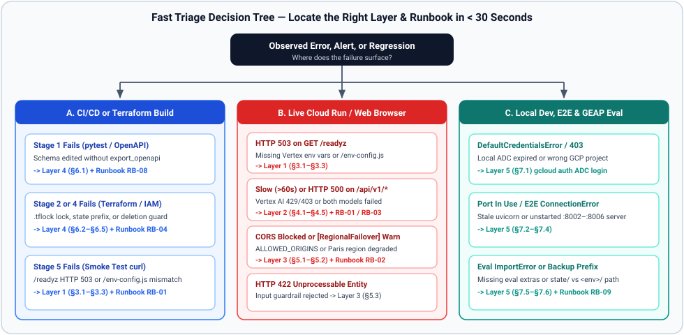

# Travel Agent Platform — Symptom-Driven Troubleshooting Guide

Fast diagnostic reference organized by **Exact Symptom / Error Signature → Root Cause → Diagnostic Check → Resolution** across Cloud Run, Vertex AI/ADK, browser CORS/failover, Cloud Build/Terraform, and local development.

| Field | Details |
| :--- | :--- |
| **Document ID** | `OPS-TSG-001` |
| **Target Audience** | All Engineers, On-Call Responders, SRE / DevOps Operators |
| **Scope** | Symptom-driven diagnostics across all 5 platform layers (`503`, `429`, `403`, `422`, CORS, CI/CD, Terraform, local dev & eval) |
| **Format Standard** | Every entry follows **Symptom / Error → Root Cause → Diagnostic Check → Resolution** |
| **Documentation Suite** | [Operational Hub](operational_documentation.md) · [Onboarding](onboarding_guide.md) · [API & SDK](api_documentation.md) · [Deployment](deployment_guide.md) · [Runbooks](runbooks.md) · **Troubleshooting (Current)** · [Root README](../README.md) |

---

## Table of Contents

1. [Fast Triage Decision Tree](#1-fast-triage-decision-tree)
2. [One-Line Diagnostic & Cloud Logging Cheat Sheet](#2-one-line-diagnostic--cloud-logging-cheat-sheet)
3. [Layer 1: Cloud Run Startup, Liveness & Readiness Failures (`503`)](#3-layer-1-cloud-run-startup-liveness--readiness-failures-503)
   - [3.1 `GET /readyz` Returns `HTTP 503` on Backend Services](#31-get-readyz-returns-http-503-on-backend-services)
   - [3.2 `GET /readyz` Returns `HTTP 503` (`missing /env-config.js`) on `frontend`](#32-get-readyz-returns-http-503-missing-env-configjs-on-frontend)
   - [3.3 Cloud Run Fails to Start: `Container failed to start and listen on port 8080`](#33-cloud-run-fails-to-start-container-failed-to-start-and-listen-on-port-8080)
4. [Layer 2: Vertex AI, ADK Workflow & LLM Runtime Failures](#4-layer-2-vertex-ai-adk-workflow--llm-runtime-failures)
   - [4.1 High Latency (`60s–90s`) with `Failing over to backup model` Warnings](#41-high-latency-60s90s-with-failing-over-to-backup-model-warnings)
   - [4.2 Backup Model Failover Did NOT Trigger (`no fallback configured`)](#42-backup-model-failover-did-not-trigger-no-fallback-configured)
   - [4.3 `403 PERMISSION_DENIED` Calling Vertex AI (`aiplatform.endpoints.predict`)](#43-403-permission_denied-calling-vertex-ai-aiplatformendpointspredict)
   - [4.4 `Filter Smart response was not valid FilterSmartOutput JSON. Routing to json_parser.`](#44-filter-smart-response-was-not-valid-filtersmartoutput-json-routing-to-json_parser)
   - [4.5 Frontend Shows `"No flights found or invalid response format."` Despite `HTTP 200`](#45-frontend-shows-no-flights-found-or-invalid-response-format-despite-http-200)
5. [Layer 3: Frontend, CORS, `422` Validation & Regional Failover Issues](#5-layer-3-frontend-cors-422-validation--regional-failover-issues)
   - [5.1 Browser Console Logs `[RegionalFailover] Primary endpoint ... failed`](#51-browser-console-logs-regionalfailover-primary-endpoint--failed)
   - [5.2 Browser Blocked by CORS (`No 'Access-Control-Allow-Origin' header`)](#52-browser-blocked-by-cors-no-access-control-allow-origin-header)
   - [5.3 Backend Returns `HTTP 422 Unprocessable Entity` (Without Failing Over)](#53-backend-returns-http-422-unprocessable-entity-without-failing-over)
6. [Layer 4: CI/CD, Cloud Build & Terraform Pipeline Failures](#6-layer-4-cicd-cloud-build--terraform-pipeline-failures)
   - [6.1 Stage 1 Fails in `test_api_versioning_and_contracts.py`](#61-stage-1-fails-in-test_api_versioning_and_contractspy)
   - [6.2 Stage 2 or Stage 4 Fails: `Error acquiring the state lock`](#62-stage-2-or-stage-4-fails-error-acquiring-the-state-lock)
   - [6.3 Manual Local `terraform apply` Fails with `Error 409: Resource ... already exists`](#63-manual-local-terraform-apply-fails-with-error-409-resource--already-exists)
   - [6.4 `terraform destroy` or Rename Fails in `prod` (`deletion_protection=true`)](#64-terraform-destroy-or-rename-fails-in-prod-deletion_protectiontrue)
   - [6.5 First-Run Cloud Build Fails with `iam.serviceAccounts.actAs` Denied or `API not enabled`](#65-first-run-cloud-build-fails-with-iamserviceaccountsactas-denied-or-api-not-enabled)
7. [Layer 5: Local Development, Sub-Agent E2E & GEAP Evaluation Issues](#7-layer-5-local-development-sub-agent-e2e--geap-evaluation-issues)
   - [7.1 `DefaultCredentialsError` or `RefreshError` Locally](#71-defaultcredentialserror-or-refresherror-locally)
   - [7.2 `OSError: [Errno 48] Address already in use` (`:8000`, `:8001`, `:5173`)](#72-oserror-errno-48-address-already-in-use-8000-8001-5173)
   - [7.3 Edited `.env` File Changes Do Not Take Effect Locally](#73-edited-env-file-changes-do-not-take-effect-locally)
   - [7.4 `pytest tests/e2e` Fails with `ConnectionError` on Ports `8002`–`8006`](#74-pytest-testse2e-fails-with-connectionerror-on-ports-80028006)
   - [7.5 `ModuleNotFoundError: No module named 'pandas'` When Running `run_evaluation.py`](#75-modulenotfounderror-no-module-named-pandas-when-running-run_evaluationpy)
   - [7.6 `verify_backups.sh --env <env>` Reports `No versioned state objects found`](#76-verify_backupssh---env-env-reports-no-versioned-state-objects-found)
8. [Related Documentation & Next Steps](#8-related-documentation--next-steps)

---

## 1. Fast Triage Decision Tree

Use the visual triage tree below to jump directly from where an error surfaces to the exact diagnostic section and operational runbook:



---

## 2. One-Line Diagnostic & Cloud Logging Cheat Sheet

Set `PROJECT_ID` (`travel-agent-511710`, `travel-agent-staging-512211`, or `travel-agent-prod-512211`) before running:

```bash
export PROJECT_ID="travel-agent-prod-512211"

# 1. Check /readyz across all 3 primary Cloud Run services
for SVC in flights-search-app conversational-app frontend; do
  URL=$(gcloud run services describe "$SVC" --project="$PROJECT_ID" --region=europe-west9 --format='value(status.url)')
  echo "=== $SVC ($URL) ===" && curl -i -s "${URL}/readyz" | head -n 15 && echo ""
done

# 2. Tail recent ERROR or HTTP 5xx logs across all Cloud Run revisions
gcloud logging read \
  'resource.type="cloud_run_revision" AND (severity>=ERROR OR httpRequest.status>=500)' \
  --project="$PROJECT_ID" --limit=25 \
  --format="table(timestamp, resource.labels.service_name, resource.labels.location, httpRequest.status, textPayload)"

# 3. Inspect logs of the latest Cloud Build execution
BUILD_ID=$(gcloud builds list --project="$PROJECT_ID" --region=europe-west9 --limit=1 --format='value(id)')
gcloud builds log "$BUILD_ID" --project="$PROJECT_ID" --region=europe-west9 | tail -n 80

# 4. Run zero-cost multi-region DR & /env-config.js symmetry check (prod)
./deployment/validate_dr.sh --env prod --probe-only
```

---

## 3. Layer 1: Cloud Run Startup, Liveness & Readiness Failures (`503`)

### 3.1 `GET /readyz` Returns `HTTP 503` on Backend Services
- **Exact Error Payload** ([`health.py`](../conversational_app/app/app_utils/health.py)):
  ```json
  {
    "status": "not_ready",
    "service": "conversational-app",
    "errors": [
      "GOOGLE_CLOUD_PROJECT must be set when GOOGLE_GENAI_USE_VERTEXAI is enabled.",
      "GOOGLE_CLOUD_LOCATION must be set when GOOGLE_GENAI_USE_VERTEXAI is enabled."
    ]
  }
  ```
  *(Or `"Model configuration '<role>' is empty."` / `"ADK App or root_agent is not initialized."`)*
- **Root Cause:** When `GOOGLE_GENAI_USE_VERTEXAI` is enabled (`1`, `true`, `yes`, `on`), `evaluate_readiness()` requires non-empty `GOOGLE_CLOUD_PROJECT`, `GOOGLE_CLOUD_LOCATION`, and non-empty model strings for every agent role before Cloud Run's `startup_probe` (`60s` max budget) admits traffic.
- **Diagnostic Check:**
  ```bash
  gcloud run services describe conversational-app --region=europe-west9 --project="$PROJECT_ID" \
    --format="yaml(spec.template.containers[0].env)"
  ```
- **Resolution:** Ensure `GOOGLE_CLOUD_PROJECT`, `GOOGLE_CLOUD_LOCATION`, and model env vars are non-empty in `.env` (local) or [`deployment/terraform/cloud_run.tf`](../deployment/terraform/cloud_run.tf) / `.tfvars`, then redeploy.

### 3.2 `GET /readyz` Returns `HTTP 503` (`missing /env-config.js`) on `frontend`
- **Exact Error Payload** ([`nginx.conf.template`](../frontend/nginx.conf.template)):
  ```json
  {"status":"not_ready","service":"frontend","errors":["missing /env-config.js"]}
  ```
- **Root Cause:** `/docker-entrypoint.d/40-generate-env-config.sh` in [`frontend/Dockerfile`](../frontend/Dockerfile) did not run at container boot (for example, `entrypoint` was overridden or `/usr/share/nginx/html` was mounted read-only).
- **Diagnostic Check:** Inspect Cloud Run container startup logs for `40-generate-env-config.sh`.
- **Resolution:** Keep the default `nginx:1.27-alpine` entrypoint (`/docker-entrypoint.sh`) with `CMD ["nginx", "-g", "daemon off;"]` and a writable `/usr/share/nginx/html`.

### 3.3 Cloud Run Fails to Start: `Container failed to start and listen on port 8080`
- **Root Cause:** Locally, `flights_search_app` defaults to `PORT=8000` and `conversational_app` defaults to `PORT=8001`, whereas Cloud Run probes port `8080`. Manually setting `PORT=8000` or `PORT=8001` in Cloud Run env vars breaks startup probes.
- **Diagnostic Check:** Check `spec.template.containers[0].env` and `ports` on the failing Cloud Run service.
- **Resolution:** Remove any custom `PORT` env var override on Cloud Run so Cloud Run injects `PORT=8080` automatically.

---

## 4. Layer 2: Vertex AI, ADK Workflow & LLM Runtime Failures

### 4.1 High Latency (`60s–90s`) with `Failing over to backup model` Warnings
- **Exact Log Signature:**
  ```text
  WARNING ... Primary conversational workflow 'gemini-3.5-flash-lite' failed (ClientError: 429 RESOURCE_EXHAUSTED ...). Failing over to backup model 'gemini-3.6-flash'.
  ```
- **Root Cause:** Each ADK agent configures `HttpRetryOptions(attempts=5, initial_delay=5.0, max_delay=60.0, exp_base=2.0)` on HTTP `408, 429, 500, 502, 503, 504`. Exhausting all 5 attempts sleeps `5 + 10 + 20 + 40 = 75s` before `execute_agent_run()` switches to `fallback_app` (`gemini-3.6-flash`).
- **Diagnostic Check:** Query Cloud Logging for `textPayload:"Failing over to backup model"`.
- **Resolution:** Execute **[`RB-03`](runbooks.md#rb-03-vertex-ai-quota-exhaustion-429-or-primary-model-degradation--emergency-model-swap)** to swap the healthy backup model into the primary slot (eliminating the `75s` retry wait), then inspect Vertex AI quotas.

### 4.2 Backup Model Failover Did NOT Trigger (`no fallback configured`)
- **Exact Log Signature:**
  ```text
  ERROR ... An error occurred during agent execution (no fallback configured): ...
  ```
- **Root Cause (Two Common Configuration Mistakes):**
  1. **Identical Primary & Fallback Models:** Both [`flights_search_app/app/agent.py`](../flights_search_app/app/agent.py) and [`conversational_app/app/agent.py`](../conversational_app/app/agent.py) set `fallback_app = None` whenever primary and fallback model strings match.
  2. **Wrong Env Var Name:** [`conversational_app/app/config.py`](../conversational_app/app/config.py) reads **`FALLBACK_GEMINI_MODEL`** (plus per-agent `ENGAGE_FALLBACK_MODEL`, etc.), **not** `CONVERSATIONAL_FALLBACK_MODEL`.
- **Diagnostic Check:** Run `curl -s <SERVICE_URL>/readyz | python3 -m json.tool` — if `"fallback_model"` is missing or `null`, `fallback_app` is disabled.
- **Resolution:** Set `FALLBACK_GEMINI_MODEL` to a distinct model ID from `CONVERSATIONAL_MODEL` / `FLIGHTS_SEARCH_MODEL` and verify `"fallback_model"` appears in `/readyz`.

### 4.3 `403 PERMISSION_DENIED` Calling Vertex AI (`aiplatform.endpoints.predict`)
- **Root Cause:**
  - **Cloud Run:** `travel-agent-runtime@<PROJECT_ID>.iam.gserviceaccount.com` lacks `roles/aiplatform.user`, or `aiplatform.googleapis.com` is disabled.
  - **Local Dev:** `GOOGLE_CLOUD_PROJECT` in `.env` points to a project where your logged-in ADC user lacks `roles/aiplatform.user`.
- **Diagnostic Check:** `gcloud projects get-iam-policy "$PROJECT_ID" --flatten="bindings[].members" --filter="bindings.role:roles/aiplatform.user"`
- **Resolution:** On Cloud Run, re-run `./deployment/deploy.sh <env>` (Stage 2 reconciles APIs & IAM). Locally, run `gcloud auth application-default login` and verify your IAM role on `GOOGLE_CLOUD_PROJECT`.

### 4.4 `Filter Smart response was not valid FilterSmartOutput JSON. Routing to json_parser.`
- **Severity:** Informational / Self-Healing (`WARNING` in [`conversational_app/app/agent.py`](../conversational_app/app/agent.py)).
- **Root Cause:** Because `filter_smart` uses live `google_search` grounding, Vertex AI cannot enforce constrained JSON schema decoding on that step. When the model returns prose around or instead of strict JSON, `parse_filter_smart` routes it to `json_parser` (`repair_json`) to repair it cleanly.
- **Diagnostic Check:** Check frequency via `gcloud logging read 'textPayload:"Routing to json_parser"'`.
- **Resolution:** No action needed for occasional repairs (`< 10%`). If occurring on most `filter_smart` turns, tune [`filter_smart/prompt.py`](../conversational_app/app/sub_agents/filter_smart/prompt.py) and run **[`RB-09`](runbooks.md#rb-09-ai-quality-regression--running-the-7-metric-geap-eval--loss-flywheel)**.

### 4.5 Frontend Shows `"No flights found or invalid response format."` Despite `HTTP 200`
- **Root Cause:** When `flights_search_app` receives unparseable non-JSON text from the LLM (for instance, `MAX_TOKENS` truncating the 15-flight JSON output), [`flights_search_app/app/main.py`](../flights_search_app/app/main.py) degrades gracefully to `{"status": "success", "results": [{"raw_text": "..."}]}`. [`App.jsx`](../frontend/src/App.jsx) checks `data.results[0]?.flights` and displays this message when `flights` is absent.
- **Diagnostic Check:** Search logs for `Agent response text was not valid JSON. Returning raw text.`.
- **Resolution:** Ensure `FLIGHTS_SEARCH_MODEL` uses a model with adequate output token budget for 15 `Flight` objects (`gemini-3.5-flash-lite` or `gemini-3.6-flash`).

---

## 5. Layer 3: Frontend, CORS, `422` Validation & Regional Failover Issues

### 5.1 Browser Console Logs `[RegionalFailover] Primary endpoint ... failed`
- **Exact Console Warning** ([`frontend/src/apiClient.js`](../frontend/src/apiClient.js)):
  ```text
  [RegionalFailover] Primary endpoint https://...-ew.a.run.app/api/v1/run-conversational returned HTTP 503. Retrying against warm secondary endpoint https://...-ew1.a.run.app/api/v1/run-conversational.
  ```
- **Root Cause:** Primary `europe-west9` backend returned `HTTP >= 500` or suffered a network error; browser failover succeeded against warm `europe-west1`.
- **Diagnostic Check:** Run `./deployment/validate_dr.sh --env prod --probe-only` and check `europe-west9` error logs.
- **Resolution:** Treat as an early warning of primary region degradation—investigate `europe-west9` via **[`RB-01`](runbooks.md#rb-01-production-service-outage--elevated-5xx--triage--immutable-rollback)** or **[`RB-02`](runbooks.md#rb-02-primary-region-europe-west9-outage--multi-region-failover--recovery)**.

### 5.2 Browser Blocked by CORS (`No 'Access-Control-Allow-Origin' header`)
- **Root Cause:**
  1. `ALLOWED_ORIGINS` omitted `frontend_secondary_url`, omitted the `https://` scheme, or included a trailing `/`.
  2. Or `allow_public_access = false` caused Google Front End (GFE) to reject unauthenticated browser requests with `403` before FastAPI's `CORSMiddleware` ran.
- **Diagnostic Check:**
  ```bash
  curl -i -X OPTIONS "${FLIGHTS_URL}/api/v1/run-flights-search" \
    -H "Origin: ${FRONT_URL}" \
    -H "Access-Control-Request-Method: POST"
  ```
- **Resolution:** Include **both** primary and secondary frontend origins in `allowed_origins` (comma-separated, exact `https://` URLs without trailing slashes) and set `allow_public_access = true` for public browser access.

### 5.3 Backend Returns `HTTP 422 Unprocessable Entity` (Without Failing Over)
- **Root Cause:** Request violated Pydantic input boundary guardrails in [`flights_search_app/app/schema.py`](../flights_search_app/app/schema.py) or [`conversational_app/app/schema.py`](../conversational_app/app/schema.py) (`postWithRegionalFailover` intentionally never retries `4xx` errors):
  - Blank or whitespace-only `origin`, `destination`, `departure_date`, `return_date`, or `user_message`
  - `origin` / `destination` / dates `> 200` chars, or `user_message` `> 4000` chars
  - `passengers < 1` or `passengers > 9`
  - Negative `max_price` or `max_stops` (`< 0`)
- **Diagnostic Check:** Inspect the `detail` JSON array in the `422` response body.
- **Resolution:** Fix the invalid field value in the client request payload.

---

## 6. Layer 4: CI/CD, Cloud Build & Terraform Pipeline Failures

### 6.1 Stage 1 Fails in `test_api_versioning_and_contracts.py`
- **Root Cause:** A Pydantic schema, field constraint, description, or FastAPI route changed without regenerating the committed `openapi.json` snapshot.
- **Diagnostic Check:** Run `(cd conversational_app && python3 -m pytest tests/unit/test_api_versioning_and_contracts.py -v)`.
- **Resolution:** Regenerate snapshots and commit them ([`RB-08`](runbooks.md#rb-08-intentional-api-schema-change--openapi-31-snapshot-regeneration)):
  ```bash
  (cd flights_search_app && python3 -m app.export_openapi)
  (cd conversational_app && python3 -m app.export_openapi)
  ```

### 6.2 Stage 2 or Stage 4 Fails: `Error acquiring the state lock`
- **Root Cause:** Another Cloud Build deployment is running concurrently in the same environment, or a cancelled Cloud Build left a stale `default.tflock` object in `gs://<PROJECT_ID>-tfstate/travel-agent/<env>/`.
- **Diagnostic Check:** `gcloud builds list --ongoing --project="$PROJECT_ID" --region=europe-west9`
- **Resolution:** Follow **[`RB-04` Scenario A](runbooks.md#scenario-a-stale-state-lock-defaulttflock-after-a-cancelledcrashed-cloud-build)** to verify zero ongoing builds and delete `default.tflock`.

### 6.3 Manual Local `terraform apply` Fails with `Error 409: Resource ... already exists`
- **Root Cause:** Running `terraform init` without `-backend-config="prefix=travel-agent/<env>"` falls back to `versions.tf`'s default `prefix = "travel-agent/state"` instead of Cloud Build's environment state (`travel-agent/dev`, `travel-agent/staging`, `travel-agent/prod`).
- **Resolution:** Deploy via `./deployment/deploy.sh <env>`, or always pass both backend flags when initializing locally:
  ```bash
  terraform init -reconfigure \
    -backend-config="bucket=${PROJECT_ID}-tfstate" \
    -backend-config="prefix=travel-agent/${ENV_NAME}"
  ```

### 6.4 `terraform destroy` or Rename Fails in `prod` (`deletion_protection=true`)
- **Root Cause:** [`cloud_run.tf`](../deployment/terraform/cloud_run.tf) sets `deletion_protection = var.environment == "prod"` (`true` in `prod`) on all Cloud Run services.
- **Resolution:** Intentional production safeguard. To retire a `prod` service, apply `deletion_protection = false` in a first PR, then remove the resource in a second PR.

### 6.5 First-Run Cloud Build Fails with `iam.serviceAccounts.actAs` Denied or `API not enabled`
- **Root Cause:** Cloud Build was invoked manually before running `bootstrap.sh`, or GCP IAM propagation took longer than `15s` on a newly created project.
- **Resolution:** Run `./deployment/bootstrap.sh <env>`, wait `30s`, and re-run `./deployment/deploy.sh <env>`.

---

## 7. Layer 5: Local Development, Sub-Agent E2E & GEAP Evaluation Issues

### 7.1 `DefaultCredentialsError` or `RefreshError` Locally
- **Root Cause:** Local Application Default Credentials (`ADC`) are missing or expired.
- **Diagnostic Check:** `gcloud auth application-default print-access-token >/dev/null`
- **Resolution:** Run `gcloud auth application-default login` and restart local Uvicorn terminals.

### 7.2 `OSError: [Errno 48] Address already in use` (`:8000`, `:8001`, `:5173`)
- **Root Cause:** An earlier local `uvicorn` or `vite` process is still bound to the port.
- **Diagnostic Check:** `lsof -i :8001` (or `:8000` / `:5173`)
- **Resolution:** Stop the existing process (`kill <PID>`) or launch on an alternate port (`PORT=8011 python3 -m app.main`).

### 7.3 Edited `.env` File Changes Do Not Take Effect Locally
- **Root Cause:** `python3 -m app.main` starts Uvicorn without `--reload`, reading `.env` once at startup via `load_dotenv()`. Note also that `load_dotenv()` defaults to `override=False`, so exported shell environment variables take precedence over `.env` values.
- **Diagnostic Check:** `curl -s http://127.0.0.1:8001/readyz | python3 -m json.tool` to inspect active model values, and `env | grep MODEL` in your shell.
- **Resolution:** `unset` any conflicting shell variables and restart `python3 -m app.main` after editing `.env`.

### 7.4 `pytest tests/e2e` Fails with `ConnectionError` on Ports `8002`–`8006`
- **Root Cause:** `tests/e2e/test_<sub_agent>.py` targets standalone sub-agent HTTP servers (`:8002`–`:8006`), which are not started by the main orchestrator (`python3 -m app.main` on `:8001`).
- **Resolution:** Either run only the main workflow E2E suite (`pytest tests/e2e/test_conversational.py`), or start the standalone sub-agent server (`python3 -m app.sub_agents.<name>.main`) in a second terminal first.

### 7.5 `ModuleNotFoundError: No module named 'pandas'` When Running `run_evaluation.py`
- **Root Cause:** `conversational_app/requirements.txt` contains lean production container dependencies only; GEAP evaluation scripts use dev-group packages defined in [`conversational_app/pyproject.toml`](../conversational_app/pyproject.toml).
- **Resolution:** Install the pinned evaluation packages into your `.venv`:
  ```bash
  pip install google-cloud-aiplatform==1.148.1 pandas==3.0.6 tqdm==4.70.1
  ```

### 7.6 `verify_backups.sh --env <env>` Reports `No versioned state objects found`
- **Root Cause:** [`verify_backups.sh`](../deployment/verify_backups.sh) inspects `travel-agent/state/default.tfstate` (matching `versions.tf`'s default prefix), whereas Cloud Build pipelines store state under `travel-agent/<env>/default.tfstate`.
- **Resolution:** Verify live Cloud Build state generations directly with:
  ```bash
  gcloud storage ls -a "gs://<PROJECT_ID>-tfstate/travel-agent/<env>/default.tfstate"
  ```
  See **[`RB-04`](runbooks.md#rb-04-terraform-state-lock-contention-or-corrupted-tfstate--recovery)** for full state generation validation and restore commands.

---

## 8. Related Documentation & Next Steps

| If You Want To... | Go To |
| :--- | :--- |
| **Execute a full step-by-step mitigation or rollback SOP** | [Production Operational Runbooks (`runbooks.md`)](runbooks.md) |
| **Review Cloud Logging queries, probe thresholds & SLOs** | [Operational Documentation Hub (`operational_documentation.md`)](operational_documentation.md) |
| **Verify local workstation setup from scratch** | [Engineer & Operator Onboarding Guide (`onboarding_guide.md`)](onboarding_guide.md) |
| **Check valid `/api/v1` request fields & validation bounds** | [API, Integration & SDK Reference (`api_documentation.md`)](api_documentation.md) |
